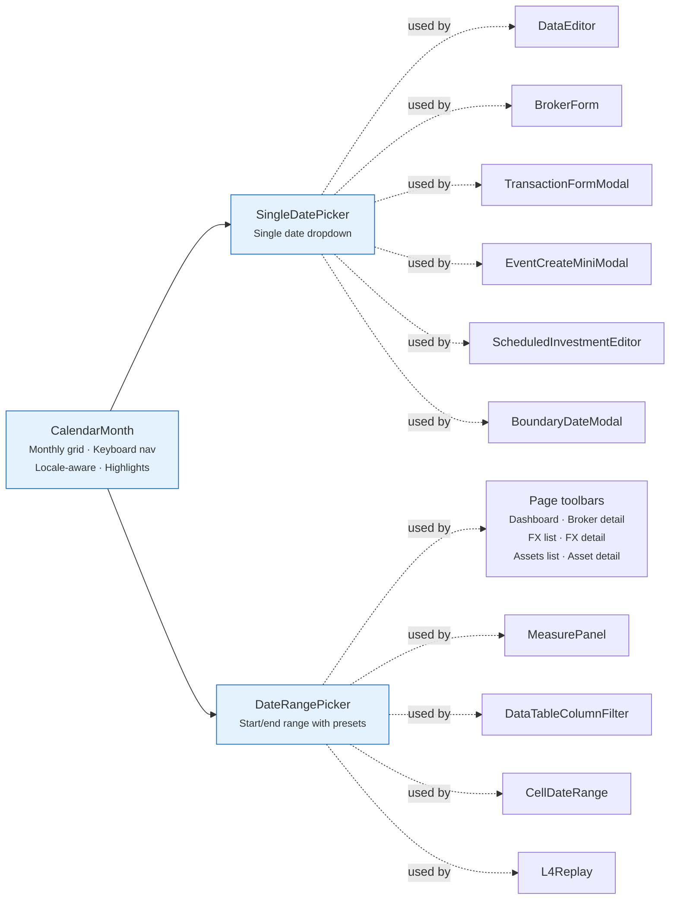

# 📅 Date Picker Components

Date selection components built on a shared `CalendarMonth` grid.

---

## 📅 CalendarMonth

A **monthly calendar grid** component — the visual building block for date pickers.

- Displays a single month with day cells
- Highlights today, selected date, and date range
- Keyboard navigation within the grid
- Locale-aware (week starts on Monday for most locales)
- The pending day (`highlights.pending`, the day of a first click in `DateRangePicker`) cannot be
  chosen again: it is a `disabled` button with the not-allowed cursor, as a future day is, while
  its colour and its `data-state` stay those of the pending day. The click handler refuses it as
  well, as it refuses `disabledDates`, because a dispatched click (what Testing Library's
  `fireEvent.click` sends in jsdom) still reaches a disabled button's handlers. `SingleDatePicker`
  never sets `pending`, so its grid is unaffected.

**Used by**: `SingleDatePicker`, `DateRangePicker`.

---

## 📆 SingleDatePicker { #singledatepicker }

A **single-date picker** dropdown with calendar.

- Opens a `CalendarMonth` in a dropdown
- Manual text input with date parsing
- Month/year navigation with arrows
- Formats date according to locale

**Used by**:

- [DataEditor](data-editor.md) — the date of a newly added row; the dates already in the series
  are disabled
- [BrokerForm](../features/brokers/forms.md#brokerform) — **Account Opened**, never in the future
- [TransactionFormModal](../features/transaction-form.md) — the transaction date and, for a pair,
  the **To** side's own date
- EventCreateMiniModal — the date of an asset event created inline from the
  [transaction form](../features/transaction-form.md)
- [ScheduledInvestmentEditor](../../../backend/assets/provider_scheduled_investment.md) — the date
  of each event row of the schedule
- BoundaryDateModal — the boundary date(s) that ScheduledInvestmentEditor asks for when it deletes
  or splits a period

---

## 📅 DateRangePicker

A **date range picker** with start and end dates.

- Two `CalendarMonth` grids side by side (current + next month)
- Visual highlight of selected range
- Quick presets: **1W**, **1M**, **3M**, **6M**, **1Y**, **2Y**, **YTD** and **MAX**, plus a custom window (an amount
  and a granularity). **3Y**, **5Y**, **10Y**, **MTD**, **QTD** and **WTD** fill the toolbar only when a JS
  measurement finds room to spare, never at the cost of an extra line (`DateRangePicker.svelte:36,216-251`)
- Start and end date text inputs

**Used by**:

- **Page toolbars** — the period of the Dashboard, broker detail, FX list, FX detail, Assets list
  and asset detail pages ([Pages](../../pages/index.md))
- [MeasurePanel](../charts.md#measure-mode) — the two dates of a measure, without presets, while
  its row is expanded
- [DataTableColumnFilter](data-table.md#date-filter) — the filter of a `date` column, where either
  end may stay blank
- CellDateRange — the **Period** cell of each row in ScheduledInvestmentEditor's period table
  ([Scheduled Investment Provider](../../../backend/assets/provider_scheduled_investment.md))
- [L4Replay](../features/risk-lab.md#replay) — the replay period, with quick ranges but no `MAX`

### 🚫 No range of a single day {: #no-single-day-range }

A range always spans two different days (lot Y-N65, developer decision of 2026-10-19): every way
into the picker refuses an end on the other end's day. The comparison is between real dates only:
a blank end, or a `min`/`max` sentinel, never matches a date.

- **Calendar.** The first click leaves its day pending (`pendingDate`, handed to both grids as
  `highlights.pending`, which [disables it](#calendarmonth)). `handleDayClick` ignores a second
  click on that day: nothing is published, the calendar stays open and the day stays pending. The
  next *different* day clicked closes the range, sorted. `handleDayHover` previews the range from
  the pending day to the day under the pointer, and nothing while the pointer is on the pending day
  itself.
- **Typed date.** `isAcceptableDate(which, iso)` is the calendar's ceiling (`isSelectableDate`: no
  future day unless `allowFuture`) plus "not the other end's day". A date equal to the other end is
  refused like a typed future date: it stays in its field, turns red once armed (blur or Enter,
  `data-invalid="true"`), and nothing is published. It is applied as soon as the other end moves to
  another day: `applyRangeDate` takes the waiting date (`waitingTypedDate`) together with the new
  one, as a pair, and the usual swap orders the two dates the user wrote. Typing «From» as the old
  «To», then a new «To», applies both at once.
- **↑/↓ on a field.** A step that would land on the other end's day goes one day further in the
  same direction, and the swap still applies. When that further day is a future day the picker
  refuses, the step does nothing.

**Open ends.** A date typed while the other end is blank, or holds the `min`/`max` sentinel of
**MAX** («All»), leaves that end as it is. Before Y-N65 the other end was filled with the same date,
a range of one day.

| Range before | Date typed | Published | Meaning |
|---|---|---|---|
| `('', '')` | «From» X | `(X, '')` | from X on |
| `('', '')` | «To» X | `('', X)` | up to X |
| `('min', 'max')` | «From» X | `(X, 'max')` | from X to today |
| `('min', 'max')` | «To» X | `('min', X)` | from the first data up to X |

A blank end is the open range of a [date column filter](data-table.md#date-filter). The pages
resolve the sentinels as they always have, through `resolveDateSentinel`
(`lib/stores/dateRangeStore.svelte.ts`), then the first date of their data for `min`.

Ranges of one day saved earlier still load and work as they are: the page period in
`sessionStorage` (`librefolio_dateRange`) or in the URL (`?start=&end=`), a table filter in the
URL, a scheduled-investment period. Only new ones can no longer be made.

The cases are pinned in `DateRangePicker.test.ts` and `CalendarMonth.test.ts` (their Y-N65
describes).
