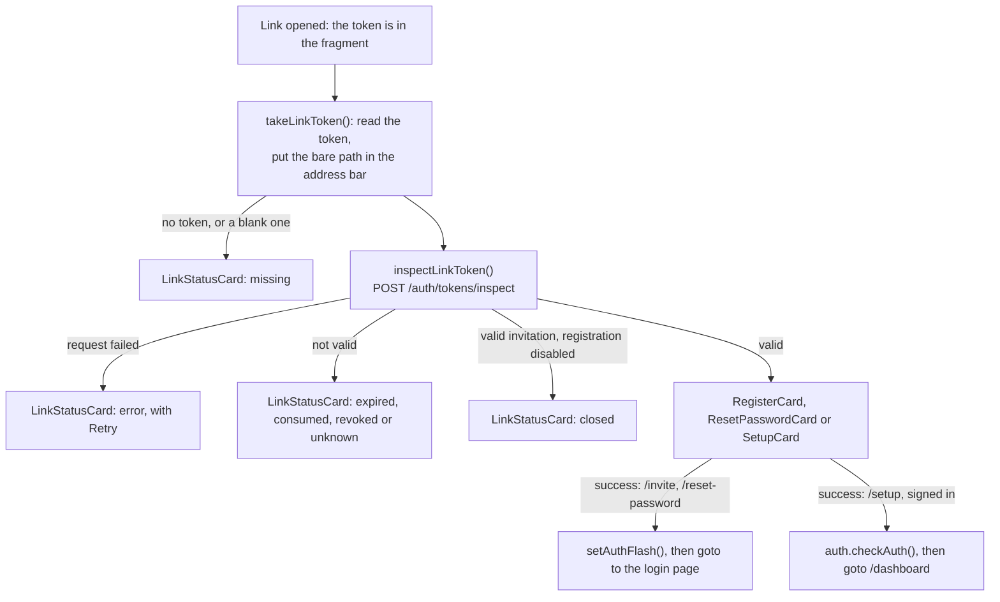

# 🔐 Authentication Components

This section documents the authentication UI components: login, registration, the pages of the
account links (invitation, password reset and the setup link of the initial administrator), password
management, and the open-registration warning.

!!! note "Card Components (Not Modals)"

    These components were renamed from `*Modal` to `*Card` (Feb 2026) because they are card-style forms displayed inline on the login page, not modal overlays. They do **not** extend `ModalBase`.

> Uses [PasswordInput and PasswordStrength](../core-ui/atoms.md#passwordinput) from the UI Base components.

<div class="screenshot-container" style="margin: 1rem 0 2rem 0; border-radius: 8px; overflow: hidden; box-shadow: 0 4px 16px rgba(0,0,0,0.1); max-width: 600px;">
    
</div>

## 🔑 LoginCard

The `LoginCard` handles user authentication via username/email and password.

### ⚡ Features

- **Input**: Username or Email field; the value is trimmed before the login call.
- **Password**: Password field with visibility toggle (via `PasswordInput`).
- **State**: Uses `$lib/stores/app/auth` (`auth.login()`, `authError`, `isAuthLoading`) to manage loading state and errors.
    - `authError` holds `{key}` and nothing else (`AuthError` in `$lib/types/user.ts`): a catalogue
      key that the store's `loginErrorKey(status, body)` picks from the HTTP status of the failure:
        - 401, whatever the body says → `auth.invalidCredentials`: one message, so the form never
          reveals whether an account exists;
        - 403 carrying `ACCOUNT_DISABLED` (only the right password of a disabled account gets it) →
          `auth.accountDisabled`;
        - 403 carrying `EMAIL_NOT_VERIFIED` (only the right password of an account waiting for its
          email verification gets it) → `email.verification.loginRequired`, which `LoginCard` answers
          with [`VerificationNotice`](../../../backend/email.md#verification-frontend) instead of the
          `login-error` line, passing the form's `username` and `password`;
        - 422 → `auth.invalidInput`; 429 → `auth.tooManyAttempts`: the backend's
          [failed sign-in limit](../../../architecture/security.md#login-limit) (`TOO_MANY_ATTEMPTS`, with
          `Retry-After`), or a throttling proxy in front of it;
        - no response at all (network error, timeout), or a 502, 503 or 504 →
          `auth.loginServerUnreachable`; any other 5xx → `auth.loginServerError`;
        - any other status (a 403 without the code included), and a failure that is not an axios
          error → `auth.loginFailed`.
    - `LoginCard` always draws `$_(key)`, so the message follows a language change on screen. The
      transport's own text (axios's *Network Error*, *Request failed with status code 500*) never
      reaches the user: it is English whatever the language.
- **Register link**: `goto-register` (**Register here**) is shown while
  `instanceConfig.config.accounts.registration_mode === 'open'`, or while
  `instanceConfig.config.accounts.first_account_open === true`: the instance has no account yet, and
  its first account can be created in any mode (it becomes the administrator). Both come from
  `GET /api/v1/system/instance`, the mode in force with `LIBREFOLIO_REGISTRATION` included
  ([Instance configuration](../../state/app-state.md#instance-config)). `LoginCard` calls
  `instanceConfig.load()` on mount, not forced, so it shares the page load's request; it does not
  load the global settings, which need a session. Until the server answers, and if it never does, the
  configuration is `DEFAULT_INSTANCE_CONFIG`, whose mode is `open`: the link is shown, and goes as
  soon as the answer says `invite` or `disabled` with `first_account_open` false, or absent (an
  answer from before the flag), without a remount.
- **Props**: `redirectTo` (default `/dashboard`), `successMessage` — drawn in `login-success`: the
  confirmation of a registration, or the message a [link page](#link-pages) left with
  `setAuthFlash()`, which the login page (`routes/+page.svelte`) reads once with `takeAuthFlash()` —,
  `onAuthenticated(requestedPath)` — when given, it replaces the plain `goto(redirectTo)` after a
  successful login (the login page uses it for the [onboarding gate](#post-login-onboarding-gate)).
- **Navigation**: Emits events to switch to Register or Forgot Password views.
- **Password managers**: see the [password-manager contract](#password-manager-contract).

### 💻 Usage

```svelte
<script>
  import LoginCard from '$lib/features/auth/LoginCard.svelte';
</script>

<LoginCard
  redirectTo="/dashboard"
  on:gotoRegister={() => showRegister = true}
  on:gotoForgot={() => showForgot = true}
/>
```

## 📝 RegisterCard {: #registercard }

The `RegisterCard` handles new user registration with client-side validation.

<div class="screenshot-container" style="margin: 1rem 0 2rem 0; border-radius: 8px; overflow: hidden; box-shadow: 0 4px 16px rgba(0,0,0,0.1); max-width: 600px;">
    
</div>

### ⚡ Features

- **Validation**: on blur of each field, and all together on submit:
    - Username (at least 3 characters, after trimming, and no `@`: `auth.validation.usernameNoAt`,
      lot A-21a). The sign-in reads a name with `@` as an email address, so the server refuses it too
      ([Which Account an Identifier Names](../../../architecture/security.md#sign-in-identifier)): the
      card keeps it off the wire, on blur and on submit. Spaces, accents, `.`, `_`, `-` and `+` go out
      as typed
    - Email (format)
    - Password: the [password rules](#passwordstrength), read from `PasswordStrength`'s `valid`
      (`bind:valid={passwordRulesMet}`): the card keeps no copy of them
    - Confirm Password (match)
- **Strength Meter**: Integrated `PasswordStrength` component.
- **Invitation mode**: three props, all given by the [`/invite` page](#link-pages):
    - `inviteToken` (`null` by default): the token of the invitation link. With it, the body of
      `POST /api/v1/auth/register` carries `invite_token`; without it, the body is the three fields
      as before.
    - `initialEmail` (`''`): the address the administrator wrote on the invitation. It fills the
      email field once, and the field stays editable: the server never binds an invitation to its
      address (the developer rejected D-A16).
    - `grantsAdmin` (`false`): the invitation creates an administrator.

    With a token, the form shows `register-invite-notice` (`auth.invite.notice`, info) above the
    fields and, when `grantsAdmin`, `register-invite-admin-notice` (`auth.invite.adminNotice`,
    warning).
- **Error Handling**: `describeRegistrationError()` turns the failure into a translated message:
  the refusals of the registration rule and of the password rules, a username or email already
  taken, and field validation errors (see [Registration errors](#registration-errors)).

### 💻 Usage

```svelte
<script>
  import RegisterCard from '$lib/features/auth/RegisterCard.svelte';
</script>

<RegisterCard
  on:gotoLogin={(e) => {
     showLogin = true;
     successMessage = e.detail.message;
  }}
/>

<!-- Invitation mode, as the /invite page uses it -->
<RegisterCard
  inviteToken={token}
  initialEmail={invitation.email ?? ''}
  grantsAdmin={invitation.grants_admin ?? false}
  on:gotoLogin={handleGotoLogin}
/>
```

## 🗝️ ForgotPasswordCard {: #forgotpasswordcard }

The sign-in's **Forgot Password?** card, `lib/features/auth/ForgotPasswordCard.svelte` (`forgot-modal`). It calls
`instanceConfig.load()` on mount, sharing the sign-in page's request. Until the server has answered
(`instanceConfig.loaded`), and if it never does, the card shows **Back to Login** alone: the default configuration
has no `email` and says `selfhosted`, and a managed instance must never show the server commands. Then:

| `profile` | `email.links` of `GET /system/instance` true | `email.links` false |
|---|---|---|
| `selfhosted` | Workstream E's [«forgot password» form](../../../backend/email.md#forgot-form), `ForgotPasswordEmailForm`, then the server commands in a native `<details>` closed by default (`forgot-commands-panel`, its `<summary>` `forgot-commands-toggle` with the `auth.serverTerminalInstructions` title and a chevron): the developer's decision P1, 16/10 | The warning `auth.emailRecoveryNotAvailable` (`forgot-email-unavailable`), then the server commands, open, under the same title |
| `managed` | E's form, unchanged, then `forgot-ask-admin` in place of the panel | `forgot-ask-admin` alone: no warning, no command |

- **The server commands** (`forgot-reset-commands`: `user reset` for Docker and for a host installation, then
  `auth.contactAdministrator`) are written once, as a snippet.
- **`forgot-ask-admin`** (F05, workstream A) says `auth.askAdminToResetPassword`, *Ask your administrator for a
  password-reset link: they can create one for your account.*: a managed instance's users have no terminal, and its
  administrator creates the link in the Users tab ([UsersTab](settings.md#userstab)).
- **Back to Login** dispatches `gotoLogin`.
- Tests: `ForgotPasswordCard.managed.test.ts` (FPM-01…07: both profiles, with and without `email.links`, before
  the answer and once it lands; CAT-01…02: the key a sentence in the four catalogues, naming no command), with
  `./dev.py test front-utility component-unit`.

## 🔗 Account Link Pages {: #link-pages }

Three routes open the single-use links of the accounts: the invitation and the password reset, which
an administrator issues from the API or the command line
([Registration, Invitations and the Admin API](../../../architecture/access_control.md#registration)),
and the setup link of the [initial administrator](../../../architecture/access_control.md#initial-admin),
which the startup issues and `./dev.py user setup-link` replaces:

| | `/invite#token=…` | `/reset-password#token=…` | `/setup#token=…` |
|---|---|---|---|
| Route | `routes/invite/+page.svelte` | `routes/reset-password/+page.svelte` | `routes/setup/+page.svelte` |
| Page `data-testid` | `invite-page` | `reset-password-page` | `setup-page` |
| Token inspected as | `invite` | `password_reset` | `admin_setup` |
| Valid link | `RegisterCard` in [invitation mode](#registercard): `inviteToken`, then `initialEmail` and `grantsAdmin` from the inspection. While the mode in force is `disabled`, the page shows `closed` instead: the server would refuse the invitation | `ResetPasswordCard` for the `username` of the inspection | [`SetupCard`](#setupcard) for the `username` of the inspection. The registration mode plays no part: setting up the administrator is not a registration |
| Success | `RegisterCard` dispatches `gotoLogin` with `auth.accountCreated`, or `email.verification.registered` when the answer says `verification_required`; the page passes the message to `setAuthFlash()` | `ondone`: `setAuthFlash()` with `auth.resetPassword.done` | `ondone`: the setup answered like a login, its session cookie included; the page awaits `auth.checkAuth()`, so that the auth store holds the administrator, and leaves no flash |
| Then | `goto('/')`: the login page shows the message in `login-success` | The same | `goto('/dashboard')`: the `(app)` layout's bootstrap and gate take over, Welcome first for a new account ([From login to the first guide](../../onboarding.md#layout-gate)) |

All three are outside the `(app)` group: they need no session, and none runs an auth check on mount
(`/setup` runs one once its setup has signed the administrator in). They are not prerendered, so the
backend serves them through the SPA fallback (`200.html`). A valid invitation
also opens the form in mode `invite`: an invitation is exactly what that mode asks for. The
`/invite` page loads the instance configuration in parallel with the inspection
(`instanceConfig.load()`), to know whether the mode is `disabled`. The `/reset-password` and `/setup`
pages ask for it on mount without waiting for it: only the password rules of
[`PasswordStrength`](#passwordstrength) depend on it, and they follow the answer when it arrives.



What the three pages share:

- **The token.** `onMount` calls `takeLinkToken(new URL(window.location.href), replaceAddress)`:
  the token comes from the fragment, and the address bar gets the bare path at once. The page keeps
  the token in memory only. Why the fragment and not the query string:
  [Links in Use](../../../architecture/security.md#account-token-links).
- **A link pasted into a tab already on the page** changes only the fragment and loads nothing.
  The page listens to `hashchange`, takes the new token the same way and checks it again; the
  listener goes when the page does.
- **No referrer.** `<svelte:head>` adds `<meta name="referrer" content="no-referrer">`: a link
  followed from the page sends no `Referer`.
- **The frame.** `AnimatedBackground`, then [`AuthPageFrame`](#authpageframe-and-authcard) with the
  page's test id, around either the form or a [`LinkStatusCard`](#linkstatuscard). The card's
  **Retry** runs the page's check again.
- **A reset link that stops working before the form is sent** (used meanwhile, or replaced by a
  newer link) makes `ResetPasswordCard` call `oninvalid`, and the page shows `unknown`. A setup link
  does the same through `SetupCard`.
- **Where a new link comes from.** Under the message of a dead link, `/invite` and
  `/reset-password` keep `LinkStatusCard`'s default line, `auth.link.askAdmin`. `/setup` passes
  `auth.setup.newLinkHint` as `hintKey` (*Ask your hosting provider for a new link. On your own
  server, run `dev.py user setup-link`.*): no administrator exists yet to ask.
- **A `401` stays on the page**: the API client does not send it to the sign-in page, which would
  lose the token. See [A 401 on a Link Page](#link-page-401).

### 🚧 A 401 on a Link Page {: #link-page-401 }

The response interceptor of `lib/api/zodios-client.ts` sends a `401` to the sign-in page, carrying
the page to come back to (`goto(loginUrl(pathname + search))`), except on two kinds of page:

- `/`, where the sign-in already is, and where a failed sign-in answers `401` too;
- the anonymous pages of a link: `isLinkPage()` is true when `window.location.pathname` is exactly
  `/setup`, `/invite`, `/reset-password` or `/verify-email` (`LINK_PAGES`), with or without a
  trailing slash. The query plays no part: `/setup?lang=it` stays. A path that only begins like one
  of them, such as `/setup/extra`, `/invites` or `/setup-something`, still goes to the sign-in.

The calls of those pages are public and need no session, so a `401` there is the
[instance block](../../../architecture/security.md#instance-block) refusing an anonymous caller,
and the sign-in would lose the token, already out of the address bar. The page handles the answer
itself: `SetupCard` shows `setup-blocked`, `RegisterCard` on `/invite` shows `auth.instanceBlocked`
([Registration errors](#registration-errors)), and `/verify-email` shows its own failure, with
**Retry**. The `423` `instance_blocked` handling is unchanged, on those pages too: it still turns
[`instanceBlock`](../../state/app-state.md#instance-block) on. This closes backlog A-13.

### 🧱 AuthPageFrame and AuthCard {: #authpageframe-and-authcard }

- **`AuthPageFrame.svelte`** is the page around an access card: the bar at the top right, the
  container that centres the card in a column, and the compact legal notice under the card. Props:
  `testId`, put on the container, and the `children` snippet. The login page (`login-page`, which
  also holds the registration and **Forgot Password?**), `/invite` (`invite-page`),
  `/reset-password` (`reset-password-page`), `/setup` (`setup-page`) and `/verify-email`
  (`verify-email-page`) use it. The page itself renders `AnimatedBackground`, outside the frame, so the background does not
  restart when the page swaps its loading state for the card.
    - **It loads the instance configuration**: `instanceConfig.load()` on mount, not forced, so the
      pages that load it already share the request, and `/verify-email`, which does not, gets it too.
    - **The bar** (`auth-page-controls`): the Buy Me a Coffee link (`auth-donate-link`) only while
      [`donationsVisible()`](../../state/app-state.md#instance-config) is true, once the server
      answered and said `selfhosted` (F05); then `ThemeToggle`, `LanguageSelector` and `HelpMenu`,
      whose own coffee item follows the same rule.
    - **The legal line** (`auth-legal-links`, F09): [`LegalLinks`](settings.md#legal-notice), centred
      under the card: the short disclaimer, then the instance's terms of service and privacy policy
      when it sets them.
- **`AuthCard.svelte`** is the card: the brand header (logo and name), then the body. Props:
  `testId` and `children`; any other attribute lands on the card, such as the `data-status` of
  `LinkStatusCard`. `LinkStatusCard`, `ResetPasswordCard` and `SetupCard` are built on it; `LoginCard`,
  `RegisterCard` and `ForgotPasswordCard` still write the same frame by hand, with small spacing
  differences.

### 🚦 LinkStatusCard {: #linkstatuscard }

What a link page shows instead of its form. Props: `status` (`LinkPageStatus`), an optional
`onretry`, and an optional `hintKey`, the line under the message of a dead link (default
`auth.link.askAdmin`). The card is `link-status`, with the status in `data-status`; the message is
`link-status-message`.

| `status` | When | Message | + hint |
|---|---|---|---|
| `checking` | The inspection is running | `common.loading` | — |
| `expired` | The link has expired | `auth.link.expired` | ✅ |
| `consumed` | The link was used | `auth.link.consumed` | ✅ |
| `revoked` | The link was withdrawn: an invitation revoked by an administrator, a reset or setup link replaced by a newer one, or a setup link ended by a change of its account, set up another way or given a new address ([Revocation](../../../architecture/security.md#account-token-revocation)) | `auth.link.revoked` | ✅ |
| `unknown` | An unknown token, a token of another purpose, or a reset or setup refused with `TOKEN_INVALID` | `auth.link.unknown` | ✅ |
| `missing` | No `token` in the fragment, or a blank one | `auth.link.missing` | ✅ |
| `closed` | A valid invitation while registration is `disabled` | `auth.registrationDisabled` | — |
| `error` | The inspection request failed | `auth.link.checkFailed` | — |

The hint is `link-status-hint`, `$_(hintKey)`, drawn for the five statuses marked ✅ and for no
other, whatever the page passed. `/invite` and `/reset-password` pass no `hintKey`; `/setup` passes
`auth.setup.newLinkHint`, since no administrator exists yet to send a new setup link.
`link-status-retry` (`common.retry`) appears only with `error` and an `onretry`.
`link-status-goto-login` (`auth.backToLogin`) is always there and goes to `/`.

### 🔑 ResetPasswordCard {: #resetpasswordcard }

The form of a reset link: the new password, twice, for one account.

- **Props**: `token`, `username` (shown in `reset-password-account` and carried by a hidden
  username field for password managers, see the [contract](#password-manager-contract); `null`
  draws neither), `ondone`, `oninvalid`.
- **Test ids**: `reset-password-modal` (the card), `reset-password-form`, `reset-password-new`,
  `reset-password-confirm`, `reset-password-submit`, `reset-password-error`.
- **The rules are the app's own**: the card binds `PasswordStrength`'s `valid`
  (`bind:valid={rulesMet}`) and keeps no copy of them. While the rules are not met, or the two
  fields differ, the submit shows `auth.validation.passwordTooWeak` or
  `auth.validation.passwordsNoMatch` and sends nothing. The server applies the same
  [password rules](../../../architecture/security.md#password-rules), before it reads the link.
- **The request**: `POST /api/v1/auth/password-reset` with `{token, new_password}`, the password
  exactly as typed. Success calls `ondone`. A `400` `TOKEN_INVALID` calls `oninvalid`; a `400`
  `PASSWORD_TOO_WEAK`, or a `422`, shows `auth.validation.passwordTooWeak`; any other failure
  `auth.resetPassword.failed`.

### 👑 SetupCard {: #setupcard }

The form of the setup link of the [initial administrator](../../../architecture/access_control.md#initial-admin):
the password of the account the link sets up, twice. Built like
[`ResetPasswordCard`](#resetpasswordcard), on `AuthCard`.

- **Props**: `token`, `username` (shown in `setup-account` and carried by a hidden username field
  for password managers, see the [contract](#password-manager-contract); `null` draws neither),
  `ondone`, `oninvalid`.
- **Test ids**: `setup-card` (the card), `setup-form`, `setup-account`, `setup-new`,
  `setup-confirm`, `setup-submit`, `setup-error`, `setup-blocked`.
- **The rules are the app's own** (decision 37): the card binds `PasswordStrength`'s `valid`
  (`bind:valid={rulesMet}`) and keeps no copy of them. While the rules are not met, or the two
  fields differ, the submit shows `auth.validation.passwordTooWeak` or
  `auth.validation.passwordsNoMatch` and sends nothing.
- **The request**: `POST /api/v1/auth/setup` (`setup_admin_api_v1_auth_setup_post`) with
  `{token, new_password}`, the password exactly as typed; the submit is disabled while it runs. A
  success answers like a login, session cookie included: the administrator is signed in.

| The answer | The card |
|---|---|
| Success | Calls `ondone` |
| `400` `TOKEN_INVALID`: the link was used, expired or was revoked meanwhile, or its account is already active | Calls `oninvalid`; the page shows `unknown` |
| `400` `PASSWORD_TOO_WEAK`, or `422` | `auth.validation.passwordTooWeak` in `setup-error`, never the server's English |
| `401`, or `423` with `detail.code` `instance_blocked` (`isInstanceBlockedError()`): the [instance is blocked](../../../architecture/security.md#instance-block), the `401` for a browser without a session, the `423` for one that holds another account's session | `auth.setup.blocked` in `setup-blocked`, and `setup-submit` disappears: every setup is refused until the hosting provider lifts the block. Neither callback runs |
| Anything else, a request that never reached the server and a `423` with another code included | `auth.setup.failed` in `setup-error`; the form stays, for another try |

### 🧩 Helper Modules {: #auth-modules }

In `lib/features/auth/`:

| Module | Exports | Role |
|---|---|---|
| `linkToken.ts` | `takeLinkToken(url, replace)`, `inspectLinkToken(token, purpose)`; types `LinkPurpose`, `InspectedLinkPurpose`, `LinkInspection`, `LinkPageStatus` | `takeLinkToken` returns the `token` parameter of the fragment, `null` when there is none or it is blank, and calls `replace(url.pathname)` once whenever the fragment has a `token` parameter. A `token` in the query string is not read. `inspectLinkToken` calls `POST /auth/tokens/inspect`. `LinkPurpose` is `invite` or `password_reset`, the links an administrator shares (`LinkShare`, the email sender); `inspectLinkToken` takes an `InspectedLinkPurpose`, which adds `admin_setup`, the setup link of the initial administrator. |
| `addressBar.ts` | `replaceAddress(path)` | Puts `path` in the address bar with SvelteKit's `replaceState`, which keeps the router in step; before the router has started, it falls back to `history.replaceState`. |
| `authFlash.ts` | `setAuthFlash(message)`, `takeAuthFlash()` | A message for the login page. `takeAuthFlash()` returns it once, then `''`. Kept in memory only: a reload of the login page shows nothing. |
| `registrationErrors.ts` | `describeRegistrationError(error)` | See [Registration errors](#registration-errors) below. |
| `localHost.ts` | `isLocalHost(hostname)` | Whether the host the browser reached the instance through is local, for the [open-registration warning](#open-registration-notice). Pure. |
| `openRegistrationNotice.svelte.ts` | `OPEN_REGISTRATION_NOTICE_ID`, `openRegistrationNoticeFor(state)`, `startOpenRegistrationNotice(dependencies?)`; types `OpenRegistrationNoticeState`, `OpenRegistrationNoticeDependencies` | The [open-registration warning](#open-registration-notice): the pure decision, and the watcher the app bootstrap starts. |
| `passwordRules.ts` | `PasswordRule` (`{code, value?}`), `DEFAULT_PASSWORD_RULES`, `RULE_UI_KEYS`, `ruleMet(rule, password)`, `unmetRules(password, rules)` | The app's half of the [password rules](../../../architecture/security.md#password-rules), pure: no store, no request. `DEFAULT_PASSWORD_RULES` are the five of release 1.3 (`min_length` 8, `uppercase`, `lowercase`, `digit`, `special`), assumed until the server answers. `RULE_UI_KEYS` maps each code the app knows to its key (`min_length` → `minLength`, `uppercase` → `hasUppercase`, `lowercase` → `hasLowercase`, `digit` → `hasNumber`, `special` → `hasSpecial`). `ruleMet()` checks with the server's classes — `\p{Lu}`, `\p{Ll}`, `\p{Nd}`, a symbol `[^\p{L}\p{N}\s]`, the length in code points — and returns `null` for a code it does not know; `unmetRules()` gives the known codes a password misses, in the order of `rules`. |

#### Registration errors {: #registration-errors }

`describeRegistrationError(error)` reads the `detail` of the failed `POST /api/v1/auth/register` and
returns a catalogue key (`{key}`), or the server's own words (`{raw}`) when nothing better is known.
`RegisterCard` draws `$_(key)` or the raw text.

The status comes first, before the body is read: a `401`, whatever its body, or a `423` whose
`detail.code` is `instance_blocked` (`isInstanceBlockedError()`), is the
[instance block](../../../architecture/security.md#instance-block) refusing the registration — the
`401` for a browser without a session, the `423` for one that holds a session — and gives
`auth.instanceBlocked` (*This instance is blocked by its hosting provider: try again once it is
unblocked.*), never the server's *Not authenticated* (backlog A-13). A `423` with another code reads
its `detail` as below. Otherwise:

| `detail` | Message |
|---|---|
| `{error_code: "REGISTRATION_DISABLED"}` | `auth.registrationDisabled` |
| `{error_code: "INVITE_REQUIRED"}` | `auth.registrationInviteOnly` |
| `{error_code: "INVITE_INVALID"}` | `auth.link.unknown` |
| `{error_code: "USER_LIMIT_REACHED"}` | `auth.userLimitReached`: the server is full, with no count, as the caller is not signed in |
| `{error_code: "PASSWORD_TOO_WEAK"}` | `auth.validation.passwordTooWeak`: the password misses a [rule of the server](../../../architecture/security.md#password-rules), and the checklist under the field says which |
| `{error_code: "EMAIL_VERIFICATION_UNAVAILABLE"}` | `email.verification.signUpUnavailable`: email verification is required and no email with a link can go out now |
| `{error_code: "USERNAME_INVALID"}` | `auth.validation.usernameNoAt`: a username holding `@` (lot A-21a), the key of the card's own check — one rule, the same words, from the client or from the server |
| Any other object | `auth.registrationFailed` |
| A Pydantic error list | Its first error: on `email`, `auth.validation.invalidEmailDomain` for a special-use or reserved domain, `auth.validation.invalidEmail` otherwise; on `username`, `auth.validation.usernameMinLength`; on `password`, `auth.validation.passwordTooWeak`; anything else, `auth.registrationFailed` |
| A string that mentions `username` (case-folded) | `auth.validation.usernameTaken` |
| A string that mentions `email` | `auth.validation.emailTaken`: *Email already registered*, for an address another account has, or since lot A-21a one that is another account's username |
| Any other string | The string itself |
| No `detail` | `auth.registrationFailed` |

### 🧪 Tests

- `./dev.py test front-utility core-unit`: `authFlash.test.ts`, `linkToken.test.ts`,
  `registrationErrors.test.ts` (with the blocked instance of A-13), `passwordRules.test.ts`,
  `localHost.test.ts` and `openRegistrationNotice.test.ts` (see
  [Open-Registration Warning](#open-registration-notice)), and, in `lib/api/zodios-client.test.ts`,
  the describe of the [401 on a link page](#link-page-401).
- `./dev.py test front-utility component-unit`: `AuthCard.test.ts`, `AuthPageFrame.test.ts`,
  `AuthPageFrame.managed.test.ts` (APM-01…05: the coffee link only once the answer says `selfhosted`),
  `AuthPageFrame.legal.test.ts` (APL: the legal line on every frame, its links, colour roles only),
  `ForgotPasswordCard.managed.test.ts`,
  `LinkStatusCard.test.ts` (with `hintKey`), `ResetPasswordCard.test.ts`, `SetupCard.test.ts`,
  `LoginCard.test.ts`, `RegisterCard.test.ts`, and the pages: `routes/page.authFlash.test.ts`,
  `routes/invite/page.test.ts`, `routes/reset-password/page.test.ts`, `routes/setup/page.test.ts`.
- `./dev.py test front-utility auth-links` (`frontend/e2e/auth-links.spec.ts`): the invitation and
  reset pages in a browser, on links an administrator issues over the API — the token leaving the
  address bar, an invitation used then read again as consumed, a reset after which only the new
  password signs in.

## 🔐 Password-manager contract {: #password-manager-contract }

Browsers' password managers decide which saved account goes into which field from each field's
`autocomplete` token, together with its `name`, its `id` and its label. The credential forms
follow one contract, so that the browser offers saved credentials on the username field and
offers to save or update the password:

| Form | Field | `id` | `name` | `autocomplete` |
|---|---|---|---|---|
| `LoginCard` | Username or email | `login-username` | `username` | `username` |
| | Password | `login-password` | `password` | `current-password` |
| `RegisterCard` | Username | `register-username` | `username` | `username` |
| | Email | `register-email` | `email` | `email` |
| | Password | `register-password` | `new-password` | `new-password` |
| | Confirm password | `register-confirm-password` | `confirm-password` | `new-password` |
| `PasswordChangeModal` | Hidden username | — | `username` | `username` |
| | Current password | `currentPassword` | `current-password` | `current-password` |
| | New password | `newPassword` | `new-password` | `new-password` |
| | Confirm new password | `confirmPassword` | `confirm-password` | `new-password` |
| `ProfileTab` (email change) | Current password | `profile-current-password` | `current-password` | `current-password` |
| `ResetPasswordCard` | Hidden username, when the server named the account | — | `username` | `username` |
| | New password | `reset-password-new` | `new-password` | `new-password` |
| | Confirm new password | `reset-password-confirm` | `confirm-password` | `new-password` |
| `SetupCard` | Hidden username, when the server named the account | — | `username` | `username` |
| | New password | `setup-new` | `new-password` | `new-password` |
| | Confirm new password | `setup-confirm` | `confirm-password` | `new-password` |

- Every visible field has a `<label for>` reading the same translation key as its placeholder —
  visually hidden in the cards, visible in the modal — which also gives screen readers a name that
  does not vanish with the first keystroke.
- The visible username fields set `autocapitalize="none"` and `spellcheck="false"`.
- `PasswordChangeModal`, `ResetPasswordCard` and `SetupCard` carry a hidden username field, in the
  form of the new passwords: `<input type="text" name="username" autocomplete="username" hidden readonly>`, with
  the signed-in username in the modal, and in the cards the account the link resets or sets up, drawn only
  when the server named one. `type="text"` rather than `type="hidden"`, because a password manager
  reads text-like inputs; `hidden` keeps it off screen and out of the tab order, `readonly` out of
  the user's hands. The password manager then knows which saved account the new password belongs
  to.
- No element carries an empty `id`: `PasswordInput` omits `id` and `name` when they are not given.
- The `data-testid`s are unchanged; E2E logins go through them.

`LoginCard.test.ts`, `RegisterCard.test.ts`, `PasswordChangeModal.test.ts`,
`ResetPasswordCard.test.ts` and `SetupCard.test.ts` pin the attributes; for the reset and setup
cards, the hidden username field (or its absence without an account) and the `type` and
`autocomplete` of their two password fields. The autofill itself belongs to the browser and is
checked by hand.

## 🔒 PasswordStrength {: #passwordstrength }

A visual indicator of password strength using `zxcvbn-ts`, with the checklist of the
[password rules](../../../architecture/security.md#password-rules)
(`lib/components/ui/input/PasswordStrength.svelte`, Svelte 5 runes).

### ⚡ Features

- **Score**: Calculates a score from 0 (Very Weak) to 4 (Very Strong), published in `data-strength`
  on `password-strength-bar`.
- **Visual Bar**: five segments, filled up to the score in one of three colours (decision D-T13):
  danger for 0 and 1, warning for 2, success for 3 and 4. The label says the level in words.
- **Rules Checklist** (`password-requirements`, with `showRules`, the default): one line per rule,
  `password-rule-<key>`, with `data-passed` and a check or a cross. The rules are the server's,
  `instanceConfig.config.accounts.password_rules`
  ([Instance configuration](../../state/app-state.md#instance-config)), in its order; while the
  configuration carries none — before the answer, or an empty list — `DEFAULT_PASSWORD_RULES`, the
  five of release 1.3. `RULE_UI_KEYS` ([`passwordRules.ts`](#auth-modules)) gives each code its key,
  which names the test id and the label, `auth.passwordStrength.rules.<key>`; the length's label is an
  ICU message that receives the rule's `{value}`. A code the app does not know is neither drawn nor
  checked: the server decides it.
- **`rules`** (optional, lot B4): the rules a server published for another password than an
  account's, such as a secure backup's (`GET /backup/instance/options`: the accounts' rules with a
  longer minimum, see [Password Rules](../../../architecture/security.md#password-rules)). Given and
  not empty, they replace the instance configuration's list for the checklist and for `valid`;
  `null`, empty or absent, the meter works as above. `BackupDownloadCard` (`lib/features/backup/`)
  passes them.
- **`valid`** (`$bindable`): true while every rule drawn holds, each checked by `ruleMet()`. A form
  that needs a valid password binds to it (`bind:valid`) instead of keeping its own copy of the
  rules: `RegisterCard`, [`ResetPasswordCard`](#resetpasswordcard), [`SetupCard`](#setupcard) and
  `PasswordChangeModal` all do.
- Nothing is drawn while the password is empty.

Tests: `PasswordStrength.test.ts` (`./dev.py test front-utility component-unit`): the checklist from
the defaults and from the server's list, unknown codes, an answer that lands under a mounted meter,
the Unicode classes, the length passed to the label, and the rules given through `rules`.

### 💻 Usage

```svelte
<script>
  import PasswordStrength from '$lib/components/ui/input/PasswordStrength.svelte';
  let password = '';
  let rulesMet = false;
</script>

<input type="password" bind:value={password} />
<PasswordStrength {password} showRules={true} bind:valid={rulesMet} />
```

## 🔑 PasswordInput

A reusable input component for passwords.

### ⚡ Features

- **Toggle Visibility**: Eye button to show/hide the password, named after what a press does: its
  `aria-label` and `title` are `$_('auth.showPassword')` while the field is masked and
  `$_('auth.hidePassword')` while it shows the text. The button is in the tab order and carries no
  `aria-pressed` on purpose: a toggle whose name changes must not also report a pressed state
  (WAI-ARIA APG, Button pattern), or a screen reader announces both.
- **Styling**: Consistent styling with error state support (`hasError`).
- **Attributes**: `autocomplete` (`current-password` by default, `new-password`, `off`, `on`),
  `id`, `name`, `testId`, `placeholder`, `disabled`; `id` and `name` are omitted when empty.
- **Icon**: `icon` (a component, `null` by default) draws a decorative icon inside the field on the
  left (`aria-hidden`, test id `<testId>-icon`) and makes room for it. The four cards — login,
  registration, password reset, setup — pass `Lock` from `lucide-svelte`; `PasswordChangeModal` passes
  none.
- **Events**: Forwards `input`, `blur` and `keydown` events.

### 💻 Usage

```svelte
<script>
  import PasswordInput from '$lib/components/ui/input/PasswordInput.svelte';
  let password = '';
</script>

<PasswordInput
  bind:value={password}
  id="new-password"
  name="new-password"
  autocomplete="new-password"
  placeholder="Enter password"
  hasError={false}
/>
```

## 🚪 Post-login onboarding gate

After a successful login the auth cards hand over to the onboarding bootstrap. How it works — the
bootstrap states, Welcome, the intro tour and the contextual guides — is documented in
[Onboarding Guides](../../onboarding.md). What belongs to authentication:

- **After a login**, `LoginCard` calls `onAuthenticated(redirectTo)`, which the login page
  (`routes/+page.svelte`) wires to its `routeAuthenticated`: it runs `appBootstrap.load()`
  (`lib/features/onboarding/appBootstrap.svelte.ts`), then navigates with `replaceState` to
  `appBootstrap.resolveDestination(redirectTo)` — `/welcome?returnTo=…` while Welcome is due or a
  Welcome replay is armed, the requested path otherwise. A visitor of `/` who is already signed in
  (`auth.checkAuth()` on mount) takes the same route.
- **`redirectTo`** is the login page's `redirect` query parameter, `/dashboard` when absent.
  `resolveDestination` replaces anything that is not a same-origin absolute path — it must start
  with `/`, not with `//`, and contain no `\` — with `/dashboard`, so the parameter cannot send
  the user off the app.
- **A `blocked` bootstrap** (user settings failed to load, or onboarding progress failed with no
  usable cached Welcome) replaces the cards with `OnboardingBootstrapBlock`: **Retry** loads the
  bootstrap again, **Logout** signs out (`auth.logout()`). The authenticated layout shows the same
  block. A `degraded` bootstrap renders the app with `OnboardingBootstrapBanner`, whose only
  action is **Retry**.
- **Registration does not sign in**: `RegisterCard` dispatches `gotoLogin` with a success message,
  which the login view shows above the form. The invitation and reset [link pages](#link-pages) do
  not sign in either: they leave their message with `setAuthFlash()` and go to `/`. The setup link
  does: `/setup` reads the new session with `auth.checkAuth()`, then goes to `/dashboard`, where the
  `(app)` layout runs the bootstrap and its gate, so Welcome comes first, as after a first login.
- **Signed-out visitors** of an app route are sent back to `/` by `routes/(app)/+layout.svelte` —
  also when its auth check does not answer within 5 s — without a `redirect` parameter.

## 📣 Open-Registration Warning {: #open-registration-notice }

An administrator, signed in, on an instance whose [registration mode](../../../architecture/access_control.md#registration-modes)
is `open`, who reached it through a host that is not local, gets an
[instance notice](../../state/app-state.md#instance-notices). It is decided in the browser, from
`location.hostname`: nothing is sent to the server. Administrator side: «The Open-Registration
Warning» in [Global Settings](../../../../admin/settings.md); why it is only advice:
[The Open-Registration Warning](../../../architecture/security.md#open-registration-warning).

**The notice.** `openRegistrationNoticeFor({isAdmin, registrationMode, registrationLocked, hostname})`
(`lib/features/auth/openRegistrationNotice.svelte.ts`) is pure: `null` unless `isAdmin`, the mode is
`open` and `isLocalHost(hostname)` is false. Then:

| | Mode set in the app | Mode pinned by `LIBREFOLIO_REGISTRATION` (`registrationLocked`) |
|---|---|---|
| `id` | `accounts.openRegistration` (`OPEN_REGISTRATION_NOTICE_ID`) | The same |
| `severity`, `dismissible` | `warning`, `true`: closed until the next page load | The same |
| `messageKey` | `auth.notices.openRegistration`: *Registration is open and this instance is reachable from outside your local network: anyone who finds it can create an account.* | `auth.notices.openRegistrationLocked`, which names `LIBREFOLIO_REGISTRATION` |
| `action` | `{labelKey: 'auth.notices.openRegistrationAction', href: '/settings?tab=admin'}`: *Change who can sign up*, the Global Settings tab of Settings › Administration | None: nothing in the app can change a pinned mode |

The «Security» tab of Settings › Administration calls `openRegistrationNoticeFor()` too, with
`isAdmin: true`, and lists its notice as one of its findings, a `warning` with the same `id`,
`messageKey` and `action`, whether or not the notice was closed
([SecurityTab](settings.md#securitytab)).

**The local hosts.** `isLocalHost(hostname)` (`lib/features/auth/localHost.ts`, pure) is true for:

- `localhost` and every name under `.localhost`;
- IPv4 `127.0.0.0/8`, `10.0.0.0/8`, `172.16.0.0/12`, `192.168.0.0/16` and `100.64.0.0/10`
  (carrier-grade NAT, where Tailscale numbers its nodes);
- IPv6 `::1`, `fc00::/7` and `fe80::/10`, and an IPv4-mapped address by the IPv4 it carries, in the
  dotted form (`::ffff:192.168.1.10`) or in the hexadecimal one a browser writes
  (`[::ffff:c0a8:10a]`);
- a single-label name (`nas`), and the names under `.local`, `.lan`, `.home.arpa` and `.internal`.

Everything else is external, `*.ts.net` included: Tailscale Funnel can publish those names to the
internet. Case, the brackets of an IPv6 literal and a trailing dot do not count; a suffix counts as
whole labels (`nas.mylan` is not under `.lan`), and a name that starts like an address is a name
(`10.0.0.1.example.com`).

!!! note "Not `classifyHost()`"

    `classifyHost()` in `lib/utils/security/connectionSecurity.ts`, the host classes of the
    connection-security indicator, is another rule: there a `*.ts.net` name counts as VPN and
    `169.254.0.0/16` as LAN. `isLocalHost()` lists neither as local.

**The watcher.** `startOpenRegistrationNotice(dependencies?)` runs one `$effect` (in an
`$effect.root`) that evaluates the notice and calls `notices.show(notice)`, or
`notices.hide(OPEN_REGISTRATION_NOTICE_ID)` when it is `null`, outside the tracking (`untrack`):
`show()` and `hide()` read the registry's own state, so a tracked call would re-run on its own
write. While the warning holds it only calls `show()`, so a dismissal survives every evaluation;
`hide()`, which would forget the dismissal, comes only when the condition ends. It returns its stop
function. The dependencies, each replaceable in tests:

| Dependency | Default |
|---|---|
| `user()` | The auth store's `currentUser`, through `fromStore()`: `is_superuser` decides |
| `config()` | `instanceConfig.config`, only once `instanceConfig.loaded`, `null` before: until `/system/instance` answers, the configuration in force is `DEFAULT_INSTANCE_CONFIG`, whose mode is `open`, and an invite-only instance would flash the warning |
| `hostname()` | `window.location.hostname`, read at each evaluation |
| `notices` | `instanceNotices` |

Only the first start watches: a second call returns a function that does nothing, and its
dependencies are ignored. `appBootstrap.load()` starts it as soon as a user is known
([From login to the first guide](../../onboarding.md#layout-gate)), and the watcher then follows
the account through sign-outs and sign-ins. Saving `registration_mode` in the Global Settings tab forces
`instanceConfig.load({force: true})` ([GlobalSettingsTab](settings.md#globalsettingstab-admin-only)),
so the warning follows the new mode on the same page load.

Tests (`./dev.py test front-utility core-unit`): `localHost.test.ts` (every range on both sides of
both its boundaries, the bracketed and the hexadecimal forms, the spellings) and
`openRegistrationNotice.test.ts` (the truth table of `openRegistrationNoticeFor()`, the watcher on
injected dependencies and on the app's stores, a second start, the stop function, and the three
keys as sentences in the four catalogues).
