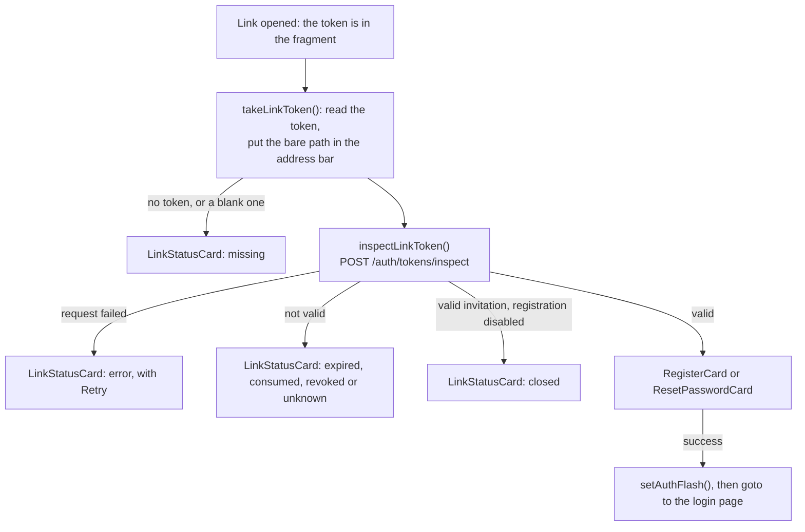

# 🔐 Authentication Components

This section documents the authentication UI components: login, registration, the pages of the
account links (invitation and password reset), and password management.

!!! note "Card Components (Not Modals)"

    These components were renamed from `*Modal` to `*Card` (Feb 2026) because they are card-style forms displayed inline on the login page, not modal overlays. They do **not** extend `ModalBase`.

> Uses [PasswordInput and PasswordStrength](../core-ui/atoms.md#passwordinput) from the UI Base components.

<div class="screenshot-container" style="margin: 1rem 0 2rem 0; border-radius: 8px; overflow: hidden; box-shadow: 0 4px 16px rgba(0,0,0,0.1); max-width: 600px;">
    
</div>

## 🔑 LoginCard

The `LoginCard` handles user authentication via username/email and password.

### ⚡ Features

- **Input**: Username or Email field; the value is trimmed before the login call.
- **Password**: Password field with visibility toggle (via `PasswordInput`).
- **State**: Uses `$lib/stores/app/auth` (`auth.login()`, `authError`, `isAuthLoading`) to manage loading state and errors.
    - `authError` holds `{key}` and nothing else (`AuthError` in `$lib/types/user.ts`): a catalogue
      key that the store's `loginErrorKey(status, body)` picks from the HTTP status of the failure:
        - 401, whatever the body says → `auth.invalidCredentials`: one message, so the form never
          reveals whether an account exists;
        - 403 carrying `ACCOUNT_DISABLED` (only the right password of a disabled account gets it) →
          `auth.accountDisabled`;
        - 422 → `auth.invalidInput`; 429 → `auth.tooManyAttempts` (the backend sets no login limit of
          its own: a throttling proxy in front of it may answer 429);
        - no response at all (network error, timeout), or a 502, 503 or 504 →
          `auth.loginServerUnreachable`; any other 5xx → `auth.loginServerError`;
        - any other status (a 403 without the code included), and a failure that is not an axios
          error → `auth.loginFailed`.
    - `LoginCard` always draws `$_(key)`, so the message follows a language change on screen. The
      transport's own text (axios's *Network Error*, *Request failed with status code 500*) never
      reaches the user: it is English whatever the language.
- **Register link**: `goto-register` (**Register here**) is shown while
  `instanceConfig.config.accounts.registration_mode === 'open'`, or while
  `instanceConfig.config.accounts.first_account_open === true`: the instance has no account yet, and
  its first account can be created in any mode (it becomes the administrator). Both come from
  `GET /api/v1/system/instance`, the mode in force with `LIBREFOLIO_REGISTRATION` included
  ([Instance configuration](../../state/app-state.md#instance-config)). `LoginCard` calls
  `instanceConfig.load()` on mount, not forced, so it shares the page load's request; it does not
  load the global settings, which need a session. Until the server answers, and if it never does, the
  configuration is `DEFAULT_INSTANCE_CONFIG`, whose mode is `open`: the link is shown, and goes as
  soon as the answer says `invite` or `disabled` with `first_account_open` false, or absent (an
  answer from before the flag), without a remount.
- **Props**: `redirectTo` (default `/dashboard`), `successMessage` — drawn in `login-success`: the
  confirmation of a registration, or the message a [link page](#link-pages) left with
  `setAuthFlash()`, which the login page (`routes/+page.svelte`) reads once with `takeAuthFlash()` —,
  `onAuthenticated(requestedPath)` — when given, it replaces the plain `goto(redirectTo)` after a
  successful login (the login page uses it for the [onboarding gate](#post-login-onboarding-gate)).
- **Navigation**: Emits events to switch to Register or Forgot Password views.
- **Password managers**: see the [password-manager contract](#password-manager-contract).

### 💻 Usage

```svelte
<script>
  import LoginCard from '$lib/features/auth/LoginCard.svelte';
</script>

<LoginCard
  redirectTo="/dashboard"
  on:gotoRegister={() => showRegister = true}
  on:gotoForgot={() => showForgot = true}
/>
```

## 📝 RegisterCard {: #registercard }

The `RegisterCard` handles new user registration with client-side validation.

<div class="screenshot-container" style="margin: 1rem 0 2rem 0; border-radius: 8px; overflow: hidden; box-shadow: 0 4px 16px rgba(0,0,0,0.1); max-width: 600px;">
    
</div>

### ⚡ Features

- **Validation**: on blur of each field, and all together on submit:
    - Username (at least 3 characters, after trimming)
    - Email (format)
    - Password (the five strength rules: 8 characters, uppercase, lowercase, number, special character)
    - Confirm Password (match)
- **Strength Meter**: Integrated `PasswordStrength` component.
- **Invitation mode**: three props, all given by the [`/invite` page](#link-pages):
    - `inviteToken` (`null` by default): the token of the invitation link. With it, the body of
      `POST /api/v1/auth/register` carries `invite_token`; without it, the body is the three fields
      as before.
    - `initialEmail` (`''`): the address the administrator wrote on the invitation. It fills the
      email field once, and the field stays editable: the server never binds an invitation to its
      address (the developer rejected D-A16).
    - `grantsAdmin` (`false`): the invitation creates an administrator.

    With a token, the form shows `register-invite-notice` (`auth.invite.notice`, info) above the
    fields and, when `grantsAdmin`, `register-invite-admin-notice` (`auth.invite.adminNotice`,
    warning).
- **Error Handling**: `describeRegistrationError()` turns the failure into a translated message:
  the refusals of the registration rule, a username or email already taken, and field validation
  errors (see [Registration errors](#registration-errors)).

### 💻 Usage

```svelte
<script>
  import RegisterCard from '$lib/features/auth/RegisterCard.svelte';
</script>

<RegisterCard
  on:gotoLogin={(e) => {
     showLogin = true;
     successMessage = e.detail.message;
  }}
/>

<!-- Invitation mode, as the /invite page uses it -->
<RegisterCard
  inviteToken={token}
  initialEmail={invitation.email ?? ''}
  grantsAdmin={invitation.grants_admin ?? false}
  on:gotoLogin={handleGotoLogin}
/>
```

## 🔗 Account Link Pages {: #link-pages }

Two routes open the single-use links of the accounts, which an administrator issues from the API or
the command line ([Registration, Invitations and the Admin API](../../../architecture/access_control.md#registration)):

| | `/invite#token=…` | `/reset-password#token=…` |
|---|---|---|
| Route | `routes/invite/+page.svelte` | `routes/reset-password/+page.svelte` |
| Page `data-testid` | `invite-page` | `reset-password-page` |
| Token inspected as | `invite` | `password_reset` |
| Valid link | `RegisterCard` in [invitation mode](#registercard): `inviteToken`, then `initialEmail` and `grantsAdmin` from the inspection. While the mode in force is `disabled`, the page shows `closed` instead: the server would refuse the invitation | `ResetPasswordCard` for the `username` of the inspection |
| Success | `RegisterCard` dispatches `gotoLogin` with `auth.accountCreated`; the page passes the message to `setAuthFlash()` | `ondone`: `setAuthFlash()` with `auth.resetPassword.done` |
| Then | `goto('/')`: the login page shows the message in `login-success` | The same |

Both are outside the `(app)` group: they need no session and run no auth check. They are not
prerendered, so the backend serves them through the SPA fallback (`200.html`). A valid invitation
also opens the form in mode `invite`: an invitation is exactly what that mode asks for. The
`/invite` page loads the instance configuration in parallel with the inspection
(`instanceConfig.load()`), to know whether the mode is `disabled`.



What the two pages share:

- **The token.** `onMount` calls `takeLinkToken(new URL(window.location.href), replaceAddress)`:
  the token comes from the fragment, and the address bar gets the bare path at once. The page keeps
  the token in memory only. Why the fragment and not the query string:
  [Links in Use](../../../architecture/security.md#account-token-links).
- **A link pasted into a tab already on the page** changes only the fragment and loads nothing.
  The page listens to `hashchange`, takes the new token the same way and checks it again; the
  listener goes when the page does.
- **No referrer.** `<svelte:head>` adds `<meta name="referrer" content="no-referrer">`: a link
  followed from the page sends no `Referer`.
- **The frame.** `AnimatedBackground`, then [`AuthPageFrame`](#authpageframe-and-authcard) with the
  page's test id, around either the form or a [`LinkStatusCard`](#linkstatuscard). The card's
  **Retry** runs the page's check again.
- **A reset link that stops working before the form is sent** (used meanwhile, or replaced by a
  newer link) makes `ResetPasswordCard` call `oninvalid`, and the page shows `unknown`.

### 🧱 AuthPageFrame and AuthCard {: #authpageframe-and-authcard }

- **`AuthPageFrame.svelte`** is the page around an access card: the bar at the top right (the
  Buy Me a Coffee link, `ThemeToggle`, `LanguageSelector`, `HelpMenu`) and the container that
  centres the card. Props: `testId`, put on the container, and the `children` snippet. The login
  page (`login-page`), `/invite` (`invite-page`) and `/reset-password` (`reset-password-page`) use
  it. The page itself renders `AnimatedBackground`, outside the frame, so the background does not
  restart when the page swaps its loading state for the card.
- **`AuthCard.svelte`** is the card: the brand header (logo and name), then the body. Props:
  `testId` and `children`; any other attribute lands on the card, such as the `data-status` of
  `LinkStatusCard`. `LinkStatusCard` and `ResetPasswordCard` are built on it; `LoginCard`,
  `RegisterCard` and `ForgotPasswordCard` still write the same frame by hand, with small spacing
  differences.

### 🚦 LinkStatusCard {: #linkstatuscard }

What a link page shows instead of its form. Props: `status` (`LinkPageStatus`) and an optional
`onretry`. The card is `link-status`, with the status in `data-status`; the message is
`link-status-message`.

| `status` | When | Message | + `auth.link.askAdmin` |
|---|---|---|---|
| `checking` | The inspection is running | `common.loading` | — |
| `expired` | The link has expired | `auth.link.expired` | ✅ |
| `consumed` | The link was used | `auth.link.consumed` | ✅ |
| `revoked` | The link was withdrawn: an invitation revoked by an administrator, or a reset link replaced by a newer one | `auth.link.revoked` | ✅ |
| `unknown` | An unknown token, a token of the other purpose, or a reset refused with `TOKEN_INVALID` | `auth.link.unknown` | ✅ |
| `missing` | No `token` in the fragment, or a blank one | `auth.link.missing` | ✅ |
| `closed` | A valid invitation while registration is `disabled` | `auth.registrationDisabled` | — |
| `error` | The inspection request failed | `auth.link.checkFailed` | — |

`link-status-retry` (`common.retry`) appears only with `error` and an `onretry`.
`link-status-goto-login` (`auth.backToLogin`) is always there and goes to `/`.

### 🔑 ResetPasswordCard {: #resetpasswordcard }

The form of a reset link: the new password, twice, for one account.

- **Props**: `token`, `username` (shown in `reset-password-account` and carried by a hidden
  username field for password managers, see the [contract](#password-manager-contract); `null`
  draws neither), `ondone`, `oninvalid`.
- **Test ids**: `reset-password-modal` (the card), `reset-password-form`, `reset-password-new`,
  `reset-password-confirm`, `reset-password-submit`, `reset-password-error`.
- **The rules are the app's own**: the card binds `PasswordStrength`'s `valid`
  (`bind:valid={rulesMet}`) and keeps no copy of them. While the rules are not met, or the two
  fields differ, the submit shows `auth.validation.passwordTooWeak` or
  `auth.validation.passwordsNoMatch` and sends nothing. The server checks only its own rule, at
  least 8 characters (`PasswordResetRequest`).
- **The request**: `POST /api/v1/auth/password-reset` with `{token, new_password}`, the password
  exactly as typed. Success calls `ondone`. A `400` `TOKEN_INVALID` calls `oninvalid`; a `422`
  shows `auth.validation.passwordTooWeak`; any other failure `auth.resetPassword.failed`.

### 🧩 Helper Modules {: #auth-modules }

In `lib/features/auth/`:

| Module | Exports | Role |
|---|---|---|
| `linkToken.ts` | `takeLinkToken(url, replace)`, `inspectLinkToken(token, purpose)`; types `LinkPurpose`, `LinkInspection`, `LinkPageStatus` | `takeLinkToken` returns the `token` parameter of the fragment, `null` when there is none or it is blank, and calls `replace(url.pathname)` once whenever the fragment has a `token` parameter. A `token` in the query string is not read. `inspectLinkToken` calls `POST /auth/tokens/inspect`. |
| `addressBar.ts` | `replaceAddress(path)` | Puts `path` in the address bar with SvelteKit's `replaceState`, which keeps the router in step; before the router has started, it falls back to `history.replaceState`. |
| `authFlash.ts` | `setAuthFlash(message)`, `takeAuthFlash()` | A message for the login page. `takeAuthFlash()` returns it once, then `''`. Kept in memory only: a reload of the login page shows nothing. |
| `registrationErrors.ts` | `describeRegistrationError(error)` | See [Registration errors](#registration-errors) below. |

#### Registration errors {: #registration-errors }

`describeRegistrationError(error)` reads the `detail` of the failed `POST /api/v1/auth/register` and
returns a catalogue key (`{key}`), or the server's own words (`{raw}`) when nothing better is known.
`RegisterCard` draws `$_(key)` or the raw text.

| `detail` | Message |
|---|---|
| `{error_code: "REGISTRATION_DISABLED"}` | `auth.registrationDisabled` |
| `{error_code: "INVITE_REQUIRED"}` | `auth.registrationInviteOnly` |
| `{error_code: "INVITE_INVALID"}` | `auth.link.unknown` |
| `{error_code: "USER_LIMIT_REACHED"}` | `auth.userLimitReached`: the server is full, with no count, as the caller is not signed in |
| Any other object | `auth.registrationFailed` |
| A Pydantic error list | Its first error: on `email`, `auth.validation.invalidEmailDomain` for a special-use or reserved domain, `auth.validation.invalidEmail` otherwise; on `username`, `auth.validation.usernameMinLength`; on `password`, `auth.validation.passwordTooWeak`; anything else, `auth.registrationFailed` |
| A string that mentions `username` (case-folded) | `auth.validation.usernameTaken` |
| A string that mentions `email` | `auth.validation.emailTaken` |
| Any other string | The string itself |
| No `detail` | `auth.registrationFailed` |

### 🧪 Tests

- `./dev.py test front-utility core-unit`: `authFlash.test.ts`, `linkToken.test.ts` and
  `registrationErrors.test.ts`.
- `./dev.py test front-utility component-unit`: `AuthCard.test.ts`, `AuthPageFrame.test.ts`,
  `LinkStatusCard.test.ts`, `ResetPasswordCard.test.ts`, `LoginCard.test.ts`, `RegisterCard.test.ts`,
  and the pages: `routes/page.authFlash.test.ts`, `routes/invite/page.test.ts`,
  `routes/reset-password/page.test.ts`.
- `./dev.py test front-utility auth-links` (`frontend/e2e/auth-links.spec.ts`): both pages in a
  browser, on links an administrator issues over the API — the token leaving the address bar, an
  invitation used then read again as consumed, a reset after which only the new password signs in.

## 🔐 Password-manager contract {: #password-manager-contract }

Browsers' password managers decide which saved account goes into which field from each field's
`autocomplete` token, together with its `name`, its `id` and its label. The credential forms
follow one contract, so that the browser offers saved credentials on the username field and
offers to save or update the password:

| Form | Field | `id` | `name` | `autocomplete` |
|---|---|---|---|---|
| `LoginCard` | Username or email | `login-username` | `username` | `username` |
| | Password | `login-password` | `password` | `current-password` |
| `RegisterCard` | Username | `register-username` | `username` | `username` |
| | Email | `register-email` | `email` | `email` |
| | Password | `register-password` | `new-password` | `new-password` |
| | Confirm password | `register-confirm-password` | `confirm-password` | `new-password` |
| `PasswordChangeModal` | Hidden username | — | `username` | `username` |
| | Current password | `currentPassword` | `current-password` | `current-password` |
| | New password | `newPassword` | `new-password` | `new-password` |
| | Confirm new password | `confirmPassword` | `confirm-password` | `new-password` |
| `ProfileTab` (email change) | Current password | `profile-current-password` | `current-password` | `current-password` |
| `ResetPasswordCard` | Hidden username, when the server named the account | — | `username` | `username` |
| | New password | `reset-password-new` | `new-password` | `new-password` |
| | Confirm new password | `reset-password-confirm` | `confirm-password` | `new-password` |

- Every visible field has a `<label for>` reading the same translation key as its placeholder —
  visually hidden in the cards, visible in the modal — which also gives screen readers a name that
  does not vanish with the first keystroke.
- The visible username fields set `autocapitalize="none"` and `spellcheck="false"`.
- `PasswordChangeModal` and `ResetPasswordCard` carry a hidden username field, in the form of the
  new passwords: `<input type="text" name="username" autocomplete="username" hidden readonly>`, with
  the signed-in username in the modal, and in the card the account the link resets, drawn only
  when the server named one. `type="text"` rather than `type="hidden"`, because a password manager
  reads text-like inputs; `hidden` keeps it off screen and out of the tab order, `readonly` out of
  the user's hands. The password manager then knows which saved account the new password belongs
  to.
- No element carries an empty `id`: `PasswordInput` omits `id` and `name` when they are not given.
- The `data-testid`s are unchanged; E2E logins go through them.

`LoginCard.test.ts`, `RegisterCard.test.ts`, `PasswordChangeModal.test.ts` and
`ResetPasswordCard.test.ts` pin the attributes; for the reset card, the hidden username field (or its
absence without an account) and the `type` and `autocomplete` of its two password fields. The
autofill itself belongs to the browser and is checked by hand.

## 🔒 PasswordStrength

A visual indicator of password strength using `zxcvbn-ts`.

### ⚡ Features

- **Score**: Calculates a score from 0 (Very Weak) to 4 (Very Strong).
- **Visual Bar**: Color-coded progress bar (Red -> Orange -> Yellow -> Lime -> Green).
- **Rules Checklist**: Shows specific requirements:
    - Min 8 characters
    - Uppercase & Lowercase
    - Number
    - Special character
- **`valid`**: true while every rule is met. A form that needs a valid password binds to it
  (`bind:valid`) instead of keeping its own copy of the rules, as
  [`ResetPasswordCard`](#resetpasswordcard) does. `RegisterCard` still checks its own copy
  (`passwordRules`).

### 💻 Usage

```svelte
<script>
  import PasswordStrength from '$lib/components/ui/input/PasswordStrength.svelte';
  let password = '';
  let rulesMet = false;
</script>

<input type="password" bind:value={password} />
<PasswordStrength {password} showRules={true} bind:valid={rulesMet} />
```

## 🔑 PasswordInput

A reusable input component for passwords.

### ⚡ Features

- **Toggle Visibility**: Eye button to show/hide the password, named after what a press does: its
  `aria-label` and `title` are `$_('auth.showPassword')` while the field is masked and
  `$_('auth.hidePassword')` while it shows the text. The button is in the tab order and carries no
  `aria-pressed` on purpose: a toggle whose name changes must not also report a pressed state
  (WAI-ARIA APG, Button pattern), or a screen reader announces both.
- **Styling**: Consistent styling with error state support (`hasError`).
- **Attributes**: `autocomplete` (`current-password` by default, `new-password`, `off`, `on`),
  `id`, `name`, `testId`, `placeholder`, `disabled`; `id` and `name` are omitted when empty.
- **Icon**: `icon` (a component, `null` by default) draws a decorative icon inside the field on the
  left (`aria-hidden`, test id `<testId>-icon`) and makes room for it. The three cards — login,
  registration, password reset — pass `Lock` from `lucide-svelte`; `PasswordChangeModal` passes
  none.
- **Events**: Forwards `input`, `blur` and `keydown` events.

### 💻 Usage

```svelte
<script>
  import PasswordInput from '$lib/components/ui/input/PasswordInput.svelte';
  let password = '';
</script>

<PasswordInput
  bind:value={password}
  id="new-password"
  name="new-password"
  autocomplete="new-password"
  placeholder="Enter password"
  hasError={false}
/>
```

## 🚪 Post-login onboarding gate

After a successful login the auth cards hand over to the onboarding bootstrap. How it works — the
bootstrap states, Welcome, the intro tour and the contextual guides — is documented in
[Onboarding Guides](../../onboarding.md). What belongs to authentication:

- **After a login**, `LoginCard` calls `onAuthenticated(redirectTo)`, which the login page
  (`routes/+page.svelte`) wires to its `routeAuthenticated`: it runs `appBootstrap.load()`
  (`lib/features/onboarding/appBootstrap.svelte.ts`), then navigates with `replaceState` to
  `appBootstrap.resolveDestination(redirectTo)` — `/welcome?returnTo=…` while Welcome is due or a
  Welcome replay is armed, the requested path otherwise. A visitor of `/` who is already signed in
  (`auth.checkAuth()` on mount) takes the same route.
- **`redirectTo`** is the login page's `redirect` query parameter, `/dashboard` when absent.
  `resolveDestination` replaces anything that is not a same-origin absolute path — it must start
  with `/`, not with `//`, and contain no `\` — with `/dashboard`, so the parameter cannot send
  the user off the app.
- **A `blocked` bootstrap** (user settings failed to load, or onboarding progress failed with no
  usable cached Welcome) replaces the cards with `OnboardingBootstrapBlock`: **Retry** loads the
  bootstrap again, **Logout** signs out (`auth.logout()`). The authenticated layout shows the same
  block. A `degraded` bootstrap renders the app with `OnboardingBootstrapBanner`, whose only
  action is **Retry**.
- **Registration does not sign in**: `RegisterCard` dispatches `gotoLogin` with a success message,
  which the login view shows above the form. A [link page](#link-pages) does not sign in either: it
  leaves its message with `setAuthFlash()` and goes to `/`.
- **Signed-out visitors** of an app route are sent back to `/` by `routes/(app)/+layout.svelte` —
  also when its auth check does not answer within 5 s — without a `redirect` parameter.
