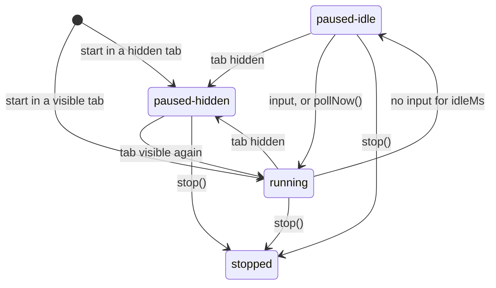
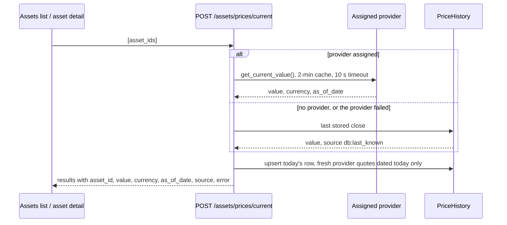

# 📡 Live Prices

LibreFolio shows **live current prices** on the Assets list and on the asset detail page. Both
pages poll the bulk current-price endpoint themselves, through one shared helper that pauses while
nobody is using the page ([Pause and resume](#pause-and-resume)); there is no ticker component.
The Assets list fetches through a small service, `livePriceService`; the asset detail page calls
the generated API client directly, and one answer feeds both its price summary and its chart.

!!! note "No `LiveTicker` component"

    The `LiveTicker` badge strip this page used to describe was removed in August 2026 (commit
    `52c8d0d70`); the page keeps its address for the existing links. The dashboard shows no live
    prices: it never calls the endpoint.

## 🧩 The shared service {: #live-price-service }

`lib/services/livePriceService.ts` holds two helpers:

| Export | Used by | Description |
|---|---|---|
| `fetchCurrentPrices(ids)` | Assets list | Wraps `POST /api/v1/assets/prices/current` and returns `LivePriceResult[]`: `{assetId, value, currency, source, error}`, with `value` parsed to a number (`null` when the asset has no price). An empty `ids` list sends nothing. |
| `computeDirection(current, prev)` | both pages | `'up'`, `'down'` or `'neutral'` — neutral when either value is missing or both are equal. |

Callers never block on it: they fire the request, keep what they show until the answer arrives,
and on an error keep the last known value.

## 🔁 Where prices are polled {: #polling }

| Poll | Interval | Runs while | Asks for | Feeds |
|---|---|---|---|---|
| Assets list (`routes/(app)/assets/+page.svelte`) | at once, then every 60 s | the date range ends today or later, and the list is not empty | every asset of the list, in one request | `livePriceMap` → `AssetCard`, `AssetTable` |
| Asset detail (`routes/(app)/assets/[id]/+page.svelte`) | at once, then every 30 s | the date range ends today or later, and the asset is loaded | the asset | `AssetPriceSummary`, then today's point of the price chart |

Both polls run on `startActivePolling()`, so both pause while the tab is hidden and after two
minutes without input, and resume by themselves — see [Pause and resume](#pause-and-resume). The
three numbers are the constants of `lib/features/live-updates/cadence.ts`, set by developer
decision 31 (2026-10-15): `ASSET_LIST_LIVE_INTERVAL_MS` (60 s), `ASSET_DETAIL_LIVE_INTERVAL_MS`
(30 s) and `LIVE_UPDATES_IDLE_MS` (2 min). The detail page is the faster one because it is the
page where a fresh price matters.

"The date range ends today or later" is the `isHeadToday` flag of both pages: `dateEnd` compared
with today's ISO date. When it is false, both pages show the last close of the selected range
instead, start no poller and ask for nothing.

### 📋 Assets list: one poll per set of assets {: #assets-list-polling }

The polling `$effect` does not read the `assets` array. It depends on `isHeadToday` and on
`liveAssetIdsKey` — the asset ids, sorted and joined into one string — so it restarts only when
the **set** of assets changes: an asset created or deleted starts a new poller (one poll at once,
then every 60 s); the price reloads, which reassign the same assets, do not. The explicit
refreshes — **Reload All** on the Assets tab and the end of a sync in `AssetSyncModal` — call
`refreshLivePricesNow()`, which is `pollNow()` on the current poller: one poll at once per user
action, and the cadence restarts from it, so a refresh is never followed by a tick a few seconds
later. With no poller (the range does not end today, or the list is empty) it does nothing.

This matters because the endpoint is a write (see [Backend](#backend)): every successful call is
a portfolio mutation (`isPortfolioAffectingMutation`, `lib/stores/portfolio/portfolioMutation.ts`)
that marks the report, risk and lots caches stale — see
[Domain state](../../state/domain-state.md). Before 1.2 the effect read `assets` itself, so every
reassignment of the list — several per refresh — fired an extra request, and each of those
mutations could cost the correlation tab on the same page the risk answers it was waiting for.

Each poll rebuilds `livePriceMap` (`Map<assetId, {value, direction}>`), the direction comparing
the new value with the previous poll's:

- `AssetCard` shows the live price (or the asset's last price) with emerald or red text and border
  while the last tick went up or down; the tint lasts until the next poll.
- `AssetTable` uses the live value in the **Last price** column, coloured the same way. A market
  quote is formatted with `sensitivity: 'public'`: the same figure for every user, it is not hidden
  by the privacy toggle.

### 🔎 Asset detail: one poll for the summary and the chart {: #asset-detail }

The detail page runs one poll: every 30 s, a single `POST /assets/prices/current` for the asset
(`pollLivePriceOnce`), whose answer feeds the price summary (`applyLiveSummary`) and then the
chart's last point (`applyLiveChartHead`). It replaced two loops on the same endpoint — the
summary every 30 s, the chart head every minute after a 5 s warm-up, so three requests a minute
for an asset with a provider — and the chart-head loop kept asking even on a range that ends in
the past.

The effect re-runs when `assetInfo`, `displayCurrency`, `fxConversionMissing` or `isHeadToday`
change, and each run starts a new poller, so one poll at once. An answer that lands after the
effect re-ran — another asset, another currency — changes nothing on the page: each run hands the
poll its own `isCurrent()` check, read after the price request, after the conversion and before
the chart head, and the poll also checks that the asset is still the page's.

`applyLiveSummary` replaces the last chart close with the live price in `AssetPriceSummary`. When
the display currency differs from the asset's, the price is converted for today through
`POST /api/v1/fx/currencies/convert`; if that fails, the native price is shown with the asset's
currency and a ⚠ tooltip (`livePriceConversionFailed`).

The direction compares the **native** values of two consecutive polls, so switching the display
currency never fakes a tick, and the first poll after a (re)mount is neutral.

#### ✨ Price flash {: #price-flash }

On an up or down tick the page sets `livePriceDirection` and increments `livePriceFlashToken`.
`AssetPriceSummary` re-keys the price element on the token (`{#key}`), so the animation restarts
even on two ticks in the same direction, and applies `.lf-price-flash-up` or
`.lf-price-flash-down` (`src/app.css`): the number jumps to emerald or red and eases back to its
resting colour in 1.3 s. `LIVE_PRICE_FLASH_DECAY_MS` (1300 ms) then resets the direction to
neutral. Under `prefers-reduced-motion` the colour swaps without the animation and the same timer
clears it. Test hooks: `data-testid="asset-detail-live-price"` and `data-live-price-direction`.

#### 📈 Chart head {: #chart-head }

`applyLiveChartHead` merges the polled close into today's point of the chart
(`mergeChartPointsIncremental`) when it changed — no reload, no flicker. The fields the answer does
not carry (`original_close`, `backward_fill_info`…) stay on the point, and the signals, derived
from `chartData`, recompute. It acts only when the asset has a provider — without one the endpoint
echoes the last stored close, so there is nothing to merge — and not while the chart, or the
calendar of returns, is reloading, nor when the answer has an `error` or no `as_of_date`; a close
equal to the one already charted for that date changes nothing. In a chart converted to another
currency (the polled close is in the asset's own currency) or in calendar-return mode, it reloads
the chart silently (`loadChartData(true)`) instead of merging.

## ⏸️ Pause and resume {: #pause-and-resume }

A live poll runs only while someone is using the page. A tab in the background, or one left open
with nobody at it, sends nothing: it stops costing requests to the server and to the price
providers, and no longer keeps a cloud instance awake. Both pages get this from
`lib/features/live-updates/`:

| File | Role |
|---|---|
| `cadence.ts` | The three numbers of decision 31 (see [above](#polling)) |
| `activityTracker.ts` | Whether someone is using the page: the time of the last input, and whether the tab is visible |
| `activePolling.ts` | `startActivePolling()`: the cadence, the pause and the resume |
| `LiveUpdatesStatus.svelte` | The «Updates paused» pill |



### 👀 The activity tracker {: #activity-tracker }

`getActivityTracker()` returns the tracker of the browser tab: created on first use, shared by
every poller, and kept across route changes. It adds its listeners once, at creation:

- on `window`, in the capture phase and passive, to `pointermove`, `pointerdown`, `keydown`,
  `wheel` and `touchstart` (`ACTIVITY_EVENTS`). An input only stores a timestamp — `pointermove`
  fires many times a second — and signals `activity` only while a poller is subscribed;
- on `document`, to `visibilitychange`: the tab going to the background signals `hidden`; coming
  back counts as input and signals `visible`.

Scroll is not an input: the app scrolls the page itself (guides, `scrollIntoView`), and a user's
scroll already shows as `wheel` or `touchstart`. `touch()` marks activity now: a poller calls it
when it starts in a visible tab, since a page that starts to poll follows a user's navigation,
and on `pollNow()`.
The tracker is built by `createActivityTracker({target, document, now})`: `getActivityTracker()`
passes `window`, `document` and `Date.now`, the unit tests their own; `dispose()` removes its
listeners.

### ⏱️ `startActivePolling` {: #active-polling }

```ts
const poller = startActivePolling({
    run: fetchLivePrices,                    // one poll
    intervalMs: ASSET_LIST_LIVE_INTERVAL_MS, // between the starts of two polls
    onstatechange: (state) => (liveUpdatesState = state),
});
poller.pollNow(); // a refresh the user asked for
poller.stop();    // in the effect's cleanup
```

| Option | Default | Meaning |
|---|---|---|
| `run` | — | One poll. A throw or a rejected promise is caught: the state stays, the next poll runs on time. |
| `intervalMs` | — | Between the starts of two polls. |
| `idleMs` | `LIVE_UPDATES_IDLE_MS` (2 min) | No input for this long pauses the polls; `0` never pauses for inactivity, but a hidden tab still does. |
| `initialDelayMs` | `0` | Delay of the first poll, which always starts from a timer. |
| `onstatechange` | — | The initial state, then every change, each reported once. |
| `tracker` | the tab's tracker | Injected by the unit tests. |

It returns `{state, pollNow(), stop()}`, the state being `running`, `paused-idle`,
`paused-hidden` or `stopped`:

- **Start** — in a visible tab: `running`, `touch()`, and the first poll after `initialDelayMs`.
  In a hidden tab: `paused-hidden`, and no poll until the tab is visible.
- **Cadence** — a poll starts every `intervalMs`, counted from the start of the previous one. A
  poll still in flight when the next is due makes that tick skip: two polls never overlap.
- **Pause** — at once when the tab goes to the background: the timers are cleared, a poll in
  flight still lands, none starts. And at `lastActivity + idleMs`: a single timer waits for that
  threshold, inputs in between only move the timestamp, and the timer re-arms on the newer one
  when it fires — so the pause comes at the threshold itself, even between two ticks.
- **Resume** — on the first input while `paused-idle`, or on the return to the tab: `running`,
  with one poll at once if a whole interval has passed since the start of the last one (or there
  was none), otherwise at the time it was due.
- **`pollNow()`** — marks activity, polls at once (unless a poll is in flight), restarts the
  cadence from that moment and ends a pause. This poll was asked for, so it skips the visibility
  and idle checks; the ticks after it apply them again.
- **`stop()`** — no poll and no listener afterwards, and a second call is harmless; it does not
  abort a poll in flight.

A pause keeps what the page shows: the first poll after a resume compares its value with the last
one before the pause, so it can tint a card or flash the price.

### 🧵 Why every poll starts from a timer {: #from-a-timer }

A page creates its poller inside an `$effect`. A poll started synchronously by
`startActivePolling()` would run inside that effect, and the effect would subscribe to everything
the poll's synchronous head reads. On the Assets list, `fetchLivePrices` reads `assets`: the effect
would re-run on every reassignment of the list, and every re-run would send one more write (see
[Assets list](#assets-list-polling)). So the helper never calls `run` inside the call that starts or
nudges it: the first poll, every tick, the poll of a resume and the one of `pollNow()` all start
from `setTimeout` — 0 ms for "at once". The list page used to guard its first call with
`untrack()`; the helper makes the rule hold for every page.

### 🏷️ The published state and the pill {: #live-updates-status }

Each page keeps the poller's state in `liveUpdatesState` (through `onstatechange`, and `stopped`
while it has no poller) and publishes it twice:

- as `data-live-updates` on its root, `data-testid="assets-page"` or
  `data-testid="asset-detail-page"` — what the E2E reads;
- through `<LiveUpdatesStatus state={liveUpdatesState} />`: beside the title on the list, at the
  end of the header's chips row on the detail page.

`LiveUpdatesStatus` draws only in `paused-idle`: a pill with a pause icon and **Updates paused**
(`liveUpdates.paused`), whose `title` reads *Live prices refresh again as soon as you use the
page.* (`liveUpdates.pausedHint`), with `role="status"`, `data-testid="live-updates-status"` and
`data-state`. It is a signal, not a command: it holds no button, because the next input resumes
the polls and the pill goes away by itself. It draws nothing in the other states — running,
stopped, or `paused-hidden`, where nobody would see it. Its colours are colour roles,
`STATUS_TONES.liveUpdates.paused` in `lib/theme/toneClasses.ts`, which follow the theme by
themselves; its strings belong to the `liveUpdates` subsystem of the
[translation sources](../../i18n.md).

### ✍️ Still a write {: #still-a-write }

Pausing does not turn the poll into a read. Every poll that runs is still
`POST /assets/prices/current`, which persists today's candle ([Backend](#backend)): now that it
runs only while someone uses the page, it is that user's active update of today's price, and
`isPortfolioAffectingMutation()` keeps counting it as a portfolio mutation, so the portfolio views
are marked stale and refreshed in the background ([Domain state](../../state/domain-state.md)).
What changed is how often it happens: on the detail page, two requests a minute instead of three
for an asset with a provider; on the list, one instead of two; none on a range in the past, and
none from a tab nobody uses. Today's candle does not depend on an open tab: the scheduler's
current-price refresh calls the same service on its own schedule
([Scheduler](../../../backend/scheduler.md)).

## 🧪 How it is tested {: #testing }

| Test | Runner action | What it pins |
|---|---|---|
| `lib/features/live-updates/activePolling.test.ts` (Vitest, node, fake timers) | `./dev.py test front-utility core-unit` | Every rule of [`startActivePolling`](#active-polling) on a clock and a tracker the test owns, and the three numbers of `cadence.ts` |
| `lib/features/live-updates/activityTracker.test.ts` (Vitest, node, fake clock) | `./dev.py test front-utility core-unit` | The five input events, `hidden` and `visible`, `touch()`, the subscribers, and no listener left after `dispose()` |
| `lib/features/live-updates/LiveUpdatesStatus.test.ts` (Vitest, jsdom) | `./dev.py test front-utility component-unit` | The pill only in `paused-idle`, with a label and a hint, and no button |
| `frontend/e2e/assets/asset-live-pause.spec.ts` (Playwright) | `./dev.py test front-asset live-pause` | The list asks every 60 s and the detail exactly once per 30 s; both pause after 2 minutes without input, show the pill and ask at once on the next pointer move; the list pauses in a hidden tab and asks at once on the return; the detail asks nothing on a range in the past |

The E2E drives time with `page.clock`, since minutes of cadence can be neither waited for nor
guessed, and answers `POST /assets/prices/current` in the browser with an empty, schema-valid
result that it counts: nothing reaches a provider and nothing is written. A hidden tab has no
Playwright API, so the spec redefines `document.visibilityState` and dispatches
`visibilitychange`, which is exactly what the tracker listens to.

## ⚙️ Backend {: #backend }

`POST /api/v1/assets/prices/current` takes a list of asset ids and answers
`FACurrentPriceResponse` (`results`, `success_count`). `get_current_prices_bulk`
(`backend/app/services/assets/price_query.py`) resolves every asset in parallel:



- A provider answer has `source: "provider:<code>"` and is cached for two minutes
  (`_asset_current_cache`, `backend/app/services/assets/core.py`).
- An asset with no price at all comes back with `value: null` and an `error`.
- **Side effect**: a provider quote dated today creates or extends today's `PriceHistory` row. A
  database fallback is never written back. This write is why the frontend treats the call as a
  portfolio mutation.

## 🔗 Related

- 📡 [Bulk Current Price Endpoint](../../../api/overview.md#post-apiv1assetspricescurrent-bulk-current-price)
- 💰 [Asset Architecture](../../../backend/assets/architecture.md) — Sync pipeline and pricing
- 🧠 [Domain state](../../state/domain-state.md) — The portfolio caches and the mutation signal
- ⏱️ [Scheduler](../../../backend/scheduler.md) — The server-side current-price refresh
- 🎨 [Styling](../../styling.md#utility-classes) — The `.lf-price-flash-*` classes


