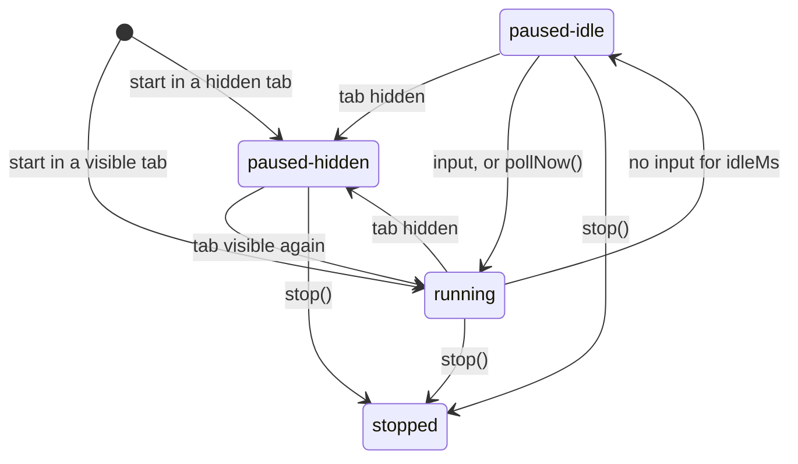
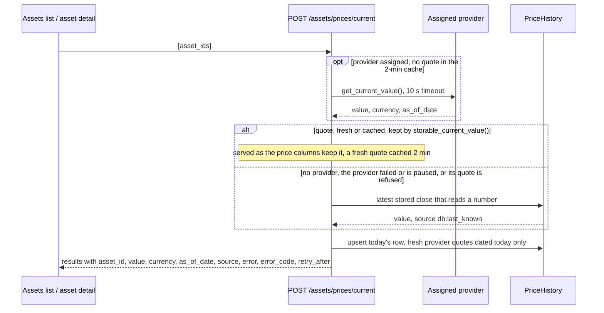

# 📡 Live Prices

LibreFolio shows **live current prices** on the Assets list and on the asset detail page. Both
pages poll the bulk current-price endpoint themselves, through one shared helper that pauses while
nobody is using the page ([Pause and resume](#pause-and-resume)) and waits longer after a failed
poll or during a provider's pause ([Failures and provider pauses](#backoff)); there is no ticker
component. The Assets list fetches through a small service, `livePriceService`; the asset detail
page posts its one id itself, through the generated API client, and uses only the service's helpers
to read the answer, one answer feeding both its price summary and its chart.

The page also covers the notice **Updating prices…**, which the web app shows while the server
catches up on prices, through the same helper: see [Updating prices…](#price-refresh).

!!! note "No `LiveTicker` component"

    The `LiveTicker` badge strip this page used to describe was removed in August 2026 (commit
    `52c8d0d70`); the page keeps its address for the existing links. The dashboard shows no live
    prices: it never calls the endpoint.

## 🧩 The shared service {: #live-price-service }

`lib/services/livePriceService.ts` holds the helpers both pages share:

| Export | Used by | Description |
|---|---|---|
| `fetchCurrentPrices(ids)` | Assets list | Wraps `POST /api/v1/assets/prices/current` and returns `LivePriceResult[]`: `{assetId, value, currency, source, error, errorCode, retryAfter}`, with `value` parsed to a number (`null` when the asset has no price). An empty `ids` list sends nothing. The endpoint refuses more than 1,000 ids (422 `bulk_too_many_items`, R13-SEC9-1), so the ids go through `sendBulkBatches(ids, () => 0, send)` (`lib/api/bulkBatches.ts`, Z-27; X-R64): consecutive batches of at most 1,000, in the order given, one request after the other, with no day estimate, and the items of every batch mapped in that order, as if one request had answered; up to 1,000 ids it is one request. All or nothing: a failed batch rejects the call with its own error, as axios raised it, so `livePollFailure` still reads its `Retry-After`, and nothing is sent after it. |
| `toLivePriceResult(raw)` | both pages | One item of the answer as a `LivePriceResult`; `fetchCurrentPrices` maps every item through it. `errorCode` is the item's `error_code`: `RATE_LIMITED` while the asset's provider is paused. `retryAfter` is its `retry_after`, the seconds until that pause ends, `null` when absent or not a number. |
| `livePollOutcome(results, now?)` | both pages | The [outcome](#backoff) of a poll that got an answer: `{ok: true, notBefore}` at the end of the shortest pause when every result is `RATE_LIMITED` with a `retryAfter`; `{ok: false}` when every result is `RATE_LIMITED` and one has no `retryAfter`; `{ok: true}` otherwise, an empty list included. |
| `livePollFailure(error, now?)` | both pages | The [outcome](#backoff) of a request that failed: `{ok: false}`, with `notBefore` when the answer is a 429 or a 503 that carries a usable `Retry-After`, in seconds or as an HTTP date. |
| `computeDirection(current, prev)` | both pages | `'up'`, `'down'` or `'neutral'` — neutral when either value is missing or both are equal. |

Callers never block on it: they fire the request, keep what they show until the answer arrives,
and on an error keep the last known value. Each poll then returns its outcome to the poller —
`livePollOutcome(…)` after an answer, `livePollFailure(error)` after a failed request — and the
outcome spaces the next poll.

## 🔁 Where prices are polled {: #polling }

| Poll | Interval | Runs while | Asks for | Feeds |
|---|---|---|---|---|
| Assets list (`routes/(app)/assets/+page.svelte`) | at once, then every 60 s | the date range ends today or later, and the list is not empty | every asset of the list: one request up to 1,000 assets, consecutive batches of at most 1,000 beyond ([The shared service](#live-price-service)) | `livePriceMap` → `AssetCard`, `AssetTable` |
| Asset detail (`routes/(app)/assets/[id]/+page.svelte`) | at once, then every 30 s | the date range ends today or later, the asset is loaded, and it has a provider ([below](#asset-detail)) | the asset | `AssetPriceSummary`, then today's point of the price chart |

Both polls run on `startActivePolling()`, so both pause while the tab is hidden and after two
minutes without input, and resume by themselves — see [Pause and resume](#pause-and-resume). After
a failed poll they wait longer, and while every asset they ask about has its provider paused they
wait for the first of those pauses to end — see [Failures and provider pauses](#backoff). The
three numbers are the constants of `lib/features/live-updates/cadence.ts`, set by developer
decision 31 (2026-10-15): `ASSET_LIST_LIVE_INTERVAL_MS` (60 s), `ASSET_DETAIL_LIVE_INTERVAL_MS`
(30 s) and `LIVE_UPDATES_IDLE_MS` (2 min). The detail page is the faster one because it is the
page where a fresh price matters. A fourth constant, `LIVE_UPDATES_MAX_BACKOFF_MS` (10 min), caps
the wait after failures (decision 34, D-Z7-1).

"The date range ends today or later" is the `isHeadToday` flag of both pages: `dateEnd` compared
with today on the user's calendar, `todayIso()` (`lib/utils/dateOnly.ts`), the calendar `dateEnd` is
resolved in (`resolveDateSentinel('max')` returns `todayIso()`). Until Z-3 the pages compared it with
the UTC date, which is a day off for part of every day: in the evening west of Greenwich it is already
tomorrow, so a range ending today read as past (no live price, and the detail summary showed the
chart's last close); just after midnight east of Greenwich it is still yesterday, so a range that
ended yesterday read as live and polled. When the flag is false, both pages show the last close of
the selected range instead, start no poller and ask for nothing.

### 📋 Assets list: one poll per set of assets {: #assets-list-polling }

The polling `$effect` does not read the `assets` array. It depends on `isHeadToday` and on
`liveAssetIdsKey` — the asset ids, sorted and joined into one string — so it restarts only when
the **set** of assets changes: an asset created or deleted starts a new poller (one poll at once,
then every 60 s); the price reloads, which reassign the same assets, do not. The explicit
refreshes — **Reload All** on the Assets tab and the end of a sync in `AssetSyncModal` — call
`refreshLivePricesNow()`, which is `pollNow()` on the current poller: one poll at once per user
action, and the cadence restarts from it, so a refresh is never followed by a tick a few seconds
later. With no poller (the range does not end today, or the list is empty) it does nothing.

This matters because the endpoint is a write (see [Backend](#backend)): every successful call is
a portfolio mutation (`isPortfolioAffectingMutation`, `lib/stores/portfolio/portfolioMutation.ts`)
that marks the report, risk and lots caches stale — see
[Domain state](../../state/domain-state.md). Before 1.2 the effect read `assets` itself, so every
reassignment of the list — several per refresh — fired an extra request, and each of those
mutations could cost the correlation tab on the same page the risk answers it was waiting for.

Each poll rebuilds `livePriceMap` (`Map<assetId, {value, direction}>`), the direction comparing
the new value with the previous poll's:

- `AssetCard` shows the live price (or the asset's last price) with emerald or red text and border
  while the last tick went up or down; the tint lasts until the next poll.
- `AssetTable` uses the live value in the **Last price** column, coloured the same way. A market
  quote is formatted with `sensitivity: 'public'`: the same figure for every user, it is not hidden
  by the privacy toggle.

`fetchLivePrices` returns the poll's [outcome](#backoff): `livePollOutcome(results)` once
`livePriceMap` is rebuilt, and `livePollFailure(e)` from its `catch`. That `try` wraps the whole
poll, so an error of the page's own code counts as a failure too.

### 🔎 Asset detail: one poll for the summary and the chart {: #asset-detail }

The detail page runs one poll, in `AssetDetailLive` (`lib/components/assets/detail/assetDetailLive.svelte.ts`),
which the page creates while it initialises and which reads the page's state through getters: every
30 s, a single `POST /assets/prices/current` for the asset (`#pollLivePriceOnce`), whose answer feeds
the price summary (`#applyLiveSummary`) and then the chart's last point (`#applyLiveChartHead`). It
replaced two loops on the same endpoint — the
summary every 30 s, the chart head every minute after a 5 s warm-up, so three requests a minute
for an asset with a provider — and the chart-head loop kept asking even on a range that ends in
the past.

The instance's effect reads `assetInfo`, `displayCurrency`, `fxConversionMissing`, `isHeadToday`
and, through a `$derived` boolean, `providerAssignment` — nothing else from the page. It re-runs
when one of the first four changes or when a provider code appears or goes, and each run that finds
the range reaching today, an asset and a provider code starts a new poller, so one poll at once. An
answer that lands after the effect re-ran — another asset, another currency, the provider code
gone — changes nothing on the page: each run hands the poll its own `isCurrent()` check, read after
the price request, after the conversion and before the chart head, and the poll also checks that
the asset is still the page's.

Without a provider code (Z-8) — a manual asset, or any asset until its assignment has loaded — no
poller starts, `updatesState` (the page's `data-live-updates`) is `stopped` and nothing is asked:
without a provider `POST /assets/prices/current` only echoes the stored price, and every answer
would still count as a portfolio mutation ([Still a write](#still-a-write)). The effect reads the
code through `hasProvider` (`!!providerAssignment?.provider_code`), a `$derived` declared in the
constructor and lazy, so building the instance reads nothing from the page. Through the boolean, the
assignment reloaded with the same code — `reloadMetadata()` reassigns it with a new object after a
sync or an edit — or with another one does not re-run the effect: the poll asks the backend, which
reads the assignment of the moment. That reload also reassigns `assetInfo`, which does re-run the effect.

`#pollLivePriceOnce` returns the poll's [outcome](#backoff): `livePollFailure(error)` when the
request fails; otherwise `livePollOutcome([toLivePriceResult(item)])` (of an empty list when the
answer has no item), worked out before the `isCurrent()` checks and returned on every path after
them. An error of `#applyLiveSummary` or `#applyLiveChartHead` is not caught: the poller counts the
throw as a failure.

`#applyLiveSummary` sets `currentPrice`, which the page shows in `AssetPriceSummary` instead of the
last chart close. When
the display currency differs from the asset's, the price is converted for today through
`POST /api/v1/fx/currencies/convert` — the UTC date on purpose: the lookup fills backward, so either
calendar gives the latest stored rate; if that fails, the native price is shown with the asset's
currency and a ⚠ tooltip (`conversionFailed`, passed as `livePriceConversionFailed`).

The direction compares the **native** values of two consecutive polls, so switching the display
currency never fakes a tick, and the first poll after a (re)mount is neutral.

#### ✨ Price flash {: #price-flash }

On an up or down tick the instance sets `direction` and increments `flashToken`, which the page
passes to `AssetPriceSummary` as `livePriceDirection` and `livePriceFlashToken`.
`AssetPriceSummary` re-keys the price element on the token (`{#key}`), so the animation restarts
even on two ticks in the same direction, and applies `.lf-price-flash-up` or
`.lf-price-flash-down` (`src/app.css`): the number jumps to emerald or red and eases back to its
resting colour in 1.3 s. `LIVE_PRICE_FLASH_DECAY_MS` (1300 ms, exported by the module) then resets
the direction to
neutral. Under `prefers-reduced-motion` the colour swaps without the animation and the same timer
clears it. When the effect re-runs (another asset, display currency or FX gap, the range no longer
reaching today, a provider code that comes or goes) or the page goes away, its cleanup stops that
timer and puts the direction back to neutral too, so a flash cut short never stays lit. Test hooks:
`data-testid="asset-detail-live-price"` and `data-live-price-direction`.

#### 📈 Chart head {: #chart-head }

`#applyLiveChartHead` merges the polled close into today's point of the page's `chartData`, through
the input's setter (`mergeChartPointsIncremental`), when it changed — no reload, no flicker. The fields the answer does
not carry (`original_close`, `backward_fill_info`…) stay on the point, and the signals, derived
from `chartData`, recompute. It does not check the provider: no poll runs for an asset without one
([above](#asset-detail)) — the endpoint would only echo the last stored close, with nothing to
merge — and an answer still in flight when the code goes is dropped by `isCurrent()`, so the chart
head never sees such an answer. It skips the answer while the chart, or the calendar of returns, is
reloading, and when the answer has an `error` or no `as_of_date`; a close equal to the one already
charted for that date changes nothing. The comparison is made in the
asset's own currency, the poll's: the point's native close, `original_close ?? close`, since in a
converted chart `close` is in the display currency and `original_close` holds the native one. In a
chart converted to another currency (the polled close is in the asset's own currency) or in
calendar-return mode, a close that changed reloads the chart silently (`loadChartData(true)`)
instead of merging.

## ⏸️ Pause and resume {: #pause-and-resume }

A live poll runs only while someone is using the page. A tab in the background, or one left open
with nobody at it, sends nothing: it stops costing requests to the server and to the price
providers, and no longer keeps a cloud instance awake. Both pages get this from
`lib/features/live-updates/`:

| File | Role |
|---|---|
| `cadence.ts` | The three numbers of decision 31 (see [above](#polling)), and the cap of the wait after failures |
| `activityTracker.ts` | Whether someone is using the page: the time of the last input, and whether the tab is visible |
| `activePolling.ts` | `startActivePolling()`: the cadence, the wait after failures, the pause and the resume |
| `LiveUpdatesStatus.svelte` | The «Updates paused» pill |



### 👀 The activity tracker {: #activity-tracker }

`getActivityTracker()` returns the tracker of the browser tab: created on first use, shared by
every poller, and kept across route changes. It adds its listeners once, at creation:

- on `window`, in the capture phase and passive, to `pointermove`, `pointerdown`, `keydown`,
  `wheel` and `touchstart` (`ACTIVITY_EVENTS`). An input only stores a timestamp — `pointermove`
  fires many times a second — and signals `activity` only while a poller is subscribed;
- on `document`, to `visibilitychange`: the tab going to the background signals `hidden`; coming
  back counts as input and signals `visible`.

Scroll is not an input: the app scrolls the page itself (guides, `scrollIntoView`), and a user's
scroll already shows as `wheel` or `touchstart`. `touch()` marks activity now: a poller calls it
when it starts in a visible tab, since a page that starts to poll follows a user's navigation,
and on `pollNow()`.
The tracker is built by `createActivityTracker({target, document, now})`: `getActivityTracker()`
passes `window`, `document` and `Date.now`, the unit tests their own; `dispose()` removes its
listeners.

### ⏱️ `startActivePolling` {: #active-polling }

```ts
const poller = startActivePolling({
    run: fetchLivePrices,                    // one poll, which returns its outcome
    intervalMs: ASSET_LIST_LIVE_INTERVAL_MS, // between the starts of two polls
    onstatechange: (state) => (liveUpdatesState = state),
});
poller.pollNow(); // a refresh the user asked for
poller.stop();    // in the effect's cleanup
```

| Option | Default | Meaning |
|---|---|---|
| `run` | — | One poll. It may return a [`PollOutcome`](#backoff), `{ok?, notBefore?}`. A throw or a rejected promise is caught and is a failure, like `{ok: false}`: the state stays, and the next poll waits longer. |
| `intervalMs` | — | Between the starts of two polls. |
| `idleMs` | `LIVE_UPDATES_IDLE_MS` (2 min) | No input for this long pauses the polls; `0` never pauses for inactivity, but a hidden tab still does. |
| `initialDelayMs` | `0` | Delay of the first poll, which always starts from a timer. |
| `maxBackoffMs` | `LIVE_UPDATES_MAX_BACKOFF_MS` (10 min) | The longest wait after failures in a row; the wait never drops below `intervalMs`. |
| `onstatechange` | — | The initial state, then every change, each reported once. |
| `tracker` | the tab's tracker | Injected by the unit tests. |

It returns `{state, pollNow(), stop()}`, the state being `running`, `paused-idle`,
`paused-hidden` or `stopped`:

- **Start** — in a visible tab: `running`, `touch()`, and the first poll after `initialDelayMs`.
  In a hidden tab: `paused-hidden`, and no poll until the tab is visible.
- **Cadence** — a poll starts every `intervalMs`, counted from the start of the previous one; after
  failures the wait is longer, and the next poll never starts before `notBefore`
  ([Failures and provider pauses](#backoff)). A poll still in flight when the next is due makes
  that tick skip: two polls never overlap, and when it lands the next one starts at the following
  step of the same cadence — landing late buys no extra poll.
- **Pause** — at once when the tab goes to the background: the timers are cleared, a poll in
  flight still lands (its outcome still counts), none starts. And at `lastActivity + idleMs`: a
  single timer waits for that threshold, inputs in between only move the timestamp, and the timer
  re-arms on the newer one when it fires — so the pause comes at the threshold itself, even between
  two ticks.
- **Resume** — on the first input while `paused-idle`, or on the return to the tab: `running`,
  with one poll at once if the next one is already due — the wait has passed since the start of
  the last poll (or there was none), and so has `notBefore` — otherwise at the time it is due.
- **`pollNow()`** — marks activity, ends a pause and polls at once, and the cadence restarts from
  that poll. This poll was asked for, so it skips the visibility and idle checks, the wait after
  failures and `notBefore`; its outcome counts like any other, and the polls after it apply them
  all again. With a poll still in flight it starts none, and the next poll follows that one's start
  and outcome.
- **`stop()`** — no poll and no listener afterwards, and a second call is harmless; it does not
  abort a poll in flight.

A pause keeps what the page shows: the first poll after a resume compares its value with the last
one before the pause, so it can tint a card or flash the price.

### 🐢 Failures and provider pauses {: #backoff }

`run` tells the poller how the poll went by what it returns, a `PollOutcome` (`activePolling.ts`):

```ts
export interface PollOutcome {
    ok?: boolean;       // false: the poll failed, and the next one waits longer
    notBefore?: number; // a Date.now() time before which the next poll does not start
}
```

- **A failure** is a `run` that throws, rejects or returns `{ok: false}`. Anything else is a
  success, `undefined` included.
- **The wait**, from the start of one poll to the start of the next, is `intervalMs` until a poll
  fails. After `k` failures in a row it is `intervalMs × 2^k`, capped at `maxBackoffMs` and never
  shorter than `intervalMs`. The first success brings back `intervalMs`.
- **`notBefore`** is a floor: the next poll starts at the later of the end of the wait and
  `notBefore`. Only the latest outcome counts: an outcome without `notBefore` clears it.
- **A resume** waits for both; **`pollNow()`** ignores both, and its outcome counts.
- **A slower cadence is not a state**: the poller stays `running`, the «Updates paused» pill does
  not show, and the page keeps what it shows. The idle and hidden pauses apply as usual.

With the default cap, the waits after failures in a row:

| Failures in a row | Assets list (60 s) | Asset detail (30 s) |
|---|---|---|
| 1 | 2 min | 1 min |
| 2 | 4 min | 2 min |
| 3 | 8 min | 4 min |
| 4 | 10 min | 8 min |
| 5 or more | 10 min | 10 min |

Both pages build their outcome with `livePriceService` ([The shared service](#live-price-service)):

- **An answer** goes through `livePollOutcome(results)`. An asset whose provider is paused after
  «too many requests» comes back `RATE_LIMITED`, with the last stored price, if any, and
  `retry_after` ([Backend](#backend)). When every asset asked about is `RATE_LIMITED` and each one
  knows its `retryAfter`, the outcome is a success with `notBefore` at the end of the shortest
  pause: the wait is known, so it does not double. When one of them has no `retryAfter`, the pause
  has no known end: the outcome is a failure, and the wait doubles. As long as one result is not
  `RATE_LIMITED`, the outcome is a plain success and the cadence goes on: such a poll costs little,
  since the backend does not call the paused providers. On the list, one asset without a provider
  is enough.
- **A failed request** goes through `livePollFailure(error)`: a failure, with `notBefore` when the
  answer is a 429 or a 503 that carries a usable `Retry-After`, in seconds or as an HTTP date. The
  backend sends no `Retry-After` on this endpoint today; a proxy in front of the server can.

Nothing new shows during a provider's pause: the page keeps showing the last stored price that the
answer carries, with no new text (decision 34, D-Z7-2).

### 🧵 Why every poll starts from a timer {: #from-a-timer }

A page creates its poller inside an `$effect`. A poll started synchronously by
`startActivePolling()` would run inside that effect, and the effect would subscribe to everything
the poll's synchronous head reads. On the Assets list, `fetchLivePrices` reads `assets`: the effect
would re-run on every reassignment of the list, and every re-run would send one more write (see
[Assets list](#assets-list-polling)). So the helper never calls `run` inside the call that starts or
nudges it: the first poll, every tick, the poll of a resume and the one of `pollNow()` all start
from `setTimeout` — 0 ms for "at once". The list page used to guard its first call with
`untrack()`; the helper makes the rule hold for every page.

### 🏷️ The published state and the pill {: #live-updates-status }

The list keeps the poller's state in `liveUpdatesState`, the detail page in `live.updatesState`
(`AssetDetailLive`, handed to `AssetDetailHeader` as its `liveUpdatesState` prop) — through
`onstatechange`, and `stopped` while there is no poller — and each publishes it twice:

- as `data-live-updates` on its root, `data-testid="assets-page"` or
  `data-testid="asset-detail-page"` — what the E2E reads;
- through `<LiveUpdatesStatus state={liveUpdatesState} />`: beside the title on the list, at the
  end of the header's chips row on the detail page.

`LiveUpdatesStatus` draws only in `paused-idle`: a pill with a pause icon and **Updates paused**
(`liveUpdates.paused`), whose `title` reads *Live prices refresh again as soon as you use the
page.* (`liveUpdates.pausedHint`), with `role="status"`, `data-testid="live-updates-status"` and
`data-state`. It is a signal, not a command: it holds no button, because the next input resumes
the polls and the pill goes away by itself. It draws nothing in the other states — running,
stopped, or `paused-hidden`, where nobody would see it. Its colours are colour roles,
`STATUS_TONES.liveUpdates.paused` in `lib/theme/toneClasses.ts`, which follow the theme by
themselves; its strings belong to the `liveUpdates` subsystem of the
[translation sources](../../i18n.md).

### ✍️ Still a write {: #still-a-write }

Pausing does not turn the poll into a read. Every poll that runs is still
`POST /assets/prices/current`, which persists today's candle ([Backend](#backend)): now that it
runs only while someone uses the page, it is that user's active update of today's price, and
`isPortfolioAffectingMutation()` keeps counting it as a portfolio mutation, so the portfolio views
are marked stale and refreshed in the background ([Domain state](../../state/domain-state.md)).
On the list a poll over more than 1,000 assets is one request per batch
([The shared service](#live-price-service)), and each batch that succeeds persists today's candles
of its assets and counts as a mutation: the views hear it once per batch, which since decision E1
only marks them stale for a background refresh, nothing thrown away.
What changed is how often it happens: on the detail page, two requests a minute instead of three
for an asset with a provider, and none for an asset without one, which had two a minute until Z-8,
each an echo of the stored price counted as a mutation; on the list, one poll instead of two, each
a request per batch of at most 1,000 assets; none on a range in the past, and none from a tab
nobody uses; fewer still after failed polls, or while every provider asked about is paused
([Failures and provider pauses](#backoff)). Today's candle does not
depend on an open tab: the scheduler's current-price refresh calls the same service on its own
schedule ([Scheduler](../../../backend/scheduler.md)).

## 🔄 Updating prices… {: #price-refresh }

When the server catches up on prices — at its start, at the first request after a minute of
silence, at a scheduled wake-up — the web app shows the instance notice **Updating prices…** while
one of the catch-up's jobs runs and, once the catch-up has brought something up to date, marks the
portfolio views stale and reloads the Dashboard or a broker's page on screen.
`lib/features/price-refresh/priceRefresh.ts` does it, on the
`startActivePolling()` of the live prices. The server's side — what a catch-up is, the header, the
route — is in [Catch-up Progress](../../../backend/scheduler.md#price-refresh); what users see, in
[While Prices Catch Up](../../../../admin/wake_sync.md#price-refresh).

### 📥 The header {: #price-refresh-header }

The response interceptor of `lib/api/zodios-client.ts` hands the headers of every successful answer
to `priceRefresh.observe(response.headers)`, right after `notifyPortfolioMutation()`; a failed answer
goes to the error interceptor and is not read.

- `readPriceRefreshHeader(headers)` reads `x-librefolio-price-refresh` (`PRICE_REFRESH_HEADER`, in
  lower case, as axios exposes it) through the `get()` of axios's `AxiosHeaders`, or as a key of a
  plain object. It trims and lower-cases the value, and returns `starting`, `running` or `null` (no
  header, or any other value).
- `observe()` does nothing while the tracker ignores the headers after a `4xx`
  ([After a 4xx](#price-refresh-4xx)), and nothing on `null`. On `running` it shows the notice at
  once. On either value, when no tracking is under way, it starts one:
  `startActivePolling({run: check, intervalMs: PRICE_REFRESH_POLL_MS})`, with its counters at 0.

Every successful answer means the public ones too: the pages without a session hear the header like
the others. They are the sign-in page, whose `LoginCard` loads the instance configuration, and the
invitation, password-reset, email-verification and setup pages, which send the token of their link
through the API client; opening one on a quiet instance starts a catch-up by itself. Such a page starts a
tracking like any other, and its first question settles it ([After a 4xx](#price-refresh-4xx)).

The header reaches the web app on the answers it gets anyway, at load or later, from the moment the
server announces a catch-up: a status asked only at load would miss one that starts later, such as a
scheduled wake-up while the app is open. And without the header the web app asks nothing, so an
instance with nothing to catch up can still sleep.

### ⏱️ The questions {: #price-refresh-questions }

`check()` asks `GET /api/v1/system/price-refresh` every 3 s (`PRICE_REFRESH_POLL_MS`) with
`fetch(PRICE_REFRESH_STATUS_PATH, {credentials: 'same-origin', headers: {Accept: 'application/json'}})`,
not through the API client, because of the pages without a session. There the question gets a `401`,
and through the client that `401` would reach its error interceptor, whose way to the sign-in page
would leave the invitation, password-reset, email-verification and setup pages without the token of
their link, already out of the address. The interceptor now spares those pages
([A 401 on a Link Page](auth.md#link-page-401)), but the poll does not depend on that list: a `fetch`
answer goes through none of the client's interceptors, nor through its Zod validation; one that is
not ok throws `PriceRefreshStatusError`, which carries its `status`.

The poller is [`startActivePolling()`](#active-polling), for the same reasons as the live prices:

- the first question goes at once, from a timer; in a background tab, none goes until the tab is
  visible;
- the questions pause in a background tab and after two minutes without input: each one is a user's
  request for the server's [idle suspension](../../../../admin/sleep_wake.md#idle-suspend-activity),
  and a tab nobody uses must not keep the instance awake. Meanwhile the notice stays as it was, and
  the question of the resume settles it;
- after a failed question the next one waits twice as long: 6, 12, 24, then 48 s
  ([Failures and provider pauses](#backoff)).

| Answer | What the tracker does |
|---|---|
| `running` | Shows the notice, if it is not shown yet, and sets the `starting` count back to 0 |
| `starting` | Counts it. The tenth `starting` answer since the tracking began, or since the last `running` (`PRICE_REFRESH_MAX_STARTING_POLLS`), ends the tracking: the run never came |
| `idle`, or any state but those two | Ends the tracking, the notice hidden; then asks the portfolio views to refresh, when a job of this catch-up was seen running and `last_refreshed` is true |
| A `4xx` | Ends the tracking at once, the notice hidden, without a refresh, and the headers are ignored from then on: see [After a 4xx](#price-refresh-4xx). It is not a failure |
| A `5xx`, a network error, or a body that is not JSON | A failure: the poller waits longer. The fifth failure in a row (`PRICE_REFRESH_MAX_FAILURES`) ends the tracking, the notice hidden |

Any answer sets the failure count back to 0, and an answer that lands after its tracking has ended
changes nothing. Once a tracking has ended, the next answer that carries the header starts a new
one.

**The portfolio refresh.** "Seen running" means a `running` header or answer during this tracking:
a catch-up with nothing due never shows one, and the `last_refreshed` read at `idle` would then be an
older catch-up's. The refresh is `notifyPricesCaughtUp()`
(`lib/stores/portfolio/portfolioMutation.ts`), which dispatches `{kind: 'prices'}` on the portfolio
bus. It is a signal of its own, so that a page on screen can tell the end of a catch-up from a write
(`{kind: 'mutation', …}`) and from its own **Refresh** button (`requestPortfolioRefresh()`,
`{kind: 'refresh'}`), which already reloads the page, with `force`. The report, risk and
lots caches mark their answers stale on any signal and keep them, so each portfolio view asks again
the next time it loads, showing what it has meanwhile ([Domain state](../../state/domain-state.md)).

Two pages also reload while on screen: the Dashboard (`routes/(app)/dashboard/+page.svelte`) and the
broker detail page (`routes/(app)/brokers/[id]/+page.svelte`). Each registers a bus listener in
`onMount`, `dashboard:prices` or `broker-page:<id>:prices`, and removes it on destroy. On
`{kind: 'prices'}`, and on no other kind, the listener queues `reloadAfterPriceCatchUp()` with
`queueMicrotask()`: the reload runs once the dispatch is over, when every cache has marked its
answers stale, whatever the order of the listeners. The reload calls the page's report loader
without `force`, in background: `loadAll()` on the Dashboard, `loadOverview()` on the broker page.
The mark has made the report on screen stale, so the loader asks that question again; the figures
stay until the new ones land.

It touches neither `refreshVersion` nor `requestPortfolioRefresh()`, the signals of the user's
**Refresh**: the caches are already marked, and the risk and lots panels on screen keep their
answers, marked stale, until they next load. Nor does it hold the **Refresh** button. Since Y11
(decision 48) the button of each page, `sync-button` on the Dashboard and `broker-refresh` on the
broker page, follows `pageBusy.busy` (`lib/stores/app/pageBusy.svelte.ts`): it spins, disabled,
while one of the page's big requests is pending — a load the page starts on a trigger (the first
load, a **Refresh**, a change of period or currency), wrapped there in `pageBusy.track()`, or a
panel's own load, which `pageBusy.join()` counts only while one of those is pending. The reload is
wrapped in neither, so no **Refresh** button waits or spins while it runs.

On the Dashboard the call is `loadAll(false, false, {background: true})`, and the option keeps the
page from saying it is busy (Z-18): a screen reader would announce «busy» for a price refresh
nobody asked for. The root (`data-testid="dashboard-page"`) binds `aria-busy` and `data-busy` to
`reportLoading || contributionLoading || contributionRefreshing || syncLoading`. With `background`,
`loadAll()` does not turn `reportLoading` on, and `loadContribution({background})` asks a stale
cached contribution again under `contributionInBackground` instead of `contributionRefreshing`: a
non-reactive flag that keeps a second request from leaving, as `contributionRefreshing` does, but
that the root does not read. The reload thus turns neither attribute on, while a load the user asks
for still does; and it does nothing once the page is destroyed (`pageAlive`). On the broker page
`loadOverview()` has no such option: the `reportLoading` it turns on only shows the skeletons drawn
while no figures are on screen yet, and the page's root publishes no `aria-busy`. The broker
summary (`loadBroker()`) and the transactions, which that page's **Refresh** asks again too, are
left as they are.

No other page listens for `prices`. The broker list (`routes/(app)/brokers/+page.svelte`) and the
risk panels of the asset pages read the caches the signal marked stale, so they ask again the next
time they load; the live prices of the Assets list and of an asset's page keep their own polling
([Where prices are polled](#polling)).

The price and rate series that the asset pages and the FX pages keep in their session caches
(`lib/stores/assetPriceStoreRegistry.ts`, `lib/stores/fxStoreRegistry.ts`) go stale too, on
`prices` and on no other kind: each registry listens on the bus from its import and marks every
store stale, keeping its points ([Registries & Caches](../../state/registries.md#how-it-works)).
The next visit of a price or FX page, or its next change of range, asks the server again, once,
and shows the page's loading state, as on a first visit, instead of the prices of before; the
market rate a transaction modal compares an exchange with (`lookupFxRate`) is asked again for its
day. A page already open during the catch-up does not reload by itself: it keeps its chart until
its next load — a change of range, a return to the page, its **Refresh** (backlog Z-14b).

#### 🚫 After a 4xx {: #price-refresh-4xx }

A `4xx` is a status from 400 to 499: the `status` of a `PriceRefreshStatusError`, or the axios-like
`response.status` of an error that an injected `fetchStatus` throws. It means this page cannot follow
the catch-up: it has no session (`401`), or the instance is
[blocked](../../state/app-state.md#instance-block) (`423`). The tracker ends the tracking at once,
hides the notice and asks no refresh; the answer does not count as a failure. Then it stops
listening (its `suspended` flag): `observe()` ignores every header until `reset()`, at the next change
of the signed-in account — for a page without a session, the sign-in — or until the next page load.
`stop()` alone does not lift it. A sign-in page left open thus asks once at most, then nothing more.

### 📢 The notice and the session {: #price-refresh-notice }

The notice is
`{id: 'liveUpdates.priceRefresh', severity: 'info', messageKey: 'liveUpdates.priceRefresh.running'}`
(`PRICE_REFRESH_NOTICE_ID`, `PRICE_REFRESH_MESSAGE_KEY`), shown with `instanceNotices.show()` and
removed with `hide()`: see [Instance notices](../../state/app-state.md#instance-notices). It is not
dismissible: it goes away by itself, when the tracking ends. `InstanceNotices.svelte` draws it above
every page of the app shell, with `role="status"`, `data-testid="instance-notice"`,
`data-notice-id="liveUpdates.priceRefresh"` and `data-severity="info"`: no markup of its own, and the
colours are the notice component's. Its text, **Updating prices…**, belongs to the `liveUpdates`
subsystem of the [translation sources](../../i18n.md).

`stop()` ends the tracking: no more questions, the notice hidden if shown, the counters at 0.
`reset()` does the same, and also lets the headers through again after a `4xx`: the app calls it
through `registerClientSessionReset('priceRefresh', …)` when the signed-in account changes, a sign-in
or a sign-out, so no tracking and no notice outlive the account that saw them.

`createPriceRefresh(deps)` builds a tracker with its collaborators — `fetchStatus`, `notices`,
`refreshPortfolio` and `startPolling` — so a test can pass its own. The module exports the app's
tracker, `priceRefresh`, built with the defaults: the `fetch` above, `instanceNotices`,
`notifyPricesCaughtUp()` and `startActivePolling()`. The defaults reach those modules when they
are called, not when the module loads: the API client imports this module, and a test that mocks one
of them only in part, such as the client's own tests, must still load it.

The default `notices` goes further: it loads the registry on first use. `instanceNotices.svelte.ts`
holds runes, so `priceRefresh.ts` imports only its `InstanceNotice` type (`import type`); the first
`show()` or `hide()` loads the module with `import()`, through one promise that every later call
shares, which keeps a `hide()` from overtaking its `show()`. The API client imports `priceRefresh`,
and the client must stay free of runes: the AI Export probe loads it without Svelte's compiler, and a
gate checks it ([the probe's frontend bridge](../../../architecture/patterns/ai_export_probe_workflow.md#frontend-bridge)).
The notice thus reaches `instanceNotices` a few microtasks after the tracker shows or hides it, which
nothing visible depends on; a tracker built with `deps.notices`, as the tests build theirs, calls its
sink at once.

## 🧪 How it is tested {: #testing }

| Test | Runner action | What it pins |
|---|---|---|
| `lib/features/live-updates/activePolling.test.ts` (Vitest, node, fake timers) | `./dev.py test front-utility core-unit` | Every rule of [`startActivePolling`](#active-polling) on a clock and a tracker the test owns, [failures and provider pauses](#backoff) included, and the four numbers of `cadence.ts` |
| `lib/services/livePriceService.test.ts` (Vitest, node) | `./dev.py test front-utility core-unit` | `toLivePriceResult`, `fetchCurrentPrices` on a faked axios adapter, its batches included (LPS-14 to LPS-16: 1,001 ids go as two requests, 1,000 then 1, in the order given, the results of both mapped as if one request had answered; exactly 1,000 as one request; a 429 with `Retry-After` on the second of three batches reaches the caller as axios raised it, nothing is sent after it, and `livePollFailure` still reads the header), `livePollOutcome`, `livePollFailure` and `computeDirection` |
| `lib/features/live-updates/activityTracker.test.ts` (Vitest, node, fake clock) | `./dev.py test front-utility core-unit` | The five input events, `hidden` and `visible`, `touch()`, the subscribers, and no listener left after `dispose()` |
| `lib/features/price-refresh/priceRefresh.test.ts` (Vitest, node) | `./dev.py test front-utility core-unit` | [Updating prices…](#price-refresh): `readPriceRefreshHeader`; the tracking that a header starts, one at a time; the notice; the ends of a tracking (`idle`, ten `starting`, five failures); a `4xx`, after which the headers are ignored until `reset()`; the portfolio refresh, only after a job seen running and with `last_refreshed`; `stop()`, and `reset()` at a change of account; the defaults, the `fetch` of the status route included, and the refresh of the app's tracker: `notifyPricesCaughtUp()` once a catch-up that updated something is over, never `requestPortfolioRefresh()`, and neither signal when nothing was updated or no job was seen running; the default `notices`: importing the module or building a tracker loads no `instanceNotices.svelte.ts`, the first notice loads it, once, and a `show()` and a `hide()` issued while it is loading reach it in their order |
| `lib/api/apiClientRuneFree.gate.test.ts` (Vitest, node) | `./dev.py test front-utility core-unit` | The rule behind the lazy `notices` ([the probe's frontend bridge](../../../architecture/patterns/ai_export_probe_workflow.md#frontend-bridge)): from `lib/api/index.ts` and from `frontend/scripts/ai-export-render-prompt-probe.ts`, no static import reaches a `.svelte.ts` module or a `.svelte` component, each one reported with the chain of imports that reaches it, and `lib/api/zodios-client.ts` imports none directly. Imports are read on TypeScript's syntax tree: `import type` and `export type` are erased, `import {type X}` counts, since `verbatimModuleSyntax` keeps it, and a dynamic `import()` is not followed. It reads the generated client (`lib/api/generated.ts`, from `./dev.py api sync`): a local import that names no file fails it instead of being skipped. Synthetic graphs, and a real site that imports the instance block's face (`lib/features/email/verificationApi.ts`), check that the scanner reports what it must |
| `lib/stores/portfolio/portfolioMutation.test.ts`, `lib/stores/portfolio/portfolioStore.test.ts`, `lib/features/brokers/lots/lotsAnalysisStore.test.ts` (Vitest, node) | `./dev.py test front-portfolio store-unit` | The cases of [Updating prices…](#price-refresh): `notifyPricesCaughtUp()` gives every listener exactly `{kind: 'prices'}`, once, kept apart from `refresh` and `mutation`; a listener that throws keeps none of the others from hearing it and is logged; a removed listener hears nothing. The report and lots caches mark their answers stale on it, keep them and ask nothing; the next report fetch without `force` asks the stale one again |
| `lib/features/risk/riskStore.test.ts` (Vitest, node) | `./dev.py test front-portfolio risk-unit` | The case of [Updating prices…](#price-refresh): the risk answers marked stale on `{kind: 'prices'}`, kept, and nothing asked |
| `lib/stores/__tests__/TimeSeriesStore.test.ts`, `lib/stores/__tests__/fxStoreRegistry.test.ts` (Vitest, node) | `./dev.py test front-fx fx-unit` | The stale price and rate caches of [Updating prices…](#price-refresh) (Z-14). `markStale()` keeps every point readable (`get`, `has`, `size`, `getRange().data`, `getAllSorted()`) and reports a loaded range missing whole, points or not; a merge covers nothing, only `markFetched` does; the fetches made after the mark add up, and what they leave uncovered comes back as contiguous intervals in date order; a fetch of the whole range makes the store fresh, a second mark stale again; `invalidateAll()` ends the state, and `invalidateRange()` still works in it; without a mark the gaps are the ones of before. On `{kind: 'prices'}` the FX registry marks every pair stale: `ensureFxRangeLoaded`, `ensureFxRangeLoadedBulk` and `loadFxRatesAndSignalsBulk` without signals ask a range loaded before again, in one interval for the whole range, then answer from the cache; `lookupFxRate` takes a stale day for a miss, asks it once and makes only that day fresh; `lookupFxRateSync` still returns the stale point and asks nothing; a `mutation` (the live poll's `POST /assets/prices/current`, a commit) or a `refresh` changes nothing |
| `lib/stores/__tests__/assetPriceStoreRegistry.test.ts` (Vitest, node) | `./dev.py test front-asset asset-unit` | The same for the asset prices: on `{kind: 'prices'}` every store is stale, every asset in every currency, converted prices included; `ensureAssetPriceRangeLoaded` asks a range loaded before again, once, in one query for the whole range, then answers from the cache; the old points stay readable while the answer is in flight; a `mutation` or a `refresh` changes nothing |
| `lib/features/live-updates/LiveUpdatesStatus.test.ts` (Vitest, jsdom) | `./dev.py test front-utility component-unit` | The pill only in `paused-idle`, with a label and a hint, and no button |
| `lib/components/assets/detail/assetDetailLive.svelte.test.ts` (Vitest, jsdom, fake clock around the flash) | `./dev.py test front-utility core-unit` | The [asset detail poll](#asset-detail): what its effect reads; when it starts and stops the poller: none without a provider code (none assigned, no code, an empty code), one as soon as the code arrives alone, stopped when it goes, and no restart when the assignment is reloaded with the same code or another one (Z-8); the outcome it hands back, the answers it drops, the price summary with its conversion and fallback, the [flash](#price-flash) and its decay, put out by the effect's cleanup too, and the [chart head](#chart-head): the merge, the same-close guard on the native close, and the silent reload |
| `frontend/e2e/assets/asset-live-pause.spec.ts` (Playwright) | `./dev.py test front-asset live-pause` | The list asks every 60 s and the detail exactly once per 30 s; both pause after 2 minutes without input, show the pill and ask at once on the next pointer move; the list pauses in a hidden tab and asks at once on the return; the detail asks nothing on a range in the past; (g) on the detail page, an endpoint that answers 500 spaces the requests 60, 120, 240, 480, 600 and 600 s apart; (h) on the list, an answer where every asset is `RATE_LIMITED` with `retry_after` 300 holds the next request for 300 s after the answer. In both, the state stays `running` and the pill hidden. (i)–(l), today on the user's calendar (Z-3): (i) on the list and (j) on the detail page, at 21:00 in New York, already the next day in UTC, a range ending today (`end=max`) asks when the page opens and again one interval later, and the detail's summary shows the polled quote, not the chart's last close; (k) on the list and (l) on the detail page, at 00:30 in Rome, still the day before in UTC, a range that ended yesterday asks nothing over the load and 65 s more, and the page is `stopped` |
| `frontend/e2e/portfolio/price-refresh-reload.spec.ts` (Playwright) | `./dev.py test front-portfolio price-refresh` | [Updating prices…](#price-refresh) on a stubbed catch-up: the notice while a job runs, gone at `idle`. (a) Once a catch-up that updated something is over, the Dashboard asks for its main report again, once, the very question on screen, with no navigation; (b) a broker's page, the same on its overview report; (c) on the Dashboard, no reload after a catch-up whose job the page never saw run (`starting` → `idle`, no notice at any moment, even with `last_refreshed` true), nor after one that updated nothing (the notice comes and goes); then the control in the same page, a catch-up that updated something, reloads it once; (d) on the Dashboard, from the end of a catch-up that updated something to the user's next click, the whole reload in it, neither the root (`dashboard-page`) nor `sync-button` takes `data-busy="true"`, read from a record in the page of every value `data-busy` takes on `dashboard-page`, `sync-button` and `broker-refresh`, while the control, a **Refresh** the user asks for in the same page, makes both say busy, then idle again; (e) a broker's page, the same for `broker-refresh` (its root publishes no `data-busy`), with the same control; (f) the Dashboard on its Positions tab with the Performance view saved, the same as (d), the cached contribution, turned stale by the catch-up, asked again by the reload beside the main report; (g) an asset's page and (h) an FX pair's page without backend signals, on a range ending today, left for the Dashboard through the sidebar and found again with the browser's Back, an in-app navigation the session caches survive (the document's time origin is checked at every return); on the Dashboard both round trips press its **Refresh**, which starts the tracker on the case's header (its main report must come back first: a premise) and which the caches ignore: back without a catch-up the cache answers, the asset page's `POST /assets/prices/query` item carrying `include_price: false` though the live poll ran on the way, and the pair's page sending no `POST /fx/currencies/convert`; back after a catch-up that updated something, ended on the Dashboard, the asset page asks its prices again (`include_price: true`) and the pair's page asks again rates that cover its whole range |
| `frontend/e2e/portfolio/page-busy.spec.ts` (Playwright) | `./dev.py test front-portfolio page-busy` | Its two cases of [Updating prices…](#price-refresh), on a stubbed catch-up that updated something, the reload held by `page.route` until the case lets it through and every value of the button's `data-busy` recorded in the page. Dashboard: from the reload's send to its landing `sync-button` stays idle and enabled, and the root (`dashboard-page`) keeps `data-busy="false"` while the reload is held; the control, a change of period to 6M in the same page, keeps the button busy until the new report is back. Broker detail: the same for `broker-refresh` and the broker's overview (its root publishes no `data-busy`) |

The live-pause E2E drives time with `page.clock`, since minutes of cadence can be neither waited for nor
guessed, and answers `POST /assets/prices/current` in the browser with an empty, schema-valid
result — or, in (g) and (h), with a failure or a provider pause, and in (j) with a provider quote —
that it counts: nothing reaches a provider and nothing is written. (i)–(l) set the browser's time
zone (`timezoneId`) and install the clock at a chosen instant of that zone's evening or night, then
read the page's calendar — its time zone, its local date, its UTC date — before counting anything,
since the two dates agree for most of the day. A hidden tab has no
Playwright API, so the spec redefines `document.visibilityState` and dispatches
`visibilitychange`, which is exactly what the tracker listens to.

The price-refresh E2E, desktop only, never waits on a real catch-up of the shared backend. One
route on `**/api/v1/**`, installed after the sign-in, answers the status route in the browser with
what the case scripts, and passes every other request to the backend (`route.fetch()`), giving the
page the real answer with the case's header, or with none. Time runs on real timers. An init script
records in the page every report request and every status answer read, the latter one task later,
so a reload that answer caused is already recorded and an absence is read exactly; for (g) and (h)
it also records each price or rate query a chart sends, with its body and what its answer held. The
one write on their path, the asset page's live poll, is answered in the browser with an empty
result, as in the live-pause E2E. Nothing is written.

## ⚙️ Backend {: #backend }

`POST /api/v1/assets/prices/current` takes a list of asset ids and answers
`FACurrentPriceResponse` (`results`, `success_count`). `get_current_prices_bulk`
(`backend/app/services/assets/price_query.py`) resolves every asset in parallel:



- A provider answer has `source: "provider:<code>"` and is served as the price columns keep it
  (`storable_current_value()`, `backend/app/services/assets/price_store.py`; X-R40, W-B62): in
  its own form when the history's truncation leaves it unchanged (`101.5` stays `101.5`),
  truncated otherwise (`65432.1234567890999` → `65432.123456789`). Only such a quote is cached,
  for two minutes (`_asset_current_cache`, `backend/app/services/assets/core.py`, shared with
  the price sync), and a cached one is served the same way.
- **A refused quote**, one no price column can keep (not finite, more than 12 digits before the
  decimal point, or non-zero but 0 once truncated to 12 decimal places, such as `1E-13`) or, since
  N92, one not above 0, is neither served, cached nor written: the asset falls back to the database exactly as after a
  provider failure, with no `error_code`, and the next poll asks the provider again. The backend
  logs it once per asset, provider and value:
  [Current Quotes and Today's OHLC](../../../backend/assets/architecture.md#current-quotes-and-todays-ohlc).
- The database fallback is the latest stored close that reads a number, with
  `source: "db:last_known"`: a close the file holds as ±inf reads as no value and is passed over.
  An asset with no price at all comes back with `value: null` and an `error`.
- **A paused provider** is not called: while the asset's provider is paused after «too many
  requests», or when it refuses this call, the answer is the last stored price
  (`source: "db:last_known"`, still HTTP 200) with `error_code: "RATE_LIMITED"` and `retry_after`,
  the seconds until the provider may be called again; with no stored price, an `error` and the same
  two fields. The pauses are the backend's:
  [Provider Pauses](../../../backend/assets/architecture.md#provider-pauses).
- **Side effect**: a provider quote dated today creates or extends today's `PriceHistory` row, with
  the value served. A database fallback is never written back. This write is why the frontend
  treats the call as a portfolio mutation.

## 🔗 Related

- 📡 [Bulk Current Price Endpoint](../../../api/overview.md#post-apiv1assetspricescurrent-bulk-current-price)
- 💰 [Asset Architecture](../../../backend/assets/architecture.md) — Sync pipeline and pricing
- ⏸️ [Provider Pauses](../../../backend/assets/architecture.md#provider-pauses) — The backend's
  pauses after «too many requests», behind `RATE_LIMITED`
- 🛠️ [Provider Pauses](../../../../admin/sleep_wake.md#provider-pauses) — The administrator's
  side: the two variables, and what each page shows during a pause
- 🧠 [Domain state](../../state/domain-state.md) — The portfolio caches and the mutation signal
- ⏱️ [Scheduler](../../../backend/scheduler.md) — The server-side current-price refresh
- ⏳ [Catch-up Progress](../../../backend/scheduler.md#price-refresh) — The server's side of
  **Updating prices…**: the tracker, the header and the route
- 🛠️ [While Prices Catch Up](../../../../admin/wake_sync.md#price-refresh) — What users see
  during a catch-up
- 📢 [Instance notices](../../state/app-state.md#instance-notices) — The registry that shows the
  notice
- 🎨 [Styling](../../styling.md#utility-classes) — The `.lf-price-flash-*` classes


