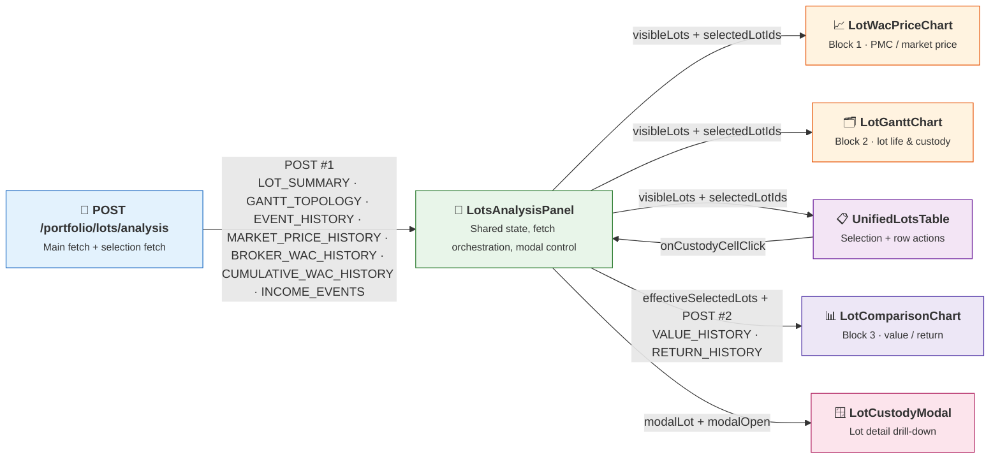

# 🔬 Lots Analysis

The **FIFO Lots Analysis** feature group is the frontend drill-down for the FIFO v3 subsystem. It is mounted from the **Dashboard Positions** tab and the **Broker detail Positions** tab, and complements the aggregate portfolio and WAC views with a per-lot perspective: **price vs WAC**, **custody topology**, **tabular inspection**, **value/return comparison**, and **lot-level chronology**.

---

## 🏗️ Architecture

## 🧩 Component composition

| Component | Role | Key inputs / outputs |
|---|---|---|
| `LotsAnalysisPanel` | Orchestrating parent | Owns fetch lifecycle, shared selection, shared zoom, open/closed lot filter, and custody modal state. |
| `LotAnalysisFailedNotice` | `FAILED`-analysis notice | Rendered only when `calculation_status === 'FAILED'`. Consumes the blocking `issues` (the `failure` half of `partitionLotIssues`) and `brokers`, builds its rows with `buildFailureRows` (both in `lotDataQualityHelpers.ts`), and emits `onGotoTransaction(transactionId)`. |
| `LotDataQualityBanner` | Data-quality banner | Rendered when issues remain for it. Consumes `issues` (the `banner` half of `partitionLotIssues`) and `lotDates` (lot id → opening date, for the visible lots), groups the issues with `buildIssueGroups` (also in `lotDataQualityHelpers.ts`), and emits `onLotClick(lotId)`. |
| `LotWacPriceChart` | **Block 1**: PMC / market price | Consumes `visibleLots`, WAC histories, `marketPriceHistory` (the lot-independent `market_price_history`), lot events, income events, `quoteBaseQuantity`, and shared zoom. Emits `onSelectionChange`, `onZoomChange`, and `onEventDoubleClick`. |
| `LotGanttChart` | **Block 2**: lot life & custody | Consumes `visibleLots`, `ganttSegments`, lot events, shared zoom, and open/closed toggle state. Emits `onSelectionChange`, `onZoomChange`, and `onRowDoubleClick`. |
| `UnifiedLotsTable` | Tabular lot inspection | Consumes `visibleLots`, `selectedLotIds`, brokers, and currency. Emits `onSelectionChange`, `onCustodyCellClick`, `onViewGanttLot`, and `onGotoOpeningTransaction`. |
| `LotComparisonChart` | **Block 3**: value / return comparison | Consumes `effectiveSelectedLots`, `valueHistory`, `returnHistory`, `incomeEvents`, `currency`, and `xAxisRange`. |
| `LotCustodyModal` | Lot drill-down modal | Renders only when `modalOpen` is true and `modalLot` is set. Receives the selected lot plus its filtered `lotEvents` timeline. |

### Render order inside `LotsAnalysisPanel`

The template renders the feature group in this exact order:

1. `LotAnalysisFailedNotice` (only on a `FAILED` analysis)
2. `LotDataQualityBanner` (when issues remain for it; on a `FAILED` analysis, only those that did not break the replay): one block per issue code, with its message lines and its lot chips — see the `LotDataQualityBanner` notes below
3. `LotWacPriceChart`
4. `LotGanttChart` (not on a `FAILED` analysis)
5. `UnifiedLotsTable` (not on a `FAILED` analysis)
6. `LotComparisonChart` (not on a `FAILED` analysis)
7. `LotCustodyModal` (conditionally rendered after the main panel block)

---

## 🔄 Data flow

### 1. Main analysis fetch

When the panel opens or the asset / broker / date-range scope changes, `LotsAnalysisPanel` sends a first `POST /portfolio/lots/analysis` request with:

- `LOT_SUMMARY`
- `GANTT_TOPOLOGY`
- `EVENT_HISTORY`
- `MARKET_PRICE_HISTORY` — the asset's price, one point a day whatever lots are open (Y-30; the per-lot `PRICE_HISTORY` is no longer requested)
- `BROKER_WAC_HISTORY`
- `CUMULATIVE_WAC_HISTORY`
- `INCOME_EVENTS`

This populates the shared lot list, the Gantt topology, Block 1 overlays, and the data-quality banner. A `FAILED` answer populates only the WAC lines, the market price line and the issues, and no selection fetch follows: see the `LotsAnalysisPanel` notes below.

### 2. Selection-scoped comparison fetch

A second `POST /portfolio/lots/analysis` request is triggered by the derived `effectiveSelectionIds`. It requests:

- `VALUE_HISTORY`
- `RETURN_HISTORY`

This fetch is scoped to the current effective lot set and feeds **only** `LotComparisonChart`.

### 3. Shared selection model

`selectedLotIds` is lifted to the parent and shared across the feature group.

- `selectedLotIds.length > 0` → use the explicit selection.
- `selectedLotIds.length === 0` → interpret as **all visible lots**, not “none”.

This is encoded in:

- `effectiveSelectionIds = selectedLotIds.length > 0 ? selectedLotIds : visibleLots.map(...)`
- `effectiveSelectedLots = selectedLotIds.length > 0 ? selectedLots : visibleLots`

The open/closed filter is also parent-owned. `LotGanttChart` renders the **Open / Closed** toggle, but `LotsAnalysisPanel` derives `visibleLots` so the WAC chart, table, and comparison chart stay consistent.

### 4. Custody modal drill-down

`UnifiedLotsTable` defines a row kebab action with id `lot-view-details-action`. That action calls the `onCustodyCellClick` prop, which is bound in the parent to `handleCustodyCellClick(lot)`. The handler sets:

- `modalLot = lot`
- `modalOpen = true`

Then `LotCustodyModal` is rendered with the chosen lot and `history={lotEvents.filter((event) => event.lot_id === modalLot?.lot_id)}`.

---

## 🧱 Component notes

### `LotsAnalysisPanel`

The parent is intentionally thin in business logic and heavy in orchestration:

- loads the initial payload and the selection payload in two separate `$effect`-driven requests;
- resets `selectedLotIds`, shared zoom, and computed range when a new panel instance opens;
- keeps Gantt and Block 1 zoom synchronized through `sharedZoomStart` / `sharedZoomEnd`;
- bridges cross-component navigation (`table → Gantt`, `Gantt → table`, event marker → multi-lot selection);
- owns the custody modal lifecycle;
- when `calculation_status === 'FAILED'` — the FIFO replay of the quantities broke on some transactions, so no lot is reliable — **explains and hides** (J-12):
    - `applyMain` takes no lot-derived section. The backend sends them `null` (its half of the contract is in [Lots Analysis Service](../../../backend/transactions/lots_analysis_service.md)), but an older cached answer may still carry them, so `lots`, `gantt_segments`, `lot_events` and `income_events` become `[]` whatever the answer holds (`lotSection()`). It keeps `market_price_history` — the asset's price, independent of the lots, read with `asArray` like the WAC lines and never through `lotSection()` (Y-30) — `broker_wac_history`, `cumulative_wac_history`, `quote_base_quantity`, the computed range and `data_quality`. The selection prunes to empty and, with no visible lot, `effectiveSelectionIds` is empty: no selection fetch is sent;
    - `LotWacPriceChart` draws only the WAC lines and the market price line (no bubbles or markers); `LotGanttChart`, `UnifiedLotsTable` and `LotComparisonChart` are not rendered;
    - `partitionLotIssues(issues, failed)` sends the issues flagged `message_params.fails_analysis === true` to `LotAnalysisFailedNotice`, rendered first, and leaves the others to `LotDataQualityBanner`, rendered after it — on a `FAILED` answer, the gaps of the WAC lines (missing rates, `MISSING_COST_BASIS`) and of the market price line (missing rates). The backend flag decides: the frontend keeps no copy of `_QUANTITATIVE_FAILURE_CODES`;
    - `LotAnalysisFailedNotice` (red, `role="alert"`, `lots-analysis-panel-failed`) explains the failure (`brokers.lots.analysisFailed`), then lists the rows of `buildFailureRows` under `brokers.lots.analysisFailedFix`: one per (code, `transaction_id`), the first occurrence winning, ordered by `transaction_date` (undated last), then transaction id (none last), then code — all read from `message_params`;
    - a row shows the day, the broker named from the panel's `brokers` through `resolveBrokerName` (whose `#<id>` default only covers a broker outside that list), the message, and a **Go to transaction** button to `/transactions?highlight=<id>` (`handleGotoTransaction`) when the issue names a transaction. `related_transaction_id` is never offered: it may name a partner leg the user cannot see. `missing_quantity` is written as a lot quantity (`formatExactDecimal` on the backend's decimal string, up to the 10 decimals of its column) and masked under privacy (`maskableQuantity`), following the toggle in place; `dataQuality.shortTransferNotSupported`, `shortAdjustmentNotSupported` and `fifoSourceQuantityMissing` no longer print `(broker {broker_id})`.

### `LotDataQualityBanner`

The banner shows the issues `partitionLotIssues` leaves to it, folded when it mounts:

- the header (`lot-data-quality-toggle`, `aria-expanded`) counts **categories** — issue codes — not issues: `dataQuality.headerErrors` and/or `dataQuality.headerWarnings`, or `dataQuality.headerInfoOnly` when every category is info;
- unfolded, it draws one block per code (`lot-data-quality-issue-{code}`), errors first, then warnings, then info, without call-to-action buttons;
- `buildIssueGroups()` (`lotDataQualityHelpers.ts`, beside `partitionLotIssues` and `buildFailureRows`) gives each block its message lines: `IssueGroup.messages`, each `{key, messageKey, params}` and drawn as a `lot-data-quality-message`, in the order their issues came (J-53):
    - the code's issues **on a lot** — a finite `message_params.lot_id`, the lot visible or not — share **one** line, the first one's: they say the same thing of different lots, and the visible ones are the chips;
    - each issue **without a lot** — `lot_id` null, absent or not a number — gets a line of its own, with its own params: each orphan income or cost pool (`ASSET_INCOME_NO_ELIGIBLE_LOTS` / `ASSET_COST_NO_ELIGIBLE_LOTS`, one issue per pool) with its amount, currency and day, and each `MISSING_FX_RATES` notice (`dataQuality.missingFxRates` for the pairs with a provider, with their date range; `dataQuality.missingFxRatesManual` for the manual pairs). The same message key with the same params makes one line;
    - the banner adds no total: two pools may be stated in different currencies, and each has its own day;
- the code's visible lots become chips (`lot-data-quality-chip-{lotId}`, labelled `brokers.lots.lotLabel` with the opening date) after `dataQuality.affectedLots`, ordered by opening date then id, with a `#index` when several share an opening day; a lot hidden by the **Open / Closed** filter has no chip. A click emits `onLotClick(lotId)`, and the panel pulses that lot's bubble in `LotWacPriceChart` (`pulseLot`).

### `LotWacPriceChart`

This chart is the **price / cost-basis** view of the selected asset.

- draws broker WAC lines, cumulative WAC, market price, transaction markers, income markers, and lot performance bubbles;
- reads its market price line from `marketPriceHistory`, the analysis' `market_price_history` (Y-30): the asset's price each day whatever lots are open, so the line runs across the days with no open lot and stays with a `FAILED` analysis. `marketPriceLine()` (`lotWacPriceChartHelpers.ts`) turns it into one point a date, in date order: a repeated date keeps its first point, and a price it cannot read keeps its date with a `null` value, a gap in the line. Those points draw the line — a segment that ends on an `estimated` point is dashed — and count in the axis dates and in the point count that decides «No data available»; their prices, read at or before a date, anchor each bubble's connector on its lot's opening day and set the height of an income marker. A new `marketPriceHistory`, like new WAC histories, resets the resolution;
- draws the cumulative line (**Combined**, dashed) only when `broker_wac_history` spans two or more brokers and `cumulative_wac_history` is not empty;
- applies `quoteBaseQuantity` scaling so WAC and opening-unit-price values align with market quotes on bond-like assets;
- supports **Abs / %** mode and **Auto / From 0** Y-axis behavior in absolute mode; the toggle labels come from `dashboard.abs` (`Abs`) and `dashboard.pct` (`%`), and the uppercase `ABS` in the source is only the fallback for a missing key;
- sizes each bubble by a mode-dependent metric: in **Abs** the lot's `open_quantity`, or its `original_quantity` once closed; in **%** its opening value (`original_cost`). `lotBubbleRadius()` maps the square root of that metric, between the smallest and the largest rendered bubble, onto `LOT_BUBBLE_MIN_RADIUS`–`LOT_BUBBLE_MAX_RADIUS` (7–22 px), and uses the midpoint when every bubble has the same metric;
- uses bubble click for lot selection and marker double-click for cross-component selection jumps.

### `LotGanttChart`

This chart is the **custody topology** and **life-cycle** view.

- renders each lot as one or more custody lanes using custom ECharts series;
- creates child lanes for transfer branches and connects them with elbow lines;
- exposes invisible DOM hit targets (`lot-gantt-segment-{lotId}`) over canvas bars for accessibility and E2E interaction;
- keeps its time window synchronized with Block 1, but owns the **Open / Closed** toggle UI.

### `UnifiedLotsTable`

The table is the **inspection and action hub**.

- mirrors the parent-filtered `visibleLots` set;
- supports multi-selection and propagates row selection back to the parent;
- exposes custody cells as clickable drill-down entry points;
- offers row actions for lot detail, Gantt focus, opening transaction navigation, and lot-id copy;
- adds four **net columns** (`allocated_fees`, `allocated_taxes`, `net P&L`, `net return`) shown by default
  only when **any visible row** carries allocated FEE/TAX or a fee or tax the API could not value — `null`,
  shown as `—` (`hasNetCosts`, through `isUnknownOrNonZero()`); otherwise they stay hidden.
  Visibility follows the `DataTable` override policy: the dynamic default applies until the user explicitly
  toggles a column, and **Reset layout** clears that override and re-applies the dynamic default.

### `LotComparisonChart`

This chart is the **selection-dependent economic comparison** view.

- `value` mode shows only the aggregated economic stack (`openValue`, `proceeds`, `income`, comprehensive total, opening value);
- `return` mode shows aggregate return plus per-lot lines when at least two lots are plotted;
- consumes only the second fetch (`VALUE_HISTORY`, `RETURN_HISTORY`), which keeps the heavy history payload scoped to the current lot set;
- reuses income `|` markers in both modes.

### `LotCustodyModal`

The modal is the **deep audit view** for one lot.

It shows summary metrics, current custody fragments, and a clickable chronology built from `EVENT_HISTORY`, with navigation to the active transaction when available. A closure row labels its value with `closureValueLabelKey(kind)` (`lotCustodyModalHelpers.ts`): "Value handed over" (`brokers.lots.modal.historyDetail.handedOver`) on an `ADJUSTMENT_OUT` row — nothing was sold: the units left at their cost, at their own FIFO cost, or, for a transfer leg leaving the lots' scope, at that day's market value ([Transfers Across the Scope's Edge](../../../backend/transactions/lots_analysis_service.md#scope-edge-transfers)) — and "Proceeds" (`brokers.lots.modal.historyDetail.proceeds`) on every other closure.

When the lot carries allocated FEE/TAX — or its fees or taxes could not be valued (`null`, shown as `—`) — it
also renders a **net breakdown** block: gross total P&L → `− fees` → `− taxes` → **net total P&L** and
**net return**, the net figures shown as `—` when `net_metrics_status` is `UNAVAILABLE`. Only the numeric
breakdown is shown today; the cost provenance (pool / rule / source transactions) is available in the DTO but
not yet surfaced here.

### Transfers across the scope's edge {: #scope-edge-transfers }

A transfer leg whose partner sits at a broker outside the analysis scope arrives as an `ADJUSTMENT_IN` or
`ADJUSTMENT_OUT` row with `scope_boundary` set to `IN` or `OUT`
([Transfers Across the Scope's Edge](../../../backend/transactions/lots_analysis_service.md#scope-edge-transfers)).
Two helpers of `lotChartShared.ts` read it (J-48): `scopeBoundaryOf(event)` returns `IN`, `OUT` or `null`, unwrapping
the generated client's scalar-or-array shape, and `eventLabelKind(event)` returns `TRANSFER_IN` or `TRANSFER_OUT` for
such a row, the event's own `kind` otherwise. The three views use them for the label and the marker category only:

- `LotCustodyModal` labels the History row with `brokers.lots.modal.event.TRANSFER_IN` / `TRANSFER_OUT` («TRANSFER+» /
  «TRANSFER-»), and `eventMarkerKind()` (`lotCustodyModalHelpers.ts`) gives it the `transfer` marker;
- `LotGanttChart` draws it as a ◆ `TRANSFER` marker (`eventMarkerKind(kind, boundary)`, `lotGanttChartHelpers.ts`),
  whose label `eventMarkerLabelKey()` takes from `brokers.lots.chartMarkers.eventType.TRANSFER_IN` / `TRANSFER_OUT`
  («Transfer In» / «Transfer Out»);
- `LotWacPriceChart` puts it in the transfer marker series (`eventCategory(kind, boundary)`,
  `lotWacPriceChartHelpers.ts`); its tooltip header reads the transfer label, without the «Adjustment type» row.

The economics stay on `kind`: `applyLotEvent()`, the modal's detail chips and every quantity and price branch read it
as before. No view names the partner broker.

### Quantities and prices

- **Quantities.** Every lot quantity on screen is written with `LOT_QUANTITY_FRACTION_DIGITS` (`lotChartShared.ts`),
  the 10 decimals a quantity keeps, through `Intl`, so a lot of 10 satoshis reads `0.0000001`, never `1e-7` or `0`
  (C-97c).
    - `formatLotQuantity` (`unifiedLotsTableHelpers.ts`) writes the quantities of the table, of the WAC chart
      (`formatQuantityValue`) and of the custody modal.
    - The Gantt's `formatQuantity` (`lotGanttChartHelpers.ts`) writes the same digits.
    - `quantityPluralCount` counts those same digits, so a tooltip's noun follows the figure it shows: «1.0000001
      shares», «1 share».
    - `LotAnalysisFailedNotice` writes the backend's decimal string exactly (`formatExactDecimal`, up to 10 decimals).
- **Prices per unit.** These are public: the modal's opening and closing price, and the unit, sale, previous and next
  prices of the WAC chart's transaction markers. Each keeps the decimals its first 4 significant digits need, and
  never fewer than 2 (`priceFractionDigits`, `lib/utils/core/formatFixed.ts`), so a price of 0.000003457 is not
  `0.00`.
- **Unchanged:** totals stay money (`formatCurrencyAmountPlain`, masked under privacy), split ratios keep up to 8
  decimals, and axis labels stay compact.

---

## 🧪 `data-testid` reference

The list below reflects the literal `data-testid` strings present in the component source files. Dynamic ids are shown with placeholders.

| Component | `data-testid` values |
|---|---|
| `LotsAnalysisPanel` | `lots-analysis-panel`, `lots-analysis-panel-title`, `lots-analysis-panel-asset-link`, `lots-analysis-panel-close`, `lots-analysis-panel-error`, `lots-analysis-panel-loading` |
| `LotAnalysisFailedNotice` | `lots-analysis-panel-failed`, `lots-analysis-failed-explanation`, `lots-analysis-failed-list`, `lots-analysis-failed-row-{code}-{transactionId}` (`none` in place of `{transactionId}` when the issue names no transaction), `lots-analysis-failed-date`, `lots-analysis-failed-broker`, `lots-analysis-failed-message`, `lots-analysis-failed-goto-{transactionId}` |
| `LotDataQualityBanner` | `lot-data-quality-banner`, `lot-data-quality-toggle`, `lot-data-quality-issue-{code}`, `lot-data-quality-message` (one per message line of a block), `lot-data-quality-chip-{lotId}` |
| `LotWacPriceChart` | `lot-wac-price-chart` (`data-state` is `drawn` when the chart draws, `empty` when it shows «No data available» instead; `data-price-line` is `drawn` when it also draws the market price line — out of «No data available», with a point of the line valued in the current **Abs** / **%** mode, the condition its series is pushed on — and `absent` otherwise), `lot-wac-yaxis-toggle`, `lot-wac-yaxis-auto`, `lot-wac-yaxis-zero`, `lot-wac-toggle-absolute`, `lot-wac-toggle-percentage` |
| `LotGanttChart` | `lot-gantt-chart`, `lot-gantt-state-filter`, `lot-gantt-filter-open`, `lot-gantt-filter-closed`, `lot-gantt-scroll`, `lot-gantt-echart`, `lot-gantt-segment-{lotId}`, `lot-gantt-sticky-axis`, `lot-gantt-legend`, `lot-gantt-legend-broker-{brokerId}`, `lot-gantt-legend-transit` |
| `UnifiedLotsTable` | `unified-lots-table`, `unified-lots-custody-{lotId}` |
| `LotComparisonChart` | `lot-comparison-chart`, `lot-comparison-value-yaxis-toggle`, `lot-comparison-value-yaxis-auto`, `lot-comparison-value-yaxis-zero`, `lot-comparison-mode-toggle`, `lot-comparison-mode-value`, `lot-comparison-mode-return`, `lot-comparison-empty`, `lot-comparison-echart`, `lot-comparison-estimated-at-cost-legend` |
| `LotCustodyModal` | `lot-custody-modal-title`, `lot-custody-modal-lot-id`, `lot-custody-modal-close`, `lot-custody-modal-summary`, `lot-custody-modal-value-source`, `lot-custody-modal-asset-income`, `lot-custody-modal-market-pnl`, `lot-custody-modal-total-pnl`, `lot-custody-modal-total-return`, `lot-custody-modal-net-breakdown`, `lot-custody-modal-allocated-fees`, `lot-custody-modal-allocated-taxes`, `lot-custody-modal-net-total-pnl`, `lot-custody-modal-net-total-return`, `lot-custody-modal-cash-yield`, `lot-custody-modal-states`, `lot-custody-modal-current-custody`, `lot-custody-modal-absolute-quantity-info`, `lot-custody-modal-custody-summary`, `lot-custody-modal-custody-summary-row-{index}`, `lot-custody-modal-custody-fragments-label`, `lot-custody-modal-custody-row-{index}`, `lot-custody-modal-current-custody-empty`, `lot-custody-modal-history`, `lot-custody-modal-history-row-{index}`, `lot-custody-modal-history-details-{index}`, `lot-custody-modal-history-empty`, `lot-custody-modal-footer-close`, `lot-custody-modal-footer-goto-transaction` |

!!! note "Testing nuance"

    `LotCustodyModal` also passes `testId="lot-custody-modal"` to `ModalBase`, but that string is not a literal `data-testid` attribute inside `LotCustodyModal.svelte` itself.

---

## 🔗 Related

- ⚙️ **[Backend FIFO Lot Engine](../../../backend/transactions/fifo_lot_engine.md)**
- 🧮 **[Backend Lots Analysis Service](../../../backend/transactions/lots_analysis_service.md)**
- 📚 **[FIFO Lot Analysis Theory](../../../../financial-theory/technical-analysis/performance-metrics/fifo-engine/fifo-lot-analysis.md)**
