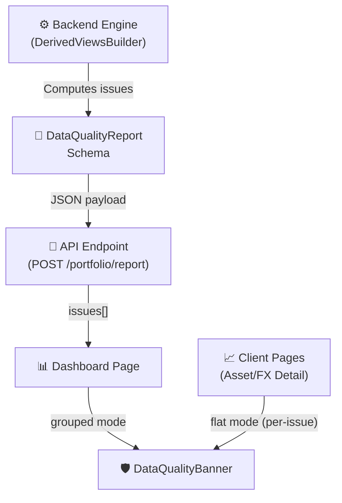

# 🛡️ DataQualityBanner Component

Component and model for unified data quality warnings across the LibreFolio UI.

---

## 🔍 Overview

`DataQualityIssue` is the standard model for surfacing data quality problems (missing prices, missing FX, incomplete NAV, etc.) across three key pages:
- **Dashboard** 📊
- **Asset Detail** 📈
- **Forex Detail** 💱

`DataQualityBanner` is the single, reusable UI component that renders these issues consistently. Before this system existed, each page had its own ad-hoc inline banners — separate markup, no consistency, and no Call-To-Action (CTA). Now, all three pages share the same component and issue model.

### 📁 File Mapping

| File | Role |
|------|------|
| 🐍 `backend/app/schemas/portfolio.py` | Defines `IssueCode`, `IssueSeverity`, `IssueDomain`, `DataQualityIssue`, and `DataQualityReport` schemas. |
| ⚙️ `backend/app/services/financial_math/portfolio/data_quality.py` | `build_data_quality_report()` — generates portfolio-wide issues from the engine's daily states; `DerivedViewsBuilder.build_data_quality_report()` (`derived_views.py`) passes its daily states to it. |
| 📊 `backend/app/services/portfolio_service.py` | `get_summary()` / `get_report()` — collect the missing FX pairs, the assets without cost basis and the assets with an invalid split ratio, then call `build_data_quality_report()`. |
| 🎨 `frontend/src/lib/components/ui/feedback/DataQualityBanner.svelte` | Reusable UI component (supporting `grouped` and `flat` modes). |
| 🌐 `frontend/src/lib/i18n/dataQuality/{en,it,fr,es}.json` | `dataQuality.*` translation namespace for localized warnings: the `dataQuality` subsystem, one of the sources of the generated catalogue (see [Internationalization](i18n.md)). |

---

## 🏗️ Architecture & Data Flow

Here is how data quality reports are computed in the backend and rendered inside SvelteKit pages:



---

## 📁 Component Modes

### 1. `grouped` — Dashboard 📊
* Single amber/sky container grouping all issues.
* Issues are sorted by severity: **Error** 🔴 → **Warning** 🟡 → **Info** 🔵.
* The header counts errors and warnings only, naming just the non-zero counts: `"1 error(s)"`, `"2 warning(s)"` or `"1 error(s), 2 warning(s)"` (`dataQuality.headerErrors`, `dataQuality.headerWarnings`). With neither — info issues only — it reads `"Data quality note"` (`dataQuality.headerInfoOnly`).
* The banner starts collapsed, showing only its header (`let expanded = $state(false)`). The header is itself the toggle: a button (test id `data-quality-toggle`, with `aria-expanded` and a chevron) that opens and closes the whole list. Once open, the errors and warnings — the issues the header counts — sit indented under it (`data-quality-actionable`); the info issues follow apart, not indented (`data-quality-info`), below a thin rule when errors or warnings precede them.

```svelte
<DataQualityBanner issues={dataQualityIssues} mode="grouped" onaction={handleBannerAction} />
```

### 2. `flat` — Asset Detail / FX Detail 📈 💱
* One banner is rendered per issue.
* Each banner displays: icon + message + FX pair flags + asset context (in parentheses) + CTA button.

```svelte
<DataQualityBanner issues={assetDetailIssues} mode="flat" onaction={handleBannerAction} />
```

---

## 🖱️ CTA (Call-to-Action) System

The component emits intent — it does not navigate or open modals itself.

```typescript
onaction?: (action: string, target: string | null, issue: DataQualityIssue) => void
```

### 🎯 Active CTA Actions

| Action | Target | Handled By | Description |
|--------|--------|------------|-------------|
| `navigate_asset` | asset_id string | `goto('/assets/' + target)` | Redirects the user to the specific asset details page. |
| `navigate_fx` | FX pair slug | `goto('/fx/' + target)` on the dashboard; the asset detail adds `?start=...&end=...` | Redirects to the FX pair details page. |
| `add_fx_pair` | FX pair slug | `FxPairAddModal` | Opens the modal to configure the missing FX pair. |
| `sync_fx_pair` | First affected pair, unused — the handler syncs every pair in `issue.affected_fx_pairs` (`cta_target` only when that list is empty) | `POST /api/v1/fx/currencies/sync` (dashboard `syncMissingFxRates`) | Body built by `buildMissingFxRatesSyncRequest` (`utils/sync/syncRange.ts`): `{pairs, start, end}`, the pairs as alphabetical slugs and the issue's `message_params.date_from`…`date_to` widened by `padSyncRange` to 7 days either side, the end capped at today — the margin `buildComparisonSyncRange` also uses. E.g. `2022-11-03`…`2023-06-27` → `start: '2022-10-27'`, `end: '2023-07-04'`. Without usable dates: the full history (`start: 'min'`, `end`: today). Timeout 120 s (`FX_SYNC_TIMEOUT_MS`). After the answer — not after a transport error — the dashboard bumps `refreshVersion` and reloads its report. `refreshVersion` is the signal **Refresh** sends too ([How a page uses the cache](state/domain-state.md#how-a-page-uses-the-cache)): new rates change the lots and risk figures, so an open `LotsAnalysisPanel` asks `POST /api/v1/portfolio/lots/analysis` again with `force` and drops a warning the sync fixed, and a mounted `RiskLevelsPanel` (Risk tab) reloads too. Then the dashboard emits one notification, `fx.rates.synced`, detail `{origin: 'dashboard-banner', pairs, start, end, outcome, stillMissing}` (`stillMissing` is `null` when the report was not reloaded); its toast has one line per pair. When the sync answered `ok` or `partial` but the reloaded report still has a `sync_fx_pair` issue for one of those pairs, the toast appends `dataQuality.missingFxRatesAfterSync` and a success becomes a warning. |
| `sync_asset_prices` | First affected id, unused — the handler syncs every id in `issue.affected_asset_ids` | `POST /api/v1/assets/prices/sync` (dashboard `handleBannerAction`) | Sends one item per affected asset: `{asset_id, date_range: {start: 'resume', end: <dashboard end date>}}`. `'resume'` is the backend sentinel for "the day after the last stored price" (full history when there is none). After the answer — not after a failed request, which shows one error toast and reloads nothing — it shows one toast per asset result, bumps `refreshVersion` as `sync_fx_pair` does (new prices change the lots and risk figures too: an open `LotsAnalysisPanel` and a mounted `RiskLevelsPanel` ask again), and reloads the dashboard report. |

In grouped mode, `navigate_asset` renders one link per affected asset; every other action, `sync_asset_prices` included, renders a single CTA button. While a sync request runs, the dashboard passes the issue's code as the `busyCode` prop: that issue's CTA button shows a spinner and stays disabled until the request settles. The CTA test id (`data-quality-cta-{code}`) and `busyCode` are keyed by the issue code alone, so the two `MISSING_FX_RATES` rows share them: while **Sync rates** runs, the MANUAL row's **View FX** button spins and is disabled too (known limitation).

---

## 🏷️ Active IssueCodes

!!! warning "Do Not Add Future-Proof Codes"

    Every `IssueCode` must be actively generated by the backend engine or constructed client-side. Add a new code only in the same step where it is generated. Do not define unused placeholder codes.

### 📊 Portfolio Issues (generated by `DerivedViewsBuilder.build_data_quality_report`)

| Code | Severity | Condition | CTA Action |
|------|----------|-----------|------------|
| `MISSING_PRICE` | 🔴 Error | Open position with no price and no known cost on the end date: no market quote and no `BUY` or `SELL` on or before it, and a cost not known in the report currency — an acquisition without a cost basis, or one whose rate is missing (`ValuationSource.MISSING`). With its cost known, the position is valued at cost instead (`VALUED_AT_COST`, rules below). The NAV leaves the asset out | `navigate_asset` |
| `TRANSACTION_IMPLIED` | 🟡 Warning | Open position valued on the end date at the price of its last `BUY` or `SELL` (`ValuationSource.LAST_TRADE_PRICE`) instead of a market quote, for an asset with a provider, outside the 14-day grace period after its last quote — after its first `BUY` or `SELL` when it was never quoted (full rule below). `message_params`: `count`, `as_of_date`; group `transaction_implied` | `navigate_asset` |
| `VALUED_AT_COST` | 🟡 Warning | Open position valued on the end date at its book cost (`ValuationSource.ESTIMATED_AT_COST`): no market quote and no `BUY` or `SELL` on or before it, its cost known in the report currency; for an asset with a provider, once the 14-day grace period has passed, counted from the asset's first acquisition (full rule below). `message_params`: `count`, `as_of_date`; group `valued_at_cost` | `navigate_asset` |
| `STALE_PRICE` | 🟡 Warning | Open position valued at a market price carried forward more than 7 days, on an asset with a provider (full rule below) | `sync_asset_prices` |
| `MISSING_COST_BASIS` | 🟡 Warning | An acquisition of the asset has no known cost: a `TRANSFER` or `ADJUSTMENT` adding quantity without `cost_basis_override` (full rule below). Also emitted by the FIFO lots analysis for the analysed asset. `message_params`: `count`; group `missing_cost_basis` | `navigate_asset` |
| `INVALID_SPLIT_RATIO` | 🟡 Warning | A `SPLIT` event linked to a replayed transaction has a stored ratio the layer cannot use (`is_valid_split_ratio()`: missing, not finite, or not above 0). It counts as missing: only its ratio is dropped (full rule below). Message `dataQuality.invalidSplitRatio`; `message_params`: `count` (the assets); group `invalid_split_ratio` | `navigate_asset` |
| `MISSING_FX_MARKET` | 🟡 Warning | A conversion the report needed ([sources below](#where-missing-fx-pairs-come-from)) has no configured FX pair | `add_fx_pair` |
| `MISSING_FX_RATES` | 🟡 Warning | A configured pair with a real (non-`MANUAL`) provider in at least one route step cannot convert an amount on some dates: no rate exists on or before them (`convert_bulk` backfills without limit), so they precede the pair's first stored rate. Movement dates come from the whole history up to the end date, valuation dates only from the period ([sources below](#where-missing-fx-pairs-come-from)). `message_params`: `count`, `date_from`/`date_to` (span over all affected pairs), `dates_count`; group `missing_fx_rates` | `sync_fx_pair` |
| `MISSING_FX_RATES` | 🟡 Warning | Same, for configured pairs whose routes are all `MANUAL`. `message_params`: `count` only; group `missing_fx_rates_manual` | `navigate_fx` |
| `NAV_INCOMPLETE` | 🔵 Info | One or more days of the period had an incomplete NAV: an asset held that day had no price and no known cost (the `MISSING_PRICE` condition, day by day); a position valued at cost does not make it incomplete | none |
| `MWRR_NOT_CALCULABLE` | 🔵 Info | The summary has no MWRR (`mwrr_available=False`): no net invested capital in the period (the first day's value plus the flows after it: decision N54, so a portfolio younger than the range still has its deposit), a NAV of zero or less on the end date, a period of zero days, or no rate that solves the flows' equation (the solver, `_solve_xirr`, returns only a verified root). The rule is `returns.period_mwrr()`, and the history's MWRR points come from `returns.period_mwrr_series()`, the same rule on each day (developer decision D-MF5): after the first point, pinned to 0, a day whose NAV is zero or less, or whose net invested capital up to that day is zero or less, has `null` `mwrr_annualized`/`mwrr_cumulative`, so the chart line has a gap; the summary's MWRR is the line's last point. A `get_report()` without a summary always reports it | none |
| `TRANSFER_SHARE_MISMATCH` | 🔵 Info | A linked internal `TRANSFER`, `CASH_TRANSFER` or `FX_CONVERSION` pair between two brokers of the scope owned at different shares (`effective_share`: an `EDITOR` or `VIEWER` broker counts at 1), on any dates, complete (its later leg) by the end date. Each leg counts at its own broker's share, so what leaves one broker and what reaches the other differ, and the gap is booked as a gain or loss, never as capital (D-MF4 = a): this note explains it. One issue counts the pairs (`message_params`: `count`; group `transfer_share_mismatch`); `share_mismatch_warnings` names each pair, its two brokers and shares. The classifier records them (`ScopeAwareTransactionClassifier`, `ShareMismatch`), the engine result carries them (`PortfolioCalculationResult.share_mismatches`), and both `get_summary()` and `get_report()` pass them on (J-43, night decision N72) | none |

**`TRANSACTION_IMPLIED` rule.** The engine values every holding through the unified price resolver: `DailyStateBuilder._value_held_position()` (`backend/app/services/financial_math/portfolio/daily_state.py`) asks `_market_value_for()`, which reads a per-asset `AssetPriceSeries` (`backend/app/services/financial_math/price_marks.py`). The series holds market quotes (`PriceHistory`) and trade prices: the unit price of each `BUY` or `SELL` of the asset at the brokers in scope that carries an amount and is not linked to a split. An `ADJUSTMENT` is never a price, with or without a cost basis (see [Price Resolver](../backend/transactions/price_resolver.md#the-daily-model)). Trades of the same day are averaged, and a quote of that day wins over them. For each day the resolver takes the latest observation on or before it: a quote values the holding at `MARKET_PRICE`, a trade at `LAST_TRADE_PRICE`; with no observation at all the holding counts at its book cost when that cost is known (`ESTIMATED_AT_COST`, see the `VALUED_AT_COST` rule below) and is `MISSING` otherwise (`MISSING_PRICE`). Each daily state collects its `LAST_TRADE_PRICE` assets in `transaction_implied_asset_ids`, and the date of each one's last market quote on or before that day in `transaction_implied_last_quote_dates` (`AssetPriceSeries.last_market_date()`, `None` before the first quote). `PortfolioService.get_summary()` reads both on the end-date state only — an asset quoted since its latest trade is not listed, whatever its past — and `transaction_implied_assets_to_report()` (`backend/app/services/financial_math/portfolio/data_quality.py`) drops:

* the assets still within the grace period of `TRANSACTION_IMPLIED_GRACE_DAYS` (14, `backend/app/services/platform/data_quality_thresholds.py`) days, counted from the asset's last market quote on or before the end date (developer decision 30): an asset quoted yesterday and bought again today is valued at today's trade, which is no gap, while a feed that stopped long ago is reported at once. An asset never quoted counts from its first `BUY` or `SELL` (`first_position_dates`, the earliest over its brokers): a normal placement lag, e.g. a bond bought at issue before its first quote. An asset with neither date gets no grace period;
* the assets without a provider (no `AssetProviderAssignment`): valuing them at their last trade price is their intended behaviour.

The list holds one entry per open position, so an asset held at two brokers counts twice in `count`. `as_of_date` is the date of the last daily state. The English message of `dataQuality.transactionImplied` reads "{count} asset(s) valued at their last transaction price — no market price available for over 2 weeks (as of {as_of_date})": the engine does value these assets at the price of their latest `BUY` or `SELL`, and the "over 2 weeks" matches the 14-day grace period, which counts from the latest quote.

**`VALUED_AT_COST` rule.** With no observation on or before the day, `_value_held_position()` counts a held position whose average-cost pool is complete in the report currency (`CostStep.report_complete`) at its book cost — each acquisition converted at its own date — as `ValuationSource.ESTIMATED_AT_COST`: a declared estimate, not a price. The position has no `current_price` (`valuation_effective_unit_price` and the reference fields are `null`), its `gain_loss` is 0, it is never stale and it does not make the NAV incomplete; with its cost unknown or incomplete it stays `MISSING` (see [No observation: valued at cost](../backend/transactions/price_resolver.md#valued-at-cost)). `PortfolioService.get_summary()` lists the end-date positions valued at cost through the same `transaction_implied_assets_to_report()`, with no quote dates (such an asset has none on or before the end date), and keeps only the assets with a provider: for a manual asset the cost is its intended value, and the banner says nothing. The grace counts from the asset's first acquisition: its earliest `BUY`, `SELL`, `ADJUSTMENT` or `TRANSFER` across the brokers (`first_lot_txn_dates`). An asset at cost has no `BUY` or `SELL` — an `ADJUSTMENT` or a `TRANSFER` brought it in — so the first position date of `TRANSACTION_IMPLIED`, which records only those two types (`_HOLDING_TYPES`), would list it at once. The list holds one entry per open position of a listed asset (`MissingPriceAsset`), and `as_of_date` is the date of the last daily state. The English message of `dataQuality.valuedAtCost` reads "{count} asset(s) valued at cost — no price available for over 2 weeks (as of {as_of_date})". The issue does not change the report's derived `data_quality_status`.

**`STALE_PRICE` rule.** `PortfolioService.get_summary` builds the list and passes it to `build_data_quality_report` as `stale_prices_dto`. An asset is listed when, at the end date, all of these hold:

* its position is open (quantity above the dust threshold);
* the position is valued at a **market** price (`ValuationSource.MARKET_PRICE`), not at a trade price;
* that price is carried forward **more than** `STALE_PRICE_THRESHOLD_DAYS` (7) days, so a quote exactly 7 days old is still current;
* the asset has a provider assignment.

Each asset appears once, whatever the number of brokers holding it, as `StalePriceAsset{asset_id, name, last_price_date, stale_days}`, with `stale_days` counted from `last_price_date` to the end date. Left out on purpose: manual assets, which have nothing to sync (those valued at their last trade price, such as crowdfunding or `HOLD` assets, are stale by design); provider assets valued at a trade price, which are `TRANSACTION_IMPLIED`'s case, or with no price at all, which are `VALUED_AT_COST`'s when their cost is known and `MISSING_PRICE`'s otherwise; closed positions. With stale prices and nothing that makes it `partial`, the report's derived `data_quality_status` is `carried_forward` ([source-data status](../../financial-theory/technical-analysis/risk-metrics/data-quality.md#source-data-status)), so portfolio risk results that read it can turn `PARTIAL`.

**`MISSING_COST_BASIS` rule.** `PortfolioService._missing_cost_basis_assets()` lists the assets whose average cost, in the engine run behind the report, has an acquisition of unknown cost (`AverageCost.unknown_cost_movement_ids`): a `TRANSFER` or `ADJUSTMENT` adding quantity, not split-linked, without `cost_basis_override` (see [WAC & Cost Basis](../backend/transactions/wac.md#diagnostics)). The engine replays the whole history up to the end date, so the position does not have to be open any more. Each asset appears once, as `(asset_id, name)`, whatever the number of brokers. The average cost adds the quantity without any cost: the units count at zero in the purchase cost (`open_cost_basis`), and the position's `wac_per_unit`, `gain_loss` and `annualized_return` are `null` until the pool empties. In grouped mode the issue renders one link per affected asset, labelled with the asset's name.

Two producers build this issue, both through `build_data_quality_report(missing_cost_basis_assets=...)`:

| Producer | Assets listed | Where it shows |
|----------|---------------|----------------|
| `PortfolioService._missing_cost_basis_assets()` | Every asset with an acquisition of unknown cost in the engine run behind the report | Dashboard banner (`summary.data_quality`, or the report's own `data_quality` without a summary) |
| `LotsAnalysisService._report_gaps()` | The analysed asset, when one of its WAC lines has an acquisition of unknown cost; the analysis also turns `DEGRADED` | FIFO lots analysis `data_quality`, rendered by `LotDataQualityBanner` without call-to-action buttons |

**`INVALID_SPLIT_RATIO` rule.** The portfolio engine checks the ratio of each split link with `is_valid_split_ratio()` (`financial_math/splits.py`). Before lot MF-D4 an unusable ratio raised `ValueError`, and the report answered 500. Now the split counts as missing, and only its ratio is dropped. Its linked `ADJUSTMENT` rows stay in `split_linked_tx_ids`: they remain the split's rescale, their cost is kept, and they are never in-kind capital nor `MISSING_COST_BASIS`. The event adds no `SplitRecord` to `split_history`, so a trade price observed before the split is not restated by its ratio. It goes once into `PortfolioCalculationResult.invalid_split_events` (`InvalidSplitEvent(event_id, asset_id, date)`, sorted by event id). `PortfolioService._invalid_split_assets()` turns them into one `(asset_id, name)` per asset, ids ascending, in `get_summary()` and in `get_report()` without a summary. The CTA opens the first asset: the user fixes the ratio in its events, where the API refuses a ratio not above 0 (see [Asset Events](../backend/assets/events.md)). The FIFO lots analysis skips the split and reports no issue for it (see [Lots Analysis Service](../backend/transactions/lots_analysis_service.md)).

### 💱 Where missing FX pairs come from {: #where-missing-fx-pairs-come-from }

`PortfolioService.get_summary()` merges every conversion it could not make into `summary.missing_fx_pairs` (pair `FROM/TO` with its dates, `_merge_missing_pairs()`), and `build_data_quality_report()` turns them into `MISSING_FX_MARKET` / `MISSING_FX_RATES` issues. Two sources feed the list:

| Source | Conversions | Dates kept |
|--------|-------------|------------|
| The summary's own conversions | Transaction cash amounts at their dates, from the engine's native cash (`NativeCash.missing_conversions()`); holding prices at the end date; the previous day's price for Δ1; Yield on Cost income | As requested |
| The engine, through `_engine_missing_fx_pairs()` | **Movements** — `PortfolioCalculationResult.missing_fx`: the average cost of each acquisition (report and asset leg), cash amounts, external cash flows, the value a priced outgoing `ADJUSTMENT` hands over, the cost of assets in transit (at the arrival date) | Every date, whenever the movement happened |
| | **Valuations** — `DailyPortfolioState.missing_fx_pairs`: market prices and in-transit cash, day by day | Only the days of the period shown, `[date_from, end date]`; the first one is the period's opening state |

So a purchase made years ago whose rate is missing is reported, because its cost weighs on today's figures, while a valuation gap before the period changes nothing on screen and is left out. When `get_report()` builds no summary, its own `data_quality` takes its missing pairs from the engine source only, and still reports `MISSING_COST_BASIS` and `INVALID_SPLIT_RATIO`.

The FIFO lots analysis reports in its own `data_quality` every conversion it could not make — in its WAC lines, its daily valuation and every other figure it returns (value, return, price and performance histories, lot summary, Gantt segments, event rows, income events), merged per pair — and the WAC lines' acquisitions of unknown cost. Any such gap turns a `COMPLETE` analysis `DEGRADED`; see [Lots Analysis Service — FX Conversion](../backend/transactions/lots_analysis_service.md#fx-conversion) and [WAC Lines](../backend/transactions/lots_analysis_service.md#wac-lines).

### 📈 Asset Detail Issues (built client-side in `assets/[id]/+page.svelte`)

| Code | Severity | Condition | CTA Action |
|------|----------|-----------|------------|
| `ASSET_ARCHIVED` | 🟡 Warning | `assetInfo.active === false` | none |
| `RANGE_BEFORE_FIRST_DATA` | 🔵 Info | Selected range starts before first PriceHistory | none |
| `FX_PAIR_MISSING` | 🟡 Warning | Required FX pair not configured | `add_fx_pair` |
| `FX_PAIR_NO_DATA` | 🟡 Warning | FX pair configured but no rate history | `navigate_fx` |
| `FX_PAIR_PARTIAL_GAP` | 🔵 Info | FX data exists but range starts before first rate | `navigate_fx` |

### 💱 FX Detail Issues (built client-side in `fx/[pair]/+page.svelte`)

| Code | Severity | Condition | CTA Action |
|------|----------|-----------|------------|
| `RANGE_BEFORE_FIRST_DATA` | 🔵 Info | Selected range starts before first rate in DB | none |

---

## 🧪 How to Trigger Issues (Manual Testing)

### 📊 Dashboard

| Issue | How to Trigger |
|-------|----------------|
| `MISSING_PRICE` | Hold an asset that has no `PriceHistory` row, no `BUY` or `SELL`, and an acquisition whose cost is not known in the report currency: one brought in by an `ADJUSTMENT` without a cost basis (for an asset with no `BUY`: a row left by an older version, or the P-10 path — see `MISSING_COST_BASIS` below), or by an `ADJUSTMENT` whose cost basis is in a currency with no rate on or before its date. A cost basis of 0 is a known cost, not a missing one: that asset is valued at cost, at zero (`ESTIMATED_AT_COST`, see `VALUED_AT_COST`). A `BUY` is not enough either: its own price values the holding. The NAV leaves the asset out. |
| `TRANSACTION_IMPLIED` | Buy an asset **with a provider** that has no quote yet (e.g. a BTP in collocamento), then look at a dashboard end date more than 14 days after that first `BUY`, still before its first quote. Within those 14 days the asset is valued at its trade price without an issue; the issue goes away once the asset has a quote at least as recent as its latest trade, on or before the end date. A manual asset is never listed. |
| `VALUED_AT_COST` | Hold an asset **with a provider** that has no quote and no `BUY` or `SELL`, brought in by an `ADJUSTMENT` with a cost basis — e.g. a fund received by succession before its first price sync. The holding is valued at that cost on every day, with no price and an unrealized P&L of 0, and the issue shows once the 14-day grace has passed, counted from the `ADJUSTMENT`'s date. A manual asset is never listed. A quote on or before the end date clears it; a `BUY` or `SELL` turns the asset into `TRANSACTION_IMPLIED`'s case. |
| `STALE_PRICE` | Hold an open position in an asset **with a provider** whose newest market price, with no trade of the asset after it, is more than 7 days before the dashboard end date, e.g. prices seeded with `POST /api/v1/assets/prices` and ending 10 days ago. Any fresh quote clears it, including the live-price polling of the asset pages (`POST /api/v1/assets/prices/current` stores today's quote). `e2e/portfolio/stale-price-banner.spec.ts` seeds a holding that stays stale: `mockprov` with `INVALID_TICKER_12345`, the one identifier the mock refuses a current price for, and it intercepts the sync the CTA sends. |
| `MISSING_COST_BASIS` | Hold an asset with a `TRANSFER` or `ADJUSTMENT` adding quantity, not split-linked, without `cost_basis_override`. The app refuses to save such a row with `costBasisRequired` (`TransactionService._requires_cost_basis`): `validate_cost_basis` (`backend/app/services/transactions/batch_costs.py`) checks every create and promote of a batch — new promoted rows as creates, saved ones on the promote that paired them — and, in `_check_update_cost_basis`, every update that changes the row's type, quantity, cost basis or its asset event link from what was stored before the batch, or names a `cost_basis_mode`: an edit of only the notes, tags or date of a row stored without cost basis gets no `costBasisRequired`, and the row keeps its unknown cost. Auto rows skip the check: the Auto step writes their cost, or blocks the batch when a rate is missing. The condition survives only in **rows left by an older version**: a `TRANSFER` pair, or an `ADJUSTMENT` adding quantity, stored without cost basis — including an `ADJUSTMENT` whose `SPLIT` was retyped before release 1.3. **The app path P-10 closed**: an `ADJUSTMENT` linked to a `SPLIT` and saved in Auto is stored without cost basis, since the split rescales the pool instead (`TransactionService._compute_wac_for_auto_items`); without the split it would be an acquisition of unknown cost, so the app no longer takes the split away from it. A retype of the `SPLIT` is refused with 409 `EVENT_SPLIT_ADJUSTMENTS_WITHOUT_COST`, the market-data wipe of a currency change with 409 `MARKET_DATA_SPLIT_ADJUSTMENTS_WITHOUT_COST`, and a deletion of the linked event with `EVENT_IN_USE`; the retype and the wipe go through once the `ADJUSTMENT` has a cost, 0 included — pinned by `backend/test_scripts/test_api/test_portfolio_wac.py::TestPortfolioWACSplit::test_forward_split_whose_adjustment_has_no_cost_is_retyped_only_once_the_adjustment_has_one`. How the tests produce it: the backend inserts the rows through the session (`test_portfolio_cost_currency.py`, S5 and S7); in E2E, `e2e/portfolio/data-quality-legacy.spec.ts` has `backend/test_scripts/test_db/legacy_cost_rows.py` write legacy rows — only into the lane's test database, for brokers the given user owns — and `e2e/portfolio/data-quality-real.spec.ts` (E2) checks that the P-10 path no longer produces it. |
| `INVALID_SPLIT_RATIO` | Hold an asset with an `ADJUSTMENT` linked to a `SPLIT` event whose stored ratio is 0 or below. The app no longer stores one: the API refuses it with `EVENT_INVALID_SPLIT_RATIO`, and a provider sync drops it (X-R47). Only a split stored before X-R47, or written straight into the database, still has one. |
| `MISSING_FX_MARKET` | Hold an asset in a foreign currency (e.g. buy a USD asset) when the dashboard target currency is EUR and the EUR/USD pair is not configured. |
| `MISSING_FX_RATES` | Pick a currency X and configure its pair with the dashboard currency through a route that has a real (non-`MANUAL`) provider, but no rate on or before the dates of the movements in X — cash movements, purchases or sales paid in X: e.g. deposit X at a broker and buy an EUR asset with it, before the pair's first stored rate. The issue names the pair and the missing dates, with `sync_fx_pair` (**Sync rates**). When every step of the pair's routes is `MANUAL`, the same gap lands in the `missing_fx_rates_manual` group with `navigate_fx`. To run the sync offline, as `e2e/portfolio/data-quality-real.spec.ts` (E1) does, route the pair through the test-only `MOCKFX` provider (`backend/app/services/fx_providers/mockfx/plugin.py`: 1.2345 for every day and currency, hidden from `GET /api/v1/fx/providers`): **Sync rates** really stores the rates, the reloaded report drops the issue and its banner row goes. |
| `NAV_INCOMPLETE` | Same scenario as `MISSING_PRICE` — appears automatically when NAV is incomplete for ≥1 day of the period shown. |
| `MWRR_NOT_CALCULABLE` | A portfolio that withdraws more than it has invested in the selected period: deposit 1000, let it grow, then withdraw 1500 while some value remains. From the withdrawal day the net invested capital (the first day's value plus the flows after it) is below zero: the summary has no MWRR and the chart's MWRR line has a gap from that day. A single deposit inside the range is not a trigger: since decision N54 it has its MWRR. |
| `TRANSFER_SHARE_MISMATCH` | Own two brokers at different shares (e.g. one at 100 % and one at 50 %, or a broker you own at 30 % and one you only view), deposit at the first and move cash or securities to the second with a linked `CASH_TRANSFER` or `TRANSFER` pair, on the same day or not. The mock data does this for `e2e_test_user` (Interactive Brokers at 30 %) and the admin (at 40 %). |

### 📈 Asset Detail

| Issue | How to Trigger |
|-------|----------------|
| `ASSET_ARCHIVED` | Asset detail → Edit modal → check "Archived" → save → reload the page. |
| `RANGE_BEFORE_FIRST_DATA` | In DateRangePicker, set start date to a year before the first PriceHistory entry (e.g. 2018 for an asset with data from 2020). |
| `FX_PAIR_MISSING` | Open an asset in a currency different from the display currency (e.g. USD asset, EUR display) when the EUR/USD pair is **not** configured. |
| `FX_PAIR_NO_DATA` | Create an FX pair via the FX page but skip sync — the pair exists but has no rates. |
| `FX_PAIR_PARTIAL_GAP` | Configure an FX pair with data from 2022. Open an asset detail with date range starting in 2020. |

### 💱 FX Detail

| Issue | How to Trigger |
|-------|----------------|
| `RANGE_BEFORE_FIRST_DATA` | Navigate to `/fx/EUR-USD?start=2000-01-01&end=2000-12-31`. Alternatively set DateRangePicker to a very early start date. |

---

## 🔍 Debugging: Verify `data_quality.issues` Payload

Open browser DevTools → Network → find the `POST /api/v1/portfolio/report` request.

In the response JSON, look for:

```json
{
  "data_quality": {
    "issues": [
      {
        "code": "MISSING_PRICE",
        "severity": "error",
        "count": 2,
        "affected_asset_names": ["BTP Più SC", "Apple Inc"],
        "cta_action": "navigate_asset",
        "cta_target": "123"
      }
    ]
  }
}
```

*Note: The `issues[]` array is the single source of truth for dashboard banners. For asset/forex detail, issues are constructed client-side (no network request to inspect).*

---

## 🛠️ How to Add a New IssueCode

1. Add the code to `IssueCode` enum in `backend/app/schemas/portfolio.py`.
2. Generate it in the backend engine (`build_data_quality_report`) **or** construct it client-side on the relevant page.
3. Set `severity`, `cta_action`, `cta_target`, `affected_*` fields appropriately.
4. Add `message_i18n_key` and its translations in all 4 language files under `dataQuality.*`.
5. If a new `cta_action` is needed, add its label in `dataQuality.cta.*` and handle it in the parent `onaction` callback.
6. Update this document.
7. Add a backend unit test (if generated by engine) or E2E test (if visible in the UI).
8. Document how to trigger the issue manually.

---

## 🧪 Test Coverage

### 🐍 Backend Unit Tests (`test_data_quality_report.py`)
* 39 tests. 38 cover 7 of the 9 portfolio codes — `MISSING_PRICE`, `TRANSACTION_IMPLIED`, `STALE_PRICE`, `MISSING_FX_MARKET`, `MISSING_FX_RATES` (both groups), `NAV_INCOMPLETE` and `MWRR_NOT_CALCULABLE`: severity, affected fields, CTA, count, date_range. The last one, `TestValuedAtCostIssueCode`, pins only that `VALUED_AT_COST` is an `IssueCode`.
* Empty inputs produce no issues.
* Codes together in one report: `test_all_five_codes_can_appear_together` (`MISSING_PRICE`, `STALE_PRICE`, `MISSING_FX_MARKET`, `NAV_INCOMPLETE`, `MWRR_NOT_CALCULABLE`) and `test_all_six_codes_can_appear_together` (the same plus `TRANSACTION_IMPLIED`).
* `TestStalePriceIssue`: the `sync_asset_prices` CTA, the unchanged `dataQuality.stalePrice` message contract (count, aligned affected ids and names) and the `carried_forward` status of a stale-only report.
* Not in this file: `MISSING_COST_BASIS`, covered by `test_portfolio_cost_currency.py`, and the `VALUED_AT_COST` issue itself, covered through `get_summary` by `test_portfolio_service.py` (both below).

### 🗄️ Backend Service Tests (`test_portfolio_service.py`)
`TestStalePriceDataQuality` checks the `STALE_PRICE` rule through `get_summary`, on a DB-backed portfolio:

* a provider asset last quoted 10 days ago is flagged once, with its `last_price_date`, its `stale_days` and the `sync_asset_prices` CTA, and the status is `carried_forward`;
* not flagged: a quote exactly 7 days old, a fresh quote, a manual asset with the same 10-day-old quote, a position sold before the end date, a provider asset valued at its trade price (left to `TRANSACTION_IMPLIED`);
* an asset held at two brokers is a single `StalePriceAsset`.

`TestValuedAtCostHoldings` and `TestValuedAtCostDataQuality` check the valuation at cost and the `VALUED_AT_COST` rule the same way, each asset held only through an `ADJUSTMENT` with a cost basis:

* an LKR asset received as 10 units at 3,000 LKR when 1 EUR was 150 LKR is still worth its 200 EUR cost on a day when 1 EUR is 120 LKR: `ESTIMATED_AT_COST`, no `current_price`, `gain_loss` 0, no missing pair, a net worth of 200;
* a provider asset at cost for 20 days raises one `VALUED_AT_COST` warning with its whole shape (`dataQuality.valuedAtCost`, `count` and `as_of_date`, group `valued_at_cost`, `navigate_asset` on the asset), and is listed neither under `TRANSACTION_IMPLIED` nor under `MISSING_PRICE`;
* the grace counts from the `ADJUSTMENT`: an asset at cost for 5 or 14 days is not listed, one at cost for 15 days is;
* a manual asset at cost is listed under none of the three codes.

### 🗄️ Backend Service Tests (`test_portfolio_cost_currency.py`)
On a DB-backed portfolio whose rows are inserted directly through the session:

* `TestCostDiagnostics`: a purchase, or an opening cost, in a currency without rates leaves the position's cost incomplete and reaches the banner with its pair (S4, S4b); an `ADJUSTMENT` adding quantity without cost basis raises `MISSING_COST_BASIS` and leaves the row without WAC or P&L (S5); the engine's failures reach `missing_fx_pairs` with the purchase date and only the period's valuation days (S6); 4 units that reach a second broker by a `TRANSFER` without cost basis — linked to a −4 out of the first broker, or an orphan in-leg — raise `MISSING_COST_BASIS` for the asset: the receiving broker's row has no WAC nor P&L (its value stays known), while the sending broker keeps what it paid, complete (S7).
* `TestLotsAverageCostLines`: a purchase that cannot be converted is reported by the lots analysis (pair, issue, `DEGRADED`) and blanks its WAC lines until the pool empties (L2); an `ADJUSTMENT` adding quantity without cost basis does the same — `DEGRADED`, lines blank until the pool empties — with a `MISSING_COST_BASIS` issue for the asset instead of a pair, reported once for both lines, while its control with a cost basis stays `COMPLETE` (L3); S7's linked `TRANSFER` arrival is a `MISSING_COST_BASIS` issue for the asset, the only one — the FIFO engine itself raises nothing — and the analysis is `DEGRADED` (L4). The orphan in-leg is left to S7: it fails the FIFO lots (`TRANSFER_PAIR_MISSING`).

Run both backend suites:
```bash
pipenv run ./dev.py test services roi-fifo-utils
pipenv run ./dev.py test services roi-fifo-utils TestStalePriceIssue TestStalePriceDataQuality   # STALE_PRICE only
pipenv run ./dev.py test services roi-fifo-utils TestValuedAtCostIssueCode TestValuedAtCostHoldings TestValuedAtCostDataQuality   # valuation at cost and VALUED_AT_COST only
pipenv run ./dev.py test services roi-fifo-utils TestCostDiagnostics TestLotsAverageCostLines   # missing cost and FX only
```
*(Covers `test_services/test_financial/` — includes `test_portfolio_engine/test_data_quality_report.py`, `test_portfolio_service.py` and `test_portfolio_cost_currency.py`)*

### 🎭 Frontend E2E Tests (`e2e/portfolio/data-quality-banners.spec.ts`)
Every test signs in as the shared E2E user (`TEST_USER`) and runs on the seeded data, in parallel with other specs. The dashboard states it needs are portfolio-wide: seeding them for real would mean committing transactions that move the NAV those specs read. So the file injects the issues into the real report it intercepts (`injectDashboardIssues`, and `serveMissingFxRates` for `MISSING_FX_RATES`; both first drop any real issue with the same code, so the row under test is the only one with its code), and it fakes the FX sync (`holdFxSync`: no provider is reached, no rate is written). What it tests is the rendering, the request a CTA builds and what the page does with the answer, not whether the engine emits the issue. `data-quality-real.spec.ts` (below) is the counterpart that mocks nothing: it follows the engine's own issues on disposable accounts.

**Dashboard (grouped mode)**

* The dashboard loads without JS errors, shows its page and its KPI row (`kpi-row`), and no longer renders the pre-migration banners `dashboard-missing-prices-banner` and `dashboard-missing-fx-banner` (three tests).
* Two data-conditional checks on the seed's own issues: a banner on screen is a single grouped container with at least one issue row, and its header names no zero count (no "0 error", no "0 warning"). When the seed shows no banner, each test records an `info` annotation and passes.
* `NAV_INCOMPLETE`, injected with `date_from` `2019-03-04` and `date_to` `2019-03-06`: its row shows both dates, interpolated from `message_params`.
* `MISSING_PRICE`, injected with two assets: its row renders one `navigate_asset` link per asset. The links are counted inside the row (`data-quality-nav-assets-MISSING_PRICE`), because every `navigate_asset` issue names its links with the same pattern, `data-quality-nav-asset-{id}`. A `TRANSACTION_IMPLIED` sibling, injected beside it with a third asset, shows its link in its own row: the page has another link, and the count leaves it out by scope.
* **Sync rates** on an injected `MISSING_FX_RATES` issue for `EUR-USD`, missing dates `2022-11-03`…`2023-06-27`: nothing syncs before the click, then one `POST /api/v1/fx/currencies/sync` with `{pairs: ['EUR-USD'], start: '2022-10-27', end: '2023-07-04'}`, a week either side. While `holdFxSync` holds it, the CTA is disabled and the page's `data-busy` is `true`. Once the canned `ok` answer is released, the dashboard reloads its report and emits `fx.rates.synced` with `{origin: 'dashboard-banner', pairs, start, end, outcome: 'ok', stillMissing: false}`; one click, one sync.
* **Sync rates** with missing dates from 30 to 2 days ago: the request starts 37 days ago and ends today, not 5 days ahead — the end is capped at today — and `fx.rates.synced` carries that range.
* **Sync rates** when the reloaded report still carries the issue (`serveMissingFxRates` keeps it after the sync, as when the provider had nothing for those dates): `fx.rates.synced` reports `outcome: 'ok'` with `stillMissing: true`, and a warning toast is on screen.

**Asset Detail (flat mode)**

* The first asset of the assets page opens without JS errors, without the pre-migration `asset-archived-banner`, and without a grouped container: flat mode never renders `data-quality-banner` (three tests).
* `FX_PAIR_MISSING`: the FX routes the page reads (`GET /api/v1/fx/providers/routes`) are stubbed to none (`stubFxRoutes`), and `injectForeignEvent` appends to every `POST /api/v1/assets/prices/query` result a `DIVIDEND` in USD (GBP for a USD asset) without `original_value` — how the backend returns an event whose conversion failed. The event's pair is required and not configured: the issue row and its CTA button (`add_fx_pair`) are visible.
* `FX_PAIR_NO_DATA`: the same injected event, in a currency the asset's currency has a configured route with (the real routes): the pair exists but the event came back unconverted, so the row and its CTA button (`navigate_fx`) are visible. Neither FX test clicks the CTA, and both pick a seeded asset first (Apple, Microsoft, NVIDIA): the shared listing also holds assets that neighbouring specs have just created, usually with no data.

**FX Detail (flat mode)**, on `EUR-USD`

* The pair's page loads without JS errors and renders no grouped container (two tests).
* Data-conditional: `/fx/EUR-USD?start=2000-01-01&end=2000-12-31` shows `RANGE_BEFORE_FIRST_DATA`, whose message names the first available date (the test looks for a year). When the issue does not show — the pair's data starts before 2000 — the test records an `info` annotation and passes.

Run test suite:
```bash
pipenv run ./dev.py test front-portfolio banners
```

### 🎭 Frontend E2E Tests (`e2e/portfolio/stale-price-banner.spec.ts`)
* On a disposable account, a provider-priced holding last quoted 10 days ago is reported as `STALE_PRICE` with the `sync_asset_prices` CTA.
* The grouped banner shows the issue with its single CTA button, not per-asset links.
* The CTA posts one item per affected asset to `POST /api/v1/assets/prices/sync` (`start: 'resume'`, `end`: the dashboard end date), and the button is disabled while the sync runs.
* Once the sync answers, the dashboard reloads its report and the CTA is enabled again. The sync is intercepted with a canned response: no provider is called and no price is written.
* A second test, on an account of its own, opens the dashboard with the stale holding's lots panel already open (`?tab=posizioni&asset={id}`), the lot of the seeded `BUY` on screen. Once **Sync prices** — intercepted the same way — has answered, the open panel asks `POST /api/v1/portfolio/lots/analysis` again by itself, and the answer still lists the lot, in the same document: nothing reloaded the page (`performance.timeOrigin` unchanged). The canned sync moves no figure, so asked and answered is the whole claim — E1's lots-panel check (below), for **Sync prices**.

Run test suite:
```bash
pipenv run ./dev.py test front-portfolio stale-price-banner
```

### 🎭 Frontend E2E Tests (`e2e/portfolio/data-quality-real.spec.ts`)
Unlike `data-quality-banners.spec.ts`, which injects issues into the report it intercepts, this spec routes and mocks nothing: each test registers a disposable account that owns the whole dashboard, writes its data through the API and follows the engine's own issues from the report to the screen. The positions cells are read by column: DataTable's data cells (`<td class="td-data">` in `frontend/src/lib/components/table/DataTable.svelte`) carry `data-column-id`, so this spec and `data-quality-legacy.spec.ts` read the `pnl`, `pnl-percent` and `pmc` cells of the holdings row `data-row-id="{asset_id}-{broker_id}"`.

* **E1 — a missing rate is reported, never counted at zero.** An EUR asset is bought and partly sold with cash in a currency whose pair has a `MOCKFX` route and no rate yet. The report raises one `MISSING_FX_RATES` issue (`sync_fx_pair`) with the pair and the two movement days (`dates_count: 2`), and the holding's `wac_per_unit`, `gain_loss` and `gain_loss_percent` are `null`; the banner row shows the pair and both dates, the P&L, P&L % and average-cost cells read «—», and the lots panel reports the issue. No sync request leaves before the click. **Sync rates** posts the issue dates a week either side, `MOCKFX` answers `ok`, and `fx.rates.synced` reports `outcome: 'ok'`, `stillMissing: false`. The first movement day then converts at its own stored rate, the reloaded report has no `MISSING_FX_RATES`, the figures come back and the banner row goes — and the lots panel that was already open asks `POST /api/v1/portfolio/lots/analysis` again by itself, without a reload, and drops the issue.
* **E2 — no unknown cost through the split path (P-10).** A `BUY`, a `SPLIT` event, and an `ADJUSTMENT` linked to it, saved in Auto, which stores no cost on a split-linked row. Retyping the event to `PRICE_ADJUSTMENT` is refused with 409 `EVENT_SPLIT_ADJUSTMENTS_WITHOUT_COST`, whose `params` name the split, its date and the `ADJUSTMENT` without a cost, and nothing changes: the event is still the `SPLIT`, the `ADJUSTMENT` still linked and without a cost. The dashboard and the broker page (`/brokers/{id}?tab=posizioni`) show figures in the three cells, and neither the banner nor the lots panel reports a missing cost. With a purchase cost of 0 per unit on the `ADJUSTMENT`, the same retype goes through, the event keeps its id, and still no cost is unknown.
* **E3 — the «Unrealized change» breakdown.** One asset quoted in a foreign currency and one in EUR, both bought with EUR, with hand-entered rates that move after the purchase. The report's `period_unrealized_breakdown` splits the period's change per asset currency into the assets' own change (`asset`) and the exchange-rate effect on their cost (`fx`), in the backend's order, adding up to `period_unrealized_gain_loss_delta`. The tooltip of the **Unrealized change** bar of KPI card 1 (`kpi-unrealized-delta`) shows exactly those rows (`kpi-unrealized-breakdown-{kind}-{currency}`), in that order and to the cent, the loss with its minus.

FX rates and routes are global tables, so each FX test reserves one currency per Playwright project, used by no other test, seed or spec, and deletes the pair's rates and routes before and after. Brokers, assets and the account are deleted by id in the fixture teardown.

Run test suite:
```bash
pipenv run ./dev.py test front-portfolio data-quality-real
```

### 🎭 Frontend E2E Tests (`e2e/portfolio/data-quality-legacy.spec.ts`)
One test, E4 in the numbering above: `MISSING_COST_BASIS` from rows an older version left behind, which the API can no longer create. A disposable account creates through the API brokers A and B, two manual EUR assets, a `DEPOSIT` and a `BUY` of 10 units at A for 200 EUR. The spec then runs `backend/test_scripts/test_db/legacy_cost_rows.py` in a child process (`python -m backend.test_scripts.test_db.legacy_cost_rows`, which inherits `TEST_PORT` and `LIBREFOLIO_TEST_DATA_DIR`). In one database transaction the helper writes a `TRANSFER` pair of 4 units from A to B, linked both ways, and an `ADJUSTMENT` adding 5 units of the second asset at B — no cost basis, no cash, no asset event — and prints their ids as one line of JSON. It writes only into the lane's existing test database, and only for brokers that `--user-id` owns as `OWNER`; otherwise it writes nothing. The spec reads the rows back through the API, then checks:

* one `MISSING_COST_BASIS` warning naming both assets, ids ascending, with `navigate_asset` and `count: 2`; the units at B have no average cost nor P&L, while A keeps what it paid (6 units at 20, +60);
* the banner row has exactly one link per asset, labelled with its name;
* «—» in the `pnl`, `pnl-percent` and `pmc` cells of both rows at B, figures on A's row;
* the lots panel of the transferred asset, opened by the URL, carries the same warning, and the analysis is `DEGRADED`;
* the adjusted asset's link opens its page.

The teardown deletes the brokers with `force` — the helper's rows go with them — then the assets and the account.

Run test suite:
```bash
pipenv run ./dev.py test front-portfolio data-quality-legacy
```
