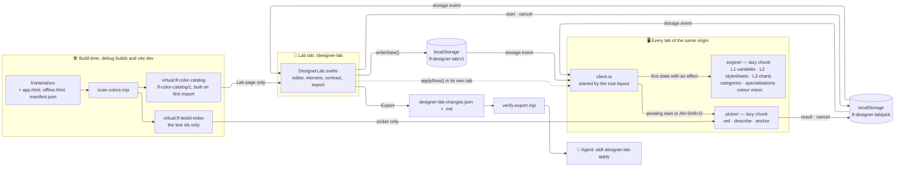
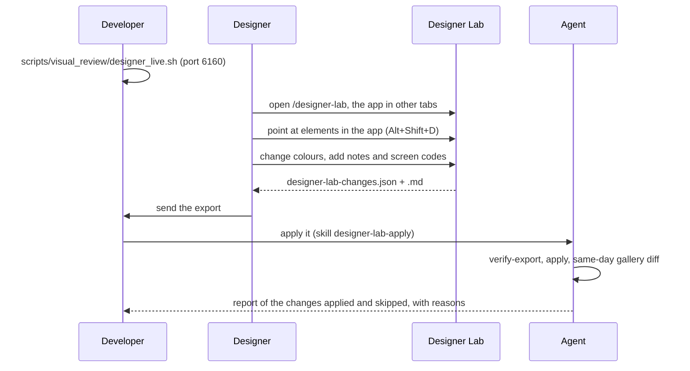

# 🧪 Designer Lab

The Designer Lab is a hidden page, `/designer-lab`, that exists only in **debug builds**. A designer opens
it in one browser tab and changes the app's colours; the app, open in other tabs of the same address,
repaints at once — charts included. The designer can also **point at an element** in an app tab: the Lab
shows what sets each of its colours in the code, and can change one of them for that component alone. At
the end of a round the Lab **exports** the changes, with the file and line of every occurrence, so that an
agent can apply them to the code.

- **Designers** edit colours while looking at the real app: no code, no install.
- **Developers** start the server for them and receive the export.
- **Agents** verify the export and apply it with the skill `designer-lab-apply`.

!!! info "Developer tooling, not a feature"

    The Lab never reaches a release build, calls no backend API and stores nothing on the server. It has
    no entry in the user changelog, and its texts stay outside the app's translation catalogue.

---

## 🚦 Availability: Debug Builds Only

### 🔀 The Build Switch

`__LF_DESIGNER_LAB__` is a constant replaced at build time (`define` in `frontend/vite.config.ts`,
declared in `src/app.d.ts`). Its value comes from `designerLabEnabled()` in
`frontend/scripts/designer-lab/vite-plugin.mjs`:

| Build | `__LF_DESIGNER_LAB__` |
|:--|:--|
| `VITE_DEBUG=true`: `npm run build:debug`, `./dev.py front build --debug` | `true` |
| `vite build --mode development` | `true` |
| `vite dev` (`npm run dev`) | `true` |
| `npm run build`, `./dev.py front build` (release) | `false` |
| `LF_DESIGNER_LAB=1` or `LF_DESIGNER_LAB=0` in the environment | forced on or off, whatever the build |

`LF_DESIGNER_LAB=0` gives a debug build without the Lab, to compare two gallery captures with and without
it.

The value is a literal, so a release build turns every `if (__LF_DESIGNER_LAB__)` into `if (false)`:
Rollup drops the branch **and the dynamic `import()` inside it**, and no Lab chunk is emitted. Three
places import the Lab inside such a branch:

| File | What the branch does |
|:--|:--|
| `src/routes/+layout.svelte` (`onMount`) | Imports and starts the Lab client, on every page |
| `src/routes/designer-lab/+page.ts` | `load()` answers `error(404)` when the switch is off |
| `src/routes/designer-lab/+page.svelte` | Imports `DesignerLab.svelte` in `onMount` |

```ts
// src/routes/+layout.svelte — onMount
if (__LF_DESIGNER_LAB__) import('$lib/dev/designer-lab/client').then((lab) => lab.start()).catch(() => {});
```

A fourth branch, in `src/lib/theme/chartCategories.ts` (workstream DV), imports nothing: it asks the
published hook for an edited category colour, and a release build drops it too — see
[Chart Categories](#chart-categories).

### 🧪 Test Server, E2E and Gallery {: #neutrality }

`./dev.py server --test` always builds and serves the **debug** bundle: `--test` forces debug mode, and
`frontend/build/.build-debug` records the mode of the last build. The E2E runs and the gallery use the
test server, so they all load the Lab client, and they must stay identical as long as nobody uses the Lab.
They do, because in a browser context where the Lab was never opened — every gallery context, and every
E2E context but those of the Lab's own specs — the client stays idle:

- the client publishes its [debug hook](#debug-hook) and adds one `storage` listener: it loads no engine
  and no picker, and touches no stylesheet, variable or chart. The hook's `categoryColor`, which every
  chart asks for its [categories](#chart-categories), answers nothing, so the charts keep their tables'
  colours;
- the Alt+Shift+D shortcut adds one `keydown` listener, and only in a browser where the Lab has been
  opened (`lf-designer-lab/seen`, written by the Lab page);
- the engines and the element picker are dynamic imports, separate chunks loaded the first time a state
  with an effect, or a pick request, appears.

Measured on 14/10/2026 in a debug build: the client chunk weighs 6.2 KB and reaches the picker (73.6 KB,
test-id index included) and the engines only through dynamic imports.

### 🛡️ Release Builds {: #release-builds }

- `/designer-lab` keeps only a stub. The backend's SPA fallback answers the URL with `200.html`
  (HTTP 200), then `+page.ts` throws the 404 and the client renders `+error.svelte`.
- The Vite plugin guards the switch in a build without the Lab:
    - `generateBundle` **fails the build** when an emitted file contains the marker `lf-designer-lab`,
      and names the files. The Lab's code carries it in its storage keys, in the ids of the styles it
      injects, in its cascade layer and in its dev-server event;
    - `load` fails the build if anything imports `virtual:lf-color-catalog` or `virtual:lf-testid-index`.
- Checked on 14/10/2026 with the element picker in place: `npm run build` emitted no file with the marker
  and no trace of the picker or of the test-id index, and the `/designer-lab` stub node kept its 488 bytes.

!!! warning "Import the Lab only inside a branch"

    Every import of `$lib/dev/designer-lab` must be a dynamic `import()` inside an
    `if (__LF_DESIGNER_LAB__)` branch. A static import would carry Lab code into the release bundle; the
    marker guard stops `./dev.py front build` when that code holds the marker, as the client's store, the
    engines and the page do.

### 🔓 No Login

The route sits outside the `(app)` group: no login and no app shell. The Lab calls no API — it reads the
catalogue bundled with the build and the state saved in the browser. The app in the other tabs asks for
its login as usual.

### 🎨 Opening It for a Designer

`scripts/visual_review/designer_live.sh` starts a test server for a designer's review on its own lane:
port **6160**, data in `/tmp/librefolio-color-review`, copied from the latest gallery run (`--from` picks
the source lane, `--refresh` copies it again). The server listens on `0.0.0.0`, so a designer on the same
network can reach it.

```bash
# In a linked worktree, reuse the main venv: the script refuses to start without it
export PIPENV_CUSTOM_VENV_NAME=<main venv name>
scripts/visual_review/designer_live.sh
```

- The Lab: `http://<this-machine>:6160/designer-lab`.
- The app, in other tabs: `http://<this-machine>:6160`, logged in with the E2E admin user the script
  prints.

`--test` already serves the debug build: the Lab is there without the script's `--debug` option.

`./dev.py server` lists `http://localhost:<port>/designer-lab` in its «Available endpoints» whenever the
build it serves holds the Lab's [marker](#release-builds): a `--test` or `--debug` build, not a release or
`LF_DESIGNER_LAB=0` build. `./dev.py front dev` (port 5173) prints it too, unless `LF_DESIGNER_LAB=0`.

!!! tip "One address for every tab"

    The state and the picker's messages live in `localStorage` and travel through the `storage` event, both
    scoped to one origin. `http://localhost:6160` and `http://192.168.1.20:6160` are two origins that share
    nothing: open the Lab and the app with the same host name.

---

## 🏗️ Architecture

The Lab has two halves. The **catalogue**, built from the sources at build time, gives completeness and
provenance: every colour of every file, with file and line, even in components the page has not loaded.
The **runtime engines** give the immediate preview, acting on what the browser has really loaded. The
export joins the two: what changes, and where. The **element picker** starts from the other end: from an
element on screen, it proves which declaration sets each of its colours, and the Lab finds that
declaration in the catalogue.



### 🔄 The Client

`client.ts`, with `store.ts` and `pick.ts`, is all of the Lab that an app page loads. `start()` is
idempotent: it publishes `window.__lfDesignerLab`, adds one `storage` listener, then reads the three keys
once, as if each had just changed. The listener follows them (`null`, which `localStorage.clear()` sends,
counts for the first two):

| Key | What the client does |
|:--|:--|
| `lf-designer-lab/v1`, the state | While no engine is loaded, stop unless the state has an effect — not suspended, with at least one change or a colour-vision mode; otherwise import `engine/` (a separate chunk) once, and call `applyState(state)` |
| `lf-designer-lab/pick`, the picker's messages | While no picker is loaded, stop unless a `start` is pending; otherwise import `picker/overlay.ts` (another chunk) once, and let it follow the message. The Lab's own page never picks |
| `lf-designer-lab/seen` | Install the Alt+Shift+D shortcut — see [The Two-Tab Flow](#two-tab-flow) |

The Lab page writes the state itself, and a tab gets no `storage` event for its own writes, so the page
calls `applyNow()`. Nothing else runs while idle: no `BroadcastChannel`, no observer, and no keyboard
listener in a browser where the Lab was never opened. The engine adds its observers — theme switches on
`<html>`, late stylesheets in `<head>` — only while a state is active; `applyState(null)`, or a suspended
state, undoes everything and leaves the module loaded but idle.

### 💾 The Shared State

`store.ts` keeps one JSON document in `localStorage['lf-designer-lab/v1']`, schema
`lf-designer-lab-state/1`. A state with another schema is ignored.

| Field | Content |
|:--|:--|
| `changes` | The changes, in the order they were first made |
| `suspended` | Show the original colours without losing the changes |
| `cvd` | Colour-vision simulation: `none`, `protanopia`, `deuteranopia`, `tritanopia`, `achromatopsia` |
| `notes`, `author` | The general note and its author, both exported |
| `variants`, `activeVariant` | Named snapshots of `changes`, for A/B comparison |
| `updatedAt` | Time of the last write |

A change has an `id` — `<layer>:<target>@<scope>`, plus `#<literal id>` when it is restricted to one
stylesheet occurrence, and `element:<property>[:<colour key>]@<scope>~<selector>` for a specialisation —
a `layer`, a `target` (a variable name, a colour key, a chart category such as `type:ETF`, or a
specialisation's selector), a `scope` (`light`, `dark` or `both`), `from`, `to` (any CSS colour,
`var(--x)` included), `alphaVariants` (default `true`),
`occurrence` and `match` for a single occurrence, `property` and `colorKey` for a specialisation, an
`anchor` (the picked element the change was decided on: set on every `element` change the Lab makes,
context on the other layers), a `note` and `shots`. `isSafeCssValue()` refuses a `to` longer than 200 characters or holding a
semicolon, a brace, an angle bracket, a quote, a backtick, a backslash or a comment opener, so a typo
cannot break out of a style rule. `isSafeSelector()` guards a specialisation's selector the same way: at
most 600 characters on one line, without a brace, a semicolon, a `<` or a comment opener.

The picker's messages travel under two other keys, outside this document: see
[The Two-Tab Flow](#two-tab-flow).

### 🎛️ L1 — CSS Variables

`engine/vars.ts` writes one `<style id="lf-designer-lab-vars">` in `<head>`, with one rule per `css-var`
change. The selector carries the scope (`VAR_SELECTOR`) and names, besides `<html>`, the `.light` or
`.dark` subtrees of the scope's themes: the elements on which the token blocks of `tokens.css` define the
colour roles ([Colour Roles](#colour-roles)):

```css
/* example values — scope both, light, dark */
html, .light, .dark { --color-emerald-600: oklch(62% 0.13 160) !important; }
html:not(.dark), .light { --theme-text-muted: #5b6370 !important; }
html.dark, .dark { --theme-text-muted: #a3adbd !important; }
```

An `!important` declaration beats every normal one, inside `@layer theme` or not, so everything that
reads the variable follows at once:

- Tailwind classes, which read the palette at runtime (`.text-red-500{color:var(--color-red-500)}`);
- their opacity modifiers (`color-mix(in oklab, var(--color-red-500) 20%, transparent)`);
- the role utilities, which read the role itself (`.bg-lf-card{background-color:var(--lf-surface-card)}`),
  and the derived roles built on it;
- the brand (`--color-libre-*`) and the `--theme-*` variables of `app.css`.

A `.light` or `.dark` subtree — an element forced into one theme, which redefines the roles for itself —
gets the overrides of its theme too. The derived roles, which `tokens.css` defines on
`:root, .light, .dark`, recompute from the overridden values, on `<html>` and in the subtree alike.
`applyVars()` writes every `both` rule before the `light` and `dark` ones, keeping the changes' order
otherwise: when a variable has both kinds of change, the theme's rule wins on `<html>` anyway
(`html.dark` beats the `both` rule's `.dark`), and on an island, where the two rules tie on `.dark` or
`.light`, it wins by coming later.

The reach is the variable: changing `--color-emerald-600` changes **every** class that uses it. The
editor shows the impact — uses, files, the most used classes, where the sources define the variable. A
role's impact counts the utilities that read it through their alias.

This path serves the variables the whole page inherits, `scope: root` in the catalogue (`:root`,
`html`, `@theme`, `html.dark`, `.light`, `.dark`…), the colour roles included. Variables that a component
defines on its own elements (`--highlight-*`, `--cropper-*`, `--lf-price-flash-*`…) are `scope: scoped`:
L2 rewrites their defining rule instead.

### 🖌️ L2 — Stylesheet Colours

`engine/stylesheets.ts` rewrites colours in the CSSOM: every rule of every readable stylesheet, nested
rules (`@media`, `@supports`, `@layer`) included, minus the Lab's own styles (`data-lf-lab-own`).

- **By parsed colour, never by text.** Chrome serialises `#64748b` as `rgb(100, 116, 139)` and expands
  shorthands into longhands: each colour token of a declaration is parsed and compared by its colour key.
- **Reversible.** A rewritten declaration keeps its priority and its original text is saved: each new
  plan, or none, starts from the page as it was.
- **Alpha variants.** Translucent writings of the colour share its key and change too, keeping their
  alpha. A change can opt out (**Translucent variants too**).
- **Late stylesheets.** SvelteKit loads CSS per route. While a plan is active, a `MutationObserver` on
  `<head>` rewrites each `<link rel="stylesheet">` when it loads and each `<style>` as it arrives.
- **Component variables.** A `css-var` change to a variable defined on a non-root rule rewrites that
  definition.
- **Variables' definitions.** A colour written inside a custom property's definition is rewritten like any
  other, and the variable changes wherever it is read: a role that `tokens.css` writes as a literal
  changes with a **Stylesheets** edit of that value, as with an L1 edit of the role. The charts that read
  roles when they draw hear of it through the redraw signal, C4 ([Chart Categories](#chart-categories)).
- **One occurrence.** A change restricted to one occurrence carries the selector and property that the
  catalogue recorded. The engine compares them with each rule after `normalizeSelector()` — `.svelte-…`
  scope classes dropped, `:global()` unwrapped, spaces and case normalised — and accepts a longhand of the
  recorded property (`border` → `border-top-color`). Occurrence changes are tried before value changes of
  the same colour. While no loaded rule matches them (its component is not on screen), the change shows
  nothing: by design, the engine does not fall back to every occurrence of the colour. The change is
  exported all the same.
- **Theme.** A `light` or `dark` change applies only while that theme is on, whatever the rule's
  selector; the engine re-plans at every theme switch. The editor warns when a one-theme change reaches
  rules written for both themes.

The step 0 spike measured the technique on `/transactions`: 24 stylesheets and 3,718 rules scanned in
13.5 ms, 33 declarations rewritten in 0.3 ms.

### 📈 L3 — Chart Colours

ECharts options are built in JavaScript: there is no stylesheet to rewrite. `engine/charts.ts` combines
two mechanisms:

1. **A wrapper on the shared prototype.** At the first non-empty chart plan the engine imports `echarts`
   — the module the app imports, so every instance shares one prototype — takes an instance on screen, or
   a 1×1 probe on a detached `<div>`, and wraps `setOption` on its prototype. From then on every option
   an instance receives (first render, new data, theme switch) has its colours mapped. With an empty plan
   the wrapper is a pass-through.
2. **A live re-apply of the instances on screen.** The engine finds them through `[_echarts_instance_]`
   and `getInstanceByDom()`, reads each `getOption()`, builds a sparse patch with only the colour paths
   that change, and merges it with the original `setOption`. Component lists at the root get `{}`
   placeholders, because ECharts merges them by index; other arrays (`data`, `colorStops`, a palette) are
   sent whole. Zoom and data stay as they are.

The re-apply exists because forcing a redraw is not enough: at the step 0 spike, 5 of the 17 chart
components did not redraw when the class of `<html>` changed without a theme switch. ScatterChart,
CorrelationHeatmap, ExposureBars and ExposureMaps only stored the `dark` flag, and SemiDonutChart had no
observer at all. The spike confirmed it on the correlation heatmap, the scatter and the semi-donut; the
re-apply updated 6 instances out of 6, in 1.9–6.8 ms each, with patches of 151–650 bytes. SemiDonutChart
now redraws on every class change, while the other four still store the flag only. Some charts also
rebuild their option on the Lab's redraw signal, C4 ([Chart Categories](#chart-categories)), which the
engine sends when the variables or the categories the charts read change — an L1 edit, a category edit,
or a variable's definition the stylesheet pass rewrote — not for chart colours: L3 patches those itself.

The mapping:

- is **copy-on-write**: the app's objects are never mutated;
- walks strings (`rgba()` keeps its alpha; tooltip HTML included), gradients (`colorStops`) and
  functions: `formatter`, `color` and `renderItem` are wrapped once, and their return value is mapped with
  the plan in force at call time;
- is **reversible**: every string the engine writes is remembered with the original it replaced, so a
  new plan, or none, starts from the app's own colours;
- writes canvas colours as sRGB `rgba(r, g, b, a)` with a four-decimal alpha, clamped to the sRGB gamut:
  a form no colour of the app uses, so the engine recognises its own output when it reads an option back;
- keeps one plan per theme, and reads the theme in force when it maps; an instance's plan also takes the
  chart specialisations whose selector contains it (see below).

### 🍩 Chart Categories {: #chart-categories }

The charts draw each asset type and each sector in a **fixed colour, chosen by key**: 11 asset-type
families and 14 sectors, plus two buckets that both kinds share, `Liquidity` (the cash) and `Unknown`.
Workstream DV keeps them in `frontend/src/lib/theme/chartCategories.ts`, under a contract with the Lab:

- **C1, one read point.** Every chart reads a category's colour through `categoryColor(kind, key, dark)`:
  the allocation pie and the allocation history, with their legends and tooltips; the PAC planner's
  exposure bars, for the actual weights (`actualColours()` in `exposureBarColours.ts`: an asset type by
  its family, its subtypes shaded with `familyShade`, a sector by its key, the uncategorised remainder as
  `Unknown`). The colours borrowed from a category go through it too (see **Reach** below): the owners of
  the semi-donut and the countries of the allocation history through `sequenceColor`, the Growth chart's
  broker lines and their tooltip rows through `growthBrokerColor()`. The GR4 subtype shades are mixed
  from the colour it returns.
- **C2, one literal per line.** The tables write one literal per line, each entry under its key, as
  `light:` and `dark:`: an edit is exported by file and line.
- **C3, a hook in debug builds.** `categoryColor` first asks
  `globalThis.__lfDesignerLab?.categoryColor?.(kind, key, dark)`, inside a
  `typeof __LF_DESIGNER_LAB__ !== 'undefined' && __LF_DESIGNER_LAB__` branch that a release build drops.
  The app imports nothing of the Lab. The [release guard](#release-builds) looks for `lf-designer-lab`,
  which the name `__lfDesignerLab` does not hold: the minifier is what keeps the branch out, and DV's
  `chartCategories.test.ts` checks it on a minified build.
- **C4, a redraw signal.** `src/lib/theme/themeMode.ts` has `onChartColorsChange(cb)` and
  `notifyChartColorsChange()`: the event `lf:chart-colors-change` on `document`. A chart that hears it
  rebuilds its whole option, so it reads its categories again, and the roles it reads through
  `chartRoles` (`roleColors.ts`, the sRGB bridge).

**By key, not by value.** Types and sectors share values (`ETF` and `Technology`, `BOND` and
`Utilities`…), and some category values are written elsewhere too, by a role or another chart: a change
of the value in the **Charts** tab would recolour several categories at once. A `category` change — the
sixth [change layer](#change-layers) — names one category by its key: `type:<KEY>`, `sector:<Key>`,
`bucket:Liquidity` or `bucket:Unknown`, as the table writes it. Its id is `category:<target>@<scope>`, and
its value any colour the editor accepts: a literal, a `var()`, a mix with `transparent`.

**The engine.** `engine/categories.ts`, part of the engine chunk of the app tabs, holds the `category`
changes of the applied state and answers the hook, which `client.ts` publishes as `categoryColor`
([The Debug Hook](#debug-hook)). The hook answers nothing until a state with an effect loads the engine,
nor while the state is suspended: the table's colour then stands. Otherwise, for a category with a change
in the asked theme:

- a change for that theme wins over one for `both`, as in L1;
- the value is resolved at each ask: a `var()` follows the page's current value of the variable, an L1
  edit included, and a value that does not resolve now gives no answer;
- the answer is a colour the canvas reads, clamped to sRGB: `#rrggbb` when opaque, the form the GR4 shades
  mix, and `rgba()` when translucent;
- keys go through DV's own `lookupKey` (`chartCategories.ts`), as in `categoryColor`: case, spaces and
  underscores ignored (`Health Care`, `HEALTH_CARE`), so an edit and the table it overrides always agree
  on what the same key is; the two buckets answer for both kinds.

`stats().categoryOverrides` counts the `category` changes the engine holds.

**The redraw (C4).** The engine calls `notifyChartColorsChange()` when what the charts read at their draw
has changed since its last check (`signalChartInputs()` in `engine/index.ts`). It compares one signature
of it:

- the `css-var` and `category` changes, by id and value;
- the custom-property declarations the stylesheet pass rewrote, on a root rule or a component's, as
  selector, property and value (`variableRewrites()` in `engine/stylesheets.ts`). The roles of
  `tokens.css`, the derived ones aside, are written as literals, so a **Stylesheets** edit of such a value
  changes the role.

The check runs at the end of `applyState()`, once every engine is applied — a change added, edited or
removed, the state suspended, resumed or reset — and again after the theme observer has re-planned the
stylesheets. A literal scoped to one theme rewrites a role in that theme only: after the switch the check
signals once, whatever order the theme observers ran in, and a chart that redrew before the re-plan reads
the role again. Nothing is sent while the signature stays the same: the same changes applied again, and
the changes the charts do not read at their draw — stylesheet literals that define no variable, chart
colours and chart specialisations (L3 patches the charts already drawn), the colour-vision simulation.
The signal brings an edit of a role, from L1 or from the stylesheets, to the charts that read roles
through `chartRoles` — today the allocation pie, the allocation history, the semi-donut, the
correlation heatmap and the PAC planner's exposure bars — at once, where it used to wait for their next
draw. A stylesheet that arrives later sends no signal of its own ([Known Limits](#known-limits)).

**Reach.** A category's colour is the base of its family's GR4 subtype shades, and the categories without
a key of their own borrow it by rank (GR5, `sequenceColor`): the owners of the semi-donut take the first
eight asset types, the countries of the allocation history the sectors. The Growth chart's broker lines
borrow the same eight types, cycled without a shade: broker line *i* takes the colour of the asset type
`CATEGORY_SEQUENCE[i mod 8]` (`growthBrokerColor()` in `src/lib/theme/chartPalettes.ts`, read each time
the series are built). Every chart that reads a category redraws on C4 — the allocation pie, the
allocation history, the semi-donut, the Growth chart and the PAC planner's exposure bars — so a
`category` change reaches all of them at once, the subtype shades and the borrowed colours included: a
type edit also recolours the broker lines that borrow it.

### 📌 Specialisations — `element` Rules {: #specialisations }

A specialisation changes one colour property of a picked element in every instance of its component,
without touching the shared source — the variable, the class or the rule the rest of the app keeps using.
`engine/anchors.ts` writes one rule per specialisation into `<style id="lf-designer-lab-elements">`, for
every theme at once (the prefix keeps them apart, as in L1):

```css
/* example value — the header cells of the transactions table, light theme */
@layer lf-designer-lab {
html:not(.dark) :is([data-testid="tx-table"] > div > div > table > thead > tr > th) { color: #475569 !important; }
}
```

The cascade layer is the point. A `<style>@layer lf-designer-lab;</style>`, prepended to `<head>`
(`id="lf-designer-lab-layer-order"`), declares it before any other layer, and among `!important`
declarations the cascade reverses: the first layer wins over the later layers — Tailwind's `!` utilities
such as `!bg-white`, in `utilities` — and over the unlayered declarations — the P1 dark overrides of
`app.css`. So the preview shows the new colour whatever the app writes there; only an inline `!important`
style stays on top. Both styles leave `<head>` when no specialisation is left.

A rule is written only when the browser parses the selector, `isSafeSelector()` and `isSafeCssValue()`
accept the selector and the value, and the property is one of `ELEMENT_PROPERTIES` (`cssProps.ts`):
`color`, `background-color`, `border-color` (the four sides) or one side's `border-*-color`,
`outline-color`, `text-decoration-color`, `fill`, `stroke`. The picker reports `box-shadow` and gradients
too, but they cannot be specialised.

A **chart specialisation** (`property: 'chart'`, with the `colorKey` it replaces) writes no CSS. L3 keeps
it in a list per theme, and `planFor(instance)` adds it to the plan of an ECharts instance only when the
instance's DOM sits inside an element the selector matches (`dom.closest(selector)`). Values that
functions return — `formatter` (tooltips), `color`, `renderItem` — are computed later, without their
instance, and keep the global plan.

The L2 engine and the picker skip these styles, like every style the Lab injects (`data-lf-lab-own`), and
`stats().elementRules` counts the rules written.

### 👓 Colour-Vision Simulation

`engine/cvd.ts` applies an SVG `feColorMatrix` filter to `<html>`: protanopia, deuteranopia and
tritanopia with the matrices of Machado, Oliveira & Fernandes (2009) at severity 1, in linear RGB, and
achromatopsia with the Rec. 709 luminance weights. The root element is the one place where `filter` does
not turn the element into the containing block of its fixed descendants, so modals and sticky headers keep
their place. The mode is part of the state: every tab follows, the Lab's own included.

### 🔍 The Debug Hook {: #debug-hook }

`start()` publishes `window.__lfDesignerLab` (typed in `src/app.d.ts`) in every tab of a debug build, for
E2E tests, the browser console and the charts' [category colours](#chart-categories):

| Member | Returns |
|:--|:--|
| `active()` | Whether an engine is active in this tab |
| `picking()` | Whether this tab is in picking mode, waiting for a click |
| `stats()` | `{cssRules, chartInstances, varOverrides, elementRules, categoryOverrides}`: declarations rewritten, chart instances patched, variable overrides written, specialisation rules written, `category` changes held |
| `chartColors(selector)` | A promise of the distinct colours of the ECharts instance in the first element matching `selector` |
| `categoryColor(kind, key, dark)` | The colour a `category` change gives that chart category in that theme, or `undefined`: what `categoryColor` of `chartCategories.ts` asks first (C3) |

An idle tab answers `active() === false`, `picking() === false`, zero stats and no category colour.

---

## 🗂️ The Colour Catalogue

### ▶️ The Scanner

`frontend/scripts/designer-lab/scan-colors.mjs` is a Node ESM module without dependencies. The Vite
plugin calls it, and it runs as a CLI for agents:

```bash
node frontend/scripts/designer-lab/scan-colors.mjs --summary                           # summary only
node frontend/scripts/designer-lab/scan-colors.mjs --out /tmp/catalog.json --summary   # catalogue + summary
```

`--pretty` indents the JSON, `--root <dir>` scans another `frontend/` tree, `--app-version <v>` stamps
`meta.app_version`. Without `--out` the summary is printed anyway.

It reads every `.svelte`, `.ts`, `.js` and `.css` file under `frontend/src` — outside `node_modules`,
without the generated API clients (file names starting with `generated`, or containing `openapi` or
`tool-contract-map`) and without the Lab's own folders — plus three documents outside the bundle:
`src/app.html`, `static/offline.html` and `static/manifest.json`. Test files (`__tests__`, `__mocks__`,
`.test.`, `.spec.`) only count towards the `var()` and definition totals of `meta.parity`, as in the
Python inventory; they never enter the catalogue. In the markup of `.svelte` files the scanner also
indexes the test ids, for the element picker ([Test Ids](#testid-index)).

Colour parsing lives in `src/lib/dev/designer-lab/color.js`, plain ESM with JSDoc types: the scanner
(Node) and the engines (browser) import the same file, with no compile step in between.

A scan costs about 1.6 s of CPU for ~1,050 files (the wall time grows on a busy machine) and produces
about 870 KB of JSON (measured on 14/10/2026).

### 📐 Schema `lf-color-catalog/1`

| Key | Content |
|:--|:--|
| `meta` | `schema`, `app_version`, `generated_at`, `hash`, `scan_ms`, `parity` (the totals shared with the Python inventory), `layers` (literals per layer), `excluded` (the Lab's folders) |
| `files` | Paths relative to `frontend/`; the other sections point into this list by index |
| `css_vars` | Every custom property defined or read with `var()`: `name`, `defs` (file, line, value, zone, selector, theme and `scope`, `root` or `scoped`; `inline` and `alias_of` for a definition inside `@theme inline`), `uses`, uses per file, and `use_sites`, the `[file, line, selector]` of every `var()` read (the selector `null` outside a stylesheet rule) |
| `palette` | Every colour variable a Tailwind class reaches (`text-emerald-600` → `--color-emerald-600`, `bg-libre-green` → `--color-libre-green`, `bg-lf-card` → `--color-lf-card`): uses, uses under `dark:`, classes, files, `occ`, the `[file, line, classIndex]` of every use — `classIndex` points into `Object.keys(classes)` — and `role` for the alias of a colour role |
| `literals` | Every hand-written colour: `id`, `file`, `line`, `col`, `raw`, `kind` (`hex`, `fn`, `mix`), `key`, `alpha`, `zone`, `theme`, `layer`, `preview`, `snippet`. Stylesheet colours add `selector`, `at` (the enclosing at-rules) and `property`; script colours add `chart`; markup colours add `via`; a line of the chart category tables adds `category`, the category it colours (`type:ETF`) |
| `by_value` | Colour key → literal ids |
| `categories` | The [chart categories](#chart-categories), in the order of their tables: `target` (`type:ETF`, `sector:Health Care`, `bucket:Liquidity`), `kind` (`type`, `sector` or `bucket`), `key` as the table writes it, and `light` and `dark`, the id of the literal that holds each theme's value (`null` when the table writes none) |
| `testids` | Every static test id → the `[file, line, via]` of each place that writes it: `via` is `attr` for `data-testid=`, `prop` for a prop that a component renders as its `data-testid` (`testid=`, `optionTestId=`…), `script` for a property or variable of a script (`testId: 'x'`) |
| `testid_prefixes` | The templated test ids (`row-{id}`): `[prefix, file, line, via]`, longest prefix first |

`testids`, `testid_prefixes`, the class index of `palette[].occ` and `css_vars[].use_sites` serve the
element picker; `inline`, `alias_of` and `role` serve the [colour roles](#colour-roles); `categories` and
the literals' `category` serve the [chart categories](#chart-categories). They are additions: the schema
keeps its name, `lf-color-catalog/1`, and none of them enters `meta.parity`.

`meta.hash` is a `sha256:` of the body only, without volatile fields such as `generated_at` and
`scan_ms`: it stays the same on an unchanged tree, and the export records it as `catalog_hash`.

**Colour key.** Equal colours are grouped whatever their notation: `#rrggbb` (lower case, alpha dropped)
inside sRGB, a rounded `oklch(…)` outside. Alpha is not part of the key, so the translucent variants of a
colour share it. Expressions (`color-mix()`, `var()`) have `key: null`.

**Zones and layers.** Where a colour is written decides whether the Lab can preview it:

| Zone | Where the colour is written | Layer | Live preview |
|:--|:--|:--|:--|
| `svelte-style` | A `<style>` block of a `.svelte` file | `css-literal` | ✅ |
| `css-file` | A `.css` file | `css-literal` | ✅ |
| `svelte-markup` | Markup, inside a Tailwind arbitrary class (`bg-[#…]`) | `css-literal` | ✅ |
| `svelte-markup` | Markup, in a `style=` attribute or elsewhere | `markup` | ❌ |
| `svelte-script`, `ts` | The script of a chart file | `chart-color` | ✅ |
| `svelte-script`, `ts` | Any other script (`.ts` and `.js`) | `script` | ❌ |
| `static` | `app.html`, `offline.html`, `manifest.json` | `static` | ❌ |

A **chart file** is one under `components/charts`, a `charts/` folder anywhere, `features/dashboard/`,
`features/risk/`, `features/brokers/lots/` or `features/tools/pac-allocator/planner/result/`, one whose
name holds `chart` in any case (`chartCategories.ts`, `GrowthChart.svelte`), or any file that imports from
`'echarts'`. It is a heuristic: a `chart-color` previews only where it reaches an ECharts option.

**Theme hint.** In stylesheets, `dark` or `light` when the rule, or a block around it, is limited to one
theme: by a `prefers-color-scheme` media query, or by a selector list whose selectors all name the same
theme — `.dark` or `:not(.light)` for dark, `.light` or `:not(.dark)` (`html:not(.dark)`) for light. A
list that mixes themes (`.a, html.dark .b`) applies in both and fixes nothing; `both` otherwise. In
scripts, `dark` or `light` from an object key (`dark: '#…'`) or from the side of a ternary whose condition
names the dark theme, on one line (`isDark ? … : …`) or split as Prettier writes it (`isDark` ending a
line, `? '#…'` and `: '#…'` on the next ones); a negated condition (`!isDark`, `!$isDark`) swaps the sides. In markup,
`dark` when the class holding the colour carries a `dark:` variant (`dark:bg-[#1e293b]`), never from a
neighbouring class. `null` otherwise.

**Chart categories.** In `src/lib/theme/chartCategories.ts` (`CATEGORY_FILE`), `categoryLines()` reads the
tables of the chart categories line by line: `ASSET_TYPE_COLORS` and `SECTOR_COLORS`,
one entry per key, and the two buckets, `LIQUIDITY_COLOR` and `UNCLASSIFIED_COLOR`. Each literal on one of
their lines gets `category`, the target a change names (`type:ETF`, `sector:Health Care`,
`bucket:Liquidity`), and as `theme` the property it is written in, `light:` or `dark:`; `categories` lists
the categories in table order. The file is a chart file by its name, so these literals stay in the
`chart-color` layer, and the **Charts** tab still lists their values.

### 🎭 Colour Roles {: #colour-roles }

Workstream T moves the interface colours to **colour roles**, in `frontend/src/lib/theme/tokens.css`:

- a role is a variable `--lf-<group>-<name>`, such as `--lf-surface-card`. The token blocks define the
  roles on `:root, html.light, .light` (light) and `html.dark, .dark` (dark), and the derived ones —
  `color-mix()`, references to other roles — on `:root, .light, .dark`;
- an `@theme inline` block turns each role into Tailwind utilities:
  `--color-lf-card: var(--lf-surface-card)` gives `bg-lf-card`, `border-lf-card`, `ring-lf-card`…

With `inline`, Tailwind writes the role into the utility —
`.bg-lf-card{background-color:var(--lf-surface-card)}` — and emits no `--color-lf-card` at runtime. The
alias exists only in the sources: editing it would change nothing, so the Lab edits the role. The
catalogue records the link:

- **Classes.** The custom-token class expression covers the role utilities: `lf-[a-z0-9-]+`, next to
  `libre-*`, `theme-*`, `primary*` and `accent*` — `TW_CUSTOM_RE` in `scan-colors.mjs` and `tw_custom_re`
  in `color_inventory.py`, changed together. Its prefixes are the palette expression's list, `PREFIXES`
  (decision D-a, 15/10/2026): besides `bg-`, `text-`, `border-`, `ring-`, `outline-`, `divide-`, `fill-`,
  `stroke-` and the gradient stops, the side borders (`border-t-`, `-b-`, `-l-`, `-r-`, `-x-`, `-y-`),
  `ring-offset-`, `shadow-`, `accent-`, `caret-`, `decoration-` and `placeholder-`. So the shadow roles'
  utilities, `shadow-lf-shadow` and `shadow-lf-shadow-card`, count and have their chips. A role name may
  hold digits, as T's own `ROLE_CLASS_RE` (`frontend/scripts/theme/theme-roles.mjs`) allows. A role
  utility, variants and opacity included (`hover:border-lf-card/50`), counts among the custom-token
  classes and enters `palette` under its alias, `--color-lf-<name>`.
- **Definitions.** A definition inside an `@theme inline` block gets `inline: true` and `alias_of`: the
  variable it names when its value is exactly `var(--x)`, else `null`. The two fields are written only
  for such definitions.
- **Palette.** A palette entry gets `role` when every definition of its variable is an inline alias of
  one same variable: `--color-lf-card` → `--lf-surface-card`. The rule is generic, not tied to the `lf`
  prefix.

Wherever the Lab meets an alias it edits the role — the palette chips and the editor's impact, the
export's occurrences, the picker's candidates: each section below says how — and L1, above, writes its
overrides where the token blocks define the roles. An alias that is not exactly `var(--x)` gets no role:
see [Known Limits](#known-limits).

### ⚖️ Parity with the Python Inventory

`scripts/visual_review/color_inventory.py`, the inventory of the visual-review toolkit, counts the same
tree with the same file selection and the same regular expressions, line by line. `meta.parity` holds the
totals the two share: files, Tailwind palette classes, custom-token classes, arbitrary classes, hex
literals, colour functions, `var()` uses and custom property definitions. On 14/10/2026 both reported
1,047 files, 1,610 hex literals and 211 colour functions, with the same occurrences line by line. The
picker's additions — test ids, `use_sites`, the class index of `occ` — are annotation, not counting: the
Python inventory has no counterpart for them, and the parity totals did not move when they arrived. The
same holds for the roles' `inline`, `alias_of` and `role`, and for the chart categories' `categories` and
`category`; what the roles did change is the class expression. On 15/10/2026, on the base `9d57aa4c0`,
which carries the first wave of workstream T, the two class expressions took in the role utilities in the
same change ([Colour Roles](#colour-roles)), and the inventories stayed identical line by line: the
custom-token classes went from 764 to 912, while the 1,080 files, 1,291 hex literals and 238 colour
functions did not move. Later that day, on the base `a0915bef9`, both took the palette's prefix list
(decision D-a), and the inventories stayed identical again: the custom-token classes went from 1,358 to
1,375. The `lf` uses went from 611 to 619 — 7 more `shadow-lf-shadow` and 1 `shadow-lf-shadow-card` —
which is now the count of T's `ROLE_CLASS_RE`; the other 9 are `libre-green` uses under `accent-`,
`decoration-`, `border-l-` and `border-t-`.

!!! warning "Change one, change the other"

    A new regular expression, extension or exclusion in one scanner must land in the other in the same
    change, or the two inventories drift apart. The Lab's own folders, `src/lib/dev/designer-lab/` and
    `src/routes/designer-lab/`, are excluded from both (`LAB_DIRS` in each file): they are tooling, not
    the app.

### 🔌 The Vite Plugin

`designerLabPlugin()` (`frontend/scripts/designer-lab/vite-plugin.mjs`, registered in `vite.config.ts`):

- **serves two virtual modules.** `virtual:lf-color-catalog` is the catalogue, built on the first import
  only — a build or a dev server that never reaches the Lab never scans. `virtual:lf-testid-index` is
  `testidIndex(catalog)`, `{statics, prefixes}`: the test ids alone, for the picker that runs in the app
  tabs ([Test Ids](#testid-index)). Both are emitted as `JSON.parse` of a string literal, cheaper to
  evaluate than an object literal of this size. In a build they are snapshots of the sources that ship
  only with the Lab's lazy chunks: the catalogue with the Lab page, the index with the picker.
  `src/lib/dev/designer-lab/virtual-catalog.d.ts` types both: an ambient file, because `app.d.ts` is a
  module;
- **under `vite dev`**, forgets the catalogue when a scanned source changes, invalidates both modules and
  sends the `lf-designer-lab:catalog-stale` event: an open Lab then asks for a reload;
- **in a build without the Lab**, runs the guard described in [Release builds](#release-builds).

### 🏷️ Test Ids {: #testid-index }

The picker says where an element is with the project's own names: its `data-testid` chain. To write a
templated id the way the code writes it, and to find where the code writes it, the scanner indexes the
test ids of the sources:

- **In markup** (`.svelte`): `data-testid=` attributes (`via: attr`), and the props components render as
  their `data-testid` — `testid=`, `testId=`, or a name ending in `TestId` such as `optionTestId=` or
  `valueTestId=` (`via: prop`). A name that goes on after it, such as `testIdPrefix=`, is not one.
  `testidValues()` reads a quoted value, or the literals of a `{…}` expression up to its closing brace on
  the same line.
- **In scripts** (a `.svelte` `<script>`, `.ts`, `.js`): a property or variable whose name ends with
  `testid` or `testId` and takes a literal — `testId: 'tab-a'`, `` const rowTestId = `row-${id}` ``, a
  parameter default (`via: script`). `scriptTestidValues()` reads the expression up to the end of the
  property or statement on the same line. Never a comparison, a `…Prefix` name, or a type annotation
  (`testId: string` holds no literal).
- **Which literals.** Only those in value position: at the start of the expression, after `?`, `:`, `??`,
  `||`, `&&`, an arrow `=>` or a grouping `(` — never the operands of a comparison, nor the arguments of a
  call (`fn('x')`). So `{active ? 'tab-on' : 'tab-off'}` gives two ids and `` {x ?? `tab-${id}`} `` one
  prefix.
- **Static or templated.** A `${…}` or `{…}` cuts the value into a prefix of at least three characters
  (`row-{id}` → `row-`); a value with nothing static before the cut — a pass-through such as `{testId}` —
  is not indexable. Static ids go to `testids`, prefixes to `testid_prefixes`.
- **In the app tab.** `virtual:lf-testid-index` carries `{statics, prefixes}`, and only
  `picker/describe.ts` imports it: the index rides in the picker's lazy chunk, never in the client. An id
  of the page that is not static but starts with a known prefix is an instance of a templated id: the
  selector writes `[data-testid^="row-"]`, the chain and the export `row-*`.
- **Ids the index does not know** are cut by `recordPrefix()` before their first token that looks like a
  record: a whole number, or a token with a capital letter — `row-42` → `row-*`, `asset-row-42-menu` →
  `asset-row-*`, `kpi-gain-EUR` → `kpi-gain-*` — when at least three characters are left. Digits inside a
  word do not count (`risk-l2-weight` stays whole): the project writes its static ids as lower-case kebab
  words, without capitals. An id with no such token is written as it is.

Writing `prefix*` keeps record values — a currency code, a row id — out of the export, and makes the
selector reach every instance of the component. The limits of the index are in
[Known Limits](#known-limits).

---

## 🖥️ The Lab Page

`DesignerLab.svelte` reads the catalogue and the saved state, and writes every edit back to the state
(`writeState()`, then `applyNow()`). When the browser refuses the write — storage full or disabled — the
Lab shows an error status and keeps the last saved state, the one the other tabs see.

**Header.**

- **Point at an element** asks the app tabs to enter picking mode; while the Lab waits, the button reads
  **Cancel picking**. Next to it, a reminder that Alt+Shift+D does the same from an app tab. See
  [The Element Picker](#element-picker).
- **Editing**: the theme the next change applies to — light, dark or both; the theme on screen by
  default, then the theme of each new pick, unless **both** is selected.
- **Suspend / Resume**: every tab shows the original colours; the changes are kept.
- **Variant**: **Save variant** stores the current changes under a name. Choosing another variant first
  saves the changes on screen into the active one (into `current` when none is active), then loads the
  chosen one: A/B in one click.
- **Colour vision**: the simulation mode, for every tab.
- **Export JSON + MD**, **JSON**, **MD**, **Copy summary**, **Import**, and **Reset all**, which asks for
  confirmation and keeps notes, variants and the colour-vision mode.

**Tabs.** A search box (name, value or file) filters the palette, variable, value and category tabs. Once
an element is picked, the checkbox **Only the picked element's colours** next to it narrows the palette,
variable and value lists to that element ([what it keeps](#element-tab)). The **Categories** tab hides
the checkbox, which would filter nothing there: the picker does not name a category yet
([Known Limits](#known-limits)).

| Tab | Content |
|:--|:--|
| Overview | Hand-written colours per layer and how many are live-editable, palette and app variables in use, catalogue schema, file count and scan time |
| Element | The picked element: where it is, each of its colours with its source, **Edit the source** and **Specialise here** — see [The Element Tab](#element-tab) |
| Tailwind palette | The `--color-*` variables the classes reach, by family and shade, with their uses; the role utilities form the family `lf` |
| App variables | Variables the app defines with a colour value: brand, `--theme-*`, the colour roles, component variables — never an inline alias |
| Stylesheets | `css-literal` colours grouped by value, alpha variants together, with occurrences, files, alphas and theme hints |
| Charts | `chart-color` colours, grouped the same way |
| Categories | The [chart categories](#chart-categories) in three groups — asset types, sectors, cash and unclassified — each row with its light and dark swatches and values; a row opens the editor on its category |
| No preview | `script`, `markup` and `static` colours: proposals only |
| Changes | The current changes, from → to, with layer, theme and note; a specialisation shows its property, and opens the editor with its anchor |
| Contrast | WCAG ratios before and after the changes, in both themes, plus a free pair |
| Notes | Author and general note, both exported |

**Roles in the palette.** The family `lf` holds the role utilities, one chip per alias, whose shade is the
rest of the alias's name (`--color-lf-card` → `card`, `--color-lf-action-hover` → `action-hover`). A
chip keeps its alias's test id, `lab-item-var-<alias>` (`lab-item-var---color-lf-card`), but edits the
role ([Colour Roles](#colour-roles)): `data-target="--lf-surface-card"`, title
`--color-lf-card → --lf-surface-card`, and its swatch and changed state follow the role. The search finds
a chip by its role too. **App variables** lists the roles, as root variables, and omits the inline
aliases (`appVars()`), which no stylesheet defines at runtime.

**Editor** (`ColorEditor.svelte`), opened from any entry:

- a text field that accepts any CSS colour, OKLCH sliders (L, C, H), and a warning when the value leaves
  sRGB;
- a fourth slider, **A**, for the opacity (0–100%). Some roles carry one, written
  `color-mix(in oklab, <base> p%, transparent)` — the backdrop `--lf-surface-overlay`, `--lf-selected`.
  Mixing with `transparent` keeps the base colour and gives it opacity p, whatever the interpolation
  space: the editor reads that form (`colorValue.ts`), and A changes p and keeps the base, so a role in
  the base (`var(--lf-focus)`) stays referenced; at 100% the value becomes the bare base. On a
  `var(--x)`, A writes that form; on a literal, it sets the alpha — `oklch(… / a)` for an `oklch()`
  literal or one outside sRGB, `#rrggbbaa` otherwise. Both swatches sit on a checkerboard, so the opacity
  shows. L1 previews the value as typed; for a stylesheet or chart colour, L2 and L3 multiply the alpha
  of each occurrence they change by the value's (`resolveTarget()` resolves the mix);
- `<input type="color">` as an sRGB shortcut, and **Snap to a variable**, which writes `var(--x)`: a
  proposal to unify two colours. Its list offers the roles, never their inline aliases. Like the L, C, H
  sliders, both change the colour and keep the opacity (`withBase()`): a translucent value stays
  translucent, a mix stays a mix;
- for values, **Translucent variants too** and, in stylesheets, **Reach in the code**: every occurrence,
  or one occurrence with its selector — preselected on the picked element's rule when the editor is opened
  from the **Element** tab and exactly one catalogue occurrence matches it;
- for a chart colour that is also the colour of chart categories, a warning that names them and points to
  the **Categories** tab: a change of the value would recolour them all at once;
- a note and gallery screen codes such as `dashboard/kpi-top` — the codes of the designer package;
- the impact of a variable (uses, files, most used classes, definitions), or the occurrences of a value
  (file, line, selector, property, theme, snippet). `varImpact()` (`catalogView.ts`) adds up the palette
  entries that read the variable, directly or through an inline alias, and the variable's own `var()`
  uses: a role's impact counts its utilities, and its definitions are those of `tokens.css`;
- in **`element` mode**, opened by **Specialise here**: the selector, the property (and the colour key for
  a chart), the reminder that only this component changes, how many elements the selector matched when
  the element was picked, and where an agent would bind the new variable. The current value is the one the
  picker read on the element;
- for a **category**, opened from the **Categories** tab: the value its table writes in the theme being
  edited as the current one, a note on the reach — every chart reads the colour through `categoryColor`,
  the subtype shades follow, and only this category changes, even where another one has the same value —
  and **Written at**, the line of each theme in `chartCategories.ts`, with its value. There is no
  translucent-variant or reach choice: the change is by key.

**Contrast** (`contrast.ts`, `ContrastPanel.svelte`). The declared pairs come from the catalogue: every
root `--theme-text-*` on every root `--theme-bg-*` except the hover surfaces (AA at 4.5:1, AAA at 7:1),
and every `--theme-border-*` on the card surface (3:1, the threshold of UI components). *Before* uses
the value the sources define for each theme (`sourceVarValue()`): the definition for that theme, else one
both themes share (`:root`, `@theme`) — never the other theme's — and at equal footing the later one, as
in the cascade. *After* applies the `css-var` changes; a translucent foreground is composited over the
background first. Changes to literal colours, chart categories and specialisations do not enter this
table.

---

## 🎯 The Element Picker {: #element-picker }

The designer points at an element in an app tab, and the Lab shows what sets each of its colours in the
code. Two ways to change one follow:

- **Edit the source**: the shared variable, class value or rule. Every element that uses it changes, so
  the designer can tour the app and see the effect on the rest.
- **Specialise here**: this component only. The shared source stays as it is, and the export tells an
  agent where to bind a new variable.

The app tab reports facts — computed colours, the declarations proved to set them, test ids, CSS — without
the catalogue; the Lab tab matches them with the catalogue.

### 🔀 The Two-Tab Flow {: #two-tab-flow }

This is the reference workflow: the Lab in one tab or window, the app in another. They talk through
`localStorage`, the channel the colour state already uses, with two keys of their own (`pick.ts`):

| Key | Content |
|:--|:--|
| `lf-designer-lab/pick` | The last message: `start` (the Lab asks the app tabs to pick), `cancel`, or `result` (an app tab reports the element it picked, with its facts). Each has an `id` and a time `at` |
| `lf-designer-lab/seen` | Written by the Lab page when it mounts: this browser has opened the Lab |

1. **Point at an element** writes a `start` with a new id. Every app tab of the origin gets the `storage`
   event, loads the picker chunk and enters picking mode. A `start` younger than five minutes
   (`PICK_FRESH_MS`) is pending: a tab that loads or reloads meanwhile joins it; an older one is a
   forgotten request.
2. **Alt+Shift+D** in an app tab enters picking mode in that tab only, without a `start`. The client reads
   the key from `event.code === 'KeyD'`, not from `event.key`: on macOS, Alt+Shift+D types «Î». The
   listener exists only where `lf-designer-lab/seen` is set — tabs already open install it as soon as the
   Lab is opened in the same browser — and the shortcut does nothing on the Lab page itself, with Ctrl or
   Cmd, or on a repeated key.
3. A click on an element writes a `result`. The Lab takes any result, from its own request or from a
   shortcut, and opens the **Element** tab on it; every tab still picking leaves picking mode.
4. **Esc** in the picking tab writes a `cancel` for its request: the other tabs waiting for the same request
   leave picking mode, and the Lab, if it was the one waiting, shows «Picking cancelled». **Cancel
   picking** in the Lab does the same from the other side, and so does leaving the Lab while it waits: it
   writes the `cancel` when it unmounts (in-app navigation) and on `pagehide` (its tab closed, reloaded or
   left for another site).

A `result` ends picking everywhere, a `cancel` ends the request it names, and removing the key ends any.
A pick started with the shortcut has its own id, so the Lab's `cancel` leaves it alone. When the Lab
opens, it shows the last `result` left in the key.

**Picking mode** (`picker/overlay.ts`), in the app tab:

- **A veil** (`data-testid="lf-lab-pick-veil"`): a transparent `<div>` fixed over the whole window, at the
  top of the z-index range, with a crosshair cursor. It takes every pointer event, so the element below is
  never hovered: the picker reads its resting colours. The app opens no `<dialog>` with `showModal()` and
  no popover, so no top-layer element of the app covers the veil.
- **A frame and a label** follow the element under the pointer, once per animation frame: the frame
  outlines its box, and the label names its tag and nearest test id (`div · tx-table`). The element
  under the pointer is the first one `document.elementsFromPoint()` returns outside the Lab's own nodes;
  a shape inside a lucide icon stands for the icon's `<svg>`.
- **Events** — pointer, mouse and touch events, clicks, `contextmenu` and keys — are stopped at `window`,
  in the capture phase (`preventDefault()` and `stopImmediatePropagation()`): no handler of the app's
  elements runs, and a click never reaches the app. Key combinations with Ctrl or Cmd pass through, so the
  browser's shortcuts keep working. The wheel is replayed by hand on the scrollable container under the
  pointer, or the page: over the veil, the browser would scroll the page alone.
- **Inline styles only.** The veil, the frame and the label carry inline styles and the `data-lf-lab-own`
  attribute: L2 never rewrites them, and the picker skips them.
- A click with the main button describes the element (`describeElement()`), writes the `result` and leaves
  picking mode. If the description fails, the tab logs the error and writes a `cancel` instead.

When a `result` arrives, the Lab:

- replaces the previous pick and opens the **Element** tab;
- closes an editor left open on a specialisation of the previous pick, which would edit the wrong element;
- switches **Editing** to the theme the element was picked in — a P1 dark override shows only there —
  unless it is **both**.

### 🔬 Finding What Sets a Colour {: #describe }

`picker/describe.ts` runs in the app tab. For each colour the designer sees on the element, it reports the
computed value and the declaration that sets it: **proved**, not guessed from selectors.

**The colours read** (`analyseAll()`):

| Property | When |
|:--|:--|
| `color` | Always. It is inherited: the search walks up the ancestors (below) |
| `background-color`, `background-image` | The background the designer sees: the element's, or that of the first ancestor whose background is not transparent. `background-image` only when it holds colours, a gradient |
| `border-*-color` | Each visible side: width above 0, style not `none` or `hidden`. Four equal sides — same value, same winning declaration — merge into one `border-color` |
| `outline-color` | A visible outline |
| `text-decoration-color` | Any text decoration |
| `fill`, `stroke` | SVG elements, unless `none` |
| `box-shadow` | A shadow with colours |

**The candidates.** `collectRules()` walks every readable stylesheet but the Lab's own, and keeps the style
rules that declare a colour property, each with its cascade layer (`utilities`; nested layers dotted), the
conditions around it and its stylesheet. It enters an `@media` or `@supports` block only when its
condition holds now, and gives a nested rule an absolute selector (`&` stands for the parent). For a
property, the candidates are:

- the declaration of every rule the element matches: the longhand, or a shorthand that sets it
  (`SHORTHANDS` in `cssProps.ts`: `background`, `border`, `border-top`, `border-color`, the logical
  `border-block-*` and `border-inline-*` forms…). The shorthand matters with `var()`: the CSSOM then
  leaves the longhand empty, and only the shorthand holds the text;
- the rules that would match in a state the element is not in — `:hover`, `:focus`, `:focus-visible`,
  `:focus-within`, `:active`, found by stripping those pseudo-classes. They are listed, so the designer
  sees them, but never tried and never winners;
- the inline `style`;
- the presentation attribute of an SVG element (`fill="…"`, `stroke="…"`, `color="…"`).

Rules on pseudo-elements (`::before`, `::placeholder`…) are left out: the picker reads the element itself.
Each candidate records its text as written, before any Lab change (`originalValue()` of L2).

**The proof.** The candidates are sorted by an estimated cascade order: `!important` first; then inline
styles, rules, attributes; unlayered before layered for normal declarations, the reverse for `!important`
ones; later in the document first. The estimate ignores specificity: the proof settles it. `prove()` takes
the candidates in that order:

1. it sets the property to a probe colour in the candidate's block, with the same priority: `rgb(1, 2, 3)`
   — `0 0 0 1px rgb(1, 2, 3)` for a shadow, a gradient of it for an image;
2. it reads the computed value of the property;
3. it puts the declaration back exactly, restoring the whole `cssText` of its block (or the attribute);
4. the first candidate whose probe changed the computed value is the one that sets it.

At most 12 candidates are tried per property. All the probing runs in one synchronous task inside
`withoutTransitions()`: a `<style data-lf-lab-own>` turns transitions off, and styles are flushed before
and after. Nothing is painted in between, and no transition starts. The Lab's own specialisation sheet is
disabled meanwhile, since a specialisation would win every probe; the property is flagged «already
specialised» when one of its rules applies.

**Up the tree.** `color`, `fill` and `stroke` are inherited. When the element declares none, or its winner
is `inherit` or `unset` — Tailwind's preflight writes `color: inherit` on buttons and inputs — or
`currentColor` for `color`, the search moves on to the parent, and further up. The property then records
the depth, the tag and the nearest test id of the declaring ancestor. A background seen through from an
ancestor is recorded the same way. A colour whose winner writes `currentColor`, or which equals `color`
with no winner, is flagged: it follows the text colour.

**Charts.** Inside an ECharts instance (`[_echarts_instance_]`), the facts add the chart: the selector of
its component (its nearest test id, else its CSS path), the colours of its option as the app wrote them —
L3's changes undone, at most 40 — and the colour of the shape under the pointer. That colour comes from
zrender's hit test, not a documented ECharts API: when it fails, the colour is unknown.

**What the app tab reports** (`PickedElement` in `types.ts`): the route (SvelteKit's route id, see
[The Anchor](#anchor)), the theme, the test-id chain (nearest first, at most 8), the CSS path (positions
included), the tag, the classes without Svelte's scope class (reported apart), the element's own component
selector and, per property, the computed value, its colours, the depth, the declarations with the winner
first, and the specialisation selector. Never the element's text.

### 🧷 The Specialisation Selector {: #specialisation-selector }

A specialisation needs a selector for «this element, in every instance of its component» — decision (a)
of 14/10/2026. `build()` in `describe.ts` computes one **per property**, with the helpers of
`picker/anchor.ts`:

1. **Which element.** The element that declares the colour, when it sits inside the picked element's
   component, whose root is the picked element's nearest test id: a header text whose colour the `th`
   declares, a card whose background shows through. Above the component — the page, `body` — the picked
   element itself.
2. **Where it is.** The nearest test id above it — `[data-testid="x"]`, or `[data-testid^="prefix"]` for an
   instance of a templated id — then the path down to the element, tag by tag, with child combinators and
   **without positions**: the same node of the same template, in every instance. Beyond six segments, the
   selector keeps the last six, after a descendant combinator. An element with its own test id is that
   test id alone.
3. **Which classes.** On the element, **only the classes the winning rule names** (`selectorNames()`):
   `p.text-gray-500` keeps its colour class, while a layout or state class — `flex`, `sorted` — neither
   widens nor narrows the selector. Svelte's scope classes never enter: they change with every build. A
   selector longer than 400 characters falls back to the test id followed by the element, as a
   descendant.
4. **No test id around.** The element's own CSS path from `body`, positions included: `breadth: element`,
   this element only.

Next to **Specialise here**, the Lab shows the selector and how many elements it matched on the open page
when the element was picked (`countMatches()`). That count is the check. In the first live test, a design
that wrote the test id, the tag and all the element's classes took **52 elements** for a layout `div`
inside a header cell of the transactions table, body cells included. The shipped design specialises the
`th` that declares the colour, and takes the 12 header cells, nothing else:

```text
[data-testid="tx-table"] > div > div > table > thead > tr > th
```

### 🧭 The Element Tab {: #element-tab }

`pickView.ts` resolves the facts against the catalogue, and `PickedElement.svelte` shows them:

- **where the element is**: route, theme, tag and classes; the test ids, nearest first
  (`tx-table ‹ transactions-page ‹ app-shell`); its component node with breadth and match count; its CSS
  path;
- **each colour**: a swatch, the property and its computed value, the kind of source, the source itself —
  the class, the variable chain, the winning rule — and up to three `file:line` from the catalogue; then
  the two actions and, folded, **Where to bind it in the code** and **Declarations** (every candidate, the
  winner first, state rules muted, with layer, conditions and stylesheet).

**Source kinds** (`classify()`):

| Kind | When | **Edit the source** opens |
|:--|:--|:--|
| `var` | A rule outside Tailwind's utilities reads a variable | The variable (`css-var`) |
| `tailwind-class` | The winning rule is in the cascade layer `utilities`; the class is its first class, unescaped (`.dark\:text-gray-400` → `dark:text-gray-400`) | The variable the class reads, or its colour value |
| `rule-literal` | A rule writes the colour | The value (`css-literal`), preset on the matched occurrence when there is exactly one |
| `inline` | The `style` attribute | The variable it reads, or a proposal |
| `attribute` | An SVG presentation attribute | A proposal |
| `current-color` | The value is `currentColor` | — edit `color` |
| `chart` | A colour of the chart under the pointer | The chart colour (`chart-color`) |
| `unknown` | No candidate was proved | — |

A role utility is a `tailwind-class` source like any other: the winner `.bg-lf-card`, in the layer
`utilities`, holds `var(--lf-surface-card)`, so the chain starts at the role and **Edit the source** opens
`--lf-surface-card` ([Colour Roles](#colour-roles)).

Around the source:

- **The variable chain**: the variable the winner reads, then the variable its root definition reads in
  the picked theme — that theme's definition, else a shared one, as for contrast — and so on, up to six
  steps (`varChain()`). Each name opens the editor on that variable, with the property's anchor as
  context.
- **Badges**: «dark-theme !important override» when the winner is an `!important` rule whose selector
  names `html.dark` — the P1 overrides, whose file shows among the candidates; «over the class …» with the
  Tailwind class the winner overrides; «already specialised»; «inherited from …» and «background of …»
  with the declaring ancestor's tag and test id (`<th>` in `tx-table`); «follows the text colour».

**Where to bind it in the code** lists the candidates: the places an agent would bind a specialisation,
each with the text expected there and why. Exact places come first, then the test-id places; duplicates
go, and at most 12 stay.

| `why` | The place | How the Lab finds it |
|:--|:--|:--|
| `matched-rule` | The stylesheet rule that sets the colour | Catalogue literals with the winner's colour key and a declaration of the property, shorthands included, whose selector equals the winner's after `normalizeSelector()`: those in the component's files, else the first six anywhere. A nested or wrapped rule does not compare: the colour's literals in the component's files stand in |
| `class-use` | The colour class on that line | The uses of that exact class (`palette[].occ` with its class index): in the component's files, else all of them when there are at most six. A role utility's uses are found through the role: the alias entry that lists the class (`--color-lf-card` for `bg-lf-card`) |
| `var-use` | The rule that reads the variable | For `var`, or a class whose uses were not found: `css_vars[].use_sites` by the winner's selector, else in the component's files, else all when at most six |
| `literal` | An inline style or an SVG attribute; for a chart, a chart colour | The markup literals of the colour, by the same rule; for a chart colour, its `chart-color` literals in the component's files |
| `testid` | Where a test id of the chain is written | The nearest id of the chain that the catalogue knows: a static id's places; for `prefix*`, or an id the scanner saw only as a template, the places of the longest catalogue prefix it extends; at most four |

«The component's files» are the files that write the nearest test id of the chain the catalogue knows —
the places of the `testid` candidates. A class, a variable or a markup value used in more than six
places, none of them in those files, gives no candidate: by itself it is no anchor.

**The two actions:**

- **Edit the source** opens the usual editor on the shared source (table above), with the anchor as
  context.
- **Specialise here** opens the editor in `element` mode on the property's selector, shown next to the
  button with its match count. It is offered for the properties a specialisation can set
  ([Specialisations](#specialisations)), and not for a background seen through from outside the component:
  only the picked box would change there, so the source is the thing to edit.

A chart's colours follow the properties, the colour under the pointer first, each with the same two
actions: a `chart-color` change of the source, or a specialisation with `property: 'chart'` for this
chart's component.

**The filter.** **Only the picked element's colours** narrows the palette, variable and value lists to:
the variables of every chain, the colour keys of the computed values and of the matched literals, the
chart's colours, and — so that the class an `app.css` override hides, or a hover colour, still shows —
the variables and colours of every declaration found, winners or not. A role in those chains brings its
alias names too (`--color-lf-card` for `--lf-surface-card`): the palette lists a role's utilities under
their alias, so their chips show.

---

## 🎚️ Live Preview: Layers and Limits

### 🧱 The Six Change Layers {: #change-layers }

| Change layer | What it changes | Engine | Reach |
|:--|:--|:--|:--|
| `css-var` | A custom property: Tailwind's `--color-*`, the brand `--color-libre-*`, `--theme-*`, a colour role, a component variable | L1 on `<html>` and the `.light`/`.dark` subtrees; L2 for a component variable | Every use of the variable |
| `css-literal` | A colour written in a stylesheet: a component `<style>`, `app.css`, a Tailwind arbitrary class | L2 | The value with its translucent variants, or one occurrence |
| `chart-color` | A colour written in a chart script, as it reaches an ECharts option | L3 | The value with its translucent variants |
| `proposal` | Colours with no live path: inline styles, other markup and scripts, generated colours, `app.html`, `offline.html`, `manifest.json` | — | Exported only, with `preview: false` |
| `element` | A specialisation: one colour property of a picked element, or one colour of the charts inside its component | [Specialisation rules](#specialisations); L3 for a chart colour | The elements the selector matches, in every instance of the component |
| `category` | The fixed colour of a [chart category](#chart-categories): an asset type, a sector, or the `Liquidity` or `Unknown` bucket — `type:<KEY>`, `sector:<Key>`, `bucket:…` | `engine/categories.ts`, through the hook `categoryColor` asks (C3), then the redraw signal (C4) | That category in every chart that reads it, its subtype shades included; never another category with the same value |

### ⚠️ Known Limits {: #known-limits }

- **By value, not by meaning.** Until colours become tokens, a change reaches every place that writes the
  value (problem P5 of the colour analysis): the spike found the same `#64748b` in 33 rules of
  `/transactions` — a modal, the pagination, the data table. The editor lists the occurrences, and a
  stylesheet colour can go down to one occurrence; a chart colour cannot, because an ECharts option
  carries no provenance. The export lists the catalogue's occurrences for both. A specialisation narrows
  either to one component, chart colours included. The fixed colours of the chart categories are the
  exception: the **Categories** tab changes them by key ([Chart Categories](#chart-categories)).
- **ECharts' default palette** (`#5070dd`, …) is not written in the app's sources: it is not in the
  catalogue, and the Lab does not offer it.
- **Derived and generated colours.** A colour computed before `setOption` — a shade derived from a
  literal (`familyShade`, the GR4 shades), an HSL generated from an index (`getIndexColor`, `lotColor`) —
  reaches the option as a value no change targets. The preview changes a base colour only where the
  option carries it unchanged; the export still points at the literal in the source. The shades of a
  chart category are the exception: they are mixed from what `categoryColor` returns, so a `category`
  change reaches them.
- **No preview** for the `proposal` layer.
- **Variables redefined in a subtree.** L1 writes its overrides on `<html>` and on the `.light` and
  `.dark` subtrees (`VAR_SELECTOR` in `engine/vars.ts`), where the token blocks of `tokens.css` define the
  roles: a theme island that redefines the roles takes the override too. A definition under any other
  selector — a component's own — is rewritten by L2 instead; only one in a `style` attribute, which no
  engine rewrites, keeps its value for its subtree, as the nearer definition. Conversely, L1 runs in the
  app tabs without the catalogue (`designerLabImports.gate.test.ts` lets only the Lab page import it), so
  its selectors are the same for every variable: it cannot know where each one is defined. A variable
  the app defines on `<html>` only — a `--theme-*` of `app.css`, a palette shade — thus also gets a
  one-theme override inside a `.light` or `.dark` island of that theme placed in the other theme, where
  the code does not redefine it: the preview there shows a value the edited definition would not reach.
  Today no element but `<html>` carries `light` or `dark` (`themeStore.ts` and the inline script of
  `app.html` set them on `document.documentElement`), so no such island exists yet.
- **Inline aliases that are not `var(--x)`.** An `@theme inline` alias with any other value — a
  `color-mix()`, say — gets no `role` ([Colour Roles](#colour-roles)): its chip edits the alias itself, a
  variable that does not exist at runtime, so nothing changes. Edit the roles it mixes. `tokens.css` has
  none today.
- **Other `color-mix()` values.** The editor reads a mix with `transparent`, the **A** slider's form, but
  not a mix of two colours, nor one whose two percentages do not add up to 100: for such a value it shows
  **Unrecognised colour** and no sliders, and keeps **Apply** disabled until a new value — typed, from the
  sRGB input or snapped to a variable — replaces it.
- **Class names in comments** count as uses, in the scanner and in the Python inventory alike: the header
  comments of `app.css` and `tokens.css` name role utilities (`bg-lf-card`, `text-lf-muted`…;
  `shadow-lf-shadow-card` is written only there). They show among the uses, in the editor's impact, and
  among the export's occurrences, where an agent finds a comment line.
- **Wide gamut.** Stylesheets keep the value as typed, so an `oklch()` outside sRGB stays wide; charts
  receive it clamped to sRGB. The editor warns when a value leaves sRGB. `<input type="color">` and the
  gallery screenshots are sRGB only, so a wide-gamut display shows such colours more saturated than the
  PNGs.
- **Late stylesheets and the redraw signal.** A stylesheet that arrives after the state is applied — a
  route's CSS — is rewritten when it loads, without a redraw signal of its own: a variable it defines that
  a chart reads at its draw would wait for the chart's next draw. The roles `chartRoles` reads are all
  defined in `tokens.css`, which `app.css` imports: the global sheet, not a route's.

**The chart categories:**

- **The picker does not name a slice's category.** It reports the colour of a pie slice as a chart
  colour, and one value can belong to two categories: open the category from the **Categories** tab.
  While a `category` change applies, the slice reports the edited colour, not the table's.
  Naming the category is in L's backlog.
- **Translucent category colours.** For a translucent value the engine answers `rgba()`, and the charts
  draw the category with it. Its GR4 subtype shades, though, are mixed from the colour alone —
  `familyShade` reads the channels and drops the alpha — so they come out opaque.
- **`bucket:Unknown` and keys outside the tables.** An edit of `bucket:Unknown` reaches the categories the
  tables call `Unknown`, of both kinds, and the charts that ask for `Unknown` by name (the unclassified
  countries of the allocation history). `categoryColor` also draws a key outside its tables in the
  Unknown colour, but the edit does not reach such a key: it keeps the table's colour. The enum gates keep
  such keys out of real data.

**The element picker:**

- **Pointer-transparent elements.** `document.elementsFromPoint()` skips elements with
  `pointer-events: none`: such an element cannot be picked, and the element under it is picked instead.
- **Resting colours only.** Rules for `:hover`, `:focus` or `:active` are listed with the declarations but
  never proved, and cannot be specialised; pseudo-elements (`::before`, `::placeholder`) are not read.
- **Conditions not evaluated.** `@container`, `@scope` and the other grouping rules are walked without
  evaluating their condition, which is only recorded: the probe decides whether the declaration applies.
- **Rules that do not compare.** The selector of a nested or wrapped rule does not match the catalogue's
  after normalisation: the candidates fall back to the colour's literals in the component's files.
- **A structural selector.** The path below the test id is exact for today's DOM: a wrapper added later
  breaks the preview selector. The export keeps the candidates and the test ids, which `verify-export`
  checks.
- **Backgrounds from outside.** A background seen through from outside the component cannot be
  specialised: edit the source.
- **Shadows and gradients** are reported, not specialised.
- **Inline `!important`** beats a specialisation, as it beats every rule.
- **Svelte scope classes** never enter a selector: they change with every build. The anchor reports the
  element's scope class apart, as context.
- **Lower-case values in unknown ids.** The index covers the markup's test-id attributes and props and the
  scripts' `…testId` properties and variables; an id it does not know is cut before its first number or
  capitalised token. A data value inside such an id that is a lower-case word — no digit, no capital —
  cannot be told from the code's own words: the chain, the selector and the export write it as it is.

---

## 📤 Export for Agents



### 📄 What the Designer Downloads

- **`designer-lab-changes.json`**, schema `lf-designer-lab/1`, for the agent.
- **`designer-lab-changes.md`**, its twin for people: one section per change (from → to, reach, impact,
  note, screen codes, definitions) and a table of up to 40 occurrences, the rest only in the JSON. A
  change decided on a picked element adds the element (route, theme, tag, test ids), its source and its
  CSS path. A specialisation adds its selector, with breadth and match count, and its table is **Where to
  bind the new variable** — file, line, expected text, why — in place of the occurrences. Headings follow
  the Lab's language.
- **Copy summary** puts a header and one line per change on the clipboard, for a chat or an e-mail; a
  specialisation's line names its selector and property, and counts candidates instead of occurrences.

The export is a browser download: nothing is stored on the server. Keep it outside the repository, in
`lab-exports/` of the visual-review work directory: `--work-dir`, else `$LF_VISUAL_REVIEW_DIR`, else
`LibreFolio_subRepo/LibreFolio_visual_review` next to the main checkout when that folder exists, else
`~/LibreFolio_visual_review` (`scripts/visual_review/README.md`).

### 🧾 Schema `lf-designer-lab/1`

An abridged export (occurrence lists and classes cut):

```json
{
  "schema": "lf-designer-lab/1",
  "app_version": "v1.2.0-11-g27228466c",
  "catalog_hash": "sha256:39340076…",
  "exported_at": "2026-10-20T15:02:11+02:00",
  "author": "",
  "notes": "Greens too bright in light mode.",
  "changes": [
    {
      "id": "css-var:--color-emerald-600@light",
      "layer": "css-var",
      "scope": "light",
      "preview": true,
      "target": "--color-emerald-600",
      "from": "oklch(59.6% 0.145 163.225)",
      "to": "oklch(62% 0.13 160)",
      "occurrences": [{"file": "src/lib/components/assets/AssetCard.svelte", "line": 133}],
      "impact": {"uses": 52, "files": 27, "classes": {"text-emerald-600": 46, "bg-emerald-600": 3}},
      "note": "gains green too bright",
      "shots": ["assets/list"]
    },
    {
      "id": "css-literal:#374151@dark",
      "layer": "css-literal",
      "scope": "dark",
      "preview": true,
      "target": "#374151",
      "from": "#374151",
      "to": "#3b4556",
      "occurrences": [
        {
          "file": "src/lib/components/ui/feedback/LoadingSpinner.svelte",
          "line": 60,
          "col": 23,
          "raw": "#374151",
          "layer": "css-literal",
          "theme_context": "dark",
          "selector": ":global(.dark) .spinner",
          "property": "border-color",
          "snippet": "border-color: #374151;"
        }
      ],
      "granularity": "value",
      "alpha_variants": true
    }
  ],
  "contrast": [{"fg": "--theme-text-muted", "bg": "--theme-bg-primary", "scope": "light", "before": 4.83, "after": 5.12}],
  "variants": {}
}
```

| Field | Meaning |
|:--|:--|
| `app_version`, `catalog_hash` | The build (`__APP_VERSION__`) and the catalogue the export was made with |
| `exported_at` | ISO 8601 with the local offset |
| `author`, `notes` | From the **Notes** tab |
| `changes[].id`, `layer`, `scope`, `target` | As in the state: for `element`, `target` is the specialisation's selector; for `category`, the category (`type:ETF`) |
| `changes[].preview` | `false` only for `proposal` |
| `changes[].from`, `to` | The value the Lab saw, and the new value (any CSS colour, `var(--x)` included) |
| `changes[].granularity`, `alpha_variants` | `css-literal`, `chart-color` and `proposal`: `value` or `occurrence`, and whether translucent writings change too |
| `changes[].impact`, `definitions` | `css-var`: uses, files and Tailwind classes, the editor's figures (`varImpact()`); where the sources define the variable (file, line, selector, theme, value) |
| `changes[].property`, `color_key` | `element`: the property specialised, or `chart` with the colour key it replaces in the charts the selector reaches |
| `changes[].anchor` | The picked element the change was decided on: on every `element` change the Lab makes, and on a change of another layer opened from the **Element** tab — see [The Anchor](#anchor) |
| `changes[].category` | `category`: the chart category as its table writes it, `{kind, key}` — `kind` is `type`, `sector` or `bucket` |
| `changes[].occurrences` | `css-var`: the file and line of every class use, and `raw`, the class, for a utility that reads a colour role. `element`: the anchor's candidates, as `file`, `line`, `raw` (the text expected there) and `why`. Other layers: `file`, `line`, `col`, `raw`, `layer`, `theme_context`, `selector`, `property`, `snippet` — for `category`, only the category's own line in each theme of the change |
| `changes[].note`, `shots` | The designer's note and gallery screen codes, when given |
| `contrast` | The declared pairs whose ratio changed: `fg`, `bg`, `scope`, `before`, `after` |
| `variants` | The named variants, as the Lab stores them |

The `to` of a change is recorded as typed, so it may be a `color-mix(…, transparent)`, the translucent
form of the **A** slider: the schema is unchanged, and [the skill](#skill) applies such a value as
written, which keeps a `var()` base referenced.

A `css-var` change on a colour role (`--lf-surface-card`, see [Colour Roles](#colour-roles)) takes its
`impact` from `varImpact()`: `uses` and `files` count the role's utilities and its own `var()` uses, and
`classes` lists the utilities (`bg-lf-card`…). Its `occurrences[]` are the lines of those utilities, each
with `raw`, the class: the line names neither the role nor a palette shade, so the class is the text
[`verify-export`](#verify-export) looks for there. `definitions[]` lists the role's definitions in
`tokens.css`. The schema is unchanged: occurrences already had `raw`.

A `category` change ([Chart Categories](#chart-categories)) adds `category: {kind, key}`, and its
`occurrences[]` are the lines of `chartCategories.ts` that write the category's colour in the themes of
the change: the `light:` line, the `dark:` line, or both for `both`, each with `raw`, the value written
there, and `theme_context`, the theme of the line. They are never the other places that write the same
value, and [`verify-export`](#verify-export) finds them again by key and theme, not by value. A
`category` change has no `granularity` and no `alpha_variants`. These are additions too: the schema keeps
its name, `lf-designer-lab/1`.

The occurrences of a value change are the catalogue literals with the same colour key, in the change's
layers (`proposal` covers `script`, `markup` and `static`); translucent ones are listed only with
`alpha_variants`. A one-theme change leaves out the other theme's occurrences only where their theme is
certain: in stylesheets (`css-file`, `svelte-style`), where the rule's selectors and media queries give
it, and in markup (`svelte-markup`), where the `dark:` variant of the colour's own class gives it. A
script occurrence (`ts`, `svelte-script`) is always kept, whatever its hint: a script's theme is a guess
from names and ternaries, so the agent reads its `theme_context`.

### ⚓ The Anchor {: #anchor }

An anchor (`LabAnchor` in `types.ts`, snake case as in the export) says where a change was decided: the
element picked in the app, with the route, the test ids and CSS.

| Field | Content |
|:--|:--|
| `route` | SvelteKit's route id (`page.route.id`) without its `(group)` segments, dynamic segments kept as `[param]` — `/assets/[id]`, `/fx/[pair]`, never the record's id — plus `?tab=` when there is one; the path only where SvelteKit has no route id |
| `theme` | The theme on screen when the element was picked: `light` or `dark` |
| `testids` | The test ids from the element up, nearest first, as the code writes them — `prefix*` for an instance of a templated id; at most 8 |
| `css_path` | The element's own path below its nearest test id (or `body`), positions included |
| `element` | `tag`, `classes` (without Svelte's scope class) and `scope_class`, that class apart: per-build context |
| `selector`, `breadth` | The property's specialisation selector; `component` (every instance) or `element` (no test id around: this element only) |
| `matches` | How many elements `selector` matched in the app tab when the element was picked |
| `property`, `computed` | The property and its computed value |
| `source` | What sets it: `kind` (one of the [source kinds](#element-tab)), the winning rule's `selector`, the `var` it reads (the head of the chain), the Tailwind `class` |
| `candidates` | Where to bind a specialisation: `file`, `line`, `why` and `needle`, the text expected there |

!!! warning "No element text in an export"

    The anchor says where the element is — route, test ids, CSS — and never what it shows: no text
    content, no cell value. A debug build can run on real data (`./dev.py server --debug`), and an export
    travels by e-mail or chat. A templated test id is written as `prefix*`, so the record it names stays out
    too; an agent finds the component by test id, path and candidates, never by content. Keep it that way
    when you extend the picker, and mind the one gap left, in [Known Limits](#known-limits).

The live export of the final picker check (14/10/2026), one entry of `changes`, compacted. The designer
pointed at the layout `div` in the selection column's header cell of the transactions table; `#ff00aa` is
the check's test value, and the Svelte scope class (`svelte-1utaimv`) belongs to that build:

```json
{
  "id": "element:color@light~[data-testid=\"tx-table\"] > div > div > table > thead > tr > th",
  "layer": "element",
  "scope": "light",
  "preview": true,
  "target": "[data-testid=\"tx-table\"] > div > div > table > thead > tr > th",
  "from": "rgb(100, 116, 139)",
  "to": "#ff00aa",
  "occurrences": [
    {"file": "src/lib/components/table/DataTable.svelte", "line": 1607, "raw": "#64748b", "why": "matched-rule"},
    {"file": "src/lib/features/transactions/TransactionsTable.svelte", "line": 993, "raw": "tx-table", "why": "testid"}
  ],
  "property": "color",
  "anchor": {
    "route": "/transactions",
    "theme": "light",
    "testids": ["tx-table", "transactions-page", "app-shell"],
    "css_path": "[data-testid=\"tx-table\"] > div:nth-of-type(1) > div > table > thead > tr > th:nth-of-type(1) > div",
    "element": {"tag": "div", "classes": ["flex", "items-center", "justify-center", "gap-1"], "scope_class": "svelte-1utaimv"},
    "selector": "[data-testid=\"tx-table\"] > div > div > table > thead > tr > th",
    "breadth": "component",
    "matches": 12,
    "property": "color",
    "computed": "rgb(100, 116, 139)",
    "source": {"kind": "rule-literal", "selector": "th.svelte-1utaimv", "var": null, "class": null},
    "candidates": [
      {"file": "src/lib/components/table/DataTable.svelte", "line": 1607, "why": "matched-rule", "needle": "#64748b"},
      {"file": "src/lib/features/transactions/TransactionsTable.svelte", "line": 993, "why": "testid", "needle": "tx-table"}
    ]
  }
}
```

The picked `div` (`anchor.element`, `anchor.css_path`) inherits its colour from the `th`, which declares
it: the specialisation targets that `th` in every instance of the transactions table (`selector`, the 12
header cells on the page). Read together, the candidates give the binding: the rule at
`DataTable.svelte:1607` would read a new variable, set by the transactions table where its test id is
written (`TransactionsTable.svelte:993`), so that the other tables keep their colour — the skill
[`designer-lab-apply`](#skill) has the details. The same change in the Markdown twin:

```markdown
## element · `[data-testid="tx-table"] > div > div > table > thead > tr > th` · color · light

- `rgb(100, 116, 139)` → `#ff00aa`
- element: `/transactions` · light · `div` · `tx-table` ‹ `transactions-page` ‹ `app-shell`
- selector: `[data-testid="tx-table"] > div > div > table > thead > tr > th` (component, 12 elements on the page)
- source: rule-literal · `th.svelte-1utaimv`
- css_path: `[data-testid="tx-table"] > div:nth-of-type(1) > div > table > thead > tr > th:nth-of-type(1) > div`

Where to bind the new variable:

| File | Line | Expected text | Why |
|---|---:|---|---|
| `src/lib/components/table/DataTable.svelte` | 1607 | `#64748b` | matched-rule |
| `src/lib/features/transactions/TransactionsTable.svelte` | 993 | `tx-table` | testid |
```

### 📥 Import

**Import** reads an export back (`parseImport()` in `export.ts`):

- it requires the schema `lf-designer-lab/1`; a change with an unknown layer or scope, or an unsafe `to`,
  is reported and skipped;
- a specialisation (`element`) is skipped as invalid unless its selector passes `isSafeSelector()`, its
  `property` is one a specialisation can set, and a `chart` one carries a `color_key` (`#rrggbb` or
  `oklch(…)`);
- a `category` change is skipped as an unknown category unless its target has a safe shape — `type:`,
  `sector:` or `bucket:`, then at most 60 letters, digits, spaces or `_&.-` — and names a category of the
  running catalogue;
- an `anchor`, on any layer, goes through `sanitizeAnchor()`, which keeps only the shape and the sizes the
  Lab writes: one-line strings within limits (route 300 characters, selectors 600, at most 8 test ids,
  40 classes and 20 candidates), the enums (`theme`, `breadth`, `source.kind`, `why`), positive line
  numbers and a `--name` for `source.var`. An anchor without a readable route, safe selector, property or
  tag is dropped with a warning; the change is kept;
- it warns when `catalog_hash` differs from the running catalogue: the code changed since the export;
- it finds a single-occurrence `css-literal` change again by file, line and raw value; when that
  occurrence is gone, the change falls back to every occurrence of the value, with a warning;
- it keeps one change per id, as the Lab does: a repeated change replaces the earlier one, in its place,
  with a warning;
- the imported changes **replace** the current ones; notes, author and variants come from the file when
  it has them.

### ✅ Verifying an Export {: #verify-export }

`verify-export.mjs` checks an export against the code as it is now:

```bash
node frontend/scripts/designer-lab/verify-export.mjs designer-lab-changes.json          # human summary
node frontend/scripts/designer-lab/verify-export.mjs designer-lab-changes.json --json   # lf-designer-lab-verify/1 report
```

It rebuilds the catalogue to compare its hash with `catalog_hash`, then looks for every occurrence on its
`file:line`, case-insensitively. The text it looks for is the occurrence's `raw` when it has one — a
literal, or the class of a role utility — else, for a `css-var` change, the `family-shade` of its
`--color-*` target (`emerald-600`), for a Tailwind class use. Each occurrence is:

- **ok**: still there;
- **moved**: elsewhere in the same file, reported with the nearest line;
- **missing**: nowhere in the file.

Variable definitions are checked the same way, and `value_now` reports a definition whose value changed
since the export. `--root <dir>` checks another `frontend/` tree. An export is input: a path that leaves
the checked tree (`../../etc/hosts`) is never read, and counts as missing (as gone, for a candidate).

**Specialisations and anchors.** The candidates of an `element` change are located the same way, on their
`raw` text, but counted apart — `candidates_ok`, `candidates_moved`, `candidates_missing`: a candidate that
moved or is gone is a hint, not an error. Every change with an anchor, and every `element` change, gets an
`anchor.status`:

| `anchor.status` | Meaning |
|:--|:--|
| `ok` | For a specialisation, at least one candidate is still there; and every test id of the anchor is still written in the code |
| `testid-missing` | A test id of the anchor is no longer written — listed in `testids_missing`; the component moved or was renamed. A warning |
| `no-candidates` | A specialisation that lists no candidate: the agent binds it by test id |
| `lost` | A specialisation none of whose candidates is still there, in place or moved: exit code 1 |

`no-candidates` and `lost` come first; `testid-missing` only when neither applies. The test ids are
checked against the rebuilt catalogue (`testidKnown()`): a static id must still be written, or produced
by a known prefix; a `prefix*` is known when it extends a catalogue prefix, or when static ids start with
it — the picker may have cut an id the index did not know. The totals add `anchors_lost` and
`anchor_testids_missing`, and the human summary a line for the specialisations.

**Chart categories.** The occurrences of a `category` change are found by key and theme, never by value
(`locateCategory()`): categories share values, and a search for the value could land on another
category's line. `categoryLines()` of the scanner reads the occurrence's file, and the line that writes
the change's `target` in the occurrence's `theme_context` decides. The occurrence is **ok** when that is
its own line, **moved** when the key and theme are written on another line now (reported with that
line), and **missing** when the key is gone or its line holds a value other than `raw`: the export's
starting value is stale.

| Exit code | Meaning |
|:--|:--|
| `0` | Nothing is missing and no specialisation is lost: moved occurrences, moved or gone candidates, `testid-missing` and `no-candidates` are fine |
| `1` | At least one occurrence is missing, or a specialisation is `lost` |
| `2` | Bad input: no file, not JSON, or not an `lf-designer-lab/1` export |

### 🤖 The Skill `designer-lab-apply` {: #skill }

`.github/skills/design-tools/designer-lab-apply/SKILL.md` tells an agent how to apply an export:

1. verify it with `verify-export.mjs`;
2. group the changes by layer;
3. apply them occurrence by occurrence — never a blind replace of a value everywhere — respecting
   `scope` and `theme_context`, and the owners of `app.css` and of the token files;
4. prove the effect with a same-day gallery diff (`scripts/visual_review/README.md`);
5. report every change, including those not applied and why.

A specialisation (`element`) leaves the shared source as it is: the agent creates a component-scoped
variable, or a role token, and binds it at the places the candidates list. The selector in `target` is
the preview's, context rather than code to paste; since no element text is exported, the component is
found by route, test ids and CSS path, never by content.

A `category` change is applied on the lines its `occurrences[]` list in `chartCategories.ts`, one per
theme of the change, and **never by value**: another category, a role or another chart may write the
same value. The subtype shades follow the new colour by themselves, and a `bucket` change edits the one
entry both kinds share.

Changing how the app looks is a decision: an agent applies an export only when the developer asks, in a
workstream allowed to change the appearance.

---

## 🛠️ Developer Notes

### 📁 File Map

| File | Role |
|:--|:--|
| `frontend/scripts/designer-lab/scan-colors.mjs` | Colour scanner and CLI: the `lf-color-catalog/1` catalogue, test ids included (`testidValues()`), and the chart categories (`categoryLines()`) |
| `frontend/scripts/designer-lab/vite-plugin.mjs` | `designerLabEnabled()`, `virtual:lf-color-catalog`, `virtual:lf-testid-index` (`testidIndex()`), the release guard |
| `frontend/scripts/designer-lab/verify-export.mjs` | Checks an export against the current code: occurrences, candidates, the anchors' test ids |
| `frontend/vite.config.ts` | Registers the plugin, defines `__LF_DESIGNER_LAB__`, excludes the Lab from istanbul |
| `frontend/src/app.d.ts` | Declares `__LF_DESIGNER_LAB__` and `Window.__lfDesignerLab` |
| `frontend/src/routes/+layout.svelte` | One line in `onMount`: starts the client |
| `frontend/src/routes/designer-lab/` | The route: `+page.ts` (404 without the Lab) and `+page.svelte` (lazy import of the page) |
| `frontend/src/lib/dev/designer-lab/client.ts`, `store.ts`, `pick.ts` | The client every page loads, the shared state, the picker's messages between tabs |
| `frontend/src/lib/dev/designer-lab/engine/` | `index.ts` (orchestration, and the redraw signal C4), `vars.ts` (L1), `stylesheets.ts` (L2; `variableRewrites()` for C4), `charts.ts` (L3, chart specialisations included), `categories.ts` (the chart categories: the `category` changes, the hook's answer), `anchors.ts` (specialisation rules), `cvd.ts`, `targets.ts` (the value each consumer accepts; safe values and selectors) |
| `frontend/src/lib/dev/designer-lab/picker/` | The lazy chunk of the app tabs: `overlay.ts` (picking mode), `describe.ts` (colours and proved declarations), `anchor.ts` (test-id chain, CSS path, component selector) |
| `frontend/src/lib/dev/designer-lab/cssProps.ts` | The colour properties, their shorthands, what a specialisation may set: shared by the picker and the Lab |
| `frontend/src/lib/dev/designer-lab/color.js` | Colour parsing, OKLCH and sRGB conversion, gamut, WCAG contrast — shared by Node and the browser |
| `frontend/src/lib/dev/designer-lab/colorValue.ts` | Values with an opacity (a literal, `var(--x)`, `color-mix(…, transparent)`): reading, resolving, changing the opacity or the colour — shared by the editor and `engine/targets.ts` |
| `frontend/src/lib/dev/designer-lab/DesignerLab.svelte`, `ColorEditor.svelte`, `ContrastPanel.svelte`, `PickedElement.svelte` | The page; `PickedElement.svelte` is the **Element** tab |
| `frontend/src/lib/dev/designer-lab/catalogView.ts`, `contrast.ts`, `export.ts`, `pickView.ts` | What the page lists, contrast pairs, export and import, what the Lab makes of a pick: pure functions |
| `frontend/src/lib/dev/designer-lab/i18n.ts`, `labTheme.ts` | The Lab's dictionary and its own colours |
| `frontend/src/lib/dev/designer-lab/types.ts`, `virtual-catalog.d.ts` | Types of the catalogue, the state, the pick and the hook; the two virtual modules |
| `frontend/src/lib/theme/chartCategories.ts`, `themeMode.ts` | Not the Lab's: workstream DV's side of the [chart categories](#chart-categories) contract — the tables and `categoryColor` (C1–C3), the redraw signal (C4) |
| `scripts/visual_review/designer_live.sh` | The review server for a designer (port 6160) |
| `scripts/visual_review/color_inventory.py` | The Python inventory kept in parity with the scanner |
| `.github/skills/design-tools/designer-lab-apply/SKILL.md` | The agent's skill |

### 🎨 The Lab Never Repaints Itself

The Lab's own colours reach the page only as `--lab-*` custom properties in the inline `style` of its
root element (`labTheme.ts`, one set for light and one for dark, following the class of `<html>`). Its
stylesheets hold no colour, only `var(--lab-*)`, and its markup uses no Tailwind colour class. The
engines rewrite stylesheet rules and the variables of `<html>` and of the `.light`/`.dark` subtrees —
classes the Lab's markup never carries — never an inline style, so editing the app's colours never
repaints the Lab. Specialisation rules aim at the app's elements: a component selector
starts from an app test id, which the Lab's markup never carries. The colour-vision filter sits on
`<html>` and applies to the Lab as well.

### 🌐 Language

The Lab speaks Italian and English through its own small dictionary, `i18n.ts` (`labT`, `labLang`):
Italian when the app's locale is Italian, English for every other language. This is a developer decision:
the Lab is a debug tool and stays outside the app's translation catalogue, an exception to the
four-language rule of the UI. Do not add Lab keys to the [app catalogue](i18n.md).

### 🧪 Tests and Gates

- The Lab lives under `frontend/src`, so the source gates that walk the whole tree cover it too. In
  `frontend/src/`: no `{@html}` (`htmlSink.gate.test.ts`), clipboard writes only through
  `writeTextToClipboard` (`clipboardSink.gate.test.ts`), `htmlInterpolation.gate.test.ts`,
  `flagFont.gate.test.ts` and `routes/documentTitle.guard.test.ts`. See
  [Security Architecture](../architecture/security.md) for the output-escaping gates.
- Coverage runs exclude the Lab's folders (`exclude` of the istanbul plugin in `vite.config.ts`): debug
  tooling would only add never-run files.
- The test runner groups the Lab's tests in the category `front-designer-lab`
  (`./dev.py test front-designer-lab <action>`): `unit` runs the Vitest files; `live`, `picker` and
  `neutral` run one E2E spec each — the engines between two tabs, the element picker, the idle client of a
  context that never opened the Lab; `e2e` runs the E2E specs in one Playwright invocation; `all` runs the
  units, then the E2E specs.
- Unit tests sit next to the sources, as `*.test.ts` files in `frontend/src/lib/dev/designer-lab/`, and the
  route has its own, `frontend/src/routes/designer-lab/page.test.ts`. The E2E specs live in
  `frontend/e2e/designer-lab/` (`designer-lab-live`, `designer-lab-picker`, `designer-lab-neutral`, with
  `lab-helpers.ts`) and run on the test server's debug build.
- A source gate, `designerLabImports.gate.test.ts`, checks the Lab's imports on the syntax tree, before
  any build: outside the Lab's folders, only the root layout's guarded `import()` of the client; the
  catalogue imported by the Lab page only, the test-id index by `picker/describe.ts` only; `client.ts`
  reaching `engine/` and `picker/` only through `import()`; the route files reaching the Lab only through a
  guarded `import()`. It is the static side of the release guard
  ([Import the Lab only inside a branch](#release-builds)).
- Seams for tests: the pure modules (`color.js`, `colorValue.ts` with `parseTransparentMix()`,
  `resolveValue()`, `withOpacity()` and `withBase()`, `store.ts`, `pick.ts`, `cssProps.ts`, `catalogView.ts`
  with `varImpact()`, `editTarget()`, `isInlineAlias()`, `categoryRows()` and `sourceCategoryValue()`,
  `contrast.ts`, `export.ts` with `sanitizeAnchor()`, `pickView.ts`); the DOM helpers of
  `picker/anchor.ts`, which take the test-id index as a parameter and run under jsdom; `elementRule()` and
  `applyElementRules()` in `engine/anchors.ts`; `applyVars()` and `VAR_SELECTOR` in `engine/vars.ts`;
  `categoryKey` (DV's `lookupKey`, re-exported), `categoryTargetKey()`, `setCategoryChanges()` and
  `categoryColor()` in `engine/categories.ts`; `collectRules()` in `picker/describe.ts`; the exported
  functions of the scripts
  (`scanColors()`, `scanSource()`, `listSourceFiles()`, `testidValues()`, `categoryLines()`,
  `designerLabEnabled()`, `filesWithMarker()`, `testidIndex()`, `verifyExport()`, `locate()`,
  `locateCategory()`, `testidKnown()`); `mapChartOption()` and `chartPatch()` in `engine/charts.ts`, kept
  for tests.
- In the browser: `window.__lfDesignerLab` (`picking()`, `categoryColor()`, `stats().elementRules` and
  `stats().categoryOverrides` included) and the test ids. The page root is `data-testid="designer-lab"`,
  with `data-catalog-hash` and `data-changes`; every control has a `lab-…` test id. A palette chip is
  `lab-item-var-<variable>`, with `data-target`, the variable it edits; the picker's are `lab-pick`,
  `lab-pick-cancel`, `lab-tab-element`, `lab-picked-…` (with `data-property`, `data-kind`,
  `data-matches`) and `lab-filter-picked`. The Categories tab is `lab-tab-categories`, its list
  `lab-categories` and a row `lab-item-category-<target>` (`lab-item-category-type:ETF`); in the editor, a
  category's reach note and lines are `lab-editor-category-reach` and `lab-editor-category-lines`, and the
  warning on a chart value that is also a category's colour is `lab-editor-category-warning`. In the app
  tab, the veil is `lf-lab-pick-veil`.
- The app's side of the [chart categories](#chart-categories) contract has DV's own tests:
  `src/lib/theme/chartCategories.test.ts` pins C3 — the hook asked first in a debug build, never asked
  without the switch, and gone from a minified build with the switch off — and
  `src/lib/theme/themeMode.test.ts` pins the C4 event. On the Lab's side, `categories.test.ts` holds the
  engine's key rule to DV's real `categoryColor` and runs C3 end to end, and `chartColorsSignal.test.ts`
  checks when `applyState()` sends C4.

### 🔁 Rebuilds

The switch, the catalogue and the test-id index are fixed when the bundle is built, and `dev.py` decides
whether to rebuild from the timestamps of `frontend/src` and of a few config files: it sees neither
`frontend/scripts/` nor an environment variable. After changing the scanner or the plugin, or
`LF_DESIGNER_LAB`, force a rebuild (`./dev.py server --test --rebuild`, or `./dev.py front build --debug`).

!!! note "Related pages"

    [Styling & Design System](styling.md) for the variables and the dark mode the Lab edits, and
    [Charts & Animations](components/charts.md) for how the charts build their ECharts options.
