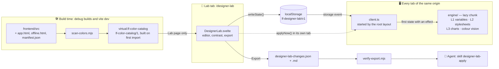
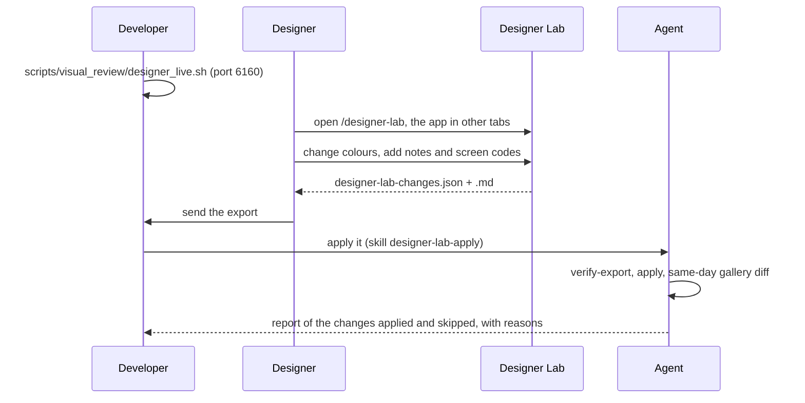

# 🧪 Designer Lab

The Designer Lab is a hidden page, `/designer-lab`, that exists only in **debug builds**. A designer opens
it in one browser tab and changes the app's colours; the app, open in other tabs of the same address,
repaints at once — charts included. At the end of a round the Lab **exports** the changes, with the file
and line of every occurrence, so that an agent can apply them to the code.

- **Designers** edit colours while looking at the real app: no code, no install.
- **Developers** start the server for them and receive the export.
- **Agents** verify the export and apply it with the skill `designer-lab-apply`.

!!! info "Developer tooling, not a feature"

    The Lab never reaches a release build, calls no backend API and stores nothing on the server. It has
    no entry in the user changelog, and its texts stay outside the app's translation catalogue.

---

## 🚦 Availability: Debug Builds Only

### 🔀 The Build Switch

`__LF_DESIGNER_LAB__` is a constant replaced at build time (`define` in `frontend/vite.config.ts`,
declared in `src/app.d.ts`). Its value comes from `designerLabEnabled()` in
`frontend/scripts/designer-lab/vite-plugin.mjs`:

| Build | `__LF_DESIGNER_LAB__` |
|:--|:--|
| `VITE_DEBUG=true`: `npm run build:debug`, `./dev.py front build --debug` | `true` |
| `vite build --mode development` | `true` |
| `vite dev` (`npm run dev`) | `true` |
| `npm run build`, `./dev.py front build` (release) | `false` |
| `LF_DESIGNER_LAB=1` or `LF_DESIGNER_LAB=0` in the environment | forced on or off, whatever the build |

`LF_DESIGNER_LAB=0` gives a debug build without the Lab, to compare two gallery captures with and without
it.

The value is a literal, so a release build turns every `if (__LF_DESIGNER_LAB__)` into `if (false)`:
Rollup drops the branch **and the dynamic `import()` inside it**, and no Lab chunk is emitted. Three
places hold such a branch:

| File | What the branch does |
|:--|:--|
| `src/routes/+layout.svelte` (`onMount`) | Imports and starts the Lab client, on every page |
| `src/routes/designer-lab/+page.ts` | `load()` answers `error(404)` when the switch is off |
| `src/routes/designer-lab/+page.svelte` | Imports `DesignerLab.svelte` in `onMount` |

```ts
// src/routes/+layout.svelte — onMount
if (__LF_DESIGNER_LAB__) import('$lib/dev/designer-lab/client').then((lab) => lab.start()).catch(() => {});
```

### 🧪 Test Server, E2E and Gallery

`./dev.py server --test` always builds and serves the **debug** bundle: `--test` forces debug mode, and
`frontend/build/.build-debug` records the mode of the last build. The E2E runs and the gallery use the
test server, so they all load the Lab client — idle: with no saved state it only listens for the
`storage` event, loads no engine and touches no stylesheet, variable or chart.

### 🛡️ Release Builds {: #release-builds }

- `/designer-lab` keeps only a stub. The backend's SPA fallback answers the URL with `200.html`
  (HTTP 200), then `+page.ts` throws the 404 and the client renders `+error.svelte`.
- The Vite plugin guards the switch in a build without the Lab:
    - `generateBundle` **fails the build** when an emitted file contains the marker `lf-designer-lab`,
      and names the files. The Lab's code carries it in its storage key, in the ids of the styles it
      injects and in its dev-server event;
    - `load` fails the build if anything imports `virtual:lf-color-catalog`.

!!! warning "Import the Lab only inside a branch"

    Every import of `$lib/dev/designer-lab` must be a dynamic `import()` inside an
    `if (__LF_DESIGNER_LAB__)` branch. A static import would carry Lab code into the release bundle; the
    marker guard stops `./dev.py front build` when that code holds the marker, as the client's store, the
    engines and the page do.

### 🔓 No Login

The route sits outside the `(app)` group: no login and no app shell. The Lab calls no API — it reads the
catalogue bundled with the build and the state saved in the browser. The app in the other tabs asks for
its login as usual.

### 🎨 Opening It for a Designer

`scripts/visual_review/designer_live.sh` starts a test server for a designer's review on its own lane:
port **6160**, data in `/tmp/librefolio-color-review`, copied from the latest gallery run (`--from` picks
the source lane, `--refresh` copies it again). The server listens on `0.0.0.0`, so a designer on the same
network can reach it.

```bash
# In a linked worktree, reuse the main venv: the script refuses to start without it
export PIPENV_CUSTOM_VENV_NAME=<main venv name>
scripts/visual_review/designer_live.sh
```

- The Lab: `http://<this-machine>:6160/designer-lab`.
- The app, in other tabs: `http://<this-machine>:6160`, logged in with the E2E admin user the script
  prints.

`--test` already serves the debug build: the Lab is there without the script's `--debug` option.

!!! tip "One address for every tab"

    The state lives in `localStorage` and travels through the `storage` event, both scoped to one origin.
    `http://localhost:6160` and `http://192.168.1.20:6160` are two origins that share nothing: open the
    Lab and the app with the same host name.

---

## 🏗️ Architecture

The Lab has two halves. The **catalogue**, built from the sources at build time, gives completeness and
provenance: every colour of every file, with file and line, even in components the page has not loaded.
The **runtime engines** give the immediate preview, acting on what the browser has really loaded. The
export joins the two: what changes, and where.



### 🔄 The Client

`client.ts`, with `store.ts`, is all of the Lab that an app page loads. `start()` is idempotent: it
publishes `window.__lfDesignerLab`, listens for `storage` events on the Lab's key (or `null`, which
`localStorage.clear()` sends), and syncs once:

1. read the state; while no engine is loaded, stop unless the state has an effect — not suspended, with
   at least one change or a colour-vision mode;
2. otherwise import `engine/` (a separate chunk) once, and call `applyState(state)`.

The Lab page writes the state itself, and a tab gets no `storage` event for its own writes, so the page
calls `applyNow()`. Nothing else runs while idle: no `BroadcastChannel`, no observer. The engine adds its
observers — theme switches on `<html>`, late stylesheets in `<head>` — only while a state is active;
`applyState(null)`, or a suspended state, undoes everything and leaves the module loaded but idle.

### 💾 The Shared State

`store.ts` keeps one JSON document in `localStorage['lf-designer-lab/v1']`, schema
`lf-designer-lab-state/1`. A state with another schema is ignored.

| Field | Content |
|:--|:--|
| `changes` | The changes, in the order they were first made |
| `suspended` | Show the original colours without losing the changes |
| `cvd` | Colour-vision simulation: `none`, `protanopia`, `deuteranopia`, `tritanopia`, `achromatopsia` |
| `notes`, `author` | The general note and its author, both exported |
| `variants`, `activeVariant` | Named snapshots of `changes`, for A/B comparison |
| `updatedAt` | Time of the last write |

A change has an `id` — `<layer>:<target>@<scope>`, plus `#<literal id>` when it is restricted to one
stylesheet occurrence — a `layer`, a `target` (a variable name or a colour key), a `scope` (`light`,
`dark` or `both`), `from`, `to` (any CSS colour, `var(--x)` included), `alphaVariants` (default `true`),
`occurrence` and `match` for a single occurrence, a `note` and `shots`. `isSafeCssValue()` refuses a `to`
longer than 200 characters or holding a semicolon, a brace, an angle bracket, a quote, a backtick, a
backslash or a comment opener, so a typo cannot break out of a style rule.

### 🎛️ L1 — CSS Variables

`engine/vars.ts` writes one `<style id="lf-designer-lab-vars">` in `<head>`, with one rule per `css-var`
change; the selector carries the scope:

```css
/* example values — scope both, light, dark */
html { --color-emerald-600: oklch(62% 0.13 160) !important; }
html:not(.dark) { --theme-text-muted: #5b6370 !important; }
html.dark { --theme-text-muted: #a3adbd !important; }
```

An `!important` declaration beats every normal one, inside `@layer theme` or not, so everything that
reads the variable follows at once:

- Tailwind classes, which read the palette at runtime (`.text-red-500{color:var(--color-red-500)}`);
- their opacity modifiers (`color-mix(in oklab, var(--color-red-500) 20%, transparent)`);
- the brand (`--color-libre-*`) and the `--theme-*` variables of `app.css`.

The reach is the variable: changing `--color-emerald-600` changes **every** class that uses it. The
editor shows the impact — uses, files, the most used classes, where the sources define the variable.

This path serves the variables the whole page inherits, `scope: root` in the catalogue (`:root`,
`html`, `@theme`, `html.dark`…). Variables that a component defines on its own elements
(`--highlight-*`, `--cropper-*`, `--lf-price-flash-*`…) are `scope: scoped`: L2 rewrites their defining
rule instead.

### 🖌️ L2 — Stylesheet Colours

`engine/stylesheets.ts` rewrites colours in the CSSOM: every rule of every readable stylesheet, nested
rules (`@media`, `@supports`, `@layer`) included, minus the Lab's own styles (`data-lf-lab-own`).

- **By parsed colour, never by text.** Chrome serialises `#64748b` as `rgb(100, 116, 139)` and expands
  shorthands into longhands: each colour token of a declaration is parsed and compared by its colour key.
- **Reversible.** A rewritten declaration keeps its priority and its original text is saved: each new
  plan, or none, starts from the page as it was.
- **Alpha variants.** Translucent writings of the colour share its key and change too, keeping their
  alpha. A change can opt out (**Translucent variants too**).
- **Late stylesheets.** SvelteKit loads CSS per route. While a plan is active, a `MutationObserver` on
  `<head>` rewrites each `<link rel="stylesheet">` when it loads and each `<style>` as it arrives.
- **Component variables.** A `css-var` change to a variable defined on a non-root rule rewrites that
  definition.
- **One occurrence.** A change restricted to one occurrence carries the selector and property that the
  catalogue recorded. The engine compares them with each rule after `normalizeSelector()` — `.svelte-…`
  scope classes dropped, `:global()` unwrapped, spaces and case normalised — and accepts a longhand of the
  recorded property (`border` → `border-top-color`). Occurrence changes are tried before value changes of
  the same colour. While no loaded rule matches them (its component is not on screen), the change shows
  nothing: by design, the engine does not fall back to every occurrence of the colour. The change is
  exported all the same.
- **Theme.** A `light` or `dark` change applies only while that theme is on, whatever the rule's
  selector; the engine re-plans at every theme switch. The editor warns when a one-theme change reaches
  rules written for both themes.

The step 0 spike measured the technique on `/transactions`: 24 stylesheets and 3,718 rules scanned in
13.5 ms, 33 declarations rewritten in 0.3 ms.

### 📈 L3 — Chart Colours

ECharts options are built in JavaScript: there is no stylesheet to rewrite. `engine/charts.ts` combines
two mechanisms:

1. **A wrapper on the shared prototype.** At the first non-empty chart plan the engine imports `echarts`
   — the module the app imports, so every instance shares one prototype — takes an instance on screen, or
   a 1×1 probe on a detached `<div>`, and wraps `setOption` on its prototype. From then on every option
   an instance receives (first render, new data, theme switch) has its colours mapped. With an empty plan
   the wrapper is a pass-through.
2. **A live re-apply of the instances on screen.** The engine finds them through `[_echarts_instance_]`
   and `getInstanceByDom()`, reads each `getOption()`, builds a sparse patch with only the colour paths
   that change, and merges it with the original `setOption`. Component lists at the root get `{}`
   placeholders, because ECharts merges them by index; other arrays (`data`, `colorStops`, a palette) are
   sent whole. Zoom and data stay as they are.

The re-apply exists because forcing a redraw is not enough: 5 of the 17 chart components do not redraw
when the class of `<html>` changes without a theme switch. ScatterChart, CorrelationHeatmap, ExposureBars
and ExposureMaps only store the `dark` flag, and SemiDonutChart has no observer at all. The spike
confirmed it on the correlation heatmap, the scatter and the semi-donut; the re-apply updated 6 instances
out of 6, in 1.9–6.8 ms each, with patches of 151–650 bytes.

The mapping:

- is **copy-on-write**: the app's objects are never mutated;
- walks strings (`rgba()` keeps its alpha; tooltip HTML included), gradients (`colorStops`) and
  functions: `formatter`, `color` and `renderItem` are wrapped once, and their return value is mapped with
  the plan in force at call time;
- is **reversible**: every string the engine writes is remembered with the original it replaced, so a
  new plan, or none, starts from the app's own colours;
- writes canvas colours as sRGB `rgba(r, g, b, a)` with a four-decimal alpha, clamped to the sRGB gamut:
  a form no colour of the app uses, so the engine recognises its own output when it reads an option back;
- keeps one plan per theme, and reads the theme in force when it maps.

### 👓 Colour-Vision Simulation

`engine/cvd.ts` applies an SVG `feColorMatrix` filter to `<html>`: protanopia, deuteranopia and
tritanopia with the matrices of Machado, Oliveira & Fernandes (2009) at severity 1, in linear RGB, and
achromatopsia with the Rec. 709 luminance weights. The root element is the one place where `filter` does
not turn the element into the containing block of its fixed descendants, so modals and sticky headers keep
their place. The mode is part of the state: every tab follows, the Lab's own included.

### 🔍 The Debug Hook

`start()` publishes `window.__lfDesignerLab` (typed in `src/app.d.ts`) in every tab of a debug build, for
E2E tests and the browser console:

| Member | Returns |
|:--|:--|
| `active()` | Whether an engine is active in this tab |
| `stats()` | `{cssRules, chartInstances, varOverrides}`: declarations rewritten, chart instances patched, variable overrides written |
| `chartColors(selector)` | A promise of the distinct colours of the ECharts instance in the first element matching `selector` |

An idle tab answers `active() === false` and zero stats.

---

## 🗂️ The Colour Catalogue

### ▶️ The Scanner

`frontend/scripts/designer-lab/scan-colors.mjs` is a Node ESM module without dependencies. The Vite
plugin calls it, and it runs as a CLI for agents:

```bash
node frontend/scripts/designer-lab/scan-colors.mjs --summary                           # summary only
node frontend/scripts/designer-lab/scan-colors.mjs --out /tmp/catalog.json --summary   # catalogue + summary
```

`--pretty` indents the JSON, `--root <dir>` scans another `frontend/` tree, `--app-version <v>` stamps
`meta.app_version`. Without `--out` the summary is printed anyway.

It reads every `.svelte`, `.ts`, `.js` and `.css` file under `frontend/src` — outside `node_modules`,
without the generated API clients (file names starting with `generated`, or containing `openapi` or
`tool-contract-map`) and without the Lab's own folders — plus three documents outside the bundle:
`src/app.html`, `static/offline.html` and `static/manifest.json`. Test files (`__tests__`, `__mocks__`,
`.test.`, `.spec.`) only count towards the `var()` and definition totals of `meta.parity`, as in the
Python inventory; they never enter the catalogue.

Colour parsing lives in `src/lib/dev/designer-lab/color.js`, plain ESM with JSDoc types: the scanner
(Node) and the engines (browser) import the same file, with no compile step in between.

A scan costs about 1.5 s of CPU for ~1,050 files (the wall time grows on a busy machine) and produces
about 750 KB of JSON.

### 📐 Schema `lf-color-catalog/1`

| Key | Content |
|:--|:--|
| `meta` | `schema`, `app_version`, `generated_at`, `hash`, `scan_ms`, `parity` (the totals shared with the Python inventory), `layers` (literals per layer), `excluded` (the Lab's folders) |
| `files` | Paths relative to `frontend/`; the other sections point into this list by index |
| `css_vars` | Every custom property defined or read with `var()`: `name`, `defs` (file, line, value, zone, selector, theme and `scope`, `root` or `scoped`), `uses`, uses per file |
| `palette` | Every colour variable a Tailwind class reaches (`text-emerald-600` → `--color-emerald-600`, `bg-libre-green` → `--color-libre-green`): uses, uses under `dark:`, classes, files, and `occ`, the `[file, line]` of every use |
| `literals` | Every hand-written colour: `id`, `file`, `line`, `col`, `raw`, `kind` (`hex`, `fn`, `mix`), `key`, `alpha`, `zone`, `theme`, `layer`, `preview`, `snippet`. Stylesheet colours add `selector`, `at` (the enclosing at-rules) and `property`; script colours add `chart`; markup colours add `via` |
| `by_value` | Colour key → literal ids |

`meta.hash` is a `sha256:` of the body only, without volatile fields such as `generated_at` and
`scan_ms`: it stays the same on an unchanged tree, and the export records it as `catalog_hash`.

**Colour key.** Equal colours are grouped whatever their notation: `#rrggbb` (lower case, alpha dropped)
inside sRGB, a rounded `oklch(…)` outside. Alpha is not part of the key, so the translucent variants of a
colour share it. Expressions (`color-mix()`, `var()`) have `key: null`.

**Zones and layers.** Where a colour is written decides whether the Lab can preview it:

| Zone | Where the colour is written | Layer | Live preview |
|:--|:--|:--|:--|
| `svelte-style` | A `<style>` block of a `.svelte` file | `css-literal` | ✅ |
| `css-file` | A `.css` file | `css-literal` | ✅ |
| `svelte-markup` | Markup, inside a Tailwind arbitrary class (`bg-[#…]`) | `css-literal` | ✅ |
| `svelte-markup` | Markup, in a `style=` attribute or elsewhere | `markup` | ❌ |
| `svelte-script`, `ts` | The script of a chart file | `chart-color` | ✅ |
| `svelte-script`, `ts` | Any other script (`.ts` and `.js`) | `script` | ❌ |
| `static` | `app.html`, `offline.html`, `manifest.json` | `static` | ❌ |

A **chart file** is one under `components/charts`, `components/dashboard`, `components/risk`,
`components/brokers/lots`, a `charts/` folder or `features/tools/pac-allocator/planner/result/`, or any
file that imports from `'echarts'`. It is a heuristic: a `chart-color` previews only where it reaches an
ECharts option.

**Theme hint.** In stylesheets, `dark` or `light` when the rule, or a block around it, is limited to one
theme: by a `prefers-color-scheme` media query, or by a selector list whose selectors all name the same
theme — `.dark` or `:not(.light)` for dark, `.light` or `:not(.dark)` (`html:not(.dark)`) for light. A
list that mixes themes (`.a, html.dark .b`) applies in both and fixes nothing; `both` otherwise. In
scripts, `dark` or `light` from an object key (`dark: '#…'`) or from the side of a ternary whose condition
names the dark theme, on one line (`isDark ? … : …`) or split as Prettier writes it (`isDark` ending a
line, `? '#…'` and `: '#…'` on the next ones); a negated condition (`!isDark`) swaps the sides. In markup,
`dark` when the class holding the colour carries a `dark:` variant (`dark:bg-[#1e293b]`), never from a
neighbouring class. `null` otherwise.

### ⚖️ Parity with the Python Inventory

`scripts/visual_review/color_inventory.py`, the inventory of the visual-review toolkit, counts the same
tree with the same file selection and the same regular expressions, line by line. `meta.parity` holds the
totals the two share: files, Tailwind palette classes, custom-token classes, arbitrary classes, hex
literals, colour functions, `var()` uses and custom property definitions. On 14/10/2026 both reported
1,047 files, 1,610 hex literals and 211 colour functions, with the same occurrences line by line.

!!! warning "Change one, change the other"

    A new regular expression, extension or exclusion in one scanner must land in the other in the same
    change, or the two inventories drift apart. The Lab's own folders, `src/lib/dev/designer-lab/` and
    `src/routes/designer-lab/`, are excluded from both (`LAB_DIRS` in each file): they are tooling, not
    the app.

### 🔌 The Vite Plugin

`designerLabPlugin()` (`frontend/scripts/designer-lab/vite-plugin.mjs`, registered in `vite.config.ts`):

- **serves `virtual:lf-color-catalog`.** The catalogue is built on the first import only — a build or a
  dev server that never reaches the Lab never scans — and emitted as `JSON.parse` of a string literal,
  cheaper to evaluate than an object literal of this size. In a build it is a snapshot of the sources
  that ships only with the Lab page's lazy chunks. `src/lib/dev/designer-lab/virtual-catalog.d.ts` types
  it: an ambient file, because `app.d.ts` is a module;
- **under `vite dev`**, forgets the catalogue when a scanned source changes, invalidates the module and
  sends the `lf-designer-lab:catalog-stale` event: an open Lab then asks for a reload;
- **in a build without the Lab**, runs the guard described in [Release builds](#release-builds).

---

## 🖥️ The Lab Page

`DesignerLab.svelte` reads the catalogue and the saved state, and writes every edit back to the state
(`writeState()`, then `applyNow()`).

**Header.**

- **Editing**: the theme the next change applies to — light, dark or both; the theme on screen by
  default.
- **Suspend / Resume**: every tab shows the original colours; the changes are kept.
- **Variant**: **Save variant** stores the current changes under a name. Choosing another variant first
  saves the changes on screen into the active one (into `current` when none is active), then loads the
  chosen one: A/B in one click.
- **Colour vision**: the simulation mode, for every tab.
- **Export JSON + MD**, **JSON**, **MD**, **Copy summary**, **Import**, and **Reset all**, which asks for
  confirmation and keeps notes, variants and the colour-vision mode.

**Tabs.** A search box (name, value or file) filters the palette, variable and value tabs.

| Tab | Content |
|:--|:--|
| Overview | Hand-written colours per layer and how many are live-editable, palette and app variables in use, catalogue schema, file count and scan time |
| Tailwind palette | The `--color-*` variables the classes reach, by family and shade, with their uses |
| App variables | Variables the app defines with a colour value: brand, `--theme-*`, component variables |
| Stylesheets | `css-literal` colours grouped by value, alpha variants together, with occurrences, files, alphas and theme hints |
| Charts | `chart-color` colours, grouped the same way |
| No preview | `script`, `markup` and `static` colours: proposals only |
| Changes | The current changes, from → to, with layer, theme and note |
| Contrast | WCAG ratios before and after the changes, in both themes, plus a free pair |
| Notes | Author and general note, both exported |

**Editor** (`ColorEditor.svelte`), opened from any entry:

- a text field that accepts any CSS colour, OKLCH sliders (L, C, H), and a warning when the value leaves
  sRGB;
- `<input type="color">` as an sRGB shortcut, and **Snap to a variable**, which writes `var(--x)`: a
  proposal to unify two colours;
- for values, **Translucent variants too** and, in stylesheets, **Reach in the code**: every occurrence,
  or one occurrence with its selector;
- a note and gallery screen codes such as `dashboard/kpi-top` — the codes of the designer package;
- the impact of a variable (uses, files, most used classes, definitions), or the occurrences of a value
  (file, line, selector, property, theme, snippet).

**Contrast** (`contrast.ts`, `ContrastPanel.svelte`). The declared pairs come from the catalogue: every
root `--theme-text-*` on every root `--theme-bg-*` except the hover surfaces (AA at 4.5:1, AAA at 7:1),
and every `--theme-border-*` on the card surface (3:1, the threshold of UI components). *Before* uses
the values the sources define for each theme, *after* applies the `css-var` changes; a translucent
foreground is composited over the background first. Changes to literal colours do not enter this table.

---

## 🎚️ Live Preview: Layers and Limits

### 🧱 The Four Change Layers

| Change layer | What it changes | Engine | Reach |
|:--|:--|:--|:--|
| `css-var` | A custom property: Tailwind's `--color-*`, the brand `--color-libre-*`, `--theme-*`, a component variable | L1 on `<html>`; L2 for a component variable | Every use of the variable |
| `css-literal` | A colour written in a stylesheet: a component `<style>`, `app.css`, a Tailwind arbitrary class | L2 | The value with its translucent variants, or one occurrence |
| `chart-color` | A colour written in a chart script, as it reaches an ECharts option | L3 | The value with its translucent variants |
| `proposal` | Colours with no live path: inline styles, other markup and scripts, generated colours, `app.html`, `offline.html`, `manifest.json` | — | Exported only, with `preview: false` |

### ⚠️ Known Limits

- **By value, not by meaning.** Until colours become tokens, a change reaches every place that writes the
  value (problem P5 of the colour analysis): the spike found the same `#64748b` in 33 rules of
  `/transactions` — a modal, the pagination, the data table. The editor lists the occurrences, and a
  stylesheet colour can go down to one occurrence; a chart colour cannot, because an ECharts option
  carries no provenance. The export lists the catalogue's occurrences for both.
- **ECharts' default palette** (`#5070dd`, …) is not written in the app's sources: it is not in the
  catalogue, and the Lab does not offer it.
- **Derived and generated colours.** A colour computed before `setOption` — a shade derived from a
  literal (`shadeForDepth`), an HSL generated from an index (`getIndexColor`, `lotColor`) — reaches the
  option as a value no change targets. The preview changes a base colour only where the option carries it
  unchanged; the export still points at the literal in the source.
- **No preview** for the `proposal` layer.
- **Wide gamut.** Stylesheets keep the value as typed, so an `oklch()` outside sRGB stays wide; charts
  receive it clamped to sRGB. The editor warns when a value leaves sRGB. `<input type="color">` and the
  gallery screenshots are sRGB only, so a wide-gamut display shows such colours more saturated than the
  PNGs.

---

## 📤 Export for Agents



### 📄 What the Designer Downloads

- **`designer-lab-changes.json`**, schema `lf-designer-lab/1`, for the agent.
- **`designer-lab-changes.md`**, its twin for people: one section per change (from → to, reach, impact,
  note, screen codes, definitions) and a table of up to 40 occurrences, the rest only in the JSON.
  Headings follow the Lab's language.
- **Copy summary** puts a header and one line per change on the clipboard, for a chat or an e-mail.

The export is a browser download: nothing is stored on the server. Keep it outside the repository, in
`lab-exports/` of the visual-review work directory (`$LF_VISUAL_REVIEW_DIR`, by default
`~/LibreFolio_visual_review`).

### 🧾 Schema `lf-designer-lab/1`

An abridged export (occurrence lists and classes cut):

```json
{
  "schema": "lf-designer-lab/1",
  "app_version": "v1.2.0-11-g27228466c",
  "catalog_hash": "sha256:39340076…",
  "exported_at": "2026-10-20T15:02:11+02:00",
  "author": "",
  "notes": "Greens too bright in light mode.",
  "changes": [
    {
      "id": "css-var:--color-emerald-600@light",
      "layer": "css-var",
      "scope": "light",
      "preview": true,
      "target": "--color-emerald-600",
      "from": "oklch(59.6% 0.145 163.225)",
      "to": "oklch(62% 0.13 160)",
      "occurrences": [{"file": "src/lib/components/assets/AssetCard.svelte", "line": 133}],
      "impact": {"uses": 52, "files": 27, "classes": {"text-emerald-600": 46, "bg-emerald-600": 3}},
      "note": "gains green too bright",
      "shots": ["assets/list"]
    },
    {
      "id": "css-literal:#374151@dark",
      "layer": "css-literal",
      "scope": "dark",
      "preview": true,
      "target": "#374151",
      "from": "#374151",
      "to": "#3b4556",
      "occurrences": [
        {
          "file": "src/lib/components/brokers/BrokerImportFilesModal.svelte",
          "line": 438,
          "col": 30,
          "raw": "#374151",
          "layer": "css-literal",
          "theme_context": "dark",
          "selector": ":global(.dark) .modal-header",
          "property": "border-bottom-color",
          "snippet": "border-bottom-color: #374151;"
        }
      ],
      "granularity": "value",
      "alpha_variants": true
    }
  ],
  "contrast": [{"fg": "--theme-text-muted", "bg": "--theme-bg-primary", "scope": "light", "before": 4.83, "after": 5.12}],
  "variants": {}
}
```

| Field | Meaning |
|:--|:--|
| `app_version`, `catalog_hash` | The build (`__APP_VERSION__`) and the catalogue the export was made with |
| `exported_at` | ISO 8601 with the local offset |
| `author`, `notes` | From the **Notes** tab |
| `changes[].id`, `layer`, `scope`, `target` | As in the state |
| `changes[].preview` | `false` only for `proposal` |
| `changes[].from`, `to` | The value the Lab saw, and the new value (any CSS colour, `var(--x)` included) |
| `changes[].granularity`, `alpha_variants` | Every layer but `css-var`: `value` or `occurrence`, and whether translucent writings change too |
| `changes[].impact`, `definitions` | `css-var`: uses, files and Tailwind classes; where the sources define the variable (file, line, selector, theme, value) |
| `changes[].occurrences` | `css-var`: the file and line of every class use. Other layers: `file`, `line`, `col`, `raw`, `layer`, `theme_context`, `selector`, `property`, `snippet` |
| `changes[].note`, `shots` | The designer's note and gallery screen codes, when given |
| `contrast` | The declared pairs whose ratio changed: `fg`, `bg`, `scope`, `before`, `after` |
| `variants` | The named variants, as the Lab stores them |

The occurrences of a value change are the catalogue literals with the same colour key, in the change's
layers (`proposal` covers `script`, `markup` and `static`); translucent ones are listed only with
`alpha_variants`. A one-theme change leaves out the other theme's occurrences only where their theme is
certain: in stylesheets (`css-file`, `svelte-style`), where the rule's selectors and media queries give
it, and in markup (`svelte-markup`), where the `dark:` variant of the colour's own class gives it. A
script occurrence (`ts`, `svelte-script`) is always kept, whatever its hint: a script's theme is a guess
from names and ternaries, so the agent reads its `theme_context`.

### 📥 Import

**Import** reads an export back (`parseImport()` in `export.ts`):

- it requires the schema `lf-designer-lab/1`; a change with an unknown layer or scope, or an unsafe `to`,
  is reported and skipped;
- it warns when `catalog_hash` differs from the running catalogue: the code changed since the export;
- it finds a single-occurrence change again by file, line and raw value; when that occurrence is gone,
  the change falls back to every occurrence of the value, with a warning;
- the imported changes **replace** the current ones; notes, author and variants come from the file when
  it has them.

### ✅ Verifying an Export

`verify-export.mjs` checks an export against the code as it is now:

```bash
node frontend/scripts/designer-lab/verify-export.mjs designer-lab-changes.json          # human summary
node frontend/scripts/designer-lab/verify-export.mjs designer-lab-changes.json --json   # lf-designer-lab-verify/1 report
```

It rebuilds the catalogue to compare its hash with `catalog_hash`, then looks for every occurrence on its
`file:line`, case-insensitively — the raw value, or `family-shade` (`emerald-600`) for a Tailwind class
use:

- **ok**: still there;
- **moved**: elsewhere in the same file, reported with the nearest line;
- **missing**: nowhere in the file.

Variable definitions are checked the same way, and `value_now` reports a definition whose value changed
since the export. `--root <dir>` checks another `frontend/` tree.

| Exit code | Meaning |
|:--|:--|
| `0` | Nothing is missing (moved occurrences are fine) |
| `1` | At least one occurrence is missing |
| `2` | Bad input: no file, not JSON, or not an `lf-designer-lab/1` export |

### 🤖 The Skill `designer-lab-apply`

`.github/skills/design-tools/designer-lab-apply/SKILL.md` tells an agent how to apply an export:

1. verify it with `verify-export.mjs`;
2. group the changes by layer;
3. apply them occurrence by occurrence — never a blind replace of a value everywhere — respecting
   `scope` and `theme_context`, and the owners of `app.css` and of the token files;
4. prove the effect with a same-day gallery diff (`scripts/visual_review/README.md`);
5. report every change, including those not applied and why.

Changing how the app looks is a decision: an agent applies an export only when the developer asks, in a
workstream allowed to change the appearance.

---

## 🛠️ Developer Notes

### 📁 File Map

| File | Role |
|:--|:--|
| `frontend/scripts/designer-lab/scan-colors.mjs` | Colour scanner and CLI: the `lf-color-catalog/1` catalogue |
| `frontend/scripts/designer-lab/vite-plugin.mjs` | `designerLabEnabled()`, `virtual:lf-color-catalog`, the release guard |
| `frontend/scripts/designer-lab/verify-export.mjs` | Checks an export against the current code |
| `frontend/vite.config.ts` | Registers the plugin, defines `__LF_DESIGNER_LAB__`, excludes the Lab from istanbul |
| `frontend/src/app.d.ts` | Declares `__LF_DESIGNER_LAB__` and `Window.__lfDesignerLab` |
| `frontend/src/routes/+layout.svelte` | One line in `onMount`: starts the client |
| `frontend/src/routes/designer-lab/` | The route: `+page.ts` (404 without the Lab) and `+page.svelte` (lazy import of the page) |
| `frontend/src/lib/dev/designer-lab/client.ts`, `store.ts` | The client every page loads, and the shared state |
| `frontend/src/lib/dev/designer-lab/engine/` | `index.ts` (orchestration), `vars.ts` (L1), `stylesheets.ts` (L2), `charts.ts` (L3), `cvd.ts`, `targets.ts` (the value each consumer accepts) |
| `frontend/src/lib/dev/designer-lab/color.js` | Colour parsing, OKLCH and sRGB conversion, gamut, WCAG contrast — shared by Node and the browser |
| `frontend/src/lib/dev/designer-lab/DesignerLab.svelte`, `ColorEditor.svelte`, `ContrastPanel.svelte` | The page |
| `frontend/src/lib/dev/designer-lab/catalogView.ts`, `contrast.ts`, `export.ts` | What the page lists, contrast pairs, export and import: pure functions |
| `frontend/src/lib/dev/designer-lab/i18n.ts`, `labTheme.ts` | The Lab's dictionary and its own colours |
| `frontend/src/lib/dev/designer-lab/types.ts`, `virtual-catalog.d.ts` | Types of the catalogue, the state and the hook |
| `scripts/visual_review/designer_live.sh` | The review server for a designer (port 6160) |
| `scripts/visual_review/color_inventory.py` | The Python inventory kept in parity with the scanner |
| `.github/skills/design-tools/designer-lab-apply/SKILL.md` | The agent's skill |

### 🎨 The Lab Never Repaints Itself

The Lab's own colours reach the page only as `--lab-*` custom properties in the inline `style` of its
root element (`labTheme.ts`, one set for light and one for dark, following the class of `<html>`). Its
stylesheets hold no colour, only `var(--lab-*)`, and its markup uses no Tailwind colour class. The
engines rewrite stylesheet rules and `<html>` variables, never an inline style, so editing the app's
colours never repaints the Lab. The colour-vision filter sits on `<html>` and applies to the Lab as well.

### 🌐 Language

The Lab speaks Italian and English through its own small dictionary, `i18n.ts` (`labT`, `labLang`):
Italian when the app's locale is Italian, English for every other language. This is a developer decision:
the Lab is a debug tool and stays outside the app's translation catalogue, an exception to the
four-language rule of the UI. Do not add Lab keys to the [app catalogue](i18n.md).

### 🧪 Tests and Gates

- The Lab lives under `frontend/src`, so the source gates that walk the whole tree cover it too. In
  `frontend/src/`: no `{@html}` (`htmlSink.gate.test.ts`), clipboard writes only through
  `writeTextToClipboard` (`clipboardSink.gate.test.ts`), `htmlInterpolation.gate.test.ts`,
  `flagFont.gate.test.ts` and `routes/documentTitle.guard.test.ts`. See
  [Security Architecture](../architecture/security.md) for the output-escaping gates.
- Coverage runs exclude the Lab's folders (`exclude` of the istanbul plugin in `vite.config.ts`): debug
  tooling would only add never-run files.
- Unit tests sit next to the sources, as `*.test.ts` files in `frontend/src/lib/dev/designer-lab/`.
- Seams for tests: the pure modules (`color.js`, `store.ts`, `catalogView.ts`, `contrast.ts`,
  `export.ts`); the exported functions of the scripts (`scanColors()`, `scanSource()`,
  `listSourceFiles()`, `designerLabEnabled()`, `filesWithMarker()`, `verifyExport()`, `locate()`);
  `mapChartOption()` and `chartPatch()` in `engine/charts.ts`, kept for tests. In the browser,
  `window.__lfDesignerLab` and the test ids: the page root is `data-testid="designer-lab"`, with
  `data-catalog-hash` and `data-changes`, and every control has a `lab-…` test id.

### 🔁 Rebuilds

The switch and the catalogue are fixed when the bundle is built, and `dev.py` decides whether to rebuild
from the timestamps of `frontend/src` and of a few config files: it sees neither `frontend/scripts/` nor
an environment variable. After changing the scanner or the plugin, or `LF_DESIGNER_LAB`, force a rebuild
(`./dev.py server --test --rebuild`, or `./dev.py front build --debug`).

!!! note "Related pages"

    [Styling & Design System](styling.md) for the variables and the dark mode the Lab edits, and
    [Charts & Animations](components/charts.md) for how the charts build their ECharts options.
