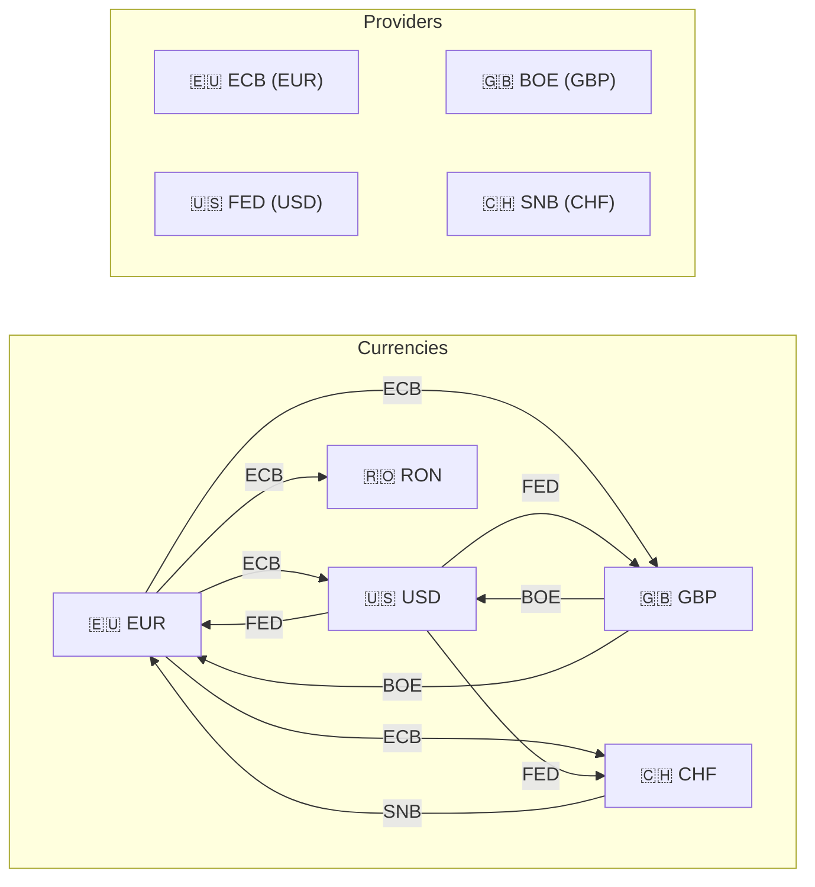
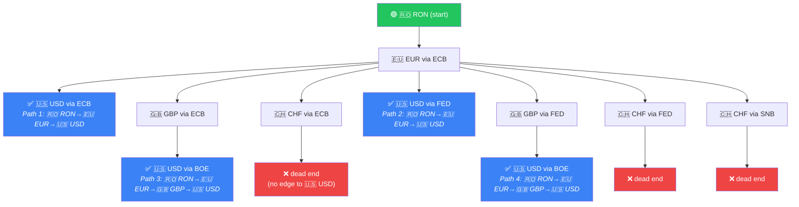

# 🔗 FX Conversion Chain — Pathfinding Algorithm

*Status: Implemented (Mar 2026)*

## 📖 Overview

LibreFolio allows users to convert between any two currencies, even when no single provider covers the pair directly. The frontend builds a **currency graph** and runs a **DFS (Depth-First Search) with backtracking** to discover all possible conversion routes — both direct (1-step) and multi-step (chain).

The algorithm lives in two modules:

| Module | Purpose |
|:-------|:--------|
| `src/lib/utils/currencyGraph.ts` | Graph construction + DFS pathfinding |
| `src/lib/stores/currencyGraphStore.ts` | Session-level caching + public API |

## 🌐 The Currency Graph

The graph is a **MultiDirectedGraph** (from the [graphology](https://graphology.github.io/) library):

- **Nodes** = all ISO 4217 currency codes (~180), from `GET /utilities/currencies`
- **Edges** = provider capabilities, from `GET /fx/providers`

### 🔗 Edge Construction

For each provider `P` (excluding `MANUAL`):

- For each base `B` in `P.base_currencies`
- And target `T` in `P.target_currencies` (with `B != T`)

**Add Directed Edge:** `B ➔ T` with payload `{provider: P.code}`

Key design decisions:

1. **Single directed edges** — one edge $B \to T$ per (provider, base, target). No reverse edge $T \to B$ is added.
2. **Bidirectionality via DFS** — the DFS explores both outbound edges ($B \to T$) and **inbound** edges ($T \leftarrow B$) at each node, effectively traversing in reverse.
3. **Multi-graph** — if two providers both cover 🇪🇺 EUR→🇺🇸 USD, there are two parallel edges with different `provider` attributes.

### ❓ Why Single-Direction Edges?

| Approach | Edges | Pros | Cons |
|:---------|:------|:-----|:-----|
| Bidirectional (2 edges per pair) | `2 * E` | Simple DFS (outbound only) | Doubled memory, unclear semantics |
| **Single + DFS inbound** ✅ | `E` | Clear semantics, compact | DFS must explore 2 directions |

The single-direction approach encodes the real relationship: *"Provider P publishes rates from B to T"*. The backend's `compute_chain_rate()` uses alphabetical normalization to decide whether to use the rate directly or invert it ($1/\text{rate}$).

## 📐 Simplified Example Graph

Consider 4 providers and 5 currencies:



Each arrow is a directed edge with the provider label. The DFS can traverse any edge in reverse (e.g., go from 🇺🇸 USD to 🇪🇺 EUR via the ECB edge 🇪🇺 EUR→🇺🇸 USD).

### 📋 Example: All Routes from 🇷🇴 RON to 🇺🇸 USD

Starting from **🇷🇴 RON**, the DFS finds these paths:

| # | Path | Steps | Providers |
|:--|:-----|:------|:----------|
| 1 | `🇷🇴 RON →[ECB]→ 🇪🇺 EUR →[ECB]→ 🇺🇸 USD` | 2 | ECB × 2 |
| 2 | `🇷🇴 RON →[ECB]→ 🇪🇺 EUR →[FED]→ 🇺🇸 USD` | 2 | ECB + FED |
| 3 | `🇷🇴 RON →[ECB]→ 🇪🇺 EUR →[BOE]→ 🇬🇧 GBP →[BOE]→ 🇺🇸 USD` | 3 | ECB + BOE × 2 |
| 4 | `🇷🇴 RON →[ECB]→ 🇪🇺 EUR →[SNB]→ 🇨🇭 CHF →[FED]→ 🇺🇸 USD` | 3 | ECB + SNB + FED |
| 5 | `🇷🇴 RON →[ECB]→ 🇪🇺 EUR →[FED]→ 🇬🇧 GBP →[BOE]→ 🇺🇸 USD` | 3 | ECB + FED + BOE |
| ... | *(other 3-4 step combinations)* | 3-4 | ... |

Route 1 is the shortest (2 steps) and uses only ECB. Route 2 mixes ECB and FED. Longer chains provide more fallback options but carry higher failure risk.

!!! warning "Chain Failure Risk"

    If **any single step** in a chain fails (provider down, API error), the **entire chain** fails. Shorter chains are more reliable.

## 🔍 DFS Algorithm

### 📝 Pseudocode

```
function findAllPaths(graph, source, target, maxDepth=4):
    validPaths = []

    function dfs(currentNode, pathEdges, visitedNodes, providerUseCount):
        if currentNode == target:
            validPaths.append(copy(pathEdges))
            return

        if len(pathEdges) >= maxDepth:
            return

        function tryEdge(neighbor, provider):
            if neighbor ∈ visitedNodes:        ← Constraint 1
                return
            if providerUseCount[provider] >= 2: ← Constraint 2
                return

            // ADVANCE
            pathEdges.push({from: currentNode, to: neighbor, provider})
            visitedNodes.add(neighbor)
            providerUseCount[provider] += 1

            dfs(neighbor, pathEdges, visitedNodes, providerUseCount)

            // BACKTRACK
            pathEdges.pop()
            visitedNodes.remove(neighbor)
            providerUseCount[provider] -= 1

        // Explore outbound edges (native direction)
        for each edge (currentNode → T) with provider P:
            tryEdge(T, P)

        // Explore inbound edges (reverse direction)
        for each edge (S → currentNode) with provider P:
            tryEdge(S, P)

    dfs(source, [], {source}, {})
    return sort(validPaths, by=length)
```

### 📏 Constraints

The DFS enforces **two constraints** at each step to produce valid, non-redundant routes:

#### 🔄 Constraint 1 — Simple Paths (No Repeated Nodes)

$$
\text{neighbor} \notin \text{visitedNodes}
$$

Each node (currency) can appear **at most once** in a path. This eliminates:

- **Trivial cycles**: A → B → A (returning to the same node)
- **Redundant round-trips**: 🇪🇺 EUR → 🇺🇸 USD → 🇬🇧 GBP → 🇪🇺 EUR → 🇷🇴 RON (the 🇪🇺 EUR→🇺🇸 USD→🇬🇧 GBP→🇪🇺 EUR detour is pointless and introduces unnecessary failure risk)

The source node is added to `visitedNodes` at initialization, so the DFS can never return to it. The target node is **not** in `visitedNodes` — it serves as the exit condition.

!!! note "Evolution"

    The original algorithm used `usedEdgePairs: Set<string>` (tracking visited *edges*, not *nodes*). This allowed the same node to appear multiple times if reached via different edge pairs, producing redundant cycles like `🇪🇺 EUR→🇺🇸 USD→🇬🇧 GBP→🇪🇺 EUR→🇷🇴 RON`. Switching to `visitedNodes` (simple paths) eliminated these and guarantees each conversion chain is **unique and optimal**.

#### 2️⃣ Constraint 2 — Max 2 Uses per Provider

$$
\text{providerUseCount}[\text{provider}] < 2
$$

A provider can be used **at most twice** in the same path. This reflects the real-world topology:

- A provider like ECB has **one base** (🇪🇺 EUR) and **many targets** (🇺🇸 USD, 🇬🇧 GBP, 🇨🇭 CHF, 🇷🇴 RON, ...).
- To "bridge through" 🇪🇺 EUR using ECB, you need **two edges**: one to reach 🇪🇺 EUR, one to leave 🇪🇺 EUR.
  Example: `🇷🇴 RON →[ECB]→ 🇪🇺 EUR →[ECB]→ 🇺🇸 USD` (2 uses of ECB).
- A third ECB edge would be redundant: you'd have already left the ECB hub.

### Backtracking

The DFS uses **mutable state with explicit undo** (backtracking):

```
// ADVANCE — modify state
pathEdges.push(step)
visitedNodes.add(neighbor)
providerUseCount[provider] += 1

// RECURSE — explore from neighbor
dfs(neighbor, ...)

// BACKTRACK — undo state
pathEdges.pop()
visitedNodes.remove(neighbor)
providerUseCount[provider] -= 1
```

This pattern is memory-efficient: only one path is in the stack at a time, regardless of how many paths exist. Each path is copied to `validPaths` only when the target is reached.

### Bidirectional Traversal

At each node, the DFS explores edges in **both directions**:

```typescript
// OUTBOUND: currentNode is the edge source (native direction)
// Edge: currentNode → neighbor | rate used as-is
graph.forEachOutboundEdge(currentNode, (_, attrs, _, tgt) => {
    tryEdge(tgt, attrs.provider);
});

// INBOUND: currentNode is the edge target (reverse direction)
// Edge: neighbor → currentNode | rate inverted (1/rate) by backend
graph.forEachInboundEdge(currentNode, (_, attrs, src, _) => {
    tryEdge(src, attrs.provider);
});
```

The `ChainStep` always records the **logical** direction: `{ from: currentNode, to: neighbor }`. The backend determines whether to use the rate directly or invert it via alphabetical normalization in `compute_chain_rate()`.

### Visualization: DFS Tree for 🇷🇴 RON → 🇺🇸 USD



!!! info "Pruning"

    Branches are pruned early: if a neighbor is in `visitedNodes` or the provider is at max usage, `tryEdge` returns immediately without recursing.

## Complexity

With $N$ = number of currencies, $E$ = number of edges, $D$ = `maxDepth`:

| Metric | Value | Notes |
|:-------|:------|:------|
| Time (worst case) | $O(E^D)$ | Exponential in depth, but $D=4$ is small |
| Time (practical) | **a few ms** with the depth rule | wave-2 catalogue, ~180 currencies, ~990 edges: 0.2–2 ms for most pairs, ~30 ms at worst (a pair with one level only, whose level detection searches up to 4) |
| Space | $O(D)$ | Path stack depth (recursive DFS) |
| Output | Sorted by length | Shortest paths first |

The walk prunes every branch that cannot reach the target in the steps left (a BFS from the target, `distancesTo`,
lane 75 L2b). Even so, the number of chains grows with the catalogue: with the central banks of wave 2 a pair of major
currencies has about 200 000 chains at depth 4 (EUR→USD: 201 625, 140–175 ms to build), almost all of 4 steps. Hence the
depth rule and the worker below.

## 🎚️ How Deep the Route Picker Searches (decision Q6)

The route picker does not search at a fixed depth. `findRoutePaths()` (`currencyGraph.ts`) finds the **first level**
(chain length) that holds a chain, then searches **up to the next level with chains**:

| Shortest chain | The picker offers |
|:---------------|:------------------|
| Direct (1 step) | 1 and 2 steps |
| 2 steps | 2 and 3 steps |
| 3 steps | 3 and 4 steps |
| Direct, none at 2 (a gap) | 1 step and the first level after the gap (3, else 4) |
| One level only | That level (the search goes up to the cap, 4) |

- **The cap stays 4** (`ROUTE_DEPTH_CAP`).
- **Levels without building chains:** `hasChainOfLength()` answers whether a level holds a chain and stops at the first
  one, so detecting the levels never costs the chains of a level. It uses the same constraints as `findAllPaths()`
  (simple paths, a provider at most twice): the BFS distance alone ignores the provider limit.
- **Levels on the configured providers:** `routeSearchDepth()` reads the levels on the graph of the providers that are
  configured (`configured !== false`). A pair whose only short chains go through a provider still to configure (a
  missing API key) keeps its longer usable chains. The routes offered are taken from the full graph up to that depth, so
  the routes to configure still show (dimmed). When the configured providers join the pair by no chain at all, the
  levels come from the full graph.
- **Why:** every extra step is one more conversion, with its rounding, and one more source that must publish on the
  same day. With BDI and BCB almost every pair has a route of 1–2 steps; the 4-step chains were 97% of the total.

Measured on the synthetic wave-2 catalogue (`currencyGraph.scale.test.ts`, block «depth rule»): EUR→USD offers 329
chains (4 direct, 325 of 2 steps) instead of 201 625.

## 🧵 The Search Runs in a Web Worker

`findConversionPaths()` (`currencyGraphStore.ts`) sends the providers (code, currencies, `configured`) and the currency
codes to `workers/currencyRoutes.worker.ts` through one `WorkerPool` (`workers/currencyRoutesPool.ts`, pool size 1).
The worker builds the full and the configured graph for every request (about 1 ms) and answers `findRoutePaths()`: the
page never waits on the search, and a provider configured in the meantime counts at the next search. Where no `Worker`
exists (SSR, the node test environment) the same function runs in the current thread. `FxProviderSelect` draws only
the answer of its latest request: a pair changed while a search ran never shows the routes of the old one.

## Session-Level Caching

The graph is built **once** per browser session and cached in `currencyGraphStore.ts`:

```typescript
// Module-level state
let cachedGraph: CurrencyGraph | null = null;
let buildPromise: Promise<CurrencyGraph> | null = null;  // shared by concurrent callers

export async function getCurrencyGraph(): Promise<CurrencyGraph> {
    if (cachedGraph) return cachedGraph;
    if (buildPromise) return buildPromise;
    buildPromise = (async () => {
        try {
            // Currencies (any language: only codes are used) and providers, in parallel
            await Promise.all([ensureCurrenciesLoaded(), listProviders()]);
            const graph = buildCurrencyGraph(providers, allCurrencyCodes);
            // Kept only when every provider came with its currencies
            if (!providers.some((p) => p.currencies_unavailable)) cachedGraph = graph;
            return graph;
        } finally {
            buildPromise = null;
        }
    })();
    return buildPromise;
}
```

**Why this works**: the currency list (`GET /utilities/currencies`, built from `pycountry`) and the FX providers with their base currencies do not change while the server runs. Each provider's `target_currencies` in `GET /fx/providers` come from a 24 h backend cache (`backend/app/services/fx/catalog.py`): when the provider's fetch fails or takes longer than 5 s, the backend answers with the last list that provider returned in this process (empty before its first success) and retries after 5 minutes. `currencyGraphStore.ts` has no invalidation API: it keeps the graph in module state until the page is reloaded — client-side navigation reuses it, a full reload fetches both endpoints again, and a failed request is not kept (the next use retries). Until that reload the graph keeps the lists it was built with, including an empty one served before a provider's first successful fetch.

## Route Sorting in the UI

When multiple paths are found, `FxProviderSelect.svelte` sorts them:

1. **Direct routes** (1-step) appear first in their own section
2. **Chain routes** are grouped by step count (2-step, 3-step, 4-step)
3. Within each group, chains are sorted by:
    1. **Configured intermediate legs** (descending) — chains that reuse already-registered pairs appear first
    2. **Unique provider count** (ascending) — fewer providers = simpler
    3. **Key** (alphabetical tiebreaker)

The picker opens from **Add conversion route** and also lists, under **Not usable**, every
provider other than `MANUAL` that appears in no path for the pair. When there is no direct route,
the first chain group opens by itself. An open group draws at most `CHAIN_PAGE` (200) chains in this order, and a
**Show more** button (`fx-route-chain-more-<steps>`, `data-hidden` = the chains not drawn) draws 200 more per click;
a new search starts again from 200 (developer decision «b1», lane 75: drawn whole, the 4-step group of a pair such as
NOK→USD, ~36 000 chains once the wave-1 banks are in, crashed the browser tab). The search splits the query on spaces and keeps a route only
when every token matches its search text: provider codes and names, plus the code, name, flag and
country names of each currency on the path, and it always filters every chain, drawn or not; each route's search
text is built at the first search. A provider's `warning_i18n` shows on a route as ⚠️, or as ℹ️
when its `warning_level` is `info`; a route with both kinds of note shows ⚠️ (`data-warning-level` publishes the level).

## Output Format

Each path is a `ChainStep[]` array, directly usable as `chain_steps` in `POST /fx/providers/routes`:

```typescript
interface ChainStep {
    from: string;    // Source currency (logical direction)
    to: string;      // Target currency (logical direction)
    provider: string; // Provider code (e.g., "ECB")
}

// Direct route
[{ from: "EUR", to: "USD", provider: "ECB" }]

// 2-step chain
[
    { from: "RON", to: "EUR", provider: "ECB" },
    { from: "EUR", to: "USD", provider: "ECB" }
]
```

No transformation is needed between the DFS output and the API request body.

### 💾 How the Modal Saves the Routes

`FxPairAddModal.svelte` builds the `POST /fx/providers/routes` body from the selection:

- The selected routes sit in an `OrderableList` (drag and drop); they are posted in list order with
  `priority` 1…n, so the first one is the primary route.
- With no route selected, the pair gets one `MANUAL` step
  (`{from: base, to: quote, provider: "MANUAL"}`) at `priority` 999, the backend's
  `MANUAL_PRIORITY` (`backend/app/services/fx_providers/manual/plugin.py`).
- **Also create intermediate pairs** (shown when a chain is selected) adds, for every chain step
  whose pair is neither configured yet nor the main pair, a 1-step route at `priority` 1,
  deduplicated across chains.
- A pair that is already configured cannot be created again: the save button is disabled, and
  before posting the modal checks the configured pairs it holds and drops the save if the pair is
  among them. It does not reload them: `ensureFxRoutesLoaded()` (`fxRoutesStore.ts`) answers from
  the store until `invalidateFxRoutes()` empties it (after a save of this tab), so a pair another
  tab configured since the last load is not seen.
- In edit mode (**Providers** on the pair page) the modal posts the new list in one request with
  `?replace=true` (X-R75): the backend keeps exactly those routes for the pair, in one transaction,
  so a save that fails or never arrives leaves the pair as it was. With an empty list it posts the
  `MANUAL` item, and the pair becomes manual. Before X-R75 the modal deleted all the pair's routes
  first, so a failed post left the pair with no route, and an empty list deleted the pair: a
  whole-pair delete never reinstates the `MANUAL` sentinel.
- In edit mode, the intermediate pairs go first, in a plain request, then the pair alone with
  `?replace=true` (X-R79): `replace` applies to every pair a request names, so a leg another tab
  configured meanwhile would lose its other routes. The plain request keeps them, though it still
  rewrites the leg's `priority` 1, as a creation does. Legs refused: nothing is written. Legs
  written and the pair refused: the pair is as it was, and the legs stay configured. A creation
  posts the pair and its intermediate pairs in one plain request.
