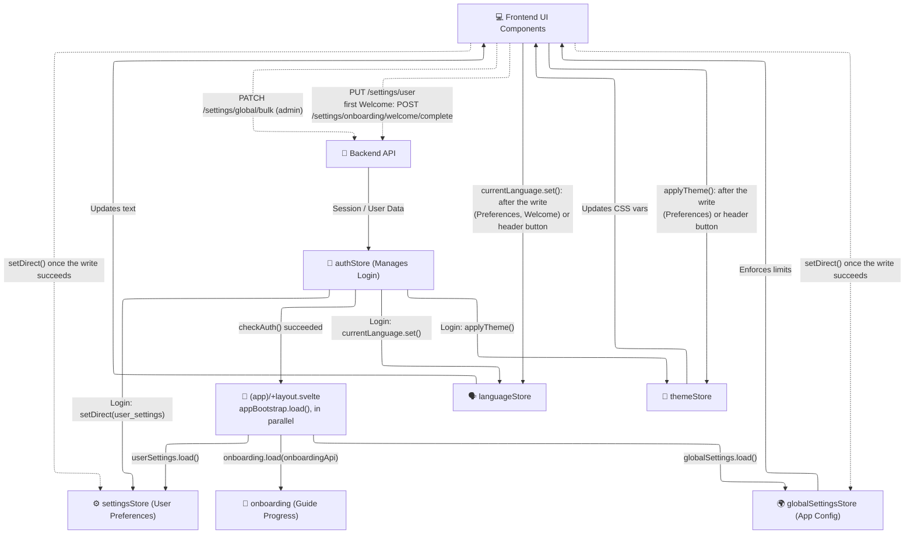

# 📱 App & UI State

*Status: Implemented (Feb 2026)*

The **App & UI State** category contains stores responsible for the global user experience. These stores manage authentication, global preferences, localization, shell navigation, and the public configuration, notices and block state of the instance.

## 🗂️ Stores

| Store | File | Purpose |
|:------|:-----|:--------|
| **Auth** | `app/auth.ts` | Holds the session state — the current user (`null` when signed out) and the loading, error and initialized flags — through `login()`, `logout()` and `checkAuth()` (`GET /auth/me`). The session itself is the HttpOnly `session` cookie the backend sets: the frontend never sees the token. |
| **Settings** | `app/settings.ts` | User-specific preferences (language, theme, base currency, avatar). Syncs with the backend. |
| **Global Settings** | `app/globalSettings.ts` | Application-wide settings (admin-only writes), like max upload sizes, loaded by the app bootstrap. It no longer types `enable_registration`, and nothing reads the registration mode from it: the login page asks the instance configuration instead, which holds the mode in force, `LIBREFOLIO_REGISTRATION` included. |
| **Language** | `app/language.ts` | The interface language. `currentLanguage.set()` also sets the `svelte-i18n` locale and saves the choice in this browser (`librefolio-locale`), which the next load starts from. Nothing listens to the Settings store: the language is set explicitly — by the auth store at login, from the user's settings in the login response, and by the UI: the Preferences tab and the Welcome page after their write, or the header selector (this browser only). |
| **Interface locale** | `app/uiLocale.ts` | The locale every figure is written in: the interface language, plus the browser's region when the browser's primary tag is in that language. Derived from Language, so it follows every switch. Two faces: `uiLocale()` for runes code and as the default of every figure formatter; `uiLocaleStore`, read as `$uiLocaleStore` in a legacy template. See [Numbers, amounts and dates](../i18n.md#ui-locale). |
| **Theme** | `app/themeStore.ts` | Manages dark/light mode toggling and system-preference detection. |
| **Privacy** | `app/privacyStore.svelte.ts` | Device-local "hide amounts" flag, read inside the currency formatters. See [Privacy masking](#privacy-masking). |
| **Navigation** | `app/navigationStore.ts` | Controls the sidebar state (open/closed) and active page tracking. |
| **Toasts** | `app/toastStore.svelte.ts` | Svelte 5 Rune-based store for displaying global notification messages. |
| **Instance configuration** | `$lib/features/instance/instanceConfig.svelte.ts` | The public configuration of the instance (`GET /api/v1/system/instance`), read once per page load, before the sign-in. See [Instance configuration](#instance-config). |
| **Instance notices** | `$lib/features/instance/instanceNotices.svelte.ts` | The messages about the instance that features register, shown above every page of the app shell. See [Instance notices](#instance-notices). |
| **Instance block** | `$lib/features/instance/instanceBlock.svelte.ts` | Whether the hosting provider blocked the instance: the first `423` `instance_blocked` from the API turns it on, and the `(app)` layout then shows the block page instead of the app. See [Instance block](#instance-block). |
| **Chart Settings** | `chartSettingsStore.svelte.ts` | Chart preferences of the FX and Assets pages: line colouring, area fill, grid lines, stale-data gradient, axis scales, the asset Calendar Return window and overlay signals. Kept per user in `localStorage` (`lf_{userId}_chartSettingsStore`), never on the server, in two separate scopes, `fx` and `assets`: each has its own global settings plus per-item overrides (pair slug, `asset-{id}`), and applying a scope's global settings clears that scope's per-item overrides. The chart period is not stored here: it lives in `sessionStorage` (Date Range, below). |
| **Date Range** | `dateRangeStore.svelte.ts` | The date range (start, end) shared by the Dashboard (through `dateRangeController.svelte.ts`), the broker detail page, and the Assets and FX pages, list and detail. It lives in `sessionStorage` (`librefolio_dateRange`), so it belongs to the browser tab and survives a reload; on a full page load, `start` and `end` in the URL win, and it falls back to the last three months when the account changes. |

## 📐 Architecture & Flow

The following diagram shows how the stores are filled and who sets the language and the theme. Once the auth check succeeds, the `(app)` layout's `appBootstrap.load()` loads the stores in parallel (see [Onboarding Guides](../onboarding.md#layout-gate)); nothing listens to the settings store, so language and theme are set explicitly (items 2–3 below). Writes are dotted and go through the components (*write first*, item 4 below): a component sends the change to the API and, once it succeeds, copies the saved values into the store with `setDirect()`. No store writes to the API itself — their `updateSetting()` methods have no callers.



### 🔐 Authentication Flow

1. **Mount**: On app load, `auth.checkAuth()` verifies the existing cookie with the backend.
2. **Bootstrap**: If authenticated, the `(app)` layout runs `appBootstrap.load()`, which loads the user settings (`userSettings.load()`), the onboarding progress (`onboarding.load(onboardingApi)`) and the global settings (`globalSettings.load()`) in parallel. Before them, as soon as it knows the user, it starts the [open-registration warning](../components/features/auth.md#open-registration-notice) (its dependency `startOpenRegistrationNotice`, see [Onboarding Guides](../onboarding.md#layout-gate)). The auth store loads nothing: at login it copies the login response's `user_settings` into the store with `setDirect()`, and applies their language and theme (item 3).
3. **Language and theme**: nothing listens to the settings store; they are set explicitly — by the auth store at login, from the same response (`currentLanguage.set()`, `applyTheme()`); by the Preferences tab after its write; by the Welcome page after **Continue** (the language only: Welcome leaves the theme alone); and, for this browser only, by the header buttons (item 4).
4. **Write first**: no settings screen updates the store before the server answers. The Preferences tab sends `PUT /api/v1/settings/user` (one field per request) and, only once it succeeds, applies the language or theme and calls `userSettings.setDirect()`; a failed write leaves the store as it was and shows an error toast. The Profile tab (avatar) and the Welcome page also write first; Welcome only previews a new language (the svelte-i18n `locale`) until **Continue** saves it. `setDirect()` itself never calls the API: it sets the store and its per-user `localStorage` cache (`lf_{userId}_user_settings`). The header's theme and language buttons change only this browser (`librefolio-theme`, `librefolio-locale`) and save nothing to the account.
5. **After a reload**: language and theme come from this browser's `librefolio-locale` and `librefolio-theme`, so a change made on another device shows here only at the next login.

## 🏢 Instance configuration {: #instance-config }

`instanceConfig` (`lib/features/instance/instanceConfig.svelte.ts`, Svelte 5 runes) holds the public
configuration of the instance: the answer of `GET /api/v1/system/instance`, the same for whoever asks
and readable without a session (backend side:
[Public instance configuration](../../architecture/settings.md#public-instance-configuration)).

- **When**: the `(app)` layout calls `void instanceConfig.load()` at the top of its `onMount`, before
  the auth check, and does not wait for it. Pages outside the layout call it too: `LoginCard` on
  mount, and the `/invite` page, which waits for it together with the inspection of its link
  ([Account Link Pages](../components/features/auth.md#link-pages)).
- **One request per page load**: concurrent and later calls share the same request;
  `load({force: true})` asks again, and `fetchConfig` replaces the API call (tests).
  `GlobalSettingsTab` forces it after saving `registration_mode`, so the rest of the app follows the
  new mode.
- **Never blocking**: `config` is always the configuration in force: `DEFAULT_INSTANCE_CONFIG` until
  the server answers, then its last answer. A failed request changes nothing but `failed`, and the
  next `load()` retries. Only the latest request writes its answer (a generation counter), so a forced
  reload outruns an older request.
- **The default**: a self-hosted instance where anyone may register,
  `{profile: 'selfhosted', accounts: {registration_mode: 'open', registration_locked: false}}`, without
  the optional `first_account_open` and `password_rules`: `LoginCard` treats anything but `true` as
  false, and `PasswordStrength` checks `DEFAULT_PASSWORD_RULES`, the five rules of release 1.3. So until the
  answer, and when there is none, the login page offers **Register here**; a registration the server
  refuses gets its own message. On an instance that registers by invitation, the link shows for a
  moment, until the answer withdraws it (backlog A-19).
- **Getters**: `config`; `loaded`, true once the server answered on this page load; `failed`, true when
  the last request failed.
- **Type**: `InstanceConfig` is `z.infer<typeof schemas.InstanceConfigResponse>` from the generated
  client, so a field added to the backend response appears after `./dev.py api sync`.
- **Readers of `accounts`**: `LoginCard` (**Register here** while `registration_mode` is `open` or
  `first_account_open` is true), the `/invite` page (`closed` while it is `disabled`),
  `GlobalSettingsTab` (the select locked, showing the mode in force, while `registration_locked`),
  `UsersTab` (no invitation while `registration_mode` is `disabled`, and a reason that names the
  variable while `registration_locked`), the [open-registration warning](../components/features/auth.md#open-registration-notice)
  (`registration_mode` and `registration_locked`, read only once `loaded` is true: the default is
  `open`, and an invite-only instance would show the warning until the answer), and [`PasswordStrength`](../components/features/auth.md#passwordstrength)
  under every new-password field (the checklist and its `valid` from `password_rules`,
  `DEFAULT_PASSWORD_RULES` while the list is absent or empty). `PasswordStrength` does not load the
  configuration itself: the page around it does. The `/reset-password` and `/setup` pages ask for it
  on mount without waiting for it, so the checklist switches to the server's rules when they arrive
  and a slow request never delays the form.

```ts
import {instanceConfig} from '$lib/features/instance/instanceConfig.svelte';

await instanceConfig.load();
instanceConfig.config.profile; // 'selfhosted' | 'managed'
instanceConfig.config.accounts.registration_mode; // 'open' | 'invite' | 'disabled'
instanceConfig.config.accounts.registration_locked; // true while LIBREFOLIO_REGISTRATION pins it
instanceConfig.config.accounts.first_account_open; // true while the instance has no account (optional: absent reads as false)
instanceConfig.config.accounts.password_rules; // [{code, value}]: the password rules (optional: absent or empty, PasswordStrength assumes DEFAULT_PASSWORD_RULES)
```

## 📢 Instance notices {: #instance-notices }

`instanceNotices` (`lib/features/instance/instanceNotices.svelte.ts`) is the registry of the messages
about the instance shown above every page of the app shell. **A feature registers its notice; nobody
edits the layout to add one.** `InstanceNotices.svelte` (`lib/features/instance/components/`) shows the
registry: `routes/(app)/+layout.svelte` renders it once, inside the shell's `<main>`, after the
onboarding banner and before the page. The Welcome page, which has no shell, shows no notice.

| Field of a notice | Meaning |
|-------------------|---------|
| `id` | Stable and unique; it starts with the owner's area, such as `assets.disallowedProviders` |
| `severity` | `info`, `warning` or `danger` |
| `messageKey`, `params` | The i18n key of the message, and its ICU parameters |
| `dismissible` | The user may close it, until the next page load |
| `action` | An optional link after the message: `{labelKey, href}`, with `href` a path inside the app |

- `show(notice)` adds a notice, or replaces the one with the same `id` in place.
- `hide(id)` removes it. A notice hidden and shown again is visible again, even if the user had closed
  it.
- `dismiss(id)` is the user closing a `dismissible` notice: it stays closed until the next page load.
- `clear()` removes every notice. It also runs when the signed-in account changes, signing out included
  (`registerClientSessionReset('instanceNotices', clear)`).
- `list` holds the notices to show: not closed by the user, `danger` first, then `warning`, then
  `info`, and within a severity in the order they were first shown.

The feature that registers a notice decides who sees it, since it knows the user and their role, and
hides it when the condition is gone. Two features register one today: the catch-up of the prices
(**Updating prices…**, [Updating prices…](../components/features/live-ticker.md#price-refresh)) and
the [open-registration warning](../components/features/auth.md#open-registration-notice)
(`accounts.openRegistration`, for administrators). For example (the `assets` keys are illustrative):

```ts
import {instanceNotices} from '$lib/features/instance/instanceNotices.svelte';

instanceNotices.show({
    id: 'assets.disallowedProviders',
    severity: 'warning',
    messageKey: 'assets.notices.disallowed',
    params: {count: 3},
    dismissible: true,
    action: {labelKey: 'assets.notices.review', href: '/assets'},
});

instanceNotices.hide('assets.disallowedProviders');
```

How `InstanceNotices.svelte` renders them:

- Without notices it renders nothing. Otherwise a `<section data-testid="instance-notices">`, labelled
  by `instance.notices.label`, holds one `instance-notice` per notice, with `data-notice-id` and
  `data-severity`: `role="alert"` for `danger`, `role="status"` otherwise. The link is
  `instance-notice-action`, the close button `instance-notice-dismiss`, labelled by `common.close`.
- Colours are colour roles only (`frontend/src/lib/theme/tokens.css`). For each severity X (`info`,
  `warning`, `danger`), the notice is `bg-lf-X-soft border-lf-X-line text-lf-X-on-soft` and its icon
  `text-lf-X`. The classes are written whole in `NOTICE_CLASSES` and `ICON_CLASSES`, so the colour
  gates see every class.

## 🔒 Instance block {: #instance-block }

`instanceBlock` (`lib/features/instance/instanceBlock.svelte.ts`, Svelte 5 runes) is a flag: whether
the hosting provider blocked this instance (backend side: [Instance Block](../../architecture/security.md#instance-block)).

- **Who turns it on**: the error interceptor of `lib/api/zodios-client.ts` calls `markBlocked()` when
  `isInstanceBlockedError(status, data)` is true: status `423` (`INSTANCE_BLOCKED_STATUS`) and
  `detail.code` `instance_blocked` (`INSTANCE_BLOCKED_CODE`). The error still reaches its caller. The
  module imports nothing from the API, so the interceptor imports it without a cycle.
- **Who reads it**: in `routes/(app)/+layout.svelte`, the branch `$isAuthenticated && instanceBlock.blocked`
  comes before the bootstrap ones, so `InstanceBlockedPage` replaces the app and the app shell never
  starts: its requests never pile up refusals.
- **Who turns it off**: `clear()`, which also runs when the signed-in account changes, signing out
  included (`registerClientSessionReset('instanceBlock', …)`). A page load starts with the flag off.
- **Getter**: `blocked`.

The backend answers `423` only to a signed-in user; anyone else gets the `401` of `get_current_user()`,
which the interceptor turns into the login as usual — except on `/`, where the login already is, and
on the anonymous pages of a link, which handle the `401` themselves
([A 401 on a Link Page](../components/features/auth.md#link-page-401)).

`InstanceBlockedPage.svelte` (`lib/features/instance/components/`) is the full-page block page:

- On mount it reads `GET /system/block` (`fetchBlock`, a prop that tests replace). When `blocked` is
  false, the block was lifted meanwhile: it clears the flag and reloads the window. When the request
  fails, the page stays, without the date, the subscription link and the backup card, and does not
  ask again while it is mounted: a reload brings them back.
- Its text depends on the role: `instance.block.adminDescription` for `is_superuser`,
  `instance.block.userDescription` for the other users, under the title `instance.block.title`.
- `instance.block.deletionDate` shows `deletion_date`, written in the interface locale (`uiLocale()`).
  The ISO day is read at midnight UTC and formatted in UTC, so no time zone moves it.
- An administrator (`is_superuser`) also gets the **Manage subscription** link
  (`instance.block.manageSubscription`) when `billing_url` is an `http(s)` address, checked again
  here; it opens in a new tab, `rel="noopener noreferrer"`.
- The block message is one `<section role="alert">`, which also holds the logout button: labelled by
  `auth.logout`, it calls the layout's `logout()`. There is no button to delete one's own account
  yet, though `DELETE /auth/users/me` stays allowed.
- **The backup card** (decision 12). When the answer's `backup_available` is `true`, and only then, a
  second `<section>` under the alert, named by its `<h2>` (`aria-labelledby`, text
  `instance.block.backupTitle`), holds `BackupDownloadCard` (`lib/features/backup/`), the same card as
  **Settings › Backup**: start a backup of the whole instance, follow it, download the archive, delete
  it. The server decides who gets it (the administrators, today: see
  [Instance Block](../../architecture/security.md#instance-block)); the page never guesses it from the
  role, so a `false`, a missing field, a pending or a failed request mean no card, for an
  administrator too. The section stays outside the `role="alert"` one, so a screen reader announces
  the block, not the card and its progress. The card's four routes already answer on a blocked
  instance.
- The page mounts its own `ToastContainer`: the `(app)` layout mounts one only with the app shell,
  which this page replaces, and the card reports its errors and a backup with warnings by toast.
- Colours are colour roles only. The test ids are `instance-blocked`, `instance-blocked-description`,
  `instance-blocked-deletion-date`, `instance-blocked-billing`, `instance-blocked-logout` and
  `instance-blocked-backup`; inside the last one, the card keeps its own (`backup-download-card` and
  the others).

```ts
import {instanceBlock, isInstanceBlockedError} from '$lib/features/instance/instanceBlock.svelte';

if (isInstanceBlockedError(error.response?.status, error.response?.data)) instanceBlock.markBlocked();
instanceBlock.blocked; // true: the (app) layout shows InstanceBlockedPage
```

Tests: `./dev.py test front-utility component-unit` runs `InstanceBlockedPage.test.ts`, which mounts
`BackupDownloadCardStub` (`frontend/src/__tests__/harness/`) in place of the card: it checks where the
card goes and when, while `lib/features/backup/BackupDownloadCard.test.ts` covers what the card does.

## 🙈 Privacy masking {: #privacy-masking }

The header's eye button (`lib/components/ui/PrivacyToggle.svelte`) flips a single flag. Everything
else is decided where a number becomes a string, so this section is the contract for any code that
renders money. What the user sees is described in the *Privacy mode* section of
[User Preferences](../../../user/settings/preferences.md). Paths are relative to
`frontend/src/` unless they start with `backend/`.

### 🗄️ The store

`lib/stores/app/privacyStore.svelte.ts` holds one rune, hydrated **synchronously at module init**
from `localStorage['librefolio-privacy']`: the currency formatters import the store, so it is
initialized before the first amount is formatted. Only the exact value `'1'` means on; an absent key
means off, so nothing is masked by default.

- **Device-local, bare key.** The preference describes the screen being watched, not the account,
  so the key is not `lf_{userId}_…`. With a per-user key, switching account in front of a projector
  would adopt the other account's "off" and bring every value back.
- **Two guards.** `browser` answers whether `localStorage` exists; `try/catch` answers whether the
  call can fail while existing (private modes, exceeded quota, denied storage). After a refused
  write `isPrivacyPersisted()` returns `false`: this session keeps masking, the next load will not.
  No component reads it today.
- **No cross-tab sync.** There is no `storage` listener: another open tab follows on reload.

| Export | Use |
|:-------|:----|
| `isPrivacyEnabled()` | Read the flag. Called inside a runes template or a `$derived`, the read registers the dependency — no subscription needed. |
| `setPrivacyEnabled(value)`, `togglePrivacy()` | Write the flag and try to persist it. |
| `isPrivacyPersisted()` | `false` once a write has failed. |

### 🧰 The masking channel

Masking is decided at **formatter level**: before the string exists, the formatter hands the caller
either the figure or `PRIVACY_PLACEHOLDER` (`•••`). Where the resulting node lands is then
irrelevant — a masked string is as safe in a table cell as in an ECharts tooltip or a `title`
attribute. The placeholder is a constant and carries nothing derived from the value: no magnitude,
no digit count, no sign.

| Primitive | File | Use it for |
|:----------|:-----|:-----------|
| `formatCurrencyAmountPlain`, `formatCurrencyAmountHtml` | `lib/utils/currency/currencyFormat.ts` | Every money amount — the **D8 primitives**. Option `sensitivity`: `'personal'` or `'public'`; omitted means `personal`, i.e. masked. |
| `maskable(formatted, sensitivity?)` | `lib/utils/privacy/maskable.ts` | A formatted amount *without its sign*, replaced whole. |
| `maskCurrencyParts(parts, sensitivity?)` | `lib/utils/privacy/maskable.ts` | An `Intl.NumberFormat` with `style: 'currency'`: pass its `formatToParts(…)`. |
| `maskFormattedNumber(formatted, sensitivity?)` | `lib/utils/privacy/maskable.ts` | A number with no currency, such as an axis tick. |
| `maskableQuantity(formatted)` | `lib/utils/privacy/maskable.ts` | A quantity the user holds, where it sits next to a price. |
| `shouldMaskAmount(sensitivity?)` | `lib/utils/privacy/maskable.ts` | The decision itself; `public` returns `false` before reading the store. |
| `CurrencyAmount.svelte` | `lib/components/ui/display/` | One D8 amount rendered from a legacy parent ([below](#privacy-legacy-freeze)). |

The rules the primitives carry:

- **`personal` or `public`.** `personal` is wealth: values, cash, P&L, proceeds, fees, taxes.
  `public` is a number that does not let anyone infer what the user owns — market and unit prices,
  WAC, FX rates, the amounts of asset-level events (product owner, 2026-09-22). The default is
  `personal` on purpose: a public value left unclassified disappears, which the user reports; a
  personal value left in the clear by the opposite default would leak, which nobody sees.
- **The currency stays.** The D8 primitives mask the absolute value and append symbol, flag and code
  afterwards: `-••• € 🇪🇺 EUR`. A formatter that lets `Intl` place the currency cannot append it, so
  `maskCurrencyParts` works on the parts: the run from the first to the last magnitude part
  (`integer`, `group`, `decimal`, `fraction`, `compact`, the exponent parts, `nan`, `infinity`),
  **inner literals included**, becomes one `•••`, while `currency`, the sign and the outer literals
  stay — `-$1,234.50` gives `-$•••`, a compact `1,2 Mio. €` gives `••• €`. `compact` is inside the
  run on purpose: `€•••K` would still disclose the order of magnitude. Known limit: in `pt-CV` ICU
  types the escudo sign `$` as a `decimal` part (and the `currency` part is a zero-width space), so
  the masked string loses the only visible symbol.
- **The sign stays (D8).** The D8 primitives write `+` or `-` outside `maskable`.
  `maskFormattedNumber` and `maskableQuantity` keep the leading sign run exactly as the locale wrote
  it (`/^[\p{Cf}+\-\u2212]*/u`: U+2212 in `sv-SE`, a bidi mark before the minus in Arabic) rather
  than rebuilding an ASCII hyphen, which would change the unmasked output too. The cost is stated
  in the `maskable` docstring: where a site passes `showSign: value !== 0`, a prefix appears exactly
  when the amount is non-zero, so a masked column still shows which rows are zero. The product
  owner ruled with that objection on the table; do not move the sign back inside the mask.
- **Absence is the caller's job.** Check for a missing, non-finite or unavailable value first and
  render `—`: masking an absence would claim a figure that does not exist, and an em-dash handed to
  `maskFormattedNumber` comes back masked.
- **A quantity's class is decided at the call site (D5′).** The same number is masked in positions
  and lots, where quantity × public price rebuilds what the user owns, and stays visible in the
  Transactions list. So the rule cannot live in a shared quantity formatter: `maskableQuantity` is a
  separate, searchable name with no `sensitivity`, and a site that must stay visible —
  `formatTxQuantity` in `lib/features/transactions/txDisplayHelpers.ts` — simply does not
  call it. Its callers today are `ExposureTable.svelte`, `unifiedLotsTableHelpers.ts`,
  `LotCustodyModal.svelte`, `LotGanttChart.svelte` and `LotWacPriceChart.svelte`. Units and tickers
  stay outside the argument, as the currency does for money; a partially closed lot keeps its open
  share (`formatLotQuantityCell` renders `••• (60%)`).

### 🚧 The anti-regression gate {: #privacy-gate }

`lib/utils/privacy/moneyRenderSites.test.ts` tests a premise, not behaviour: that the places
rendering money are the places we know. It scans every `.ts` and `.svelte` file under
`frontend/src/` — test files and the `node_modules`, `__mocks__` and `__tests__` folders excluded —
line by line for two forms:

- **Form A** — `style: 'currency'`, exact;
- **Form B** — a template literal interpolating a currency token (`currency` or `symbol`) beside a
  numeric-looking one (`toFixed`, `toLocaleString`, `amount`, `price`, `total`, …), a heuristic.

Every hit must be registered in `REGISTRY`, keyed by file and whitespace-collapsed content rather
than by line number, so an unrelated edit above a site does not turn the gate red. Each entry
carries a status and a written reason:

| Status | Meaning |
|:-------|:--------|
| `masked` | Goes through the channel, at the site or at its function boundary. |
| `not-money` | Matches a form but renders no amount. |
| `public` | Real money in the clear by rule: a market price, an asset-level event, a rate. |
| `residual` | Real money outside the channel, deliberately not fixed yet. |
| `unmasked` | Real money outside the channel, found by the gate and not yet triaged. |

The test fails on an unregistered hit and on an entry whose code no longer exists. It asserts the
`residual`, `unmasked` and `public` lists by exact content, so fixing or reclassifying a site is a
visible edit, and it carries a positive control — hits ≥ entries, both forms found, the risk helper
found — because "no unregistered site" is also true of a scanner that reads nothing. It runs in
`./dev.py test front-utility core-unit`.

A line that matches `SAFE_CALL` — it names a D8 primitive, a currency-code formatter or the risk
helpers' `formatCurrencyAmount` / `formatScopedCurrencyAmount`, or calls `maskable(` or
`maskFormattedNumber(` — is not scanned for Form B. The skip is **line-granular**: a masked call on
a line also hides an unmasked fallback written on the same line. Entry to `SAFE_CALL` has a price:
the name must be an export pinned by unit tests that would break if its masking were removed.

What the gate cannot see:

1. **Money without a currency token** — axis ticks and labels, such as the value axis of the lot
   comparison chart (`formatAxisAmount` in `lib/features/brokers/lots/lotComparisonChartHelpers.ts`).
   Only their own tests protect them.
2. **A `public` marking.** `{sensitivity: 'public'}` sits on a `SAFE_CALL` line and is never a hit,
   and a `public` entry is not re-examined. Only the tests of that site protect the decision — for
   the Positions price and average cost, the D5′ block of `ExposureTable.test.ts`.
3. **Reactivity.** A site can be registered, masked and green and still not follow the toggle: see
   the legacy freeze below.

### 🧊 Legacy components freeze masked output (R20) {: #privacy-legacy-freeze }

In a **legacy** (non-runes) component, a function call inside a template expression is compiled
into `$.untrack(…)`, and only the values the expression names are tracked. The privacy flag, read
*inside* the formatter, never becomes a dependency, so the output keeps the state it had at mount:
turned on in place, privacy leaves the digits visible; turned off, `•••` stays. The same
`{@html formatCurrencyAmountHtml(amount, code)}`, compiled with the Svelte in
`frontend/node_modules` (5.48.0) — excerpt:

```js
// legacy parent: export let amount; export let code;
$.deep_read_state(amount()),
$.deep_read_state(code()),
$.untrack(() => formatCurrencyAmountHtml(amount(), code()))

// runes parent: let {amount, code} = $props();
$.html(node, () => formatCurrencyAmountHtml($$props.amount, $$props.code));
```

Neither the gate, which reads source text, nor a formatter unit test, which calls the formatter
fresh, can see this. The remedy:

- render the amount through a runes child — `lib/components/ui/display/CurrencyAmount.svelte`
  renders one D8 amount — or migrate the parent to runes when it is small;
- cover the site with a component test that toggles privacy **in place, in both directions**,
  including a mount with privacy already on: `lib/features/brokers/BrokerCard.test.ts`, and
  `lib/components/ui/display/CurrencyAmount.test.ts`, which mounts the child under
  `__tests__/harness/CurrencyAmountLegacyHost.svelte`. That host is legacy by construction
  (`export let`) and also renders the same call inline, as a control that must stay frozen.

Today the legacy parents that render money are `lib/features/brokers/BrokerCard.svelte` and
`routes/(app)/brokers/[id]/+page.svelte`; both render it through `CurrencyAmount`.

### 📈 ECharts formatters {: #privacy-echarts }

ECharts calls `formatter` and `renderItem` callbacks itself, outside Svelte's effect tracking. They
read the current flag whenever they run, but the read registers nothing, so a toggle does not redraw
what is already painted: an axis keeps its ticks, a bar keeps its label, and an open tooltip keeps
its text until it is shown again. The render `$effect` must read the flag itself —
`void isPrivacyEnabled();`, beside its other `void` dependencies — so that a toggle re-runs it and
the option is rebuilt with every formatter called again:

- `lib/features/brokers/lots/LotComparisonChart.svelte` — axis formatters; each render replaces
  `xAxis`, `yAxis` and `series` (`replaceMerge`);
- `lib/features/brokers/lots/LotGanttChart.svelte` — the lot quantity on each bar is built in
  `renderItem`.

The interface locale follows the same pattern: both effects also read `void uiLocale();`, so a language
switch redraws the chart as a toggle does (see [Numbers, amounts and dates](../i18n.md#ui-locale-reactivity)).

Keep the formatter a pure exported helper, as `formatAxisAmount` and `formatAxisCurrency` in
`lotComparisonChartHelpers.ts` are, so a unit test can pin it; the effect wiring itself is only
exercised by a test that mounts the chart.

### 🧩 Contract for Tool renderers {: #tool-renderer-privacy-contract }

A Tool's compiled renderer (see
[Tool plugins](../../architecture/patterns/tool_plugins.md#frontend-and-documentation)) presents
results the backend computed from the user's own scenario, so it renders through the same channel:

- **money** only through the D8 primitives, with an **explicit** `sensitivity` on every call, so the
  classification is read at the site rather than implied by the default;
- **quantities** through `maskableQuantity` where they are holdings;
- **rates and percentages** marked `public` explicitly wherever they pass through a masking
  primitive;
- **`—`** for an empty, non-finite or unavailable value — checked before formatting, never masked;
- runes mode for the component, and the ECharts rule above for any chart it draws.

The PAC allocator renders through `lib/features/tools/pac-allocator/planner/format.ts`, its only privacy
adapter: every amount, quantity, price, rate and percentage the planner shows goes through it.
An `exact_ratio` number — the `ExactRatio` branch of `backend/app/schemas/pac_allocator/exact.py`, whose
authoritative value is its reduced `numerator` and `denominator` — is shown through the backend's
`display_decimal`, a projection the schema marks `non_authoritative`, with `≈` in front unless that
projection equals the ratio; an amount is rounded exactly from the ratio to its currency's minor unit
instead, `≈` marking a rounding that changed it.
