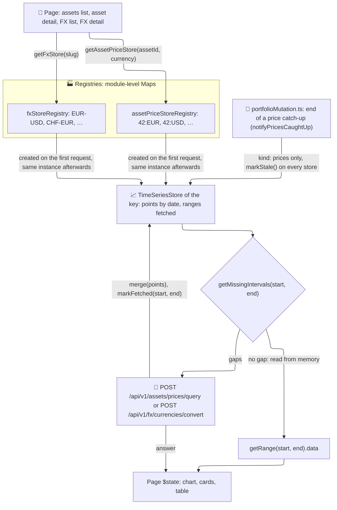

# 🏭 Registries & Caches

*Status: Implemented (Mar 2026) · asset price registry and image preview cache: Jun 2026 · stale after a price catch-up: Oct 2026 · bulk requests in batches: Oct 2026*

The **Registries & Caches** category holds the client-side caches for data that the frontend loads in pieces and reuses across pages: the daily price series of each asset, the daily rate series of each FX pair, and the object URLs of image previews.

A **registry** is not a store itself: it is a module-level `Map` of *many independent stores*, one per key. It creates a store the first time its key is requested and returns that same instance on every later request.

## 🗂️ Stores

| Store | Location | Purpose |
|:------|:---------|:--------|
| **`assetPriceStoreRegistry`** | `assetPriceStoreRegistry.ts` | One `TimeSeriesStore<AssetPricePoint>` per asset **and currency**, keyed `"{assetId}:{CURRENCY}"` (e.g. `"42:EUR"`), holding the daily price points already loaded. Prices converted to another currency (`target_currency`) are cached apart from the native ones. |
| **`fxStoreRegistry`** | `fxStoreRegistry.ts` | One `TimeSeriesStore<FxDataPoint>` per currency pair, keyed by the pair slug in alphabetical order (`"EUR-USD"`, see `createPairSlug`), holding the daily rates already loaded in that orientation. The FX list and the FX detail page share these stores. |
| **`imagePreviewCache`** | `stores/files/imagePreviewCache.ts` | Plain `Map` from file ID to the object URL of the largest preview fetched for that file. `LazyImage` reuses it for the same or a smaller size instead of downloading the preview again; a larger size replaces the entry and revokes the old URL. Emptied, every URL revoked, when the signed-in account changes. |

## 📐 Architecture & Flow (The Registry Pattern)

A chart shows a date range, and the user moves between ranges (another preset, a custom range) and between pages that show the same series. The stores outlive the page components, and each one remembers both the points it holds and the ranges already requested: a range that is already loaded is answered from memory, and only a range with gaps costs a price or rate request.

The portfolio figures do not come from these stores: the backend computes the portfolio report, and `portfolioStore` keeps it as a session cache — see [Domain & Feature State](domain-state.md).

### 🧠 How it Works

1. **Getting a store**: a page asks the registry for the store of its key: `getAssetPriceStore(assetId, currency)`, which upper-cases the currency into the key, or `getFxStore(slug)` (`getFxStoreByPair(base, quote)` builds the slug first). The first request creates an empty `TimeSeriesStore` (`stores/core/TimeSeriesStore.ts`); every later request returns the same instance.
2. **Finding the gaps**: `store.getMissingIntervals(start, end)` lists the date intervals of the range that hold no point and were never marked fetched; in a store a price catch-up made stale, the intervals not fetched since, points or not (step 5). With no gap, the page reads `store.getRange(start, end).data` instead of asking the backend for prices or rates (the asset detail page still asks for its events, and backend-computed signals are still requested), so narrowing or widening the range is instant once it is loaded.
3. **Fetching and merging**: otherwise the data is requested, `store.merge(points)` upserts the answer by date, and `store.markFetched(start, end)` records the range as fetched (the asset pages do so only when the answer holds points). Asset prices are requested for the whole range, not gap by gap: each item of `POST /api/v1/assets/prices/query` carries one `date_range`. FX rates come from `POST /api/v1/fx/currencies/convert`, one item per gap, or one for the whole range when the request also asks for signals.
4. **Invalidating**: after a sync or a refresh, `invalidateAssetPriceStore(assetId)` empties every currency store of the asset. The FX pages empty every FX store with `invalidateAllFxStores()` or one range of a pair with `store.invalidateRange(start, end)`, and `removeFxStore(slug)` drops the store of a deleted pair.
5. **Going stale after a price catch-up**: when a price catch-up on the server has updated something, `notifyPricesCaughtUp()` sends `{kind: 'prices'}` on the portfolio bus (`stores/portfolio/portfolioMutation.ts`, see [Updating prices…](../components/features/live-ticker.md#price-refresh)). Each registry registers a listener when it is imported, under its own name (`registerPortfolioMutationListener('assetPriceStoreRegistry', …)`, `'fxStoreRegistry'`), and on that kind alone calls `markStale()` on every store it holds: `kind: 'mutation'` (among others the live-price poll writing today's candle, every 30 s on an asset's page) and `kind: 'refresh'` (the portfolio's **Refresh**) leave the stores alone. A stale store keeps its points — `get`, `has`, `size`, `getRange` and `getAllSorted` answer as before — and drops its fetched marks: `getMissingIntervals(start, end)` then returns the parts of the range that no `markFetched` made after the mark covers, even where the store holds points, so the next read of a range asks the server again, once; the fetches made after the mark add up. `lookupFxRate` takes a stale cached day for a miss: it asks the server for that day and marks it fetched, while `lookupFxRateSync` stays a pure cache read. `invalidateAll()` ends the stale state; `invalidateRange()` does not. The mark ignores the points because the price and rate answers fill the days without a value backward (`backward_fill_info`): a loaded store holds a point for every day, so the days a catch-up filled are not gaps. And it is a mark rather than `invalidateAll()` because many reads are synchronous (`getRange`, `getAllSorted`, `lookupFxRateSync`): an emptied store would leave them blank, with nobody to reload them. So the next visit of a price or FX page, or its next change of range, shows the page's loading state once, as on a first visit; a page already open during the catch-up keeps its chart until its next load (backlog Z-14b).
6. **Lifetime**: nothing counts subscribers and nothing is evicted. `TimeSeriesStore` is a plain class, not a Svelte store: each page copies what it reads into its own `$state`. The stores stay in memory as long as the loaded app: a logout does not clear them, a page reload does. `removeAssetPriceStore(assetId)` exists for asset deletion, but nothing calls it.

`ensureAssetPriceRangeLoaded(assetId, currency, start, end, {targetCurrency})` and `ensureFxRangeLoaded(slug, start, end)` wrap steps 2 and 3 in one call and return the cached points of the range; `ensureFxRangeLoadedBulk` does the same for several pairs in one request. They mark a range fetched even when the answer is empty or a 404, so it is not requested again; any other error (network, 5xx) leaves it unmarked, and the next call retries. `ensureFxRangeLoaded` loads the FX overlays of the FX detail page and the FX data of the asset pages; the other two are called only by their unit tests. The asset pages run steps 2 and 3 inline: the assets list sends `POST /api/v1/assets/prices/query` for every asset that misses prices or needs backend signals, in one request when they fit under the backend's caps, with a margin, and in batches otherwise ([Bulk requests in batches](#bulk-requests-in-batches)), and the asset detail page asks for events and signals in the same request. On the FX side, `loadFxRatesAndSignalsBulk` loads the rates and signals of the FX list cards the same way, in one request or in batches, and `lookupFxRate(base, quote, date)` answers one day's rate for the transaction modals, reading the cache first (`lookupFxRateSync`).

## 📦 Bulk requests in batches {: #bulk-requests-in-batches }

`POST /api/v1/assets/prices/query` and `POST /api/v1/fx/currencies/convert` refuse a request of more than 1,000 items or more than 1,000,000 item-days (422 `bulk_too_many_items`, `bulk_too_many_days`: see [Bulk request limits](../../backend/assets/architecture.md#bulk-request-limits)), and the assets list and the FX list send one item per asset or pair. `frontend/src/lib/api/bulkBatches.ts` keeps their requests under both caps (Z-27):

- **Caps**: `BULK_MAX_ITEMS` (1,000) mirrors the backend's `MAX_BULK_ITEMS`; `BULK_ITEM_DAYS_BUDGET` (800,000) is 80 % of its `MAX_BULK_ITEM_DAYS`, a margin (decision D1) because the web app only estimates the days: it sees neither an asset's first stored price nor a signal's real warm-up.
- **Estimate**: `bulkRangeDays(start, end, today)` counts the days of a range cut as the backend cuts it, at tomorrow and 100 years back from its end (`BULK_RANGE_SPAN_DAYS`, 36,525); 0 when it is empty. Each caller adds what its items build beyond the range.
- **Plan**: `planBulkBatches()` cuts the items, in order, into consecutive batches: an item joins the current batch unless that would pass either cap, and one whose estimate alone passes the budget gets a batch of its own. When everything fits there is one batch: the single request the lists sent before Z-27.
- **Send**: `sendBulkBatches()` sends the batches one after the other (D2: production runs one backend process). A batch refused with `bulk_too_many_days` is split by the refusal's own numbers into `max(2, ceil(item_days / max_item_days) + 1)` consecutive parts (never more parts than items), sent next, at most `BULK_SPLIT_MAX_DEPTH` (4) levels deep. Any other error, or a refused batch of one item or at the last level, stops the sending: the outcome keeps the answers already received, each with its batch, plus the error and the batch that failed.

The callers apply nothing until every batch has settled (D3):

- **Assets list**: `fetchPriceSeries()` (`routes/(app)/assets/+page.svelte`) estimates an item as its range's days, plus `BULK_SIGNAL_MARGIN_DAYS` (400) when it asks for backend signals. Each batch's raw answer goes through the worker pool (`processPriceItemsInParallel()`) before the next batch is sent. The assets left without an answer stay as a failed request leaves them: cached prices kept, signals untouched and reported as not updated, the error in the console. «All» resolves its start date only from a complete load.
- **FX list**: `loadFxRatesAndSignalsBulk()` estimates an entry as its range's days, or twice that plus the same margin when it carries signals (its daily items, then its signal items with their warm-up). A `signal_results[].request_index` points into its own batch (`batch.items[request_index]`). The rates of the answered batches are merged and marked fetched; after a failure, a 404 also marks the failed batch's entries fetched, as before, and the error is re-thrown to the FX page.
- **Δ columns of both lists** (X-R64): `fetchAssetPeriodChanges()` and `fetchFxPeriodChanges()` (`lib/utils/periodChanges.ts`) send one item per asset or pair, all up to the same `as_of`, through `inBatches()`, which calls `sendBulkBatches(items, () => 0, send)`. No day estimate: `POST /api/v1/assets/prices/period-changes` and `POST /api/v1/fx/currencies/period-changes` have the item cap but no item-days budget, so only `BULK_MAX_ITEMS` cuts the batches, and no batch is ever split again, since neither answers `bulk_too_many_days`. The answers merge as if one request had answered, the periods taken from the first item that has any. Unlike the two callers above, which apply what the batches before a failure answered (the prices and signals of those assets, the rates of those pairs), these calls are all or nothing: a failed batch rejects the call with its own error, nothing after it is sent, and the answers of the batches before it are dropped. What stays on screen then follows the list's `PeriodChangesLedger` (X-R60: [Assets](../../backend/assets/architecture.md#fixed-period-changes), [FX](../../backend/fx/architecture.md#fixed-period-changes)).
- **Live poll of the Assets list** (X-R64): `fetchCurrentPrices()` (`lib/services/livePriceService.ts`) sends the poll's ids to `POST /api/v1/assets/prices/current`, which refuses more than 1,000 since R13-SEC9-1, through `sendBulkBatches(ids, () => 0, send)` as well: that endpoint has only the item cap. The results of every batch are mapped in order, as if one request had answered. All or nothing too: a failed batch rejects the call with its own error, as axios raised it, so that `livePollFailure()` still reads its `Retry-After`; nothing after it is sent, and the list keeps the prices of its previous poll. The batches answered before the failure have still written, though: each one persists today's candles and counts as a portfolio mutation ([Still a write](../components/features/live-ticker.md#still-a-write)).

Since X-R64 the Δ columns of both lists and the Assets list's live poll no longer send one request each, outside the helper: past 1,000 items they are no longer refused for their length. And batching bounds each request, not the total: on «All» each card of the assets list still loads its asset's full daily history (backlog Z-29).
