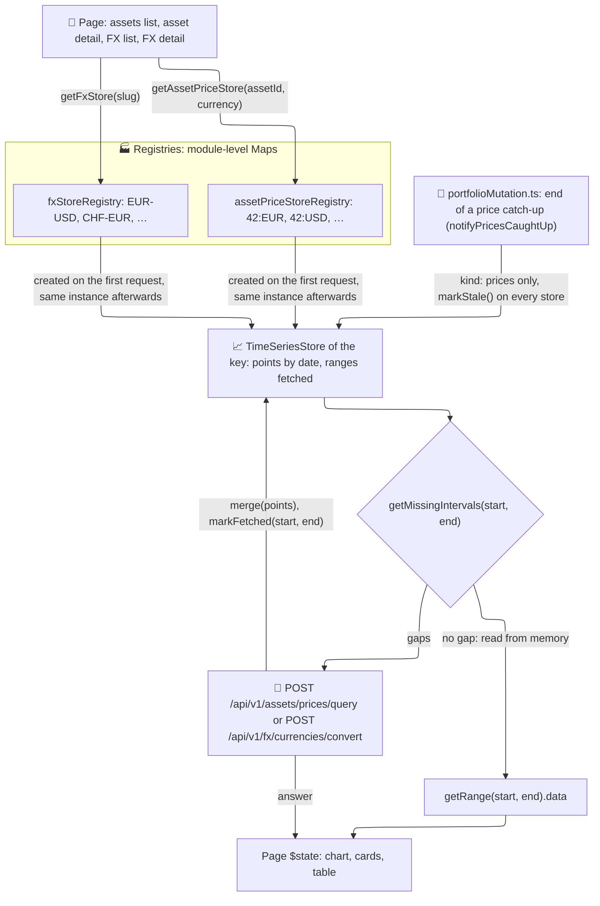
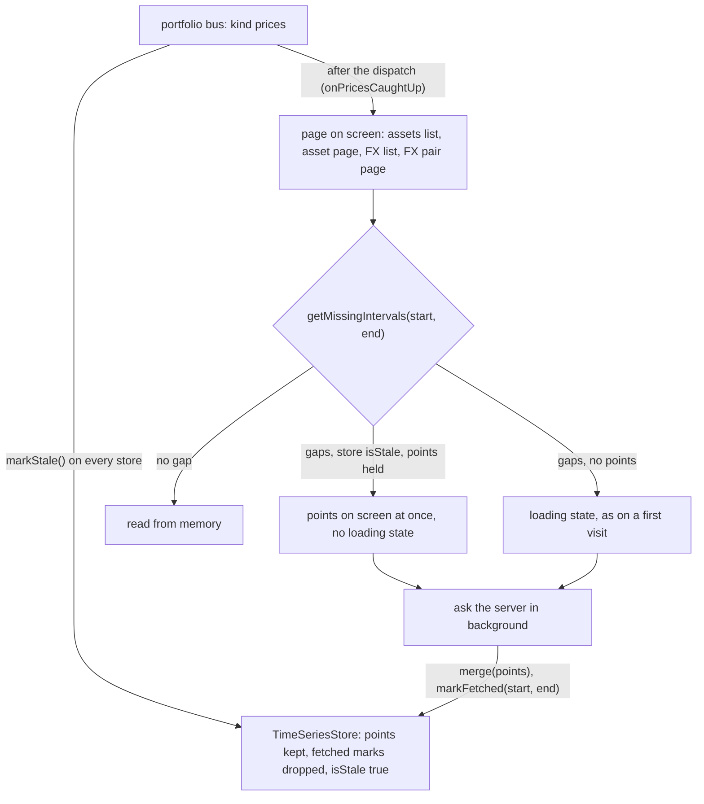

# 🏭 Registries & Caches

*Status: Implemented (Mar 2026) · asset price registry and image preview cache: Jun 2026 · stale after a price catch-up: Oct 2026 · reload of the open pages: Oct 2026 · bulk requests in batches: Oct 2026 · signal result cache: Oct 2026*

The **Registries & Caches** category holds the client-side caches for data that the frontend loads in pieces and reuses across pages: the daily price series of each asset, the daily rate series of each FX pair, the backend signal results the detail pages already received, and the object URLs of image previews.

A **registry** is not a store itself: it is a module-level `Map` of *many independent stores*, one per key. It creates a store the first time its key is requested and returns that same instance on every later request.

## 🗂️ Stores

| Store | Location | Purpose |
|:------|:---------|:--------|
| **`assetPriceStoreRegistry`** | `assetPriceStoreRegistry.ts` | One `TimeSeriesStore<AssetPricePoint>` per asset **and currency**, keyed `"{assetId}:{CURRENCY}"` (e.g. `"42:EUR"`), holding the daily price points already loaded. Prices converted to another currency (`target_currency`) are cached apart from the native ones. |
| **`reducedPriceCache`** | `reducedPriceCache.ts` | The series a card of the Assets grid draws, sampled by the backend for the card's plot (Z-29b): one entry per asset and range, with the step it was read at (`resolution`), the point on the fill's first day (`derived.base`) and the counts of days and weeks of the fill; and, apart, the comparison targets read for a card (`sample_like`), by card. It answers a width only if the step that width asks is the entry's own, so a resize that changes the step reads again from the backend. It marks everything stale on `{kind: 'prices'}`; `invalidateAsset()` drops what an asset's sync touched. It sits beside `assetPriceStoreRegistry`, which holds every day and is not touched. |
| **`fxStoreRegistry`** | `fxStoreRegistry.ts` | One `TimeSeriesStore<FxDataPoint>` per currency pair, keyed by the pair slug in alphabetical order (`"EUR-USD"`, see `createPairSlug`), holding the daily rates already loaded in that orientation. The FX list and the FX detail page share these stores. |
| **`signalResultCache`** | `signalResultCache.ts` | The backend signal results of the asset and FX detail pages, kept under the exact request they answered and given back only while the price or rate stores they were computed from are unchanged: three singletons, `assetChartAnswers`, `fxSignalAnswers` and `comparisonSeriesAnswers` (N64, N64b). See [Signal result cache](#signal-result-cache). |
| **`imagePreviewCache`** | `stores/files/imagePreviewCache.ts` | Plain `Map` from file ID to the object URL of the largest preview fetched for that file. `LazyImage` reuses it for the same or a smaller size instead of downloading the preview again; a larger size replaces the entry and revokes the old URL. Emptied, every URL revoked, when the signed-in account changes. |

## 📐 Architecture & Flow (The Registry Pattern)

A chart shows a date range, and the user moves between ranges (another preset, a custom range) and between pages that show the same series. The stores outlive the page components, and each one remembers both the points it holds and the ranges already requested: a range that is already loaded is answered from memory, and only a range with gaps costs a price or rate request.

The portfolio figures do not come from these stores: the backend computes the portfolio report, and `portfolioStore` keeps it as a session cache — see [Domain & Feature State](domain-state.md).

### 🧠 How it Works

1. **Getting a store**: a page asks the registry for the store of its key: `getAssetPriceStore(assetId, currency)`, which upper-cases the currency into the key, or `getFxStore(slug)` (`getFxStoreByPair(base, quote)` builds the slug first). The first request creates an empty `TimeSeriesStore` (`stores/core/TimeSeriesStore.ts`); every later request returns the same instance.
2. **Finding the gaps**: `store.getMissingIntervals(start, end)` lists the date intervals of the range that hold no point and were never marked fetched; in a store a price catch-up made stale, the intervals not fetched since, points or not (step 5). With no gap, the page reads `store.getRange(start, end).data` instead of asking the backend for prices or rates (the asset detail page still asks for its events, and backend-computed signals are still requested), so narrowing or widening the range is instant once it is loaded.
3. **Fetching and merging**: otherwise the data is requested, `store.merge(points)` upserts the answer by date, and `store.markFetched(start, end)` records the range as fetched (the asset pages do so only when the answer holds points). Asset prices are requested for the whole range, not gap by gap: each item of `POST /api/v1/assets/prices/query` carries one `date_range`. FX rates come from `POST /api/v1/fx/currencies/convert`, one item per gap, or one for the whole range when the request also asks for signals.
4. **Invalidating** (explicit): after a sync or a refresh, `invalidateAssetPriceStore(assetId)` empties every currency store of the asset. The FX pages empty every FX store with `invalidateAllFxStores()` or one range of a pair with `store.invalidateRange(start, end)`, and `removeFxStore(slug)` drops the store of a deleted pair.
5. **Going stale after a price catch-up**: when a price catch-up on the server has updated something, `notifyPricesCaughtUp()` sends `{kind: 'prices'}` on the portfolio bus (`stores/portfolio/portfolioMutation.ts`, see [Updating prices…](../components/features/live-ticker.md#price-refresh)). Each registry registers a listener when it is imported, under its own name (`registerPortfolioMutationListener('assetPriceStoreRegistry', …)`, `'fxStoreRegistry'`), and on that kind alone calls `markStale()` on every store it holds: `kind: 'mutation'` (among others the live-price poll writing today's candle, every 30 s on an asset's page) and `kind: 'refresh'` (the portfolio's **Refresh**) leave the stores alone. A stale store keeps its points — `get`, `has`, `size`, `getRange` and `getAllSorted` answer as before — and drops its fetched marks: `getMissingIntervals(start, end)` then returns the parts of the range that no `markFetched` made after the mark covers, even where the store holds points, so the next read of a range asks the server again, once; the fetches made after the mark add up. `lookupFxRate` takes a stale cached day for a miss: it asks the server for that day and marks it fetched, while `lookupFxRateSync` stays a pure cache read. `invalidateAll()` ends the stale state; `invalidateRange()` does not. Marking a store stale also renews its `generation`, so what was computed from its data misses too ([Signal result cache](#signal-result-cache)). The mark ignores the points because the price and rate answers fill the days without a value backward (`backward_fill_info`): a loaded store holds a point for every day, so the days a catch-up filled are not gaps. And it is a mark rather than `invalidateAll()` because many reads are synchronous (`getRange`, `getAllSorted`, `lookupFxRateSync`): an emptied store would leave them blank, with nobody to reload them. The read-only getter `store.isStale` tells a page that the store was marked and not emptied since (it stays set until `invalidateAll()`; a fetch clears the gaps, not the flag). So the next visit of a price or FX page, or its next change of range, finds the gaps; when the store still holds points for the range (`isStale` and a non-empty `getRange`), the page puts them on screen at once and asks the server in background, with no loading state (rule D3, Y5-1); a store with no points for the range loads as on a first visit. A page already open during the catch-up reloads by itself, in silence: see [Going stale, then reloading](#stale-reload).
6. **Lifetime**: nothing counts subscribers and nothing is evicted. `TimeSeriesStore` is a plain class, not a Svelte store: each page copies what it reads into its own `$state`. The stores stay in memory as long as the loaded app: a logout does not clear them, a page reload does. `removeAssetPriceStore(assetId)` exists for asset deletion, but nothing calls it.

`ensureAssetPriceRangeLoaded(assetId, currency, start, end, {targetCurrency})` and `ensureFxRangeLoaded(slug, start, end)` wrap steps 2 and 3 in one call and return the cached points of the range; `ensureFxRangeLoadedBulk` does the same for several pairs in one request. They mark a range fetched even when the answer is empty or a 404, so it is not requested again; any other error (network, 5xx) leaves it unmarked, and the next call retries. `ensureFxRangeLoaded` loads the FX overlays of the FX detail page and the FX data of the asset pages; the other two are called only by their unit tests. The asset pages run steps 2 and 3 inline: the assets list sends `POST /api/v1/assets/prices/query` for every asset that misses prices or needs backend signals, in one request when they fit under the backend's caps, with a margin, and in batches otherwise ([Bulk requests in batches](#bulk-requests-in-batches)), and the asset detail page asks for events and signals in the same request. On the FX side, `loadFxRatesAndSignalsBulk` loads the rates and signals of the FX list cards the same way, in one request or in batches, and `lookupFxRate(base, quote, date)` answers one day's rate for the transaction modals, reading the cache first (`lookupFxRateSync`).

#### 🔔 Going stale, then reloading {: #stale-reload }

Going stale is the other way to let go of a store: nothing is emptied, the store only says its fetched marks are out of date. Who marks it, and who asks again, after a price catch-up:

The pages call `onPricesCaughtUp()` ([Updating prices…](../components/features/live-ticker.md#price-refresh-reload)), which runs their loader without `force` after the dispatch, once every store has been marked; the loader goes down the diagram above. The reduced cache of the Assets grid (`reducedPriceCache`) is marked stale by the same signal, and the grid reads it through the same reload.

## 🧮 Signal result cache {: #signal-result-cache }

The detail pages keep their prices and rates in the stores above, but their **backend signals** (SMA, RSI…, the calendar rolling returns) used to be asked again at every change of mode, window, period or currency, even when nothing had changed. `lib/stores/signalResultCache.ts` (N64) keeps each answer under the exact request that produced it and gives it back only while the data it was computed from is the same.

- **Key**: `canonicalCacheKey(value)` is the JSON text of a request body with the keys of every object sorted at every depth, so two bodies that differ only in the order of their properties are one key; arrays keep their order. There is no merge by intervals as for prices: a signal on [start, end] depends on its warm-up before `start`, so only the exact request matches.
- **Generations**: the caller reads `TimeSeriesStore.generation` ([Core Infrastructure](core-infrastructure.md)) of the stores the answer is computed from when the request starts, and passes them to `get(key, generations)` and `set(key, generations, value)`. A `get` hits only if the entry was stored over the same generations, same stores in the same order; any other generation is a miss and drops the entry.
- **Bounded and isolated**: `SignalResultCache<T>` is an LRU of 32 entries (a hit becomes the most recent; a `set` past 32 drops the oldest), with `clear()` and `size`. Values are deep copies (`structuredClone`) both ways, so no caller can change what another one reads later. All three singletons are emptied when the signed-in account changes (`registerClientSessionReset('signalResultCache', …)`, `stores/app/clientSession.ts`).

| Singleton | Page | What it keeps | Generations in the check | Key |
|:----------|:-----|:--------------|:-------------------------|:----|
| **`assetChartAnswers`** | Asset detail | The answer of `POST /api/v1/assets/prices/query` **without the prices** (the price store holds them): events, backend signals and calendar returns, the comparison peers' included. `assetChartAnswerForCache(answer)` drops each item's `prices`. | The price store of the asset and of each comparison peer, in the displayed currency. | `assetChartAnswerKey(body)`: the body, canonical, with each item's `include_price` left out, since the answer is the same whether the prices travel or come from the store. |
| **`fxSignalAnswers`** | FX detail | The validated backend signal results (`BackendSignalResult[]`) of the pair's convert request. | The pair's store. | `canonicalCacheKey(requestBody)` of that request. |
| **`comparisonSeriesAnswers`** | Asset detail and FX detail | The series of the assets the price-view comparisons draw, as `loadComparisonAssetsData` answered them (`ComparisonAssetsLoadResult`: prices, in the displayed currency, and events, per peer). | The price store of each peer, in the displayed currency (the peer's own on the FX page): `comparisonAnswerGenerations(ids, allAssets, targetCurrency)`, null (nothing is kept) when a peer is unknown to the page. | `comparisonAnswerKey(ids, range, targetCurrency)`: the distinct peer ids ascending, the range and the target currency. |

A hit also needs the prices (or rates) of the range to be cached already: the asset page checks `pricesFromCache` and skips the cache on a forced load; the FX page checks that `getMissingIntervals` has no gap. On a hit the page applies the cached answer and asks nothing; on a miss it asks and, after applying the answer, writes it. Only answers the page could apply are written: signal results that parse, a calendar return that is not an error (the peers' too), never a failed request or an invalid answer.

### 🔒 Invalidation, by construction {: #signal-result-cache-invalidation }

No call is needed to invalidate an entry: it goes stale on its own. `TimeSeriesStore.generation` is a number renewed by `invalidateAll()`, `invalidateRange()` and `markStale()`, never by `merge()`, `markFetched()` or a read, so:

- **Refresh, a sync, an editor save, a currency change** that empty or re-key a store, and **a price catch-up** (`{kind: 'prices'}` on the portfolio bus marks every store stale, step 5 above), all renew the generations of the affected stores: the next load with the same request misses, asks the server and stores the new answer. After a price catch-up the pages thus ask again, once, as they do for the prices.
- **Loading more points** (a wider range, a gap filled) renews nothing: a signal answer on a range does not depend on days outside it.
- A generation is never given twice in the app (a module-level counter), not even to a store made anew after `removeAssetPriceStore()`.

The asset page adds an explicit `clearAssetPageAnswers()` (it empties `assetChartAnswers` and `comparisonSeriesAnswers`) where a kept answer may have been built from data the stores do not all show: `handleRefresh()` (Refresh asks everything again, the peers' calendar returns included), `runSyncAsset()` (a sync may change this asset, a comparison peer or a pair the converted prices use) and `handleSyncPair()` (the rates may have changed under a converted answer); both clear even when the sync's own response finds the page moved on. The FX page relies on the generation for its signals; for the comparison series it also empties `comparisonSeriesAnswers` in `runSyncAsset()`.

**The comparison series (N64b)** come from the backend with the displayed currency applied, not from a store, so a peer's store generation shows only the invalidations that go through the store (an editor save of the peer, a price catch-up, a currency change); a sync of the peer or of a pair is the explicit clear above. `maybeLoadComparison()` of both pages keeps its fingerprint memo (`comparisonAppliedFingerprint`: the same request twice in a row) and, past it, asks `comparisonSeriesAnswers.get(key, generations)` unless the load is forced (a refresh, a sync): a period seen before comes back in the same tick, so `lastComparisonLoadAskedServer` stays `false` and no busy token opens. A miss loads, and `comparisonAnswerIsCacheable(loaded)` decides what is kept: an answer with a price the backend could not convert (`_conversionFailed`) is not.

### ⏳ Cache hits and the busy token {: #signal-result-cache-busy }

A load the cache answers shows no spinner and leaves the Refresh button still ([Page busy](app-state.md#page-busy)). So on both detail pages the `pageBusy` token is taken **only when a load asks the server**:

- `loadChartData()` and `maybeLoadComparison()` set `lastChartLoadAskedServer` and `lastComparisonLoadAskedServer` as soon as they know: `true` when a request goes out (or the load joins one in flight), `false` when the cache, the comparison memo or a price or rate store that already covers the range answers with no request.
- `trackChartLoad()`, `trackComparisonLoad()` and `trackChartAndComparison()` start the load, read the flag right after the call, and wrap the load's promise in `pageBusy.track()` only if it is `true`. `trackChartAndComparison()` holds one token for the chart and the comparisons together if either asks.
- The load must therefore decide before its first `await`: on the asset page `const response = cachedAnswer ?? (await …)` skips the `await` on a hit, so the whole load completes synchronously and the flag is already final when the caller reads it. A load that asks the server is wrapped as before.

## 📦 Bulk requests in batches {: #bulk-requests-in-batches }

`POST /api/v1/assets/prices/query` and `POST /api/v1/fx/currencies/convert` refuse a request of more than 1,000 items or more than 1,000,000 item-days (422 `bulk_too_many_items`, `bulk_too_many_days`: see [Bulk request limits](../../backend/assets/architecture.md#bulk-request-limits)), and the assets list and the FX list send one item per asset or pair. `frontend/src/lib/api/bulkBatches.ts` keeps their requests under both caps (Z-27):

- **Caps**: `BULK_MAX_ITEMS` (1,000) mirrors the backend's `MAX_BULK_ITEMS`; `BULK_ITEM_DAYS_BUDGET` (800,000) is 80 % of its `MAX_BULK_ITEM_DAYS`, a margin (decision D1) because the web app only estimates the days: it sees neither an asset's first stored price nor a signal's real warm-up.
- **Estimate**: `bulkRangeDays(start, end, today)` counts the days of a range cut as the backend cuts it, at tomorrow and 100 years back from its end (`BULK_RANGE_SPAN_DAYS`, 36,525); 0 when it is empty. Each caller adds what its items build beyond the range.
- **Plan**: `planBulkBatches()` cuts the items, in order, into consecutive batches: an item joins the current batch unless that would pass either cap, and one whose estimate alone passes the budget gets a batch of its own. When everything fits there is one batch: the single request the lists sent before Z-27.
- **Groups** (Z-29b): `groupOf(item)` names the group of an item; the members of a group are consecutive and never separated, by the plan or by the split after a `bulk_too_many_days`: a group's estimate is the sum of its items', and a batch of one group fails like a batch of one item. The Assets list groups a card's item with the items of its comparison targets, which name its `key` in `sample_like`.
- **Send**: `sendBulkBatches()` sends the batches one after the other (D2: production runs one backend process). A batch refused with `bulk_too_many_days` is split by the refusal's own numbers into `max(2, ceil(item_days / max_item_days) + 1)` consecutive parts (never more parts than items), sent next, at most `BULK_SPLIT_MAX_DEPTH` (4) levels deep. Any other error, or a refused batch of one item or at the last level, stops the sending: the outcome keeps the answers already received, each with its batch, plus the error and the batch that failed.

The callers apply nothing until every batch has settled (D3):

- **Assets list**: `fetchPriceSeries()` (`routes/(app)/assets/+page.svelte`) estimates an item (`estimateEntryDays()`, `utils/reducedPriceQuery.ts`) as its range's days, plus `BULK_SIGNAL_MARGIN_DAYS` (400) when it asks for backend signals, and nothing for a card's item that only gives its step to its targets (`include_price: false`, no signals). Each batch's raw answer goes through the worker pool (`processPriceItemsInParallel()`) before the next batch is sent. The assets left without an answer stay as a failed request leaves them: cached prices kept, signals untouched and reported as not updated, the error in the console. «All» resolves its start date only from a complete load.
- **FX list**: `loadFxRatesAndSignalsBulk()` estimates an entry as its range's days, or twice that plus the same margin when it carries signals (its daily items, then its signal items with their warm-up). A `signal_results[].request_index` points into its own batch (`batch.items[request_index]`). The rates of the answered batches are merged and marked fetched; after a failure, a 404 also marks the failed batch's entries fetched, as before, and the error is re-thrown to the FX page.
- **Δ columns of both lists** (X-R64): `fetchAssetPeriodChanges()` and `fetchFxPeriodChanges()` (`lib/utils/periodChanges.ts`) send one item per asset or pair, all up to the same `as_of`, through `inBatches()`, which calls `sendBulkBatches(items, () => 0, send)`. No day estimate: `POST /api/v1/assets/prices/period-changes` and `POST /api/v1/fx/currencies/period-changes` have the item cap but no item-days budget, so only `BULK_MAX_ITEMS` cuts the batches, and no batch is ever split again, since neither answers `bulk_too_many_days`. The answers merge as if one request had answered, the periods taken from the first item that has any. Unlike the two callers above, which apply what the batches before a failure answered (the prices and signals of those assets, the rates of those pairs), these calls are all or nothing: a failed batch rejects the call with its own error, nothing after it is sent, and the answers of the batches before it are dropped. What stays on screen then follows the list's `PeriodChangesLedger` (X-R60: [Assets](../../backend/assets/architecture.md#fixed-period-changes), [FX](../../backend/fx/architecture.md#fixed-period-changes)).
- **Live poll of the Assets list** (X-R64): `fetchCurrentPrices()` (`lib/services/livePriceService.ts`) sends the poll's ids to `POST /api/v1/assets/prices/current`, which refuses more than 1,000 since R13-SEC9-1, through `sendBulkBatches(ids, () => 0, send)` as well: that endpoint has only the item cap. The results of every batch are mapped in order, as if one request had answered. All or nothing too: a failed batch rejects the call with its own error, as axios raised it, so that `livePollFailure()` still reads its `Retry-After`; nothing after it is sent, and the list keeps the prices of its previous poll. The batches answered before the failure have still written, though: each one persists today's candles and counts as a portfolio mutation ([Still a write](../components/features/live-ticker.md#still-a-write)).

Since X-R64 the Δ columns of both lists and the Assets list's live poll no longer send one request each, outside the helper: past 1,000 items they are no longer refused for their length. And batching bounds each request, not the total. The cards of the Assets list no longer load a full daily history on «All»: each asks for the points its plot takes (Z-29b, [Sampled Price Series](../../backend/assets/architecture.md#price-query-sampling)); the FX list still does (backlog Z-29fx).

Since X-R58 a size refusal that still comes back (`bulk_too_many_items`, or a `bulk_too_many_days` on a batch of one item or at the last level) is said to the user: `bulkRefusalMessage(error, t)` (`frontend/src/lib/api/bulkRefusal.ts`) turns it into one sentence in the interface language, `common.bulkRefusal.tooManyItems` with the cap and the count, or `common.bulkRefusal.tooManyDays` with the cap only (for the FX conversions `item_days` is a lower bound) and a hint to choose a shorter period, which the Assets list (`fetchPriceSeries()`, when `outcome.failed`) and the FX list (the catches of `fetchAllPairSeries()` and `fetchPairSeries()`) show as an error toast, still logging it in the console; any other error gives `null` and is handled as before. `loadFxRatesAndSignalsBulk()` still re-throws on a failure, by choice, since a size refusal can only come from a mismatch between the web app's caps and the backend's: the rates of the batches answered before it stay merged and marked fetched, and their signals are lost.
