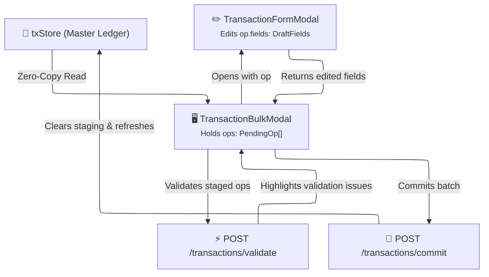
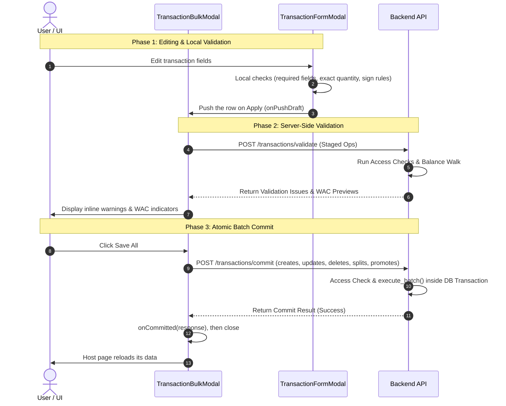
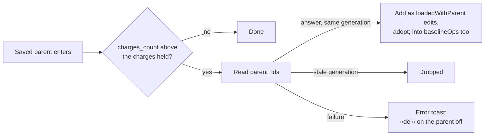

# 📝 Transaction Staging State

This document describes how LibreFolio manages the transient staging state of transactions in the frontend before they are committed in bulk to the database.

---

## 🏗️ Architecture Overview

The staging state acts as a local in-memory sandbox where users can add, edit, clone, split, promote, and delete transactions. Rather than immediately saving changes, the operations are staged in the `TransactionBulkModal` as a list of operations. 

The workspace is `TransactionBulkModal.svelte`. It owns the staging state, the validation and the commit, and renders its banners and its toolbar through `TxBulkBanners` and `TxBulkToolbar` (`frontend/src/lib/features/transactions/bulk/`), which read that state as props, write back only what they bind, and call the modal's handlers.



---

## 🏷️ The `PendingOp` Tagged Union

LibreFolio represents each staged row as a `PendingOp`. It is implemented as a TypeScript **discriminated (tagged) union**, declared with `DraftFields` in `features/transactions/bulk/txBulkTypes.ts` and held by `TransactionBulkModal.svelte`, that separates metadata from pure transaction data fields (`DraftFields`).

### State Schema

```typescript
interface DraftFields {
    broker_id: number;
    asset_id: number | null;
    type: TransactionTypeCode;
    date: string;
    quantity: string;
    cash: { code: string; amount: string; } | null;
    tags: string[];
    description: string;
    asset_event_id: number | null;
    cost_basis_override: { code: string; amount: string; } | null;
    cost_basis_mode: 'auto' | 'manual' | null; // UI-only; null = not applicable to this type/side
}

type PendingOp = (
    | { op: 'create'; } // Brand new row
    | { op: 'edit'; txId: number; markedDelete: boolean; addedViaPicker?: boolean; } // Existing DB row
) & {
    tempId: string;
    createdSeq: number; // Keeps new rows of the same day in the order they were added
    fields: DraftFields;
    pairedWith?: string; // Set on the hidden partner op: the tempId of its visible row
    link_uuid?: string | null; // Shared pairing UUID for transfers & conversions
    inaccessible?: boolean; // Read-only marker for a partner on an inaccessible broker
    promoteFromType?: TransactionTypeCode | null; // Pre-promote type sent to the backend by a mixed promote
    _wacCache?: WacResultEntry | null; // Transient WAC result returned by validate
    wacCurrencyHint?: string | null; // WAC target currency; null = backend decides
    todos?: ImportTodo[]; // Import field todos (see below)
};
```

A linked pair is two ops: the visible row and a hidden partner whose `pairedWith` points to it.

`quantity` and `cash.amount` are decimal strings held in the workspace's sign convention: a value
whose type rule demands a negative — a `SELL`'s quantity; the cash of a `BUY`, a `WITHDRAWAL`, a
`FEE` or a `TAX` — is held as its magnitude, and `applySignRules()` puts the sign back in every
payload built for validate and commit (`buildCreatePayload()` and `buildUpdateDiff()`, in
`lib/features/transactions/txPayloadHelpers.ts`). Every other value is held as given; under a
`nonzero` rule, such as a `TRANSFER` leg's or an `ADJUSTMENT`'s quantity, its sign is information.
The conversion is `magnitudeForRule(value, rule)` (same file, W-B65): under the `negative` rule a
negative value becomes its magnitude, its digits exact, trailing zeros dropped, never in exponent
notation (`-0.00000001` → `0.00000001`, `-0.020000` → `0.02`); anything else comes back as given —
a magnitude, a zero, a text that is no plain decimal, any value of another rule. It is idempotent,
and the inverse of `applySign()` on the `negative` rule. A saved row, or a clone of one, is read
in through it (`fieldsFromTx`), its cash exactly, no longer through `Number`; an imported row
takes the same convention in `txCreateItemToPendingOp`, which still reads its cash, whatever the
rule, through `Number`.

On **Apply** the Form pushes back a create-shaped payload, signed as a create is sent
(`buildCreatePayload()`, or `buildDualCreatePayloads()` for a pair). `applyFormPayload()` copies it
into the row's `DraftFields`, reads the signed quantity to derive `cost_basis_mode`, and as its
last step brings the quantity and the cash back to the workspace's convention with
`magnitudeForRule()`. Every Apply goes through it — a new row, an edited one, both halves of a
pair — so an untouched Apply gives the quantity and the cash back as the row held them (W-B65).
Before, the row kept the signed values: an untouched Apply on a one-satoshi `SELL` showed
`-0.00000001` in its cell, and closing the workspace asked to discard, though the row stayed
`original` (see *Derived Row Status* below).

---

## ⚡ Core Design Principles

### 1. Zero-Copy Originals
For edits (`op: 'edit'`), the staging state **never** stores a copy of the database row. The single source of truth is always the `txStore`. The original values are read live on-demand via `txStoreGet(op.txId)`. This ensures that if the transaction is modified elsewhere, the staging state remains in sync without stale data risks.

### 2. Derived Row Status
Row status is calculated dynamically at runtime. It is never stored as an editable property. The helper function `deriveStatus(op)` computes it instantly based on Svelte reactivity:

| Operation Mode | Condition | Derived Status | Description |
|----------------|-----------|----------------|-------------|
| `op.op === 'create'` | Always | `new` | A newly appended transaction row |
| `op.op === 'edit'` | `markedDelete === true` | `delete` | Row marked to be removed |
| `op.op === 'edit'` | `fields` match `txStoreGet(txId)` | `original` | Unchanged row |
| `op.op === 'edit'` | `fields` differ from `txStoreGet(txId)` | `edited` | Row has local modifications |

The comparison goes through `collectUpdate()` → `buildUpdateDiff()`, which signs the draft and the
saved row alike (`applySignRules()`) and compares their decimals exactly (`fieldEq()`): a
magnitude held for a `negative` rule matches the signed value saved, so the sign convention never
shows in the status.

The close guard is stricter. Closing the workspace — ✕, **Cancel**, Escape or a click on the
backdrop — goes through `requestClose()`, which first asks *Discard Changes?* when
`hasUnsavedChanges()` finds that `serializeOps(ops)` differs from `initialOpsKey`, the key
`serializeOps()` (`lib/features/transactions/bulk/bulkDisplay.ts`) took when the rows were seeded.
The key is the JSON of every op, hidden partners included: its `DraftFields` as held (not through
`applySignRules()`) and its other keys. It leaves out `tempId` and `createdSeq`, names `pairedWith`
and `link_uuid` by the rows they point at, and sorts object keys, so a reset (`resetRow`,
`resetAll`), which rebuilds the saved rows under new identities, reads no change. Unlike the
status, it compares values as held: a signed value where the row held a magnitude is a change. And
`JSON.stringify` keeps a key set to `null` but drops an absent one, so an Apply whose payload
carries no WAC currency (`_wac_currency_hint: null`) deletes the op's `wacCurrencyHint`
(`patchRowFromForm`, and the partner in `patchDualRowFromForm`) instead of writing `null`: both
mean that the backend decides (`opToTxFields()` uses the hint only when it holds a currency), and
a row starts without the key. Before W-B65 it wrote `null`, and every such Apply, even on a
`DEPOSIT`, asked to discard.

---

## ✂️ Split & Promote Integration

The tagged union structure of `PendingOp` simplifies complex composite operations in Svelte:

* **Split** (`handleSplitRow`) breaks a linked pair (`TRANSFER`, `CASH_TRANSFER`, `FX_CONVERSION`)
  into two independent rows; nothing is deleted.
  - A pair **merged in the workspace** and not saved yet — an entry of `pendingPromotes`, two
    saved rows or a saved and a new one — is not split: its merge is undone, whichever row the
    pair shows (`undoPendingPromote`, J-67). Each row takes its source type back (a saved row's
    from the store, `txStoreGet(txId).type`; a new row's `promoteFromType`) and its quantity and
    cash back in the workspace's sign convention (`magnitudeForRule()`, as `fieldsFromTx` reads
    them), the new row's `link_uuid` is cleared, both rows are visible, and the entry leaves
    `pendingPromotes`: the save sends neither the promote nor a split, where a mixed merge's save
    used to be refused (`promoteRefNotFound`). The description and the tags chosen for the merge
    stay. Two new rows merged are no such entry: they split as a **new** pair.
  - A **saved** pair is queued in `pendingSplits` as `{id_a, id_b}`; the backend splits it at
    commit. Meanwhile the partner op loses `pairedWith` and becomes a visible row next to its
    former main row. Each half keeps the pair's `fields.type` until its Form gives it its own;
    the type it will have is `postSplitType` (66 C22d): the split's type for its side, or the
    type the user chose in its Form. The Type cell («CASH_TRANSFER → DEPOSIT»), the half's Form
    and **Link** (`bulkLinkSelection`'s `typeOf`) all read it, so an untouched `DEPOSIT` or
    `WITHDRAWAL` half accepts charges at once, linked in the same batch (the backend splits
    before it links); the Type cell shows the half's charges chip too. A split `TRANSFER` gives
    two `ADJUSTMENT`, which are no parents.
  - A **new** pair is split locally: both ops lose their link and take the standalone types of
    `SPLIT_TYPE_MAP` (the client mirror of the backend's split rules, e.g. `WITHDRAWAL` and
    `DEPOSIT` for `FX_CONVERSION`).
  - `splitTypes.ts` holds the one computation: `SPLIT_TYPE_MAP`, `splitHalfType(originalType,
    fields)` (the sender — quantity for a `TRANSFER`, cash for the others, at or below zero —
    takes the first type) and `postSplitType(op, pendingSplits)`. The Type cell, the Form, **Link**,
    the issue rows and the local split of a new pair all call it.
  - The update of a split half names a type only when the user swapped it (66 C22e,
    `splitTypeToSend(op, pendingSplits, saved)`): the backend splits first and gives the half the
    type of its **saved** side (`pair_sides`), then applies the update. `resolveOps` sends
    `postSplitType` when it differs from that type and leaves the type out otherwise. The side is
    read on the saved row, because after a swap the draft holds the amount as its magnitude.
* **Promote** (`executePromote`) links two independent rows (e.g. a `WITHDRAWAL` and a `DEPOSIT`)
  into a pair of the matching type; both ops take the target type and collapse into one paired
  row, the receiving op becoming the hidden partner (`collapseIntoPaired`). Before the type
  changes, every branch below moves the sign into the values (`applySignRules()`, under each
  row's own type rule), so a `WITHDRAWAL`'s cash, held as its magnitude, turns negative: the
  target is free-sign (`CASH_TRANSFER`, `FX_CONVERSION`), and `collapseIntoPaired` picks the row
  to show by the sign of its cash — the paying one, its cash negative, on the *From:* line of the
  pair's cells, the receiving one on *To:* (J-67; before, only a merge of two new rows did). For
  a merge with a saved row the save does not depend on it: a saved row is not sent as an update
  (`resolveOps()` skips the ids in `pendingPromotes`), and a new row is created under its source
  type (`promoteFromType`), whose rule signs it again — `applySign()` is idempotent.
  - Two **saved** rows are queued in `pendingPromotes` (`{id_a, id_b}`) for the backend.
  - Two **new** rows simply share a fresh `link_uuid`.
  - A **mixed** pair (one saved, one new) is queued as `{id_a, link_uuid_b}`, and the new row keeps
    its pre-promote type in `promoteFromType`, because the backend derives the target from the
    two source types.

`e2e/transactions/tx-bulk-promote-split.spec.ts` pins both (J-67): a saved `WITHDRAWAL` merged
with a new `DEPOSIT` shows the withdrawal on *From:* (F1), its cash negative (F2); **Split pair**
on a new `WITHDRAWAL` merged with a saved `DEPOSIT`, before the save, gives each row its type
back, and the save creates the withdrawal alone, with no update and no promote (F3); G guards
two new rows, merged, split and saved as two creates.

### 💡 Promote suggestions {: #promote-suggestions }

The workspace looks for the two halves of a transfer or an exchange and offers to promote them
(`TransactionBulkModal.svelte`, with the pure helpers of `lib/features/transactions/bulk/promoteSuggest.ts`):

* **The green banner** (`promote-suggest-banner`) lists `bannerSuggestions`: pairs of standalone
  rows that are both in the workspace — two new rows, two saved rows, or a new row and a saved one
  (`mixedPromotePairs`). The two dates are at most *Max Δ days* apart (`maxDeltaDays`, 0–14), and
  `findPromoteMatch` finds a rule on the context `buildPromoteCtx` reads from the two rows: its
  broker, currency, asset and quantity constraints hold — the quantities exactly opposite for an
  asset transfer — and the target type accepts the rows' event links (`eventA`/`eventB`, each
  row's `asset_event_id`). No promote target accepts one, so a row linked to an asset event, such
  as an `ADJUSTMENT` linked to a split, is never offered. The two sides must also cancel exactly:
  a cash transfer's amounts (`cashAmountsCancel`), and an asset transfer's quantities of one asset
  (`assetQuantitiesCancel`, in `promoteSuggest.ts`). Both helpers give each value the sign its
  type implies, then compare the decimal strings exactly, as the backend compares `Decimal`s: a
  relative tolerance of 1e-9 would let a one-cent difference through above about 10 million, a
  pair the backend refuses. It shows the first five pairs, and `promotePairOrder`
  (`promoteHelpers.ts`, J-66) tells which row of a pair pays: the one whose cash, signed by its type
  (`buildSignedCash`, its sign read exactly by `exactDecimalSign`, as `cashAmountsCancel` reads it),
  is negative — a `WITHDRAWAL` pays whether the workspace holds its cash as its magnitude (the sign
  convention above: `fieldsFromTx`, `txCreateItemToPendingOp`, and since W-B65 `applyFormPayload()`)
  or signed — and never a row without cash, or whose amount is no plain decimal. Five readers share
  that answer: the banner's order, the paying row first when the other one receives (`swapped`); the
  implied rate shown for an exchange, from that row to the other (`from` → `to`, `to` ÷ `from` in
  `computeFxConversionInfo`); the market rate it is compared with, fetched in the same direction on
  the paying row's date (the `fxMarketCache` effect); the `left` of **Merge all** (*All left*), the
  row the banner lists first (`mergeAllSuggestions`); and the **Merge** dialog, which shows that row
  first, its text first in the combined description it opens with (`triggerPromoteFromSuggestion`;
  `executePromote` still gets the rows in the suggestion's order) — all but the dialog used to read
  the stored amount, where a `WITHDRAWAL` held as its magnitude never paid and the pair could show
  backwards. `executePromote` asks `findPromoteMatch` again before it promotes, so its refusals
  hold for every promote of the workspace: **Merge**, **Merge all**, and the selection toolbar's
  promote button (`selectedForPromote`, `promote-toolbar-confirm`), which also asks
  `cashAmountsCancel` of a cash transfer and `assetQuantitiesCancel` of an asset transfer.
* **Rows with linked charges** (66 C21): a row that still holds linked charges is never a side of a promote — rule 6
  of the backend (`chargesBlockParentType`) would refuse the save. `rowsWithLinkedCharges` (`bulkCharges.ts`) gives
  the holders in one pass: a charge linked under the row, or a saved charge of it the workspace does not hold yet
  (`charges_count` minus the saved charges of that row present anywhere in `ops`, so a charge moved away with
  **Link** frees the row it left). `isSuggestable` and the standalone lists behind the banner leave them out;
  `selectedForPromote` (66 C22) is `hidden`, `disabled` or `ok` (`PromoteSelection`), and a pair that only the charges
  of a leg forbid draws the button off with the reason (`aria-disabled`, `data-reason="hasCharges"`, the Tooltip
  `transactions.promote.chargesBlock`), as the Transactions page draws its `promote` action off
  (`data-disabled-reason="hasCharges"`) when a row has `charges_count > 0`; `executePromote` refuses them as a defence (`tx.bulk.promote.refused.charges`, for a charge read
  that lands while `PromoteMergeModal` is open), and `promote-suggest` never returns a saved candidate that is the
  parent of a charge. A charge «del» or «unlink» frees its row; after the merge it is a row of its own, because
  `isUnderParent` never puts a charge under a leg of a pair (rule 8). `resetRow` and a restore from «del»
  (`applyDelete`) keep a charge «unlink» when its parent is «del» or a leg of a pair, saved or pending
  (`keepUnlinkedFromUnfitParents`), and a half that a merge hides leaves the grid's selection, so **Reset selected**
  never resets it alone.
* **Leg of a pair** (66 C22): `isPairLeg(op, ops)` (`bulkCharges.ts`) is the one predicate — the hidden half names the
  visible one (`pairedWith`), for a saved pair, a merge queued in `pendingPromotes` and two new rows merged alike; a
  saved pair split here is none. `isUnderParent`, `keepUnlinkedFromUnfitParents` and the charge Form's **Link to a
  transaction…** (`_parent_link` in `applyChargePayload`) read it: the Form's picker reads the database, where a row
  merged in the workspace is not a pair yet, so a link to such a leg is refused (`tx.bulk.charge.link.refused.paired`,
  the toast of the `paired` reason) and the charge's other values apply. `bulkLinkSelection`'s `pairIdOf` and the
  parent Form's `related_transaction_id` keep their own lookup, because they need the partner's id.
* **Resets and queued merges** (66 C22): a reset brings rows back as saved, and a merge queued in `pendingPromotes` is
  not saved. `resetRows(tempIds)` (**Reset row** is `resetRows([tempId])`, **Reset selected** one call for the whole
  selection) first undoes every queued merge that touches one of the rows (`undoPendingPromote`, the partner taken
  before the undo), then resets them, so the order of the selection never changes the outcome. A split queued in
  `pendingSplits` that touches one of the rows is undone the same way (66 C22b): the entry leaves the queue and both
  halves are reset, so the pair the grid shows joined is never split by the save. A charge linked to a half while the
  split was queued would now hang under a leg: `keepUnlinkedFromUnfitParents` also looks at the charges of the reset
  rows, and undoes its link with `unlinkCharge` (66 C22c, below), with the `paired` toast. **Undo split** does the same
  for the charges of its two halves (`tx.bulk.undo-split.charge.kept-unlinked`). **Reset all** undoes
  every queued merge before it renames the rows, and empties `pendingPromotes` beside `pendingSplits`.
* **The 💡 button** (`tx-bulk-suggest-import`, and the row action `suggest`) lists
  `importableSuggestions`: saved transactions that `POST /transactions/promote-suggest` proposes as
  the other half of a row, and that are not in the workspace yet. The search runs debounced on the
  standalone saved rows and on the new rows that have a type, a broker, a date and an amount or a
  quantity, asked about under a negative id (`newRowSuggestId`). It uses the banner's *Max Δ days*
  window: the slider's value (`maxDeltaDays`) goes as `tolerance_days`, and the backend searches
  each row's date ± that many days, so 0 means the same day only. A row dated at the calendar's
  edge (0001-01-01, 9999-12-31) gets its window cut there (`shift_date()`, W-B71) and simply finds
  nothing; it used to fail the whole search. The window is part of the search
  key, so moving the slider starts a new search, debounced like any other change. Each input also
  carries the row's `asset_event_id` (`TXPromoteSuggestInput`, where `null` or `0` means not
  linked): the backend skips, for a linked row, every rule whose target type refuses the link —
  today all of them, so the row gets an empty list — and never returns a saved row linked to an
  event as a candidate for such a rule, so the 💡 never offers a pair that an event link would keep
  from merging. The 💡 opens `TransactionPickerModal` on those candidates; once one is added, the
  banner offers the pair.
* **Merge** (`promote-suggest-link-<idx>`) promotes one pair: `executePromote` at once, or
  `PromoteMergeModal` first, showing the two rows in the banner's order (`promotePairOrder`), when
  they differ in description or tags. Where the descriptions differ, the dialog counts the merged
  one under its textarea (`promote-merge-desc-counter`, `data-state` `ok` or `over`), in code points
  as Python's `len()` counts them (`textLength()` and `TX_DESCRIPTION_MAX_LENGTH`, 500, in
  `promoteHelpers.ts`). Past 500 — 500 itself fits — the textarea is `aria-invalid`, a message
  names the limit (`promote-merge-desc-too-long`) and **Confirm promotion**
  (`promote-merge-confirm`) is disabled: the backend would refuse the merged notes with
  `string_too_long` (W-B70).
* **Merge all (N)** (`promote-suggest-merge-all`, when `mergeAllPairs` holds more than one pair)
  opens `PromoteAllModal.svelte` (`promote-all-modal`), which asks one `PromoteAllStrategy` for every
  pair, `merge` preselected at each opening: `left` (*All left*, the description and tags of the
  row the banner lists first), `right` (*All right*, those of the other row) or `merge` (*Combine*:
  `mergeStrings` of the two descriptions and `mergeTagSets` of the tags, `PromoteMergeModal`'s
  default). `mergeAllPairs` is the banner's pairs in their order (all of them, not only the five
  shown), without any pair that shares a row with an earlier one: when two suggestions share a
  row, only the first is kept and the row is merged once. *N*, and the count the dialog shows, is
  `mergeAllPairs.length`: the pairs to merge, not the suggestions. `mergeAllSuggestions` then walks
  `mergeAllPairs`; it skips a pair whose rows no longer match a rule, or with a row already merged
  (`isPaired`), and passes `executePromote` what `resolvePromoteAllFields(strategy, left, right)`
  (`promoteHelpers.ts`) returns: `{}` when the two rows agree on description and tags, otherwise
  the chosen side's values or both combined. With `merge`, a pair whose combined description would
  pass 500 characters gets `null` instead: it is left unpromoted, for **Merge** and its dialog,
  and never saved with one side's notes only. After the walk, `notify()` counts those pairs in a
  warning toast (`transactions.promote.mergeAllLeftTooLong`) and the app event
  `tx.bulk.promote-all.left-for-manual-merge`, detail `{pairs}` (W-B70).
* **The save gate.** `requestCommit` first counts the suggestions nobody looked at
  (`unseenSuggestionCount`): the 💡 candidates until the picker has been opened once
  (`suggestPickerSeen`), and the banner's pairs until a click lands anywhere in the banner
  (`promoteBannerSeen`, an `onclickcapture`). With any left, **Save All** opens *Suggestions you
  have not looked at* (`tx-bulk-unseen-suggestions`) instead of saving. **Save anyway** marks both
  as seen and goes on to the [warnings gate](#validation-resolution-lifecycle)
  (`requestCommitPastSuggestions`). **Show the suggestions** — and closing the dialog — opens the
  picker when it was never opened and has candidates, and otherwise marks the banner as seen and
  scrolls it into view. Both flags reset only when the workspace opens again.

`PromoteAllModal.test.ts` (Vitest, jsdom) pins the dialog: the three answers, *Combine* by default
and again at every opening, and cancelling. `e2e/transactions/tx-import-scalable-transfers.spec.ts`
runs the whole path on two Scalable exports: the banner's **Merge** (S1), the 💡 and a new + saved
pair (S2), the save gate (S3) and **Merge all** (S4). The 500-character limit (W-B70) is pinned by
`promoteHelpers.test.ts` (`textLength()`, `resolvePromoteAllFields()`), `PromoteMergeModal.test.ts`
(the counter and the disabled confirmation) and `e2e/transactions/tx-bulk-promote-cost-basis.spec.ts`
(PC7: **Merge all** merges the pair that fits and leaves the one past it, with the toast and the app
event).

---

## 📤 Validation & Commit Pipeline

Staged operations undergo a two-phase validation before they are persisted:



### 1. Local Sanity Checks
Before a row reaches the workspace, the single-row form checks what it can know locally: the
fields its type requires, the exact quantity and the sign rules (see
[Client-Side Validation](../components/features/transaction-form.md#client-side-validation)).

### 2. Server-Side Validation (`/transactions/validate`)
LibreFolio defers all deep ledger validation (such as checking if a sale results in a negative cash or asset balance) to the backend.

* **Auto-validation**: while the workspace holds at most 50 operations (`AUTO_VALIDATE_THRESHOLD`,
  hidden partners included) and at least one row is ready for validation, every edit schedules a
  run, debounced by `createValidateScheduler` (500 ms by default); an idle run also fires after
  60 s without changes.
* **Manual validation**: above that threshold the automatic runs stop, and once more than 50 rows
  are visible the toolbar says so (*Auto-validate is OFF … press ⚡️ Validate now before commit*).
  The **⚡ Validate now** button works at any size.
* **Import hand-over**: the rows handed over by the Import Wizard (`onImportBatch`) are validated
  once right away, whatever their number (`scheduler.trigger('manual')`), so even a large import
  shows its issues without a click. Later edits follow the two rules above.

### 3. Batch Commit (`/transactions/commit`)
**Save All** passes two gates first (`requestCommit`): the [suggestions nobody looked at](#promote-suggestions),
then the warning todos ([below](#validation-resolution-lifecycle)).

Then `resolveOps()` turns `PendingOp[]` into create, update and delete operations, and `buildBatchPayload()` assembles them, together with the queued splits and promotes, into a single atomic batch:

* **Creates**: Array of brand-new transaction data (a pair contributes both legs).
* **Updates**: Key-value diffs containing only modified fields vs the original `txStore` data.
* **Deletes**: List of transaction IDs marked for deletion.
* **Splits** / **Promotes**: the pairs queued in `pendingSplits` and `pendingPromotes`.

Empty lists are left out of the payload. When the server refuses the batch (`committed: false`),
the workspace stays open with the issues; on success it calls `onCommitted` and closes.

---

## 🗺️ The `WorkspaceIntent` Pattern {: #workspace-intent }

To keep components decoupled and avoid passing large, stale arrays of transaction objects, LibreFolio uses a declarative routing pattern to open the bulk transaction workspace. 

Instead of passing copies of data, the calling component (such as the transactions page or toolbar) sets a reactive `intent` property on the `TransactionBulkModal`:

```typescript
export type WorkspaceIntent = 
  | { action: 'create'; }                      // Open empty grid to add new rows
  | { action: 'import'; }                      // Mount BRIM wizard to parse files
  | { action: 'edit'; txIds: number[]; }       // Edit specific existing rows
  | { action: 'delete'; txIds: number[]; unlinkIds?: number[]; chargeIds?: number[]; } // Pre-mark rows for deletion
  | { action: 'clone'; txIds: number[]; };     // Copy existing rows, keeping their dates
```

Upon receiving the intent, `TransactionBulkModal` resolves the actual row data directly from `txStore` (the Single Source of Truth) using the provided transaction IDs. This ensures the modal always operates on the most up-to-date ledger state.

An id that `txStore` does not hold is left out. A caller that needs rows the page did not load adds them first with
`txStoreAddExtras(rows)`: a row already in the store is kept, and the next `txStoreSetAll` drops the extras.

**Linked charges in the workspace** (project 66). A charge (a FEE or a TAX) brought into the workspace is a
`PendingOp` of its own, owned by its parent through `chargeOf`, the parent's `tempId`. It never uses `pairedWith`, so
the pairs' code is untouched. The pure half lives in `bulk/bulkCharges.ts`:

- **Ownership.** `adoptCharges` gives a present parent its saved charges, from their `parent_transaction_id`. It runs
  after every `collapsePairedOps`: an intent, a reset, the picker. A reset that regenerates the parent's `tempId`
  remaps its charges (`remapChargeOf`), so `chargeOf` never names a missing operation.
- **The link that changes lives on the charge.** `parentUnlink` sends `parent_transaction_id: 0`; `parentLinkId` names
  a saved parent absent from the workspace.
- **Undoing a link: one rule** (66 C22c, `unlinkCharge` in `bulkCharges.ts`). Every path that unlinks a charge goes
  through it: a reset or **Undo split** that makes its parent a leg again, a restore under a parent still «del»,
  «unlink» in its own Form or in its parent's Form, «Keep» on a parent's delete, an intent's `unlinkIds`, a charge read
  under a parent already «del». Undoing a link brings the charge back to what it was before that link. `parentUnlink`
  cuts only a **saved** link: when the charge's saved parent is its owner, it keeps the owner and gets `parentUnlink`;
  when it has a saved parent but another owner (unlinked from the saved one, then linked here), it gets `parentUnlink`
  and goes back under its saved parent if the workspace holds it. A link made only here (no saved parent, or a new
  charge) is dropped: the charge is back as saved, with no «unlink» badge and nothing to send about a parent. A new charge typed in its parent's form carries `followsParent`: at batch
  time it takes the parent's broker, asset and date.
- **The payload.** `chargeParentFields` gives `parent_ref` (the parent's `tempId`, sent as its create's `ref`) or
  `parent_transaction_id`, merged in `collectCreate` / `collectUpdate`. So the three places that build a payload see
  the same thing: the nested form's context, «Validate now» and «Save all».
- **The parent's form.** It receives its charges as drafts (`chargeDraftsFor`, as `_charges`, with
  `allowChargeEdits`). Its answer goes back onto the operations (`applyChargeDrafts`), one way: nothing typed is lost.
- **Reading the charges on entry.** A saved parent whose `charges_count` is higher than the charges the workspace
  holds has them read (`GET /transactions?parent_ids=…`, batched). This happens when it enters: with the intent, from
  the picker or a suggestion, and after a row reset or «Reset all». The charges read join as unchanged edit rows
  marked `loadedWithParent`, adopted by their parent. Under a parent already «del» they are unlinked. Each read
  carries a generation number, bumped on every open, reset and «Reset all», and a stale answer is dropped. While a
  read is in flight «Save all» is off. If it fails, an error toast names the parents and says that «Reset row» reads
  again, and «del» on that parent is off, with the reason in its menu; «Reset row» shows on that parent even
  untouched. The parent's form waits for the same read rather than asking again.
- **The close guard's baseline.** `initialOpsKey` is the key of `baselineOps`, the rows the editor opened on. The
  charges read are added to both, so an editor nobody changed closes without asking.



**The grid groups the charges under their parent (BK2).** `visibleOps` still holds every row; it feeds the labels.
The title counts the top-level rows, as a pair already counts as one. The grid draws `gridRows`, built in three steps:

1. The top-level rows are `visibleOps` without the charges that sit under their parent (`isUnderParent`).
2. `foldBulkCharges` puts each open parent's charges right after it, in the order of the operations.
3. The date column sorts with a constant, so the table keeps this order in both directions. The header only sets
   `dateSortDirection`.

`DataTable` gets `opensPage`, so a charge never starts a page. The rest of the grid:

- **The chip.** The parent's Type cell carries the chip «N charges» (`tx-bulk-charges-toggle-<tempId>`), with the
  markup and label of the transactions table's chip. A click, caught in the capture phase, opens and closes the
  group. It marks the group as changed when one of its charges is not unchanged; the parent's own status stays its
  own.
- **The indented row.** It shows `↳` with `data-charge-of`, and keeps its `#id`. Its Status cell holds one chip: a
  charge «del» shows the row's «🔴 del», a charge «unlink» shows «Unlink» in place of «edit», a linked charge keeps
  the row's status with 🔗 beside it. The charge's state (`linked` / `unlink` / `del`) rides on a wrapper,
  `tx-bulk-charge-state`, that draws nothing. It has its own checkbox (66 TL-4, as on the transactions page):
  ticking the parent never ticks its charges, nor the reverse; only the half a merge hides is never selectable
  (`isGridRowSelectable`). Its menu offers «Edit row», «Delete» and «Restore» (no clone, split, remove or reset), and
  keeps the ⋮ button; a double-click, or a long press on touch, opens its own form, as on any row of the workspace.
- **A charge unlinked from a parent that stays** is a top-level row, with the chip «Unlink».
- **When a group opens by itself.** The parent is «del», the charges came in the intent with their parent, or a charge
  was created or linked in the parent's form, or a parent was picked after its charges were already rows; «Link» on
  the selection opens the parent's group, and «Open» onto a charge in a closed group opens it (`openGroup`). Charges
  the workspace read itself start closed. A group never closes by itself.
- **Labels.** A charge under its parent takes no number: its label is `<parent>·k` (`buildBulkRowLabels`), so an
  issue on it names a row in the banner. The highlight and the jump use `rowAnchor`, and a jump to a charge in a
  closed group opens the group first.
- **«Remove from batch»** on a parent takes along the charges read with it that are still unchanged.
- **A row leaving the workspace** — «Remove from batch», or «Mark for deletion» / «Delete selected» on a new row — goes
  through `withoutRows` (`bulk/bulkCharges.ts`), the one removal of the workspace: the row leaves with its pair's hidden
  half, and a parent, new or saved, takes along only the creates born in its Form that still follow it (`followsParent`)
  and the copies «Clone» brought with it that nobody changed (`isUntouchedClone`, below). Any other new charge stays, as a row of its own owned by nobody, as every saved charge does: one applied in its own Form,
  which drops `followsParent` (`applyChargePayload`), or one joined with «Link», which never followed (`linkInBulk`
  leaves the flag as it is).
- **The selection (66 TL-4).** A ticked charge keeps its tick when its group closes, as a row of another page does:
  `DataTable` reads the selected rows from `selectionData` (`visibleOps`), not only from the rows drawn, so the bar
  still counts it. A row that goes under its parent keeps its tick too; only a hidden half of a pair is dropped from the
  selection. Select-all ticks the rows of the page as drawn: an open group's charges, not a closed one's.
- **«Unlink» on the selection bar (66 TL-4, `tx-bulk-unlink-charges`).** It takes the ticked charges still linked under
  their parent (`unlinkableCharges`) and says how many; without one it is not there. `unlinkSelectedCharges` unlinks each
  as «Unlink» in its form does (`unlinkCharge`); one marked «del» is no longer «del», nor the parent's choice, so
  restoring the parent later does not link it back. A ticked parent drags none of its charges. No panel: nothing is
  saved before «Save all». «Reset» links back only a saved charge whose saved parent it was cut from; a new charge has no
  reset, and a link made only here leaves nothing to reset: «Link» joins those again. The selection empties, as after
  «Link».
- **«Delete selected» on a parent and a charge of it already «del» (66 TL-4, P-19).** When the parent goes «del» (or a
  new one leaves) in the same action, the charge stays «del»; ticked alone, it still toggles back.

**An all-new group moves together (66 TL-3b, P-30).** A group is a parent and the charges still linked under it
(`newGroupOf`, `bulk/bulkCharges.ts`: neither «unlink» nor a saved «del»). While every row of it is a create, its broker
and asset are shared, both ways: `handleFormPushed` reads the edited row's broker and asset as shown (`followedFields`)
before the patch, and after `applyChargePayload` `syncNewGroup` writes the one that changed on every row of the group.

- Only a changed field moves, so a group already divergent stays flagged until one of its rows is rewritten; the date
  never moves (a create that follows its parent takes it one way, as before).
- The asset moves only when it is not empty and the parent's type takes one (not a Deposit or a Withdrawal), and only
  onto rows whose type takes one.
- A row the sync writes loses the import todos on the fields it wrote that its new values answer (`remainingTodos`), as the row of the Form does (a todo on another field stays): an
  imported group whose rows came without an asset is unblocked by the asset set on any one of them.
- A group holding a saved row does not move: the batch's `chargeBrokerMismatch` / `chargeAssetMismatch` stay the guard,
  and nothing changes in the payload.
- A create that follows its parent (`followsParent`), applied in its own Form, loses the flag before the patch, so the
  broker, asset and date that Form gives it are kept (`syncFollowers` used to write the parent's back over them).
- The Form of a row of such a group gets `groupSync`: a line under the broker says the group moves together.

**«Clone» carries the structure (66 TL-3).** A copy keeps its original's date, as «Clone» always did.

- **A parent** brings a copy of each charge still linked under it (`cloneChargesUnder`: neither «del» nor «unlink»), owned
  by the parent's copy, whose group opens. Each charge copy holds the values it was born with (`clonedFields`); while its
  values still equal them, broker and asset aside (`isUntouchedClone`), it leaves with the parent's copy (`withoutRows`).
  `clonedFields` goes with the link (`unlinkCharge`, `linkInBulk`, «unlink» in the parent's Form) and is never sent.
- **From the pages** (the `clone` intent): a cloned parent with `charges_count` reads its charges first
  (`GET ?parent_ids`, in batches), then `wireClonedRows` builds the rows: a charge selected with its parent sits under the
  parent's copy, a charge cloned alone is linked to its saved parent (`parentLinkId`), the charges read become copies
  under their parent's copy. A failed read copies the parents alone (`tx.bulk.clone.charges-read-failed`, a warning).
- **«Clone row» in the workspace**, offered on a charge under its parent too: a saved parent whose charges are not all
  read is read first; a charge's copy is linked to the same parent when the «Link» rule allows it (`cloneChargeLink`,
  through `bulkLinkSelection`), free otherwise, with a warning that says why (`tx.bulk.clone.charge-free`, `reason`).

**Deleting a parent and keeping its charges.** The same panel, `TxChargesActionModal` («Keep the charges» / «Delete
all» / «Cancel»), asks on the Transactions page, on a broker's Transactions tab and inside the workspace. The two pages
share one flow, `createChargesDeleteFlow` in `lib/features/transactions/chargesDeleteFlow.svelte.ts`, each with its own
panel bound to the flow's `panel`, `counts`, `choose` and `cancel`:

- `start(rows)` opens the workspace at once when no row has `charges_count > 0`. Otherwise it reads the parents' charges
  (`GET /transactions?parent_ids=…`) and adds them to the store (`txStoreAddExtras`), so the workspace resolves them
  even when the list does not show them. `deletePlan` (`chargeLinkRules.ts`) keeps the parents whose charges are not
  all selected; with none, the workspace opens on the selection, otherwise the panel opens. A failed read calls
  `onReadFailed` (the page's error toast) and opens nothing.
- `choose(choice)` closes the panel and opens the workspace on `deleteIntent(ids, plan, choice)`: «Delete all» adds
  the plan's other charges to `txIds`, «Keep» lists them in `unlinkIds`, and both name them in `chargeIds`. A charge
  the user selected is in neither `unlinkIds` nor `chargeIds`: it stays in `txIds` and is deleted as asked, on its own.
- `cancel()` closes the panel; nothing opens.

`buildInitialOps` reads the intent: a charge of `unlinkIds` not marked for deletion is a row with `parentUnlink`,
indented under its parent «del» with the state `unlink`; a charge of `chargeIds` that is unlinked or marked for deletion
also carries `byParentChoice`. An intent without `chargeIds` takes `unlinkIds` as the parent's choice. Charges the
workspace reads itself under a parent already «del» are unlinked the same way.

Inside the workspace, «Delete» on a row and «Delete selected» go through one plan, `planBulkDelete` in
`bulk/bulkCharges.ts`. It is decided on the state before anything changes:

- a saved row flips («del» or restored), and a new row leaves;
- a parent going «del» that still has linked charges (`linkedChargesOf`, new ones included) waits for the panel. One
  panel asks for every such parent, and its counts come from the plan;
- a parent whose charges are still being read is waited for. A reset, «Reset all» or closing the workspace cancels
  the wait;
- a parent whose read failed is skipped, and a warning toast (`transactions.bulk.deleteSkippedUnread`) says how many.

`applyDeleteChoice` then applies the plan and the choice. With «Keep», each charge goes through `unlinkCharge`: one
saved under this parent gets `parentUnlink`; one linked only here loses its local link; new charges become rows of their own, with the broker, asset and date they
followed. With «Delete all», saved charges are «del» and new ones leave. «Cancel» or Esc changes nothing and keeps the
selection.

Every mark the choice sets carries `byParentChoice`, and so do the page's and the broker tab's «Keep» and «Delete all»
(`chargeIds`, above). «Restore» on the parent (or a row reset) takes back only those marks, so a charge unlinked or
deleted by hand stays as it is. A charge restored under a parent still «del» is unlinked, never linked to it.

**One delete request per row.** `requestDelete` holds the rows of the requests still waiting for a read in
`deleteHeld`, by `tempId`. A new request leaves those rows out and goes on with the others; when all of its rows are
held it changes nothing, since the earlier request decides. Each request releases its own rows in a `finally`, so a
wait cut by a reset, «Reset all» or the workspace closing frees them too. The plan itself is `planAndAskDelete`.

**«Open» in the workspace.** The Form's «Open» (on a charge in the parent's section, or on the parent in «Linked to»)
calls `handleFormOpenTransaction(id)`:

- the row with that `txId` is looked up on screen (`findSavedRow`: its own, or the visible half of its pair). An absent
  row is read from the store, else from the server (`GET /transactions?ids=…`, then `txStoreAddExtras`), and joins as
  the picker adds rows: `addSavedRows`, shared with `handlePickerAdd`, which collapses the pairs, adopts the charges,
  opens the group of a charge brought in and reads the charges of a saved parent;
- the rows added are navigation, not a change: `joinBaseline` adds them, adopted, to `baselineOps` and recomputes
  `initialOpsKey`, so a workspace nobody edited still closes without asking;
- a target under a closed group opens it (`openGroup`), so the row is on screen when the Form closes. The Form then
  moves by the double-click's entry, `handleEditRowClick`: a row «del» asks «restore and edit» first. The row the user
  came from is passed as `highlightTxId` (`formHighlightTxId`, carried across that question);
- a failed read gives the `tx.form.open.failed` toast; a late answer (the workspace or the Form closed, or the Form
  moved to another row) does nothing. The Form itself is open only while the workspace is (`open && formOpen`).

On a new row, which has no id, the Form calls `handleFormOpenRow(tempId)` (66 TL-11): the row is in the workspace
already, so nothing is read or added; a closed group opens, and the row the user came from is highlighted by its id, or
by its key (`formHighlightKey`) when it is new too. `newParentOf` hands the Form of a charge its parent when that is a
new row (`_newParent`); a saved parent keeps travelling as `parent_transaction_id` (`effectiveParentId`).

**«Link» in the workspace (U3).** The toolbar's «Link» (`tx-bulk-link-charges` in `TxBulkToolbar`) joins one parent
and its charges among the selected rows, new ones included. `bulkLinkSelection` (`bulk/bulkCharges.ts`) applies the
page's rules, `linkSelection` of `chargeLinkRules.ts`, to mirror rows built from the operations:

- each mirror takes the operation's broker, asset, type and date; a create gets a synthetic id, positive and far above
  any saved one (66 TL-4: `linkSelection` reads a parent only when its id is above 0, so a negative id made a charge
  under a new parent look free);
- its parent is its owner in the workspace (`chargeOf`), else `parentLinkId`, else the saved one; none after
  `parentUnlink`, so a charge unlinked here is free to link;
- a pair is read from the saved row's `related_transaction_id` (a new pair has no saved partner).

Every `hidden` outcome of `linkSelection` wins; then a selected row marked for deletion turns «Link» off with the
reason `deleted` (restore the row first); then the page's reasons. A disabled «Link» is the selection bar's pattern
(`aria-disabled`, the reason in a `Tooltip` reachable by tap and keyboard, `data-reason`). The confirmation is the same
`TxChargesActionModal`, in `link` mode; `confirmLinkPanel` applies `linkInBulk`, which sets each charge's `chargeOf` to
the parent and drops `parentUnlink`, `parentLinkId`, `byParentChoice` and `clonedFields` (keeping `followsParent` as it is), then opens
the group and empties the selection. Nothing else is needed for the save: `chargeParentFields` already turns `chargeOf`
into `parent_ref` (a new parent) or `parent_transaction_id` (a saved one). A row of the Bulk picked in a parent's
Form (66 TL-2, «Link an existing charge…», candidates from `bulkChargeCandidates`) comes back through
`applyChargeDrafts`, which gives it the same operation.

**Naming a row: `txRowRef`.** One helper in `chargeLinkRules.ts` names a row in the texts of the charges:
`#123` for a saved row, `row N` (`transactions.bulk.rowRef`, no `#`, which in the workspace's banners already means a
row) for a new one with a label, «new» without one. It builds the disabled reasons of «Link» on the page and in the
workspace (`bulkRowRef`, from `visualRowLabels`, which do not depend on the grid's filters), and the panel's title,
target line and column headers (`parentRefs` / `chargeRefs`, which the workspace passes for both of its panels).

---

## 📥 `ImportTodo` (BRIM Staging Integration)

When running a file import (`action: 'import'`), LibreFolio's backend BRIM parser plugins might accept a transaction but leave some fields incomplete if they cannot be computed automatically (e.g. cost basis on complex corporate mergers). These are returned to the frontend as a list of `field_todos` (`BRIMFieldTodo` schema).

On the frontend, these are loaded into the bulk modal grid as an array of `ImportTodo` objects
(`lib/features/transactions/txPayloadHelpers.ts`) linked to the staging row:

```typescript
export interface ImportTodo {
    field: string;                  // The field requiring manual input (e.g. 'cost_basis_override')
    severity: 'blocker' | 'warning'; // blocker = prevents saving; warning = to verify before saving
    reasonCode: string;             // Machine-readable code (e.g., 'stock_merger')
    message: string;                // Human-readable fallback message
    evidence?: BrimEvidence[];      // Source-data tables backing the todo (raw rows + plugin comment)
    context?: Record<string, unknown>; // Numbers behind the todo
}
```

### Validation & Resolution Lifecycle:
1. **Highlighting:** A row with a blocker todo gets the `row-todo-blocker` row class. Above the
   grid, two folded banners list the open todos: the blockers in red (each with its evidence
   tables) and the warnings (*auto-derived fields to verify*). Each entry shows the row number and
   the todo's message.
2. **Going to the row:** clicking an entry calls `jumpToTodoRow()`, which pages the grid to that
   row and highlights it through `DataTable.navigateToRowId()` — the same mechanism as a
   validation issue. The highlight clears on the next row click or key press in the table. A todo
   of a hidden partner leads to its visible row (`pairedWith`); a row filtered out of the table
   gives a warning toast instead (*The affected rows are hidden by the table filters.*).
3. **Blocker Prevention:** If any row has a todo with `severity: 'blocker'`, the **Save All** button
   is disabled and its tooltip reads *Complete all required fields before saving*.
4. **Warnings gate:** with warning todos left, **Save All** — once past the
   [suggestions gate](#promote-suggestions) — opens *Verify auto-derived fields?*, listing them,
   with **Save anyway** and **Review**.
5. **Resolution:** the user opens the row in the nested `TransactionFormModal` (double-click or the
   row action) and applies it. Applying re-checks the row's todos with `remainingTodos()`
   (`lib/features/transactions/bulk/bulkTodos.ts`): a todo is resolved when its field now holds a value.
   A missing cost basis has a second answer: Auto (WAC) mode, where the backend computes the cost.
   Applying the form with **Auto** selected clears the "enter the cost" todo
   (`cost_basis_override`) even when Auto was already the mode, because `remainingTodos()` looks
   only at the row's resulting `cost_basis_mode`. Once its last blocker is resolved, the row no
   longer holds **Save All** back.

### 🧹 Selection on the Transactions page {: #transactions-selection }

The Transactions page (`routes/(app)/transactions/+page.svelte`) empties its selection — the
table's checkboxes and the toolbar's `selectedRows` — with `clearSelection()` after every operation
that ran: any save from the bulk workspace (add, edit, clone, delete, import) through
`handleBulkCommitted`, and a successful link (promote) or unlink (split) of a pair. The rows the
selection pointed at may have changed or disappeared. Cancelling — closing the workspace without
saving, or dismissing a confirmation — keeps the selection. The **Refresh** button also clears it,
together with the filters.

---

## 🔗 Related

- ⚖️ **[Backend Transactions Service](../../backend/transactions/service.md)** — Batch commit endpoint and execution pipeline
- ✂️ **[Backend Split & Promote](../../backend/transactions/split_promote.md)** — Split and promote rules
- 🔒 **[Backend Balance Validation](../../backend/transactions/balance_validation.md)** — Balance walk validation rules
- ✏️ **[Transaction Form Feature](../components/features/transaction-form.md)** — Single item editor modal and form schemas

