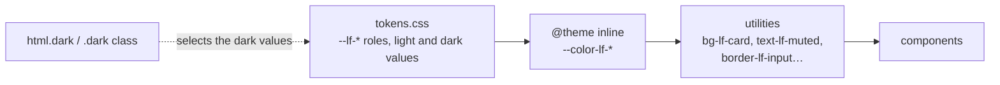

# 🎨 Styling & Design System

LibreFolio uses **Tailwind CSS v4** for styling, providing a utility-first approach with a custom design system.

## 🧰 Technology Stack

- **Tailwind CSS v4** (`tailwindcss`, through `@tailwindcss/postcss`): the utility-first CSS framework.
- **CSS-first configuration**: `src/app.css` imports Tailwind and declares the design tokens with
  the `@theme` directive. `tailwind.config.js` only holds an empty `extend` and is not loaded:
  Tailwind v4 reads a JavaScript config only through `@config`, which `app.css` does not use.
- **CSS Variables**: the colour roles `--lf-*` of `src/lib/theme/tokens.css` carry both themes (light and dark); see [Colour Roles](#colour-roles).
- **Fonts**: system and locally installed fonts, plus one self-hosted face for flags — see
  [Fonts](#fonts).

## 🎯 Design System: Colour Roles {: #colour-roles }

**A component never picks a colour: it picks a role.** A role says what the colour is for (the card,
the muted text, the border of a field, an error); it has one value in the light theme and one in the
dark theme, defined in one file, `src/lib/theme/tokens.css`.

- A role is a CSS custom property named `--lf-<group>-<name>` (`--lf-surface-card`,
  `--lf-text-muted`, `--lf-border-input`).
- The two themes are **«Stone and Sage»** (light) and **«Slate and Sage»** (dark). The light values
  sit on `:root, html.light, .light`, the dark ones on `html.dark, .dark`; roles derived from others
  (`var()`, `color-mix(in oklab, …)`) are computed on `:root, .light, .dark`, so a subtree forced
  into the other theme recomputes them with its own base values.
- An `@theme inline` block at the end of `tokens.css` turns each role into Tailwind utilities
  (`--color-lf-card` gives `bg-lf-card`, `border-lf-card`, `ring-lf-card`…). `inline` makes the
  utility read `var(--lf-…)` directly, so a theme switch (or a live Designer Lab override) reaches
  every element, subtrees included. Every utility takes an opacity: `bg-lf-card/90`.
- `app.css` imports `tokens.css`, so the roles are part of the single Tailwind build.



### 🧩 Role families

The full catalogue (every role, its value in both themes, when to use it) is **not** repeated in
these docs: it lives in `.claude/skills/design-system/palette.md`, checked against `tokens.css`.
The families:

| Family | Examples | What for |
|:--|:--|:--|
| Surfaces | `bg-lf-app`, `bg-lf-page`, `bg-lf-card`, `bg-lf-panel`, `bg-lf-field`, `bg-lf-hover` | The shell, standalone pages, cards and modals, panels, the inside of a field |
| Text | `text-lf-primary`, `text-lf-secondary`, `text-lf-muted`, `placeholder:text-lf-placeholder` | Body, labels, hints, placeholders |
| Borders | `border-lf-subtle`, `border-lf-raised`, `border-lf-input` | Dividers, floating surfaces, fields |
| Brand, action, focus | `bg-lf-brand`, `bg-lf-action`, `outline-lf-focus`, `text-lf-link`, `bg-lf-selected` | The green sidebar and primary button, keyboard focus, links, selection |
| States | `text-lf-success`, `bg-lf-warning-soft`, `border-lf-danger-line`, `text-lf-info-on-soft` | Success, warning, danger, info: text, tint, edge, solid fill |
| Gain and loss | `text-lf-gain`, `text-lf-loss` | The sign of a financial figure; never a state |
| Categories | `bg-lf-cat-etf-soft`, `text-lf-cat-etf-on-soft`, `bg-lf-cat-etf` | Asset type badges and the same colours in the charts |
| Tooltip, overlay, shadows | `bg-lf-inverse`, `bg-lf-overlay`, `shadow-lf-shadow` | The inverted tooltip, modal backdrops, raised surfaces |
| Shell and special surfaces | `bg-lf-bar`, `bg-lf-switch-off`, `bg-lf-terminal`, `text-lf-ai` | Sidebar, switch, terminal, AI accent |

### 📏 The rules

1. **Roles only.** No palette class (`bg-white`, `text-gray-500`, `bg-libre-green`) and no
   hand-written colour (hex, `rgb()`, `hsl()`) in markup, script or `<style>`. In a `<style>` block
   use `var(--lf-…)` or `color-mix(in oklab, var(--lf-…) 70%, transparent)`.
2. **Never `dark:` on a role.** The role already changes value with the theme.
3. **Every `border` names its role** (`border border-lf-subtle`): Tailwind 4 draws an unnamed
   border in `currentColor`.
4. **A native field names its text and placeholder role** (`text-lf-primary`,
   `placeholder:text-lf-placeholder`): the legacy dark rules of `app.css` skip any element carrying
   a `-lf-` class.
5. **Class names stay whole literals.** Never `'bg-lf-' + x`: Tailwind would not generate the class
   and the gate could not see it.
6. **One element, one colour language.** Never a role utility and a palette class on the same element.
7. **One property, one ternary.** Two utilities on the same property come out sorted by name, not by
   position, so the idle and the state colour go in the two branches of one ternary.

The gates enforce them: `src/themeRoles.gate.test.ts` (a ratchet on legacy classes and colour
literals, plus the grammar of the roles) and `src/themeTokens.gate.test.ts` (both themes, the
utility table and the WCAG contrast pairs, 4.5:1 for text and 3:1 for the rest). For new or changed UI
follow the skill `design-system` (`.claude/skills/design-system/SKILL.md`); to convert a component
that still writes palette classes, the skill `theme-roles`.

!!! tip "Tuning colours live"

    The roles can be edited while looking at the real app in the [Designer Lab](designer-lab.md),
    which exports the changes for the skill `designer-lab-apply`.

### 🕰️ Legacy colours, being migrated

Components not yet migrated still use the old system, and `app.css` keeps it alive until they move:

- **`libre-*` colours** in `@theme` (`libre-green`, `libre-beige`, `libre-sage`, `libre-dark`,
  `libre-banner`), with the `primary-50…900` and `surface-50…500` palettes.
- **`--theme-*` variables** (`--theme-bg-*`, `--theme-text-*`, `--theme-border-*`, `--theme-accent*`,
  `--theme-shadow*`), defined for `:root, html.light` and `html.dark`.
- **The legacy dark remap**: unlayered `html.dark` rules that repaint common palette utilities
  (`.bg-white`, `.text-gray-600`, `.border-gray-100`, un-migrated fields…) from the `--theme-*`
  variables. Every element carrying a `-lf-` class is exempt.
- **`dark:` variants** still written by un-migrated components; `app.css` binds them to the `dark`
  class with `@custom-variant dark (&:where(.dark, .dark *))`.

Nothing new may use them. The colour ratchet records what is left in
`src/themeRoles.baseline.tsv` (one line per file with its legacy class and colour literal counts):
a file can only lose entries, and a new file starts with none. Rules are removed from `app.css` when
the last use of their class disappears.

## 🌙 Switching Theme

Dark mode is the `dark` class on the `<html>` element. An inline script in `src/app.html` sets
`dark` or `light` before the first paint, from the stored preference (`librefolio-theme` in
`localStorage`) or, when there is none, from `prefers-color-scheme`; `applyTheme()` in
`src/lib/stores/app/themeStore.ts` changes it at run time. A subtree can force a theme with the
`.light` or `.dark` class and the roles recompute inside it.

Code that draws outside CSS (charts, canvas) never reads the class itself: it uses `isDarkTheme()`
and `onThemeClassChange()` of `src/lib/theme/themeMode.ts` (gate `src/themeModeReads.gate.test.ts`),
and reads roles through `chartRoles()` of `roleColors.ts`. See [Charts](components/charts.md).

## 🔤 Fonts {: #fonts }

Every font stack the app sets starts with the **`'LF Flags'`** face:

```css
/* src/app.css — @theme */
--font-sans: 'LF Flags', Inter, system-ui, sans-serif;
--font-mono: 'LF Flags', ui-monospace, SFMono-Regular, Menlo, Monaco, Consolas, 'Liberation Mono', 'Courier New', monospace;
```

The `html` element uses the same sans stack. Inter is not self-hosted: it is used where it is
installed, and `system-ui` takes over elsewhere.

`'LF Flags'` is declared in `static/lf-flags.css`, linked by `src/app.html` and by
`static/offline.html`. Its `unicode-range: U+1F1E6-1F1FF` covers only the regional indicator
symbols that make up a flag, so it draws flags and nothing else: digits, `#`, `*` and every other
emoji keep the fonts after it.

- **Apple devices** draw their own flags: the face resolves to the system Apple Color Emoji
  through its `local()` sources, and nothing is downloaded.
- **Everywhere else — Windows included**, whose Segoe UI Emoji has no flags and prints the two
  letters instead — it uses a locally installed Noto Color Emoji when there is one, and otherwise
  the self-hosted Noto Color Emoji flags subset, `/fonts/noto-color-emoji/noto-color-emoji.0.woff2`,
  fetched only when a flag is on screen.

The subset is not committed (`frontend/static/fonts/` is gitignored): `scripts/update_js_cache.py`
downloads Noto Color Emoji from Google Fonts and keeps only the flags range
(`keep_unicode_ranges`). `./dev.py front build` and `./dev.py docker build` run it first and stop
when the font is missing and cannot be fetched; `./dev.py server` runs it too.

Chart text is out of the stacks' reach: ECharts draws legends, labels and axes on a canvas and
writes its tooltip with an inline `font`, so no CSS applies to it. The charts get the face through
the theme they are created with, `CHART_INIT_THEME` (`src/lib/components/charts/chartFont.ts`),
whose font puts `'LF Flags'` before ECharts' default family; the same module requests the face
before the first chart paints, since canvas text does not make the browser fetch it. See
[Flags in chart text](components/charts.md#chart-flag-font).

!!! warning "Never name an emoji font in a `font-family`"

    No stack may name Apple Color Emoji, Noto Color Emoji, Segoe UI Emoji or Segoe UI Symbol: an
    emoji font placed before the text font draws digits, `#` and `*` with emoji glyphs. Those names
    appear only as `local()` sources in `static/lf-flags.css`. A component that sets its own stack
    (a monospace cell, an inline style) starts it with `'LF Flags'`, or wraps the flag in
    `.emoji-flag`, which applies the app's sans stack.

    The gate `src/flagFont.gate.test.ts` checks the face, the stacks of `app.css` and
    `offline.html`, and that no source names an emoji font; `e2e/fx/fx-flag-font.spec.ts` reads
    from the browser (Chrome DevTools Protocol) which font actually draws a flag.

## 🛠️ Utility Classes {: #utility-classes }

Global classes defined in `src/app.css`:

| Class | Purpose |
|:--|:--|
| `.emoji-flag` | Applies the app's sans stack, so a flag inside an element with its own font (a monospace cell) is still drawn by `'LF Flags'`. |
| `.lf-compact-number-input` | Shared typography of compact numeric inputs: inherited font, `0.75rem`/`1rem`, tabular numerals. Below 768 px the anti-zoom rule still sets inputs to 16 px, and the class only raises the line height. Used by the custom axis bounds of `ChartAestheticsSection.svelte`. |
| `.zoom-guard-exempt` | Opts an input out of the mobile 16 px font size that prevents iOS auto-zoom, for dense toolbars (date fields). |
| `.safe-top`, `.safe-top-offset` | Padding / offset for the iOS safe area (notch, status bar) in standalone mode. |
| `.scrollbar-hidden` | Scrollable without a visible scrollbar. |
| `.lf-price-flash-up`, `.lf-price-flash-down` | One-shot colour flash of a live price — see [Live Prices](components/features/live-ticker.md#price-flash). |

## 🧱 Component Styling

A typical migrated component, all roles:

```html
<div class="bg-lf-card border border-lf-subtle rounded-xl shadow-lf-shadow-card text-lf-primary">
  <input class="bg-lf-field border border-lf-input hover:border-lf-input-hover text-lf-primary
                placeholder:text-lf-placeholder focus:border-lf-focus focus:ring-lf-focus rounded-lg" />
  <button class="bg-lf-action hover:bg-lf-action-hover text-lf-on-action rounded-lg">Save</button>
</div>
```

- **Cards**: `bg-lf-card`, a named border, `rounded-xl`; a floating surface (modal, menu) uses
  `border-lf-raised` and `shadow-lf-shadow`. Modals go through `ModalBase.svelte`.
- **Inputs**: `rounded-lg`, `border-lf-input`, focus with `focus:border-lf-focus focus:ring-lf-focus`.
- **Primary buttons**: `bg-lf-action` with `text-lf-on-action`.
- **Signs, states, badges**: take the ready class strings of `src/lib/theme/toneClasses.ts`
  (`SIGN_TEXT`, `STATUS_TONES`…) instead of composing them.
- **Charts** take their colours from the same folder, `src/lib/theme/` (`chartTheme.ts`,
  `chartCategories.ts`, `chartShades.ts`), never as a literal in a component.
