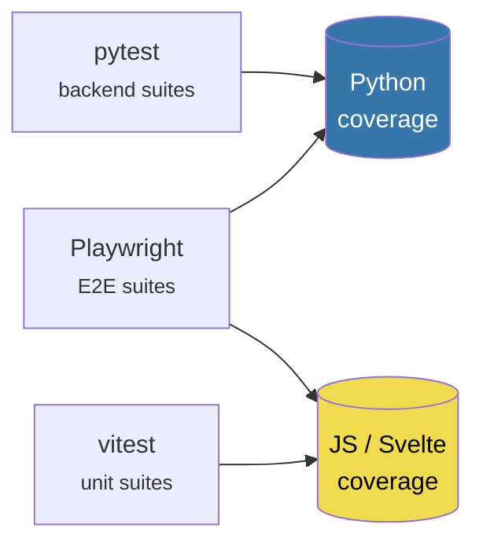

# Coverage Model

LibreFolio measures coverage on **two independent axes**. Keeping them apart is the
single most important thing to understand about the reports — most of the confusion
around the older report names came from collapsing them into one.

| Axis | Question it answers | Values |
|------|--------------------|--------|
| **Language** | *Which code is being measured?* | `py` (Python backend) · `js` (JS/Svelte frontend) |
| **Suite** | *Which tests are driving it?* | backend pytest · Playwright E2E · vitest unit |

The two axes are orthogonal. A Playwright E2E run drives **both** languages at once:
it exercises the frontend in the browser *and* the backend through HTTP.



## The six reports

| Report | Language | Driven by | Opened with |
|--------|----------|-----------|-------------|
| `htmlcov-backend/` | Python | backend pytest | `./dev.py test coverage show backend` |
| `htmlcov-backend-e2e/` | Python | Playwright E2E | `./dev.py test coverage show frontend` |
| `htmlcov/` | Python | both, merged | `./dev.py test coverage show combined` |
| `frontend/coverage-js/unit-combined/` | JS/Svelte | vitest | `./dev.py test coverage show js-unit` |
| `frontend/coverage-js/e2e/` | JS/Svelte | Playwright E2E | `./dev.py test coverage show js-e2e` |
| `frontend/coverage-js/combined/` | JS/Svelte | both, merged | `./dev.py test coverage show js` |

!!! info "Why `htmlcov-backend-e2e/` and not `htmlcov-frontend/`"

    The folder used to be called `htmlcov-frontend/`, which suggested it measured
    frontend code. It never did: it measures **Python**, driven by the frontend's E2E
    suite. The HTML title was already correct ("Frontend E2E → Backend Coverage") —
    only the folder name lied. Frontend *code* coverage now lives under
    `frontend/coverage-js/`.

## The `--coverage` flag

```bash
./dev.py test --coverage all            # both languages (default when omitted)
./dev.py test --coverage py all         # Python only
./dev.py test --coverage js front-asset all
```

`--coverage` takes an optional language. When omitted it means `all`, so every
pre-existing invocation keeps working unchanged:

```bash
./dev.py test --coverage api all        # still valid — 'api' is the suite, not a language
```

### `all` means "everything measurable *in that suite*"

Not "everything, always". Asking for something a suite cannot produce is an error,
not an empty report:

| Suite | What `all` collects |
|-------|--------------------|
| backend (`api`, `db`, `services`, `schemas`, `utils`, `external`) | Python only |
| Playwright E2E | Python **+** JS |
| vitest unit | JS only |

!!! warning "`./dev.py server --coverage` stays boolean"

    A server process can only ever measure Python. The flag is deliberately **not**
    generalised there, and the argv normaliser that makes `--coverage api all` work
    is scoped to the `test` sub-command so it cannot corrupt the Playwright
    `webServer` command line.

## How JS coverage is collected

```text
vitest     ──(istanbul provider)────▶ unit/<time>-<pid>/coverage-final.json ──▶ unit-combined/ ─┐
                                                                                                ├──▶ combined/
Playwright ──(window.__coverage__)──▶ e2e-raw/<one per test>.json           ──▶ e2e/           ─┘
```

Both levels speak **istanbul**, end to end; paths are relative to
`frontend/coverage-js/`. While the tests run, each level only writes JSON files — one
per vitest process, one per Playwright test — the same role `.coverage.<pid>` files
play on the Python side before `coverage combine`. Nothing is merged until the run is
over: then `_finalize_js_coverage()` (`scripts/test_runner/_coverage.py`) calls
`frontend/scripts/js-coverage-report.js` once per arrow on the right. The script
merges its inputs with `istanbul-lib-coverage` — same file, same statement map, hit
counts summed — and writes a `coverage-final.json`, an HTML report and a console
summary. `combined/` is built from the two level reports, and only when both exist;
with a single level, that level's report is the final one.

The moving parts:

| File | Role |
|------|------|
| `frontend/vite.config.ts` | E2E level — `vite-plugin-istanbul` instruments the build when `COVERAGE_INSTRUMENT=1` |
| `frontend/vitest.config.ts` | Unit level — vitest's istanbul provider (`@vitest/coverage-istanbul`), on when `COVERAGE_JS=1` |
| `frontend/e2e/fixtures/playwright.ts` | The `jsCoverage` fixture — one JSON per test, read from `window.__coverage__` |
| `frontend/scripts/js-coverage-report.js` | Merges, remaps and filters its inputs into one report |
| `scripts/test_runner/_frontend_common.py` | `_ensure_frontend_build()` — builds the instrumented frontend, and checks that it is |
| `scripts/test_runner/_coverage.py` | Wipes `frontend/coverage-js/` before the run, builds the three reports after it |

Nothing survives from one run to the next: `_clean_js_coverage_dirs()` deletes the
whole `frontend/coverage-js/` at the start of every run that collects JS coverage.
The counters belong to the build that produced them — istanbul's statement maps
follow that build's instrumented sources — so data kept across a rebuild would add
old counts onto statements that have since moved. A directory that still cannot be
deleted after three attempts stops the run, rather than let it report stale data.

!!! info "Why istanbul, and no monocart any more"

    Until August 2026 the E2E level read Chromium's V8 coverage of the bundles, and
    `monocart-coverage-reports` walked those ranges back through the sourcemaps to the
    `.svelte` and `.ts` files. But V8 reports an **empty branch map** for a Svelte
    template: on a component with a single `{#if}` exercised from both sides, V8 saw
    no branch where istanbul saw two. Every `{#if}`, `{:else}` and `{#each}` of the
    app was outside the count and only `<script>` blocks were measured — when the
    build switched to istanbul instrumentation, the branches counted on `.svelte`
    files went from 0 to 11 620. A build that carries its own counters also left
    monocart without a job, and monocart left the project.

### The Playwright fixture

`frontend/e2e/fixtures/playwright.ts` is a **barrel**: every spec imports `test` and
`expect` from it instead of from `@playwright/test`. It adds an `auto` fixture,
`jsCoverage`, that steps aside unless `COVERAGE_JS=1`. Even then there is nothing to
start before the test — the instrumented build counts by itself — so the whole job
happens in the teardown:

1. read `window.__coverage__` from every page of the test's browser context (a page
   that has already closed is skipped);
2. write **one JSON file per test** to `frontend/coverage-js/e2e-raw/` — about 17 MB
   each on the instrumented build — and keep nothing in memory.

`window.__coverage__` is keyed by source file, not by bundle chunk, and holds the
statement, branch and function maps of every module the page loaded. Its positions
are those of the module as Vite transformed it; each entry carries the sourcemap back
to the source (`inputSourceMap`), and the report script follows it — see detail 3
below.

One file per test, rather than an accumulator inside the worker, is deliberate. The
previous fixture kept every payload in memory — V8's came with sources and
sourcemaps — and over the 25 spec files of a consolidated category, run in one
worker, it reached 8 GB and took the worker down, reported against whichever test
happened to be running. Writing and forgetting keeps the worker's memory flat; the
merge happens once, at the end of the run. The consolidated pass still splits a
category into Playwright runs of at most 8 specs under JS coverage
(`_JS_COVERAGE_CHUNK` in `scripts/test_runner/_consolidate.py`): the limit was
measured against that accumulator, which no longer exists, and it stays as a bound
on how long one worker lives.

When no page exposes `window.__coverage__` and the build has no instrumentation
sentinel, the fixture warns once per worker that nothing will be collected — the case
of Playwright launched by hand against a plain build.

!!! note "The collection has a time budget of its own"

    `jsCoverage` is registered with `timeout: JS_COVERAGE_TIMEOUT_MS` (120 s). A
    fixture without a `timeout` has its teardown charged to the slot Playwright gives
    the test's after-hooks — the test timeout again, 30 s, shared with every
    `afterEach` and every other teardown. Under load the collection overran it: in
    the full coverage run of 12 October 2026, 15 tests that pass in 11–19 s on their
    own went red after 40–49 s with *Tearing down
    "jsCoverage" exceeded the test timeout of 30000ms*. With a slot of its own the
    test keeps its whole budget, and a slow collection fails under its own name:
    *Fixture "jsCoverage" timeout of 120000ms exceeded during teardown*. 120 s is
    four times the 30 s it overran, and still short enough for a hung
    `page.evaluate` to fail instead of holding the worker. The option is set
    unconditionally: without `COVERAGE_JS` the teardown returns at once and the slot
    can never fire, so every run exercises the registration the coverage run relies
    on.

!!! note "The unit level: one report per vitest process"

    vitest measures with its own istanbul provider (`@vitest/coverage-istanbul`,
    `provider: 'istanbul'` in `frontend/vitest.config.ts`), switched on by
    `enabled: process.env.COVERAGE_JS === '1'`: the runner exports the variable once
    and every vitest it launches inherits it, so no command line carries
    `--coverage`. It measures `src/**/*.{js,ts,svelte}` minus the test files,
    `__tests__/`, `__mocks__/` and `app.d.ts`, and writes a `json` report at the end
    of every process. A run launches vitest several times — once per frontend
    category, or once per action with `--no-consolidate` — and in a shared directory
    each process would delete the previous one's report, so each writes into its own
    `coverage-js/unit/<time>-<pid>/`. They are merged afterwards, like the E2E
    files.

### Four non-obvious details

1. **The build must really be instrumented — and the runner checks.**
   `vite-plugin-istanbul` installs itself only for `vite serve` unless told otherwise,
   so `vite.config.ts` sets `forceBuildInstrument: true` (and `checkProd: false`).
   Without it, `vite build` produces an ordinary bundle and the run measures nothing
   while still reporting success. `_ensure_frontend_build()` therefore does not trust
   the flag: it builds with `COVERAGE_INSTRUMENT=1` and Node's heap raised to 8 GB —
   instrumenting all of `src` with sourcemaps does not fit the default — then looks
   for the `__coverage__` global in the chunks under `frontend/build/_app/immutable/`
   and stops the run when it is missing.

2. **The kind of build is recorded beside it.** The frontend auto-build reuses any
   build whose sources have not changed, and timestamps cannot tell an instrumented
   build from a plain one. So a verified instrumented build gets a sentinel,
   `frontend/build/.coverage-instrumented`, and when the kind a run needs differs
   from what the sentinel says, the rebuild is forced — in both directions: a
   coverage run never measures a plain build, and a normal run never tests an
   instrumented one (the sentinel goes with it). Under `COVERAGE_JS=1`,
   `playwright.config.ts` also passes `COVERAGE_INSTRUMENT=1` and the larger heap to
   its `webServer`, so a rebuild started by the test server reproduces the same kind
   instead of laying a plain bundle over the instrumented one. An instrumented build
   must never ship: `scripts/docker/check_frontend_build.sh` fails the image build
   when it finds the sentinel.

3. **Each level is remapped before the levels meet.** `vite-plugin-istanbul` runs
   after the rest of the Vite pipeline (`enforce: 'post'`), so its counters are
   positioned in the *transformed* module: `formatPercent.ts` reported its first
   statement at line 2, inside the docblock. vitest's provider remaps before writing,
   and put the same statement at line 36, where it is. istanbul matches statements by
   position; two coordinate systems do not line up, so it **appends** instead of
   merging. `js-coverage-report.js` therefore merges each input on its own, follows
   the `inputSourceMap` its entries carry (a no-op for the unit level, already
   remapped), re-keys every file to its frontend-relative `src/…` path — the remapper
   returns absolute paths, the unit level relative ones, and two keys for one file
   merge into neither — and drops the followed map, so that a report can be fed back
   in. Only then do the levels meet. `combined/` is built from the two level reports
   rather than from the raw data again: re-reading it would repeat minutes of
   sourcemap work.

    !!! danger "How this fails"

        The broken report still generates, still lists every file, and still shows
        plausible percentages. The symptom is in the denominator: the first combined
        report counted 119 291 statements — exactly 83 527 + 35 764, the sum of its two
        levels — with every file both levels measured counted twice, and a percentage
        lower than the truth. If you change the merge, compare the totals the script
        prints: a combined statement total equal to unit + E2E means files are being
        appended, not merged.

4. **Only `src/` carries counters.** The plugin instruments `src/**/*` with the
   `.js`, `.ts` and `.svelte` extensions and always skips `node_modules`; vitest
   measures `src/**/*.{js,ts,svelte}` — by extension, because a bare `src/**` once had
   the provider instrument a `.DS_Store`, and the run died on a `SyntaxError`.
   Third-party code never gets counters, so there is nothing to tell apart afterwards.
   The report script still filters every input: only keys that normalise to `src/…`
   are kept, and test files, `__tests__/`, `__mocks__/` and the generated API client
   `src/lib/api/generated.ts` are dropped — the client is crossed on every call, so it
   is covered by construction and would lift the percentage without anyone having
   tested anything.

## How Python coverage reaches **spawned** children

`.coveragerc` already declares `concurrency = multiprocessing,thread,gevent`, which lets a
*running* tracer follow **forked** children (e.g. `uvicorn --workers N`). It does nothing for a
**spawned** child — `backend/app/services/risk/quant/spawn_worker.py` starts a fresh
interpreter that inherits the environment but no tracer, so the quant workers measured **0 %**
while being very much alive.

The fix is coverage.py's documented subprocess recipe, wired by the test runner:

1. `backend/test_scripts/_coverage_sitecustomize/sitecustomize.py` calls
   `coverage.process_startup()` at interpreter startup.
2. Whenever a run collects coverage, `scripts/test_runner/_common.py`
   (`apply_subprocess_coverage_env`) sets `COVERAGE_PROCESS_START=<repo>/.coveragerc` and
   **prepends** that directory to `PYTHONPATH` on every child it spawns (pytest workers, the
   shared backend, Playwright → its `webServer`). Python's `site` module then imports the
   sitecustomize in *every* interpreter of the process tree.
3. Each child reads the repo `.coveragerc` (`parallel = true`), starts its own tracer, and
   writes `.coverage.<host>.<pid>.<rand>` next to the parent's data file — where the existing
   `coverage combine` steps already pick it up.

Three load-bearing details:

- **The guard is the feature.** Outside a coverage run `COVERAGE_PROCESS_START` is unset and
  the module is a no-op — production interpreters pay nothing. When the variable *is* set, a
  failure to start coverage must crash the spawn bootstrap (surfacing as a test failure)
  instead of silently dropping data. `coverage.process_startup()` is itself idempotent, so
  coexisting with the `a1_coverage.pth` that coverage 7.14 installs in the virtualenv is safe.
- **Not every interpreter has coverage installed.** Along the spawn/exec chain there are
  interpreters that never run measured code (the Homebrew Python hosting the `pipenv`
  launcher): a `ModuleNotFoundError` on `import coverage` is tolerated for exactly those.
- **The sitecustomize chain-execs the next one down `sys.path`.** Python imports only ONE
  `sitecustomize` — the first found — so prepending ours **shadows** the interpreter's own.
  Homebrew Python ships one that rewrites `sys.prefix` from the Cellar path to the opt prefix
  and exposes `/opt/homebrew/lib/pythonX.Y/site-packages`; when it is shadowed, `pipenv`
  becomes unimportable and every `pipenv run …` child of the server/test flow dies at import.
  The file therefore finds and `exec`s the next sitecustomize down the path — do not remove
  that block. The full post-mortem lives in the devWiki at
  `LibreFolio_devWiki/wiki/problems/sitecustomize-shadows-homebrew-python.md`.

## Reading the reports

!!! tip "Coverage is a map, not a grade"

    There are deliberately **no blocking thresholds**. Svelte 5 compiles templates
    into closures: the remap is reliable about *"was this component reached"* and much
    less so about *"is line X covered"*.

    On the defects actually found during beta testing, coverage would have flagged
    roughly half of them — the ones caused by code that never ran. It says nothing
    about code that runs and is simply wrong.

!!! tip "Running under coverage doubles as a slow-environment stress test"

    Python instrumentation slows the backend down enough to turn latent races into
    deterministic failures. A spec that passes without `--coverage` and fails with it
    is worth investigating: it has usually found a real timing bug, not a measurement
    artefact.

## Finding the gaps

An HTML report tells you the percentage. It does not tell you *which* untested code
is worth a test. `coverage-report` does:

```bash
./dev.py test coverage-report --lang js --summary          # counts by category
./dev.py test coverage-report --lang js --category js_store   # the detail
./dev.py test coverage-report --lang js --priority high --json
```

Without `--lang js` the same command analyses the **backend** JSON, exactly as before —
one analyser, two languages, identical filters and output modes.

The input is picked automatically: `combined`, then `e2e`, then `unit-combined`,
whichever exists. Pass `--input` to point elsewhere.

| Category | Covers |
|---|---|
| `JS_FEATURE` | `src/lib/features/` — AI export, import wizard, asset grouping |
| `JS_STORE` | `src/lib/stores/` — shared client state |
| `JS_API` | `src/lib/api/`, `src/lib/services/` |
| `JS_UTILITY` | `src/lib/utils/`, `src/lib/features/risk/` — pure functions, the cheapest to test |
| `JS_CHART` | `src/lib/charts/` — chart building and signal overlays |
| `SVELTE_UI` | `.svelte` component blocks |
| `JS_ROUTE` | `src/routes/` — pages and layouts |
| `JS_ACTION` | `src/lib/actions/` |
| `JS_I18N`, `JS_INFRA`, `JS_OTHER` | plumbing, workers, types |

!!! warning "Two things to know about the JS numbers"

    **Svelte components have no function names.** The compiler turns markup into
    closures, so entries appear as `block@142` — the line, which is what you need to
    find the code anyway. `.ts` files keep their real names, which is why the
    `JS_UTILITY` / `JS_STORE` sections are the most readable and the best place to start.

    **Statements are attributed by line range.** istanbul does not record which
    statement belongs to which function, so a nested closure is counted both for
    itself and for its parent. Use the numbers to *rank* untested code by weight,
    not to quote a percentage.

## Cleaning

```bash
./dev.py test --coverage --cov-clean-backend --cov-clean-backend-e2e all
```

JS coverage directories are cleaned automatically at the start of every run that
requests `js` or `all`, since the counters belong to one build: istanbul's statement
maps follow that build's instrumented sources, so counts kept across a rebuild would
land on statements that have since moved (see
[How JS coverage is collected](#how-js-coverage-is-collected)).
