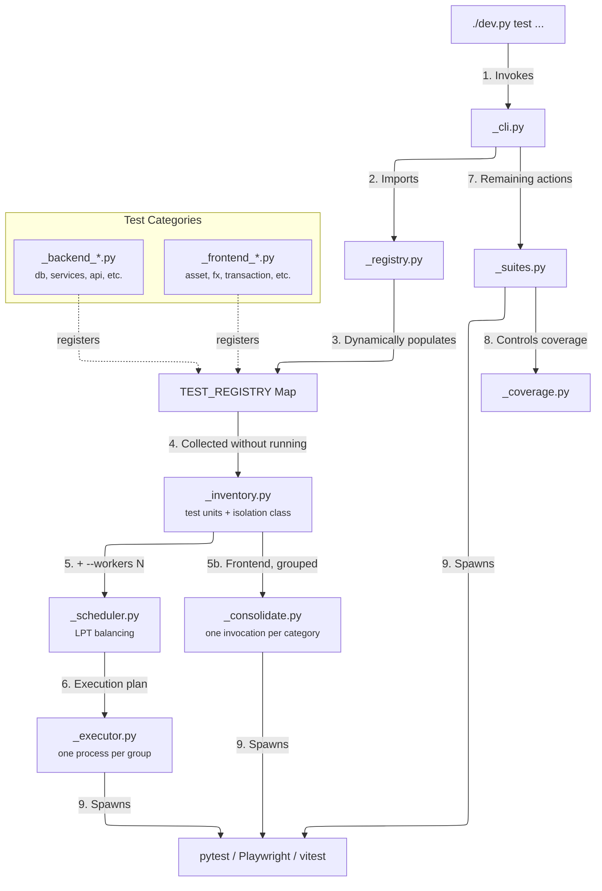
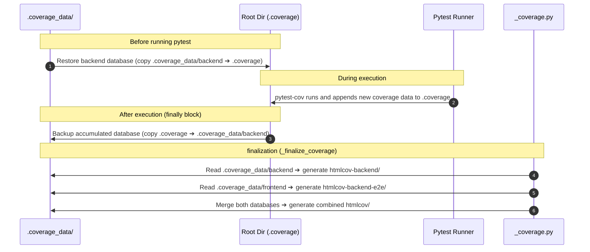

# 🏗️ Test Runner Architecture

This document describes the design and inner workings of the modular test orchestrator located in `scripts/test_runner/`.

---

## 🏗️ Architecture Overview

LibreFolio orchestrates its test execution through a custom Python package rather than a static,
monolithic script. The package separates **what exists** from **how it is grouped** from **how it is
run** — three concerns that used to live inside a single function per test action, which is why
parallel execution was impossible before.



---

## 🧭 The Inventory (`_inventory.py`)

The inventory answers one question — **what test units exist?** — and it answers it by *derivation*,
never by a hand-written list. Hand-written lists drift silently: before the inventory existed, six
registered actions covering roughly 259 tests were reachable by name but executed by no `all` list,
and the orphan check could not see it because it grepped for filenames rather than reasoning about
reachability.

Collection works because the action functions are almost-pure *command producers*. Replacing
`run_command` and `_run_playwright` with collectors makes every action report what it **would** launch
without launching anything, so the whole registry can be inspected in well under a second.

!!! danger "Two actions do real work during collection"

    `db create` and `db populate` do not merely compose a command — `db create` calls
    `TEST_DB_PATH.unlink()` for real, and an early collection pass genuinely emptied the test
    database. They are therefore neutralised **both in the registry dictionary and in the module that
    defines them**, because the `all` suites hold direct references to the function object. A guard on
    `Path.unlink` during collection catches any future action that acquires the same habit.

### Isolation classes

Every unit carries the class that says *what it needs in order not to disturb anything else*. The
classes come from the data model: of the 12 tables only `UserSettings` and `BrokerUserAccess` are
per-user, so almost every write lands on a shared surface.

| Class | Meaning | Can share with… | Dedicated resource |
|---|---|---|---|
| **PURE** | touches neither the database nor a server | anything | `COVERAGE_FILE` only |
| **READ** | reads shared data, never writes | other READs, on one backend | none |
| **WRITE-SCOPED** | writes only rows owned by its own user/broker | other WRITE-SCOPED with a *different* user | one E2E user |
| **WRITE-GLOBAL** | writes shared surfaces (assets, FX, prices, settings) | nothing | a whole database |

Classification is deliberately **strict**: vitest units are PURE by construction, a pytest unit is
PURE only when neither the file **nor the helpers it imports** mention a shared-state marker, and
everything else falls through to WRITE-GLOBAL. The asymmetry is the point — a wrong PURE produces an
intermittent red, while a wrong WRITE-GLOBAL only costs time.

!!! warning "Impurity travels through imports"

    A test file can look spotless and still import `test_db_config`, which points at the shared test
    database. Classification therefore follows `test_utils`, `test_db_config` and `test_server_helper`
    one level deep. One level is enough because those helpers do not import each other.

READ and WRITE-SCOPED must be **declared** before they can be trusted; a textual heuristic was tried
and misclassified real cases, so until a unit is declared it stays serial.

### Declaring a class — and earning it

The default is correct but it is not free: left alone, it serialised **50 of the 51 `api` units and
37 of the 85 `services` units** for no reason at all. The debt was never in the tests — it was in
the catalogue, which had no way to be told it was wrong.

Declare per unit, or on the category when the property holds for all of it:

```python
make_category(
    "api", ...,
    # every unit creates its own user and addresses its own rows by id
    default_isolation="write-scoped",
)

add_test(
    "auth", ...,
    exclusive_because="rewrites global_settings.registration_mode, one row shared by every user: "
                      "a concurrent unit would register against whatever value this one left behind",
)
```

`exclusive_because` **is** the WRITE-GLOBAL declaration, not a comment next to a flag. Storing the
class and its justification as one statement means a category default cannot silently promote a unit
somebody already explained must not be promoted — and the catalogue of exceptions is generated
rather than maintained by hand.

!!! tip "A class claim is earned by a passing parallel run, not asserted"

    `--assume-scoped` ignores the catalogue and runs everything concurrently. Use it **once per
    category** to find out what the catalogue was getting wrong, read the reds with the
    `test-triage` skill, then write down what you learnt. It is experiment instrumentation, never a
    default.

    On `api` that experiment produced **14 reds out of 603 tests**, thirteen of which had a single
    cause: `test_auth_api.py` turning registration off while its neighbours were creating users.
    The fourteenth had nothing to do with concurrency — it reached the real ECB over the internet.

### How to ask for an exclusive, and what justifies one

The whole backend currently has **one** exclusive unit. That number is the point of the section: it
is small because an exclusive has to survive being written down.

| Unit | Why it cannot be scoped |
|---|---|
| `api auth` | rewrites `global_settings.registration_mode` — **one row shared by every user**, not a per-user row. A concurrent unit would register against whatever value this one left behind (`disabled` while it checks closed registration), and a test that verifies a registration mode on the lane's server necessarily owns the instance. |

The units that came with the registration modes show the other way out: `api registration` and `api users-admin`
run every case that needs another mode, an accounts variable or a user limit in-process, on a private database, and
touch only their own accounts and tokens on the lane's server, so they stay WRITE-SCOPED with no exclusive.
`api admin-setup` goes the same way: an administrator waiting for its setup exists only on an instance that had no
account, so every case that needs one runs in-process on a private database, and the lane's server only gets
refusals that write nothing.

Two claims that look like reasons and are not:

- *"It reaches a third party over the network, so it is slow and fragile."* That is a reason to stop
  reaching the third party, not to take the database. `api fx` held an exclusive on exactly this
  argument until the three syncs were pointed at `MOCKFX`; it now runs with everyone else, and its
  assertions became exact in the process.
- *"It failed when I ran it in parallel."* Say **what** it mutates. If you cannot name the shared
  surface, the cause is somewhere else — read the reds with the `test-triage` skill first, because
  the loudest failure is usually not the one doing the damage.

The test is simple: name the surface, and say why it has no per-user equivalent. If the sentence
works, it belongs in `exclusive_because` and the exclusive is granted by the same act. If it does
not, the unit is not exclusive — it is unfinished.

---

## 🧹 Shared state: whoever commits, cleans up

This is a **rule for whoever writes the next test**, not an implementation note. It is the one thing
in this page you can break without any tool telling you.

### Why the old design hid the problem

While the runner spent one process per action, every test file effectively got a fresh database:
`globalSetup` re-populated before each Playwright invocation, and each pytest invocation started
from a clean import. A test could write whatever it liked and walk away — the evidence was wiped
before anyone could trip over it.

Consolidation removes that accident. Once several units share one invocation, **what one leaves
behind becomes the next one's input.** No test changed; the contract they were all silently relying
on did.

### The rule

> **A test that commits to a shared surface must restore it, in its own teardown, without assuming a
> freshly populated database.**

"Shared surface" is almost everything: of 12 tables only `UserSettings` and `BrokerUserAccess` are
per-user. `Transaction` in particular has **no `user_id`** — isolation happens at service level via
broker access — so a committed transaction is visible to every later test.

Tests that only *read*, and fixtures that flush and roll back, are already compliant and need
nothing. **The only candidates are fixtures and specs that deliberately call `commit()`** — few, and
findable.

### Backend

```python
@pytest_asyncio.fixture(scope="module")
async def fx_asset_ids():
    ...                       # writes and commits
    yield asset_id
    async with ... as session:   # and now puts it back
        await session.execute(delete(PriceHistory).where(...))
        await session.execute(delete(FxRate).where(...))
        await session.execute(delete(Asset).where(Asset.id == asset_id))
        await session.commit()
```

Without that teardown the committed FX rows collide with a later `session.add()` on the same
`(date, base, quote)` key, and the failure surfaces in a *different file* — which is what makes this
class of bug expensive.

### Frontend (E2E)

An E2E test writes over HTTP, so there is no session to roll back. Use `trackTransactionWrites()`
from `frontend/e2e/fixtures/db-cleanup.ts`: it records the transactions that this page's own commits
created, and its `cleanup()` deletes exactly those.

```ts
import {trackTransactionWrites, type TransactionWriteTracker} from '../fixtures/db-cleanup';

let txWrites: TransactionWriteTracker | undefined;

test.beforeEach(async ({page}) => {
    await login(page, TEST_USER);
    // After login (it reads through page.request, which needs the session cookie), before any commit.
    txWrites = await trackTransactionWrites(page);
    await goToTransactions(page);
});

test.afterEach(async () => {
    await txWrites?.cleanup();   // afterEach runs for a red test too
});
```

A row is the test's own only when two facts agree: a committed `POST /transactions/commit` made by
this page reported its id as created (a `create`, `split` or `promote` result), and the id was not
in the snapshot `trackTransactionWrites()` took when it started. The commit response lists the rows
created **indirectly** too — the second half of a linked pair, a promoted transfer — so the spec
never has to name them; the snapshot keeps a split or a promote of fixture data from deleting the
fixture row it came from. `cleanup()` skips the ids already gone (deleting one half of a linked pair
removes both) and throws when the delete request fails.

!!! warning "Never delete whatever is new since a snapshot"

    The first version of this helper did exactly that: photograph before, delete what appeared after.
    It reads "new" as "mine", which holds only while nothing else runs at the same time — the reason
    the `txHygiene` fixture below works only at one worker. Under concurrent workers the rows a
    neighbour is still using are new too, and the helper deleted them, or failed with a 500 on a row
    the neighbour had already removed.

A test that commits rows nobody else should see can also work on an account of its own:
`openOwnedAccount()` and `openAccountWithPair()` in `frontend/e2e/fixtures/owned-pair.ts` register a
disposable account, and `cleanupOwnedAccount()` deletes its brokers — their transactions go with
them — and then the account.

!!! example "The bug this rule was written from"

    `tx-clone.spec.ts` cloned "the first paired giver row on editable brokers" and committed it for
    real. That row was the `delete-safe` ETH transfer. `tx-delete.spec.ts` then deleted that pair and
    asserted nothing matching survived — and found the clone. Neither test was wrong; the implicit
    contract between them was. Both sides have since been fixed: `tx-clone` commits only onto a
    broker or an account of its own and deletes what it commits, and `tx-delete` deletes only rows
    it creates.

#### `--workers` reaches Playwright too

The frontend has **two** worker counts, and they are derived from the same number:

```text
./dev.py test front-transaction --workers 4
        │
        ├─ shared_backend_for → SharedTestServer: max(1, ⌈4 / 2⌉) = 2      (uvicorn processes)
        │                         └─ playwright.config.ts reuses it instead of starting its own
        │
        └─ _apply_parallel  → _common._E2E_WORKERS = 4
                                └─ apply_e2e_workers: min(4, max(1, ⌊logical cores / 2⌋)) → E2E_WORKERS
                                     └─ playwright.config.ts: workers: E2E_WORKERS   (browser contexts)
```

`apply_e2e_workers()`, which both Playwright launches call (per unit and consolidated), caps the
browser workers at half the logical cores, never below one: `--workers 4` gives four from 8 logical
cores up. It exports `E2E_WORKERS` only when the result is above 1 and the variable is not already
set; otherwise `playwright.config.ts` runs what the environment says, or 1.

Under the runner the backend is the shared one (`SharedTestServer`), which Playwright reuses, and it
is sized from `--workers` itself, before that cap: one uvicorn worker per two, rounded up (1 → 1,
3 → 2, 4 → 2). `--workers 8` on 10 logical cores therefore runs 5 browser workers against 4 uvicorn
workers. `playwright.config.ts` sizes a backend only when it starts one itself — with
`--no-shared-server`, for the gallery, or with `npx playwright test` by hand — by the same rule applied
to the browser count: `SERVER_WORKERS = max(1, ⌈E2E_WORKERS / 2⌉)`, unless `LIBREFOLIO_SERVER_WORKERS`
or, failing that, `GALLERY_SERVER_WORKERS` (the gallery's one per four) sets it. The ratio is
deliberate, and `_server.py` gives the reason (`CLIENTS_PER_SERVER_WORKER`): API and E2E workers hit
the backend hard, hence one uvicorn worker per two of them, while the gallery's one per four rests on
its browser workers spending most of their time rendering. A suite that never makes the backend queue
is not testing concurrency, it is only testing itself faster.

!!! warning "The environment variable is not the interface"

    `E2E_WORKERS` existed long before `--workers` wrote it. That gap meant
    `./dev.py test front-transaction --workers 4` gave four **uvicorn** workers and one **browser**
    worker: the flag was half-obeyed, silently. If you set `E2E_WORKERS` in your shell it still
    wins, uncapped — the runner does not overwrite a value you chose deliberately. The shared backend
    is still sized from `--workers`, not from that value.

!!! danger "Do not edit the repository while an E2E run is in flight"

    Under the runner the backend is started by `SharedTestServer`; Playwright's own `webServer`
    starts one only when no shared backend is up — with `--no-shared-server`, for the gallery, or
    with `npx playwright test` by hand. Either way it must be started with `--no-reload` — found the
    hard way — and both paths pass it, together with `--no-scheduler`. Under `--reload`
    uvicorn watches the **repo root**: a single saved file restarts the backend mid-run, and every
    test that happens to be logging in at that moment dies at 20 s. The signature is unmistakable —
    a burst of `login()` timeouts in the tests scheduled first, scattered across unrelated files. It
    reads exactly like a concurrency bug, and it is not one.

---

## 🧮 The Scheduler (`_scheduler.py`)

The scheduler turns *inventory + `--workers N`* into an execution plan. It decides what runs with what
using the isolation class alone — never a test name or a directory shape.

Balancing is **longest-processing-time first**: the longest unit goes to the currently shortest group.
Round-robin was measured losing about half the theoretical gain, because one group finished in 32 s
while another was still running at 84 s and the run is only as fast as its slowest group. Durations
come from the workers' JUnit reports and are persisted in `.coverage_data/unit_durations.json`, so the
first run balances on a median guess and every run after that balances on measurement.

An action is marked as *already covered* — and therefore skipped in the serial pass — only when
**every** path it launches is in the parallel set. A mixed action would otherwise lose its
WRITE-GLOBAL half in silence.

---

## ⚙️ The Executor (`_executor.py`)

Each group runs in its own process with an exclusive lot of resources. Today the lot holds one item,
`COVERAGE_FILE`, because only PURE units are parallelised and they need nothing else; the database,
the port and the E2E user join the lot as the write classes are activated.

| Resource | Serial | Per worker | Needed by |
|---|---|---|---|
| `COVERAGE_FILE` | global `.coverage`, copied in and out | `.coverage_data/parts/run-<YYYYMMDD-HHMMSS>-<pid>/.coverage.p<pass>.wN` | every worker |
| `DATABASE_URL` | one shared `app.db` | `app_wN.db` | WRITE-GLOBAL |
| `TEST_PORT` | fixed | `TEST_PORT + N` | backend workers with an in-process server |
| E2E user | always `e2e_test_user` | one of the eight | WRITE-SCOPED |

Workers also run with `-p no:cacheprovider` and without `--cov-report`, since a shared `.pytest_cache`
and a shared `htmlcov-backend/` would be written by every worker at once.

!!! note "Failure policy: stop assigning, never kill"

    By default the run continues past a red and reports the full list. Under `--fail-fast` the
    scheduler hands out no further work, but workers already running are still left to finish:
    killing a worker mid-flight discards its coverage, and coverage that disappears without failing
    is the most expensive defect this project has met.

### `--workers`

- `--workers 1` (default) is the serial path, not an approximation of it: the plan has one group and
  execution follows exactly the route it followed before the migration.
- `--workers N` parallelises the isolation-safe units and leaves everything else serial — a
  WRITE-GLOBAL unit stays serial even at `--workers 8`.
- The parallel pass plans category by category, so it runs only for a whole backend category
  (`<category> all`) or a whole suite (`all`, `all-backend`): naming one action, or filtering by test
  name (pytest `-k`, which only a named action takes), keeps the serial path. The check is
  `_parallel_prepass_applies()`, which follows the same scope rule as the consolidated pre-passes
  (`_backend_consolidation_scope()`).
- `--workers auto` resolves to half the cores, because a development machine is not dedicated to tests
  and timing-sensitive tests degrade under load.
- On a **frontend** category the same flag sets Playwright's browser workers, capped at half the
  logical cores, and the number of uvicorn processes behind them — the shared backend is sized from
  the flag itself, not from the capped count (see *[`--workers` reaches Playwright too](#-workers-reaches-playwright-too)*).

The flag belongs to `./dev.py test`, so it goes **before** the category:

```bash
./dev.py test --workers 4 services all
./dev.py test --workers auto --coverage py all-backend
```

Measured on `utils all`: 258 tests in 31.8 s serially, the same 258 tests in 22.8 s at four workers,
with an identical coverage total of 14.73 %. On `services all` the parallel pass ran 44 units and
1329 tests in 41.5 s.

#### What the whole backend actually gains

`all-backend` with coverage, run both ways from a clean database:

| | `--workers 1` | `--workers 4` |
|---|---|---|
| Tests | 4654 | 4654 |
| Failures | 0 | 0 |
| Coverage | 37336 stmts / 3224 missing / **91.36 %** | 37336 / 3224 / **91.36 %** |
| Wall time | 38 min 52 s | 31 min 03 s |

The coverage figures are identical digit for digit, and identical **file by file** across all 241
modules — the only check worth making on a tool that can silently lose data. The speedup — 1.25× — is
deliberately modest: the parallel pass finishes 51 PURE units (1494 tests) in **32.2 s** with workers
landing at 32.2 / 32.1 / 32.1 / 32.1 s, so the LPT balancing is close to perfect, but everything else
is WRITE-GLOBAL and stays serial by design. Going further means one database per worker, not a
bigger `N`.

!!! note "The total has a noise floor of about 4 statements — and it is attributable"

    Two runs launched minutes apart matched exactly. A third, hours later, closed at 3220 uncovered
    instead of 3224 — *more* covered, despite doing strictly less work, which is causally impossible
    for a deterministic number.

    Compared file by file, the difference sits entirely in the asset pricing service (a single
    module at the time, now split across the `backend/app/services/assets/` package) and
    `asset_source_providers/borsa_italiana/plugin.py`: the two places that talk to the live internet. Test
    and skip counts were identical in all three runs, so nothing changed about *what* ran — only
    which branch the provider took given what the site returned that day.

    So compare **per file, not on the total**. On the total, 4 statements of network noise are
    indistinguishable from a real loss of data; per file they are immediately attributable.

!!! warning "A running test server poisons the whole backend run"

    `--fresh-run` starts with `db create`, which **unlinks the database first** and only then calls
    `db:upgrade` — and `db:upgrade` refuses to migrate while something holds the lane's test port
    (`TEST_PORT`, 6041 by default). The result is
    not one clear error but roughly a dozen unrelated-looking reds downstream, all caused by a
    database that no longer exists. Check `lsof -ti:6041` (or your lane's port) is empty before a
    backend run.

### On failure

By default every unit runs and every failure is reported, across the parallel pass, the
consolidation pass **and** the serial suite. The reason is empirical: reds arrive in clusters, and
nine failures in one worker are usually nine symptoms of one cause — a list you cannot see if the
run stops at the first, and that costs one full re-run per red to rediscover.

`--fail-fast` inverts it: the scheduler hands out no further work and the serial pass stops at the
failing action. Workers already started are still left to finish their batch — killing one
mid-flight would discard its coverage, which is exactly how P7 lost data without anything turning
red.

---

## 📦 Frontend consolidation (`_consolidate.py`)

On the backend the win is parallelism. On the frontend it is **not invoking Playwright 120 times**.

Each frontend action used to pay, before running a single assertion: a database populate, eight user
creations, a `globalSetup` that populates and creates users *again*, and a webServer start/stop —
roughly eleven cold Python starts per spec file. Measured on `front-fx`: seven invocations run 42
tests in 502.6 s, while one invocation runs *those same 42 tests plus 21 more* in 218.6 s.

So the units of a category are grouped into one Playwright invocation and one vitest invocation:

| Category | Playwright | vitest | invocations before | after |
|---|---:|---:|---:|---:|
| `front-ai-export` | 4 | 22 | 26 | 2 |
| `front-asset` | 7 | 15 | 22 | 2 |
| `front-broker` | 2 | 3 | 5 | 2 |
| `front-designer-lab` | 3 | 15 | 18 | 2 |
| `front-fx` | 8 | 3 | 11 | 2 |
| `front-portfolio` | 3 | 3 | 6 | 2 |
| `front-transaction` | 25 | 7 | 32 | 2 |
| `front-user` | 2 | 2 | 4 | 2 |
| `front-utility` | 8 | 6 | 14 | 2 |
| **total** | **62** | **76** | **138** | **18** |

The `after` column is the shape without JS coverage. With `--coverage js` the Playwright side is run
in batches of 8 specs (see below), so `front-transaction` costs 4 invocations instead of 1 and the
total is 23 rather than 18.

!!! tip "Consolidation is now also what makes parallelism possible"

    The startup saving above was the original reason. Since `fullyParallel: true`, there is a second
    one that matters more: **a Playwright invocation can only distribute the tests it was given.**
    One spec file per invocation means one unit of work, and `--workers 4` buys nothing at all —
    three browsers sit idle. Consolidation is what turns a category into a pool the scheduler can
    spread. On `front-transaction` the two effects are not comparable: grouping alone was worth
    ~0,2 min, grouping *plus* four workers is worth 11.

### A long-lived worker exposes what a short-lived one hid

Grouping changes the lifetime of the process, and anything that accumulated per test used to be
collected for free when the process died after one spec file. It no longer is.

The case that bit: with `--coverage js`, the fixture called `MCR(options)` — a **constructor**, not a
singleton — once per test, and each instance re-resolved the sourcemaps of the whole build. Worse,
monocart's `add()` writes its payload to the cache directory *and* keeps a copy in an instance-level
`Map`, keyed by a fresh id per call. That map is an optimisation for callers that `add()` and
`generate()` in one process; here the fixture only adds, and `scripts/mcr-generate.js` produces the
report later in a different process, reading the same data back from disk. Every retained entry was a
complete V8 payload — sources and sourcemaps — kept for a reader that never looks.

Over one spec file, invisible. Over 25, the worker died at the heap limit.

Both were real and both were fixed — a worker-scoped `mcr` fixture, and `fileCache.clear()` after each
`add()`. Neither made the crash go away. Each one bought about four minutes:

| Configuration | Ceiling | Reached after |
|---|---|---|
| 25 specs, MCR per test, default heap | ~4 GB | ~700 s |
| 25 specs, one MCR per worker, `--max-old-space-size=8192` | 8181 MB | 988 s |
| 25 specs, and `fileCache.clear()` | 8174 MB | 1214 s |
| **8 specs**, same two fixes | — | **no OOM**, 163 tests green in 7.8 min |

The last row is the one that settles it: with identical code, a group of 8 finishes and a group of 25
does not. **The quantity that matters is not what any single test does, it is how long the process
lives.** So the answer is a scheduling decision, not another hunt through monocart: with JS coverage
on, a group is run in **batches of 8 specs** (`_JS_COVERAGE_CHUNK`). `front-transaction` goes from 25
invocations to 4 rather than to 1 — about a minute and a half of extra `globalSetup` in total, against
a run that previously never reached the end.

The crash was also **falsifying the measurement**, which is the part worth remembering. A full
`--coverage all --workers 4 all` run before the fix reported 91.38 % Python coverage; after it, doing
exactly the same work, it reports **91.64 %** — 98 more statements. The specs that died of OOM were
exercising the backend through the E2E path, and their coverage vanished with the process. A defect
that shows up as *slightly lower coverage* rather than as an error is the hardest kind to notice:
compare the numbers, never the colour.

!!! danger "An out-of-memory worker names the wrong test"

    Playwright reports it as `worker process exited unexpectedly (code=null, signal=SIGABRT)` against
    whichever test was running, with a duration of `0ms`. The real message is further up the log:
    `FATAL ERROR: Ineffective mark-compacts near heap limit`. A `0ms` failure is never an assertion —
    always look for the crash above it.

    Raising `--max-old-space-size` defers, it does not fix. If a run under JS coverage starts dying
    again, lower `_JS_COVERAGE_CHUNK` before raising the heap: bounding the lifetime is the lever that
    actually works.

The general rule for anything in a consolidated fixture: **hold per-worker state deliberately, and
release per-test state explicitly.** What used to be freed by process death now has to be freed on
purpose.

### The setup runs once, not once per invocation

Even 16 invocations would each redo the same preparation, so the Python side signals that it is
already done with `LF_SETUP_DONE=1`. `global-setup.ts` then skips populating the database and
creating the E2E users, and jumps straight to initialising the global settings via the API — the one
step nothing on the Python side performs (populate writes a single row, `registration_mode`), and one
that `populate --force` wipes.

The variable is set only after *both* the populate and the users have succeeded, and cleared by any
repopulate. Running `npx playwright test` by hand never has it, so that path is unchanged.

!!! warning "Deduplicate only what is genuinely duplicated"

    `global-setup.ts` populated with `--with-reports` (the sample BRIM files) while the Python
    `_ensure_db_populated()` did not. While the JS side redid everything, the difference was
    invisible — the richer populate simply happened second. Skipping it would have silently removed
    the fixtures the broker import-history specs depend on, turning an unrelated category red. The
    Python populate was made a superset *first*.

### It only applies to a whole category

`./dev.py test front-fx fx-list` still means one invocation for one spec. Consolidation applies to
`all` of a category and to `all-frontend` — the cases where the actions would have run back to back
anyway. `--no-consolidate`, `--ui`, `--headed` and `--debug` all return to the 1:1 shape. Neither
`all` nor `all-frontend` takes test names: a name after either stops the command with exit code 2.

### Per-unit outcomes are part of it, not a follow-up

Consolidation on its own would make the runner say *"the category is red"* instead of naming the
spec, and would coarsen `--resume` from a spec to a category. That is a regression, so the reporters
are read back: Playwright and vitest both write a JSON report, and each is folded into a per-spec
verdict before anything is printed. The action-level summary stays exactly as detailed as before.

!!! warning "A unit missing from the report counts as failed"

    Silence must never read as success. That is precisely how a coverage run can drop half its data
    without anything turning red.

### The serial suite steps aside when there is nothing left

Once the consolidated pass has run every action of a category, the category's `all` function returns
immediately instead of running the serial route. Without that guard it would still build the
frontend, repopulate the database and create the E2E users before discovering it has nothing to
execute — about ten seconds per category, and worse than wasteful: the repopulation happens *after*
the consolidated pass, so a log read top-down shows the database being wiped after the tests that
used it.

The check is `nothing_left_to_run(category)` in `_common.py`, and it is deliberately all-or-nothing:
if even one action was left to the serial path, the normal route with its full setup applies.

!!! danger "Stepping aside must not launder a red"

    A skipped serial suite that returns `True` makes the category green. The first version of this
    guard did exactly that, and with the run continuing past the red it printed `✘ front-transaction
    tx-wac-mode` and then, twenty lines below, **"🎉 ALL FRONTEND TESTS PASSED! 🎉"**. The exit code
    was right the whole time; a summary that contradicts the exit code is worse than no summary.

    So the guard returns `consolidated_verdict(category)`, which reports what the pre-pass actually
    found. `_SKIP_ACTIONS` and `_FAILED_ACTIONS` are kept as two separate sets on purpose: they
    answer "was it already run?" and "did it pass?", and conflating them is precisely how a red
    becomes a green.

### The precondition, and how it is met

Consolidated specs share one database, so they must not disturb each other — this is the
[whoever commits, cleans up](#shared-state-whoever-commits-cleans-up) rule. In practice the damage
is rarely a duplicate key. It is **row inflation**:

> `tx-tooltips` scans *the first 20 rows* for an `access-test` transaction; `tx-split-promote` looks
> for a paired row on *page one*. Neither assertion is wrong. But once earlier specs have added a
> hundred rows that sort ahead of the fixtures, neither finds what it needs — and the spec that gets
> blamed is the one that only reads.

Writing `beforeEach`/`afterEach` into 59 spec files would work and would be forgotten 59 times, so
the guarantee lives in an automatic fixture instead — `txHygiene` in `e2e/fixtures/playwright.ts`,
next to the JS-coverage one. It photographs the transaction ids when the spec file changes and
deletes the difference before the next file starts, through a worker-scoped API context (one login
per worker, two calls per file).

!!! danger "Per file, not per test — and the difference is measurable"

    Cleaning after every *test* looks tidier and is wrong. When this was measured, specs were written
    sequentially: `tx-commit-all-types` committed a BUY and then sold part of it, `tx-delete` created
    a pair in one test and deleted it in the next. Wiping between tests broke those chains — tried on
    the full `transactions/` directory, it turned three reds into five. Neither spec chains any more
    (`tx-commit-all-types` funds each SELL inside its own batch, and `tx-delete` deletes only rows it
    creates), but state may still accumulate inside a file, and the cleanup must not be what breaks it.

    What consolidation removed was the *inter-file* reset: before it, every spec file ran in its own
    process against a freshly populated database. So that is the invariant to restore, and no more
    than that. State accumulates freely inside a file and is rolled back when the file changes.

It is active only when `LF_TX_HYGIENE=1` **and** `E2E_WORKERS` is at most 1 (unset counts as 1). The
consolidated pass sets `LF_TX_HYGIENE=1`, and only when it runs Playwright with one worker. That is
deliberate: the invariant "the database is what `populate_mock_data` produced" needs restoring exactly
when specs share it, and someone running a single spec by hand keeps the old path bit for bit. Above
one worker, tests from different files interleave against one database: "every id that appeared since
this file started" would also cover rows that other workers' tests are still using, and a repopulate
would wipe the database under them. So the fixture switches itself off — with a warning, if
`LF_TX_HYGIENE=1` was set anyway — and each test's own cleanup is all that is left. When the fixture's
cleanup fails, it never turns the test red — inventing a red in the innocent spec that happened to run
first is worse than the defect being cured.

#### The rollback has to work in both directions

Deleting what a spec *added* is only half the invariant. A spec that **destroys** mock rows —
`tx-delete` did, until its confirm tests moved to rows they create on a disposable account — cannot
be repaired that way: no API call can bring back a row with its original id and its original half of
a linked pair. What followed was a failure that never named the culprit:

| | `tx-picker-pagination` alone, fresh database | `tx-picker-pagination` on the database the suite left behind |
|---|---|---|
| Outcome | **5 passed** | **4 failed** |

With fewer rows in the table, the spec's first two checkbox clicks landed on a *linked pair*; the bulk
modal treated it as a single entity and opened a form modal by itself; four tests then timed out
clicking a button behind that modal's backdrop. The error talked about a `tx-form-modal` intercepting
pointer events and said nothing about `tx-delete`, which had run earlier in the same pass. It is the
same family as row inflation, mirrored: **row deflation**.

So `restore()` compares the id set against the opening snapshot. If even one baseline id has gone
missing it repopulates, re-initialises the global settings (`initGlobalSettings()` is exported from
`global-setup.ts` for exactly this) and logs the worker's API context back in — after a repopulate
the users have new ids and the session cookie is stale. If nothing is missing it just drops the
difference, as before.

!!! warning "A repopulate costs time that belongs to a test"

    Playwright charges test-scoped fixture setup to the current test's timeout, and these specs run
    at 25 s. The fixture grants `testInfo.setTimeout(+25 s)` **only when a repopulate actually
    happened** — raising it unconditionally would hide the very slowness those timeouts exist to
    catch.

    Also worth knowing: `populate_mock_data` recreates the E2E users itself, but of the global
    settings only one row: `registration_mode`, written `open` by `open_lane_registration()`, since
    the API and E2E tests register accounts of their own and a new install's default, `invite`,
    would refuse them. The other global settings are the one piece of `globalSetup` that has to be
    replayed by hand; `initGlobalSettings()` creates only the missing rows, so it keeps that `open`.

!!! tip "A wedged test server looks exactly like a hung test suite"

    An aborted run can leave uvicorn half-shut-down yet still **listening** on 6041: it accepts
    connections and answers nothing — `/docs` and `/openapi.json` included, so it is the event loop,
    not a database lock. `reuseExistingServer` reuses it happily and Playwright parks forever inside
    `globalSetup`'s `fetch`, before the reporter has printed a line. The tell is that the Playwright
    node process has **no children** and the log stops at the dotenv banner.

    Both `globalSetup` fetches now carry `AbortSignal.timeout(20 s)` and say what to look for. The
    cure is to kill the process holding the port and restart with `./dev.py server --test --force`.

### Projects are grouped too

`frontend/playwright.config.ts` declares two projects: `desktop` (Desktop Chrome, 1280×720) and
`mobile` (the iPhone 14 Pro Max descriptor, run in Chromium). Outside `--ui` mode, `_run_playwright`
passes `--project desktop` unless an action says otherwise, so most actions run on desktop only. An
action that passes `project=""` gets no `--project` and runs on both: seven `front-utility` actions
(`files-uploader`, `support-copy-and-go`, `header-scroll`, `document-title`, `connection-security`,
`onboarding-tour`, `onboarding-guides`), `front-broker broker-create-feedback`,
`front-portfolio privacy-masking`, and `front-transaction tx-import-report-set` and
`tx-import-report-set-guide`. `front-ai-export` passes `project="desktop"` explicitly.

So the inventory records the project selector alongside each Playwright unit (`ALL_PROJECTS` for an
action that passes `project=""`), and consolidation runs one Playwright invocation per
`(category, project)` group (in batches of 8 specs under JS coverage), without `--project` for the
both-project group. Without it, folding those specs into the desktop group would have dropped their
mobile run — and, since everything left would still have passed, nothing would have said so.

### Resuming a consolidated pass

`--resume` skips units a previous run already passed. The consolidated pass keeps its own run-cache
namespace (`consolidated:<category>`), because the serial suites are indexed by their human title
("Frontend User Tests"), which is written by hand inside each `*_all` function and cannot be derived
from the registry. Guessing it would be fragile; a namespace of our own is exact and obvious in
`--run-status`.

Resumed units still count as covered — the serial pass does not re-run them either.

---

## 🗃️ Dynamic Registry Pattern (`_registry.py`)

To prevent the orchestrator from needing hardcoded knowledge of every single test action, the runner utilizes a **Dynamic Registry Pattern**. 

1. **Central Store:** `scripts/test_runner/_registry.py` defines a global `TEST_REGISTRY` dictionary.
2. **Registration Hooks:** Each test category module (e.g., `_backend_utils.py`, `_frontend_fx.py`) implements a `populate_registry(registry: dict)` function.
3. **Execution Mapping:** When the orchestrator starts, it calls the populate functions in order. Each category registers its commands and sub-test functions:

```python
# Example from scripts/test_runner/_backend_utils.py
def populate_registry(registry: dict) -> None:
    cat = make_category(
        help_text="Utility module tests (decimal, datetime, geo, currency, cache)",
        description="Utility Module Tests..."
    )
    # Register actions
    add_test(cat, "decimal-precision", utils_decimal_precision, name="Decimal Precision", desc="...")
    add_test(cat, "all", utils_all, test_names=False, name="All Utils Tests", desc="...")
    
    registry["utils"] = cat
```

### Registry Entry Shape {: #registry-entry-shape }

A category registered in `TEST_REGISTRY` maps to a dictionary containing:

* `_meta`: General information about the category (used for `--help` texts) and, when the category declares them in `make_category()`, these keys:
    * `setup`: What the category does to its environment before its units run: `services` recreates the test database empty, `api` reseeds it. `run_category_setup()` runs it once per invocation, whichever caller reaches it first.
    * `setup_exclusive`: The setup needs the database file to itself (`services`), so it is hoisted to before the shared backend starts. For one action run on its own that the catalogue declares `pure` (as `declared_isolation()` resolves it: an `exclusive_because` means `write-global`, else the action's own `isolation`, else the category's `default_isolation`), the setup is skipped, since such a unit opens no database, and one line says the lane's database is left as it is. A whole category, `all` and any action not declared `pure` (one with no declared class at all included) still run it. The skip holds at any `--workers`, since the parallel pass does not run for one action.
    * `setup_needed`: For one action run on its own, a no-argument callable that returns why the setup must run first, or `None` (a check that raises counts as a reason). With a reason, `ensure_category_setup()` prints it in one line and runs the setup. `api` returns one when the lane's test database is missing, unreadable or lacks one of its fixture users.
    * `default_isolation`: The isolation class of every unit that declares neither `isolation` nor `exclusive_because` — see [Declaring a class — and earning it](#declaring-a-class-and-earning-it).
* A set of actions (e.g., `"decimal-precision"`, `"all"`), where each action points to:
    * `func`: The Python callable that starts the test.
    * `name`: A human-readable title.
    * `desc`: A short description of the test action.
    * `prereq` / `tests` / `note`: Optional flags and metadata for dependencies.
    * `in_all`: `True` unless the action is registered `in_all=False` or `named_only=True`. `False` leaves it out of
      its category's serial `all`: an action whose files another action already runs, such as an aggregate alias, or
      the four per-spec actions of `front-ai-export` that `cutover` runs in one invocation. Such an action is still a
      claimant in the frontend consolidated pass: it gets its verdict from the run that covers its files.
    * `named_only`: Present, and `True`, only for an action registered `named_only=True`: it runs only when named on
      the command line, on any lane. It implies `in_all=False`, and `group_frontend_units()` (`_consolidate.py`)
      leaves it out of the frontend consolidated pass too, whatever it launches. It exists for an action that needs a
      lane of its own while other actions already run its files: today `front-utility cloud-smoke`, refused unless the
      lane is managed. On a managed lane its profile check passes while the inventory collects launches, so with
      `in_all=False` alone it would have stayed in `front-utility all`, and `all-frontend` would have run seven specs
      twice. The backend's consolidated and parallel passes do not read it: no backend action needs it today.

---

## 📊 Coverage Isolation & Swap Pipeline (`_coverage.py`)

Because backend and frontend tests run in different modes (some as direct test scripts, others as separate server subprocesses driven by Playwright E2E tests), they write coverage reports using `parallel = true`. 

By default, running `coverage combine` would merge and delete all coverage databases. To prevent backend and frontend reports from colliding, the test runner implements a **swap-in/swap-out** pipeline:



!!! note "JS/Svelte coverage follows a parallel, independent path"

    `_finalize_js_coverage()` merges monocart's `raw` output instead of coverage.py
    databases, producing the reports under `frontend/coverage-js/`. The two pipelines
    never share state — see [Coverage Model](coverage-model.md).

### Coverage File Invariants
* `.coverage`: Active working copy. Stored in the root folder, updated during pytest runs, and combined dynamically.
* `.coverage_data/backend`: Accumulated backend test coverage. Persisted here between backend test runs.
* `.coverage_data/frontend`: Subprocess coverage captured from the backend server while running Playwright E2E tests.
* `.coverage_data/parts/`: Parallel-pass output. The JUnit reports (`junit.wN.xml`) stay at its top level; worker coverage data files live in a directory per runner process, `run-<YYYYMMDD-HHMMSS>-<pid>/`, named `.coverage.p<pass>.wN`, where the pass number counts that run's parallel passes. Spawn children and multiprocessing's resource tracker write `.coverage.p<pass>.wN.<host>.pid<N>.X<random>x` beside them (coverage.py renames each to `….X<random>x.H<hash>h` when it finishes writing), and can finish after the workers return. That is why `coverage combine` is given the directory, never a list of names: a name listed before such a rename made the whole combine fail. A part that lands after coverage's own listing is folded in by a later round (three rounds at most). A part holding data is removed only once it has been folded into the accumulated database. After a successful combine the run directory is removed; when a combine fails, the directory stays, the error names it together with the parts left in it, and the parallel pass is reported red. A finished part (coverage's final `….H<hash>h` name) that holds no data is removed and named in a warning, and does not fail the combine: it is the schema without a row, left when a SIGTERM stopped its writer while coverage.py was already saving, so its data never reached the file; a part with a transient name is never judged empty, since it may still be filling up. `--cov-clean-backend` empties `parts/` of coverage data — loose `.coverage*` files left by older runs and `run-*` directories — and keeps the JUnit reports.
* `.coverage_data/unit_durations.json`: Measured seconds per test unit, read by the scheduler to balance the next run.

!!! info "Why per-worker files rather than one shared database"

    Python coverage is a SQLite database and combining is native to it, which is exactly what makes
    per-worker files viable. The copy-in/copy-out of a single global `.coverage` in `run_command` is the
    point at which the old design forced serialisation: a global mutable file cannot be shared by two
    processes. JS coverage cannot follow suit — its raw V8 data is a set of byte offsets into one
    specific bundle, so it cannot survive a rebuild and is wiped unconditionally by design.

---

## 📂 Submodule Directory Map

| File | Purpose |
|------|---------|
| `scripts/test_runner/__init__.py` | Package initialiser: puts the project root first on `sys.path`, makes it the working directory, and re-exports `main`, `register_subparser` (which `dev.py` uses to add `./dev.py test`), `_ensure_test_users` and `TEST_REGISTRY`. |
| `scripts/test_runner/__main__.py` | Lets the package run as `python -m scripts.test_runner [category] [action]`: calls `main()` and exits with code 130 on Ctrl-C. |
| `scripts/test_runner/_cli.py` | Defines the argparse command hierarchy (e.g., `./dev.py test [category] [action]`), listings (`--list`), and executes the matched callback. |
| `scripts/test_runner/_registry.py` | Imports and invokes the registry population hook of every category module to assemble `TEST_REGISTRY`. |
| `scripts/test_runner/_suites.py` | Contains logic to run entire groups of tests (`all`, `all-backend`, `all-frontend`) and clean up coverage folders. |
| `scripts/test_runner/_run_cache.py` | The run cache behind `--resume`, `--fresh-run` and `--run-status` (`.run_cache.json`: per suite, the tests passed and the last failure), and the campaign timing printed at the end of a run (`.campaign.json`). Both files sit next to the module and are gitignored. |
| `scripts/test_runner/_coverage.py` | Implements database merging, report generation (`htmlcov-backend/`, `htmlcov-backend-e2e/`, `htmlcov/`), the JS/Svelte pipeline (`frontend/coverage-js/`), and `coverage show`, which opens a report's `index.html` in the browser. |
| `scripts/test_runner/_inventory.py` | Derives the test units from the registry without executing them, classifies each one by isolation class, and answers the reachability questions used by `check-orphans`. |
| `scripts/test_runner/_scheduler.py` | Turns inventory plus `--workers N` into an execution plan, balancing groups longest-processing-time first from persisted per-unit durations. |
| `scripts/test_runner/_executor.py` | Runs the plan's groups as concurrent processes, hands each worker its exclusive resource lot, and combines the per-worker coverage databases afterwards. |
| `scripts/test_runner/_server.py` | One test backend for the whole run (`SharedTestServer`), opened by `_cli.py` when the invocation needs a server (`api`, `e2e`, the `all*` suites, frontend runs with Playwright specs): `dev.py server --test --no-reload --no-scheduler`, plus `--coverage` under Python coverage, in its own process group, with its uvicorn workers sized to the client workers. `start()` refuses a port that another process holds, then builds before it spawns: `build_server_prerequisites()` runs `dev.py server --test --build-only` in the foreground, its output on the terminal, with the runner's environment but not the coverage wiring the server gets (the tooling is not measured). That rebuilds the frontend (debug) and the MkDocs site when they are missing or stale and refreshes the JS cache; a failed build starts no server. The backend spawned next finds those builds up to date, so `STARTUP_TIMEOUT` (300 s; `LIBREFOLIO_TEST_STARTUP_TIMEOUT` overrides it, in whole seconds) measures its start alone. Before this step the server made the builds inside that wait, about 130 s after a large merge, unseen: its output was discarded at the time. Its stdout and stderr (dev.py, uvicorn, the app's console log) go to one file for the whole run, not only the startup: `shared-backend.log`, in the run's log directory (`--log-dir`, `.testLog` by default), next to the per-unit logs. The file is emptied when the run's backend first starts and appended to when the backend restarts mid-run around `db create`, so it keeps every start's output; the next run archives it with the per-unit logs (`prepare_log_dir`, `00_archive/`). A file and not a pipe, so a server that writes a lot never blocks; when the output goes there, the spawn sets `PYTHONUNBUFFERED=1` for the whole exec chain, so dev.py's own lines come out in order among uvicorn's. When a start fails (the process exits during startup, or `STARTUP_TIMEOUT` passes), the runner prints, under its error line, the file's path and the last 30 lines written by that start, never an earlier start's, or `(no output)` when that start wrote nothing; it reads at most the file's last 64 KiB. With `--log-dir ""` there is no file and the output is discarded. It sets `LIBREFOLIO_TEST_SHARED_SERVER=1` so that pytest modules and Playwright attach to it instead of starting their own, and stops with SIGTERM and a grace period: 30 s under coverage, 10 s otherwise, the server's own shutdown budget (`LIBREFOLIO_SHUTDOWN_TIMEOUT_SECONDS`, 8 s by default) plus a margin, so that outside coverage a `Shared backend ignored SIGTERM` warning means the server broke that budget. It steps aside while `db create` rebuilds the database file (`database_file_owned_exclusively()`). `--no-shared-server` turns it off. |
| `scripts/test_runner/_consolidate.py` | Groups a frontend category's units into one vitest invocation and one Playwright invocation per project selection (desktop only, or desktop and mobile; in batches of 8 specs under JS coverage), then reads the JSON reporters back into a per-spec verdict. |
| `scripts/test_runner/_consolidate_backend.py` | The backend counterpart: when a whole category or suite runs, one pytest invocation per category instead of one per unit — `services`, `utils`, `schemas`, `api`, `e2e`, in that order, while `db` and `external` keep one per action — with the JUnit report read back into a per-file verdict, so the summary and `--resume` stay per unit. |
| `scripts/test_runner/_common.py` | Shared helpers and run-wide state: `run_command` (launches one unit; for pytest it adds the coverage flags, swaps the accumulated coverage database in and out, and points the child at the test database), `_run_test_suite` (the serial loop of a suite, with the run-cache bookkeeping), `tee_output` (behind `--log-file` and the per-unit logs), and the registry helpers `make_category`, `add_test`, `run_category_setup` (runs a category's declared setup, once per invocation) and `ensure_category_setup` (before one action run on its own, runs that setup when the category's `setup_needed` gives a reason). |
| `scripts/test_runner/_archive.py` | Archives test artefacts — the previous `--log-dir` logs, coverage databases before they are replaced or cleaned, the test-DB snapshot taken at the end of a run with a log directory — as `<target>/00_archive/<label>_<YYYYMMDD_HHMMSS>.tar.xz`, compressed with the standard library only (falling back to `.tar.bz2`, `.tar.gz`, then plain `.tar` when the interpreter lacks `lzma`). It also names the per-unit logs, `<category>__<unit>.log`. |
| `scripts/test_runner/_backend_*.py` | One module per backend category; `_backend_api.py` registers both `api` and `e2e`. The actions launch pytest, except `db create` and `db populate`, which build and fill the test database. |
| `scripts/test_runner/_frontend_*.py` | One module per frontend category (`utility`, `broker`, `user`, `fx`, `asset`, `transaction`, `portfolio`, `ai_export`): its Playwright specs and Vitest files. `_frontend_common.py` matches the pattern but is not a category — see the next row. |
| `scripts/test_runner/_frontend_common.py` | Shared frontend helpers: the frontend build check, the test-DB population and E2E user creation (each done once per setup scope), the Playwright launcher, and the `--list` output of every category. |

---

## 🛠️ Developer Guide: Adding a Test Action

To add a new test action to an existing category:

1. Open the category module (e.g., `_backend_utils.py` for utility tests).
2. Write a function that executes your test suite using the shared runner helpers. Accept
   `test_names`: an action registered with the default `test_names=True` receives the test names
   the user passes, and `./dev.py test <category> --help` marks it `[TEST_NAME]`. One registered
   with `test_names=False` refuses them: the runner exits with code 2 before anything runs, rather
   than running the whole action as if no name had been given. `run_command` requires a
   description, the label it prints, also used to name the unit's log file:
   ```python
   def utils_my_new_utility(verbose: bool = False, test_names: list = None) -> bool:
       """Run tests for the new utility helper."""
       print_section("Utils: My New Utility")
       # pipenv run python -m pytest <path> -v (no "pipenv run" in Docker), plus -k "<a> or <b>" for the names given
       cmd = _build_pytest_cmd("backend/test_scripts/test_utilities/test_my_new_utility.py", test_names)
       # True when the command exits with code 0
       return run_command(cmd, "My new utility tests", verbose=verbose)
   ```
3. Locate the `populate_registry` function at the bottom of the file and register your action:
   ```python
   add_test(cat, "my-new-utility", utils_my_new_utility, name="My New Utility", desc="Tests my new utility module")
   ```
4. Once registered, it is automatically exposed in the CLI:
   ```bash
   ./dev.py test utils my-new-utility
   ```
5. Nothing else is needed. The category's `all` list is **derived** from the registry by
   `_get_category_tests_for_all()`, so a registered action is reachable by construction — the state
   "registered but never executed" is no longer expressible. Pass `in_all=False` only when another
   action already runs the same files, as with an aggregate alias. Pass `named_only=True` for an
   action that must run only when named, on any lane: one that needs a lane of its own while other
   actions already run its files, as `front-utility cloud-smoke` on a managed lane. It implies
   `in_all=False`, and the frontend consolidated pass leaves it out too (see
   [Registry Entry Shape](#registry-entry-shape)).

!!! danger "Never hand-write an `all` list"

    `_get_category_tests_for_all()` does two jobs, and the second one is easy to forget: it derives
    the list *and* it drops the actions the parallel pass has already covered (`_SKIP_ACTIONS`). An
    `all` that builds its own list therefore does not diverge in some distant future — it re-runs, in
    the serial pass, everything the workers just ran.

    `external_all()` was the last such list on the backend, and it made `test_fx_providers.py` run
    twice under `--workers 4`. Nothing turned red; the only symptom was a test count 28 higher than
    the serial run's. Derive the list, always.

!!! tip "Verify with the orphan check"

    ```bash
    ./dev.py test check-orphans
    ```

    This reports both test files that no action mentions **and** actions that no `all` reaches,
    reasoning about launched paths rather than about strings in the source.

---

## 🔗 Related

* 🧪 **[Test Walkthrough Overview](index.md)** — Listing of test commands and categories.
* 🖥️ **[Frontend E2E Tests Overview](front-overview.md)** — Guide to running Playwright E2E suites.
* 📦 **[Developer Workflow Guide](../dev_workflow.md)** — Command catalog for `dev.py`.
