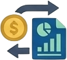
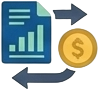
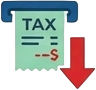

# 💸 Transaction Types

LibreFolio records every financial event as a transaction. Understanding these types is crucial for accurate portfolio tracking and tax reporting.

## 📋 Single Transactions

These operate independently on a single broker account.

| | Type | Code | Description | Cash | Asset | |
|:---:|:---|:---|---|:---:|:---:|:---:|
| {: width="32" } {: width="32" } | **Buy / Sell** | `BUY` / `SELL` | Purchase or sale of an asset. | ⬇️⬆️ | ⬆️⬇️ | [📖](buy-sell.md) |
| {: width="32" } {: width="32" } | **Deposit / Withdrawal** | `DEPOSIT` / `WITHDRAWAL` | Adding or removing cash from a broker account. | ⬆️⬇️ | — | [📖](deposit-withdrawal.md) |
| {: width="32" } {: width="32" } | **Dividend / Interest** | `DIVIDEND` / `INTEREST` | Yield received from equity or fixed-income assets. | ⬆️ | — | [📖](dividend-interest.md) |
| {: width="32" } {: width="32" } | **Fee / Tax** | `FEE` / `TAX` | Costs associated with trades, account maintenance, or taxes. | ⬇️ | — | [📖](fee.md) |
| {: width="32" } | **Adjustment** | `ADJUSTMENT` | Manual correction to balances. | ± | ± | [📖](adjustment.md) |
| {: width="32" } | **Reward** | `REWARD` | Units received in kind (staking, airdrop, free share): income at their value on receipt. | — | ⬆️ | [📖](reward.md) |

## 🔀 Composite Transactions

These represent movements **between** accounts or currencies. They produce two linked entries that balance each other.

| | Type | Code | Description | Cash | Asset | |
|:---:|:---|:---|---|:---:|:---:|:---:|
| {: width="32" } | **Asset Transfer** | `TRANSFER` | Moving securities between brokers. | — | ⬆️⬇️ | [📖](transfer.md) |
| {: width="32" } | **Cash Transfer** | `CASH_TRANSFER` | Wire transfer between brokers. | ⬆️⬇️ | — | [📖](cash-transfer.md) |
| {: width="32" } | **FX Conversion** | `FX_CONVERSION` | Currency exchange within a broker. | ⬆️⬇️ | — | [📖](fx-conversion.md) |

---

## 🔗 Related

- 📊 **[Asset Types](../asset-types/index.md)** — The instruments these transactions act upon
- 📅 **[Asset Events](../asset-events/index.md)** — Global events vs personal transactions
- 💰 **[Taxation](../../fundamentals/taxation.md)** — Tax implications of transactions
