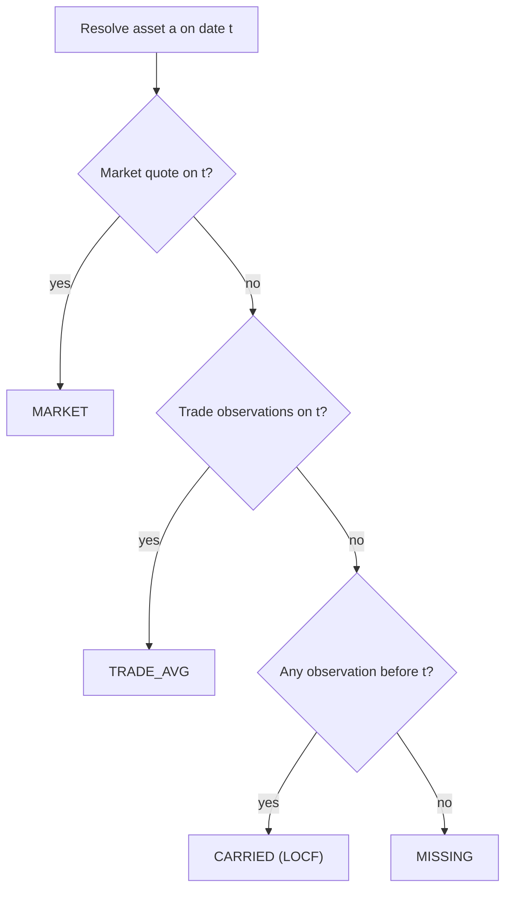

# 🧭 Price Resolution

## 💡 Purpose

LibreFolio uses one unified resolver as the primary valuation source for open positions, NAV, lot valuation, chart price lines, and data-quality flags. The resolver answers one daily question:

$$
\operatorname{mark}(a,t)=\text{best known native-currency unit mark for asset }a\text{ on date }t
$$

It is implemented by `AssetPriceSeries.resolve(t)` and built from two observation classes:

- `MARKET`: asset-system `PriceHistory.close`
- `TRADE`: transaction-implied prices from BUY/SELL rows

An ADJUSTMENT is never an observation, incoming or outgoing, with or without a cost basis: its cost basis is a cost — often an average cost — not what the asset was worth that day. Only market quotes and BUY/SELL trades mark an asset.

## 🧮 Daily Tier Cascade

For each asset and date, observations are collapsed to one mark per day:

$$
\operatorname{mark}(a,t)=
\begin{cases}
\text{MARKET}(a,t), & \text{same-day market quote exists}\\
\operatorname{avg}\bigl(\text{TRADE}(a,t)\bigr), & \text{same-day trade observations exist}\\
\text{last observation before }t, & \text{otherwise, if any}\\
\varnothing, & \text{otherwise}
\end{cases}
$$

The public engine schema maps resolver marks to valuation-source labels:

| Resolver source | Origin | Portfolio valuation source |
|-----------------|--------|----------------------------|
| `MARKET` | Same-day real quote | `MARKET_PRICE` |
| `TRADE_AVG` | Same-day transaction mark | `LAST_TRADE_PRICE` |
| `CARRIED` from MARKET | Stale real quote | `MARKET_PRICE` |
| `CARRIED` from TRADE | Stale transaction mark | `LAST_TRADE_PRICE` |
| `MISSING`, position cost complete | No observation on or before date | `ESTIMATED_AT_COST` |
| `MISSING`, position cost unknown or incomplete | No observation on or before date | `MISSING` |

A holding is therefore valued by the first source available in `MARKET_PRICE` > `LAST_TRADE_PRICE` > `ESTIMATED_AT_COST` > `MISSING`.

!!! warning "No legacy cascade"

    Current shipped code does **not** use the legacy, separate `market → last BUY → seed cost` valuation path: market quotes and trades are observations inside the one unified resolver, and WAC never enters it as a price. Only when the resolver has no observation at all does the engine count a position at its book cost — a declared estimate, never a price (see Missing Marks below).

## 🌍 Currency and Scale

Resolver marks stay in their **native currency**. Consumers convert the mark at the **valuation date**:

$$
\mathrm{Price}_{C^*}(a,t)=\operatorname{mark}(a,t)\cdot \mathrm{fx}\bigl(\mathrm{ccy}_{mark}, C^*, t\bigr)
$$

This matters for carried marks: a quote or trade observed on $s<t$ is translated using FX at $t$, not FX at $s$.

Cost basis uses different timing. Acquisition cost is pinned to the transaction date:

$$
\mathrm{Cost}_{C^*}(\tau)=\mathrm{Cost}_{native}(\tau)\cdot \mathrm{fx}\bigl(\mathrm{ccy}_{cost}, C^*, \tau\bigr)
$$

All resolver observations live on the market quote axis, including `quote_base_quantity`:

$$
\mathrm{HoldingValue}(q,p,qbq)=\frac{q}{qbq}\cdot p
$$

BUY/SELL unit prices are multiplied by `quote_base_quantity` before entering the resolver, so bond-like assets quoted per 100 nominal units compare on the same axis as `PriceHistory.close`.

## 🏷️ Estimated and Stale

`estimated=True` means the resolved value is TRADE-origin:

$$
\mathrm{estimated}(a,t) \iff \mathrm{origin}(\operatorname{mark}(a,t))=\text{TRADE}
$$

A carried real market quote is stale but **not** estimated. Staleness is represented separately through `BackwardFillInfo`:

$$
\mathrm{days\_back}=t-\mathrm{as\_of\_date}
$$

`price_backward_fill.actual_rate_date` stores the observation date and `days_back` stores the LOCF age. Portfolio data-quality warnings evaluate the valuation-date state, not a historical union of all past carried/estimated days.

## ⚠️ Missing Marks

`MISSING` means there is no market or trade observation on or before the valuation date. The portfolio engine then counts a position whose cost is complete in $C^*$ at its book cost — each acquisition converted at its own date, as in [Portfolio Engine §3](index.md#3-position-state):

$$
\mathrm{MV}(a,b,t)=\mathrm{CB}(a,b,t) \qquad \text{if } \operatorname{mark}(a,t)=\varnothing \text{ and the cost of } (a,b) \text{ is complete}
$$

This is a declared estimate, not a price: the valuation source is `ESTIMATED_AT_COST`, no unit price is reported, the value does not move with exchange rates, and the unrealized gain/loss is zero — neither a price effect nor an exchange-rate effect. The estimate is chosen day by day, with no look-ahead: it covers only the days before the asset's first observation, and from the first quote, BUY or SELL on, the mark wins, even an old one carried forward. A position whose cost is unknown or incomplete stays `MISSING`: it cannot contribute market value until a mark exists. In lots analysis the same day-by-day rule values an open LONG lot at its cost on the days before the asset's first observation, whether or not it is priced later. See [FIFO Lot Analysis](../fifo-engine/fifo-lot-analysis.md#estimated-at-cost).

Portfolio warnings are evaluated **as of the valuation date**. For an asset with a price provider, a trade-origin valuation feeds the “valued at their last transaction price” warning once the asset has had no market quote for more than the 14-day grace period, counted from its last quote — or from its first BUY or SELL when it was never quoted —, and a valuation at cost feeds the “valued at cost” warning once the same 14-day grace period has passed, counted from the asset's first acquisition (its first BUY, SELL, ADJUSTMENT or TRANSFER). An asset without a provider raises neither: its trades, or its cost, are its intended value. An asset that later receives a real market quote clears the warning.

## 🔗 Related

- 💼 [NAV](nav.md) — consumes resolver marks for market value
- 📖 [Book Value](book-value.md) — cost-basis side, independent from marks
- 📈 [Net Annualized Return](net-annualized-return.md) — annualizes returns built on resolver valuations
- ⚙️ [Portfolio Engine](index.md) — full model
