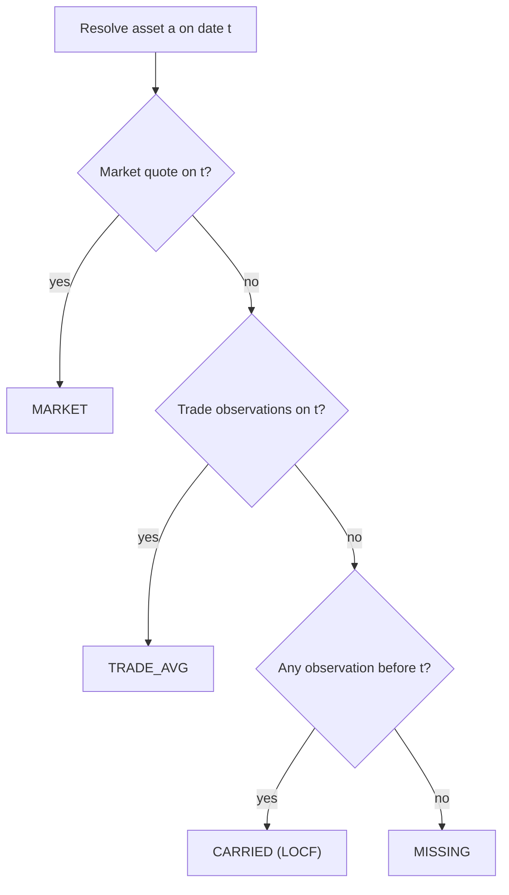

# 🧭 Resolución de precios

## 💡 Propósito

LibreFolio utiliza un único resolvedor unificado como fuente de valoración principal para las posiciones abiertas, el NAV, la valoración de lotes, las líneas de precios de los gráficos y los indicadores de calidad de datos. El resolvedor responde a una pregunta diaria:

$$
\operatorname{mark}(a,t)=\text{best known native-currency unit mark for asset }a\text{ on date }t
$$

Está implementado por `AssetPriceSeries.resolve(t)` y se construye a partir de dos clases de observación:

- `MARKET`: `PriceHistory.close` del sistema de activos
- `TRADE`: precios implícitos en las transacciones a partir de filas BUY/SELL y, para un activo que aún no tiene nada más, del coste de una transferencia entrante

Un ADJUSTMENT nunca es una observación, entrante o saliente, con o sin coste base: su coste base es un coste —a menudo un coste promedio—, no lo que valía el activo ese día. Las cotizaciones de mercado y las operaciones BUY/SELL marcan un activo; una transferencia entrante solo lo hace como la estimación que se describe a continuación.

### 🔁 Coste de transferencia como estimación {: #transfer-cost-estimate }

El coste registrado en una TRANSFER entrante —su coste base por unidad, en la moneda del coste base— se convierte en una observación `TRADE`, estimada como la de una operación, solo mientras el activo no tenga, en esa fecha o antes, ninguna cotización de mercado ni ninguna otra operación: ni BUY ni SELL, ni ADJUSTMENT, ni una transferencia saliente. Un ADJUSTMENT en la fecha de la transferencia o antes la detiene, aunque nunca sea un precio por sí mismo. Otras transferencias entrantes no lo impiden: antes de cualquier observación real, cada una es la mejor estimación de su día, y las del mismo día se promedian como operaciones. Una transferencia sin coste base, con un coste de cero o cuyo coste no tenga moneda no aporta nada, y tampoco lo hace una vinculada a un desdoblamiento. El coste se eleva al eje de cotización (× `quote_base_quantity`) como el precio unitario de una operación. La estimación se arrastra luego hacia adelante hasta que una cotización o una operación real la reemplace.

Solo cuentan las transacciones que lee el cálculo —las de los brókeres dentro de su ámbito—, de modo que un activo comprado en un bróker fuera de la vista y trasladado a ella no tiene, en esa vista, nada antes de su llegada.

Una cotización o una operación nunca se sobrescribe. Un ETF cotizado a 200 hasta el viernes, comprado hace años a 50 y trasladado entre dos de tus brókeres el sábado sigue marcado a 200 el sábado y el domingo, la cotización arrastrada, nunca a 50. La estimación cubre el caso en el que no hay nada más: un activo que llegó solo mediante una transferencia desde fuera, sin ninguna fuente de precios.

## 🧮 Cascada diaria de niveles

Para cada activo y fecha, las observaciones se reducen a una marca por día:

$$
\operatorname{mark}(a,t)=
\begin{cases}
\text{MARKET}(a,t), & \text{same-day market quote exists}\\
\operatorname{avg}\bigl(\text{TRADE}(a,t)\bigr), & \text{same-day trade observations exist (BUY/SELL, or a transfer cost estimate)}\\
\text{last observation before }t, & \text{otherwise, if any}\\
\varnothing, & \text{otherwise}
\end{cases}
$$

El esquema público del motor asigna las marcas del resolvedor a etiquetas de fuente de valoración:

| Fuente del resolvedor | Origen | Fuente de valoración de la cartera |
|-----------------|--------|----------------------------|
| `MARKET` | Cotización real del mismo día | `MARKET_PRICE` |
| `TRADE_AVG` | Marca de transacción del mismo día (una operación o una estimación del coste de transferencia) | `LAST_TRADE_PRICE` |
| `CARRIED` desde MARKET | Cotización real obsoleta | `MARKET_PRICE` |
| `CARRIED` desde TRADE | Marca de transacción obsoleta | `LAST_TRADE_PRICE` |
| `MISSING`, coste de la posición completo | Ninguna observación en la fecha o antes | `ESTIMATED_AT_COST` |
| `MISSING`, coste de la posición desconocido o incompleto | Ninguna observación en la fecha o antes | `MISSING` |

Por lo tanto, una posición se valora con la primera fuente disponible en `MARKET_PRICE` > `LAST_TRADE_PRICE` > `ESTIMATED_AT_COST` > `MISSING`.

!!! warning "Sin cascada heredada"

    El código actualmente distribuido **no** utiliza la ruta de valoración heredada y separada `market → last BUY → seed cost`: las cotizaciones de mercado y las operaciones son observaciones dentro del único resolvedor unificado, y PMC nunca entra en él como precio. Solo cuando el resolvedor no tiene ninguna observación, el motor valora una posición a su coste en libros —una estimación declarada, nunca un precio (véase Marcas faltantes más abajo).

## 🌍 Moneda y escala

Las marcas del resolvedor permanecen en su **moneda nativa**. Los consumidores convierten la marca en la **fecha de valoración**:

$$
\mathrm{Price}_{C^*}(a,t)=\operatorname{mark}(a,t)\cdot \mathrm{fx}\bigl(\mathrm{ccy}_{mark}, C^*, t\bigr)
$$

Esto es importante para las marcas arrastradas: una cotización u operación observada en $s<t$ se convierte usando el tipo de cambio en $t$, no el tipo de cambio en $s$.

El coste base utiliza una temporalidad diferente. El coste de adquisición se fija en la fecha de la transacción:

$$
\mathrm{Cost}_{C^*}(\tau)=\mathrm{Cost}_{native}(\tau)\cdot \mathrm{fx}\bigl(\mathrm{ccy}_{cost}, C^*, \tau\bigr)
$$

Todas las observaciones del resolvedor viven en el eje de cotización de mercado, incluido `quote_base_quantity`:

$$
\mathrm{HoldingValue}(q,p,qbq)=\frac{q}{qbq}\cdot p
$$

Los precios unitarios de BUY/SELL se multiplican por `quote_base_quantity` antes de entrar en el resolvedor, de modo que los activos similares a bonos cotizados por 100 unidades nominales se comparan en el mismo eje que `PriceHistory.close`.

## 🏷️ Estimado y obsoleto

`estimated=True` significa que el valor resuelto es de origen TRADE:

$$
\mathrm{estimated}(a,t) \iff \mathrm{origin}(\operatorname{mark}(a,t))=\text{TRADE}
$$

Una cotización real de mercado arrastrada es obsoleta pero **no** se considera estimada. La obsolescencia se representa por separado mediante `BackwardFillInfo`:

$$
\mathrm{days\_back}=t-\mathrm{as\_of\_date}
$$

`price_backward_fill.actual_rate_date` almacena la fecha de observación y `days_back` almacena la antigüedad LOCF. Las advertencias de calidad de datos de la cartera evalúan el estado en la fecha de valoración, no una unión histórica de todos los días arrastrados/estimados pasados.

## ⚠️ Marcas faltantes

`MISSING` significa que no hay ninguna observación de mercado o de operación en la fecha de valoración o antes: ninguna cotización, ni BUY ni SELL, y ninguna transferencia entrante que haya dado una [estimación](#transfer-cost-estimate). El motor de cartera entonces valora una posición cuyo coste está completo en $C^*$ a su coste en libros —cada adquisición convertida en su propia fecha, como en [Motor de cartera §3](index.md#3-position-state):

$$
\mathrm{MV}(a,b,t)=\mathrm{CB}(a,b,t) \qquad \text{if } \operatorname{mark}(a,t)=\varnothing \text{ and the cost of } (a,b) \text{ is complete}
$$

Esta es una estimación declarada, no un precio: la fuente de valoración es `ESTIMATED_AT_COST`, no se informa ningún precio unitario, el valor no se mueve con los tipos de cambio y la ganancia/pérdida no realizada es cero —ni un efecto de precio ni un efecto de tipo de cambio. La estimación se elige día a día, sin anticipación: cubre solo los días anteriores a la primera observación del activo y, a partir de la primera cotización, BUY, SELL o estimación del coste de transferencia, prevalece la marca, incluso una antigua arrastrada. Por lo tanto, un activo recibido solo mediante transferencias con coste base nunca se valora a coste en libros: desde el día de la primera transferencia se valora a ese coste como precio estimado, convertido al tipo de cambio de cada día, de modo que su valor se mueve con el tipo de cambio. Una posición cuyo coste es desconocido o incompleto permanece `MISSING`: no puede aportar valor de mercado hasta que exista una marca. En el análisis de lotes, la misma regla día a día valora un lote LONG abierto a su coste en los días anteriores a la primera observación del activo, tanto si posteriormente tiene precio como si no. Véase [Análisis de lotes FIFO](../fifo-engine/fifo-lot-analysis.md#estimated-at-cost).

Las advertencias de cartera se evalúan **en la fecha de valoración**. Para un activo con un proveedor de precios, una valoración de origen de operación alimenta la advertencia «valorado a su último precio de transacción» una vez que el activo lleva más de 14 días de período de gracia sin cotización de mercado, contados desde su última cotización —o desde su primer BUY o SELL cuando nunca tuvo cotización o, para un activo valorado al [coste de una transferencia](#transfer-cost-estimate) sin ninguna de las dos, desde la llegada de esa transferencia—, y una valoración a coste alimenta la advertencia «valorado a coste» una vez transcurrido el mismo período de gracia de 14 días, contado desde la primera adquisición del activo (su primer BUY, SELL, ADJUSTMENT o TRANSFER). Un activo sin proveedor no activa ninguna de las dos: sus operaciones, o su coste, son su valor previsto. Un activo que posteriormente recibe una cotización de mercado real elimina la advertencia.

## 🔗 Relacionado

- 💼 [NAV](nav.md) — consume las marcas del resolvedor para el valor de mercado
- 📖 [Valor contable](book-value.md) — lado del coste base, independiente de las marcas
- 📈 [Rentabilidad anualizada neta](net-annualized-return.md) — anualiza las rentabilidades construidas sobre las valoraciones del resolvedor
- ⚙️ [Motor de cartera](index.md) — modelo completo
