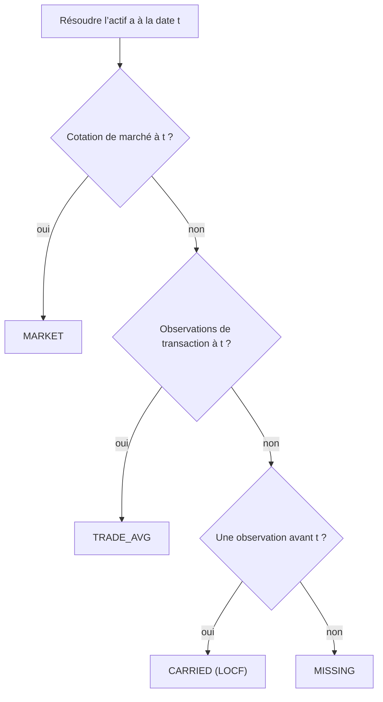

# 🧭 Résolution des prix

## 💡 Objectif

LibreFolio utilise un résolveur unifié comme source d’évaluation principale pour les positions ouvertes, la NAV, l’évaluation des lots, les lignes de prix des graphiques et les indicateurs de qualité des données. Le résolveur répond à une question quotidienne :

$$
\operatorname{mark}(a,t)=\text{meilleure valeur unitaire connue en devise native pour l’actif }a\text{ à la date }t
$$

Il est implémenté par `AssetPriceSeries.resolve(t)` et construit à partir de deux classes d’observations :

- `MARKET` : `PriceHistory.close` du système d’actifs
- `TRADE` : prix implicites des transactions à partir des lignes d’achat/vente et, pour un actif qui n’a encore rien d’autre, à partir du coût d’un transfert entrant

Un ajustement n’est jamais une observation, entrante ou sortante, avec ou sans coût de base : son coût de base est un coût — souvent un coût moyen — et non ce que valait l’actif ce jour-là. Les cotations de marché et les transactions d’achat/vente valorisent un actif ; un transfert entrant ne le fait qu’en tant qu’estimation ci-dessous.

### 🔁 Le coût de transfert comme estimation {: #transfer-cost-estimate }

Le coût enregistré sur un transfert entrant — son coût de base unitaire, dans la devise du coût de base — devient une observation `TRADE`, estimée comme celle d’une transaction, uniquement tant que l’actif ne dispose, à cette date ou avant, ni d’une cotation de marché ni d’aucune autre opération : ni achat ni vente, ni ajustement, ni transfert sortant. Un ajustement à la date du transfert ou avant empêche cela, bien qu’il ne soit jamais un prix en soi. Les autres transferts entrants ne le font pas : avant toute observation réelle, chacun constitue la meilleure estimation de sa date, et ceux de la même date sont moyennés comme les transactions. Un transfert sans coût de base, avec un coût nul, ou dont le coût n’a pas de devise, ne donne rien, et il en va de même pour un transfert lié à une division. Le coût est ramené sur l’axe des cotations (× `quote_base_quantity`) comme le prix unitaire d’une transaction. L’estimation est ensuite reportée jusqu’à ce qu’une cotation ou une transaction réelle la remplace.

Seules comptent les transactions que le calcul lit — celles des courtiers dans son périmètre —, de sorte qu’un actif acheté chez un courtier hors de la vue et transféré dans celle-ci n’a, dans cette vue, rien avant son arrivée.

Une cotation ou une transaction n’est jamais écrasée. Un ETF coté à 200 jusqu’au vendredi, acheté il y a des années à 50 et transféré entre deux de vos courtiers le samedi est toujours marqué à 200 le samedi et le dimanche, la cotation reportée, jamais 50. L’estimation couvre le cas où il n’y a rien d’autre : un actif arrivé uniquement par transfert depuis l’extérieur, sans source de prix.

## 🧮 Cascade quotidienne par niveaux

Pour chaque actif et chaque date, les observations sont réduites à une seule valeur de référence par jour :

$$
\operatorname{mark}(a,t)=
\begin{cases}
\text{MARKET}(a,t), & \text{une cotation de marché le jour même existe}\\
\operatorname{avg}\bigl(\text{TRADE}(a,t)\bigr), & \text{des observations de transaction le jour même existent (achat/vente, ou estimation du coût de transfert)}\\
\text{dernière observation avant }t, & \text{sinon, s’il en existe une}\\
\varnothing, & \text{sinon}
\end{cases}
$$

Le schéma public du moteur associe les valeurs de référence du résolveur à des libellés de source d’évaluation :

| Source du résolveur | Origine | Source d’évaluation du portefeuille |
|-----------------|--------|----------------------------|
| `MARKET` | Cotation réelle du jour même | `MARKET_PRICE` |
| `TRADE_AVG` | Valeur de référence transactionnelle du jour même (une transaction ou une estimation du coût de transfert) | `LAST_TRADE_PRICE` |
| `CARRIED` depuis MARKET | Cotation réelle obsolète | `MARKET_PRICE` |
| `CARRIED` depuis TRADE | Valeur de référence transactionnelle obsolète | `LAST_TRADE_PRICE` |
| `MISSING`, coût de la position complet | Aucune observation à cette date ni avant | `ESTIMATED_AT_COST` |
| `MISSING`, coût de la position inconnu ou incomplet | Aucune observation à cette date ni avant | `MISSING` |

Une position est donc évaluée par la première source disponible dans l’ordre `MARKET_PRICE` > `LAST_TRADE_PRICE` > `ESTIMATED_AT_COST` > `MISSING`.

!!! warning "Aucune cascade héritée"

    Le code actuellement livré n’utilise **pas** le chemin d’évaluation hérité et séparé `market → last BUY → seed cost` : les cotations de marché et les transactions sont des observations au sein de l’unique résolveur unifié, et le PRU n’y entre jamais comme prix. Ce n’est que lorsque le résolveur n’a aucune observation que le moteur comptabilise une position à son coût comptable — une estimation déclarée, jamais un prix (voir « Valeurs de référence manquantes » ci-dessous).

## 🌍 Devise et échelle

Les valeurs de référence du résolveur restent dans leur **devise native**. Les consommateurs convertissent la valeur de référence à la **date d’évaluation** :

$$
\mathrm{Price}_{C^*}(a,t)=\operatorname{mark}(a,t)\cdot \mathrm{fx}\bigl(\mathrm{ccy}_{mark}, C^*, t\bigr)
$$

Cela importe pour les valeurs de référence reportées : une cotation ou une transaction observée à $s<t$ est convertie avec le taux de change à $t$, et non avec le taux de change à $s$.

Le coût de base suit une temporalité différente. Le coût d’acquisition est rattaché à la date de la transaction :

$$
\mathrm{Cost}_{C^*}(\tau)=\mathrm{Cost}_{native}(\tau)\cdot \mathrm{fx}\bigl(\mathrm{ccy}_{cost}, C^*, \tau\bigr)
$$

Toutes les observations du résolveur se situent sur l’axe des cotations de marché, y compris `quote_base_quantity` :

$$
\mathrm{HoldingValue}(q,p,qbq)=\frac{q}{qbq}\cdot p
$$

Les prix unitaires d’achat/vente sont multipliés par `quote_base_quantity` avant d’entrer dans le résolveur, de sorte que les actifs de type obligation cotés pour 100 unités nominales se comparent sur le même axe que `PriceHistory.close`.

## 🏷️ Estimé et obsolète

`estimated=True` signifie que la valeur résolue est d’origine TRADE :

$$
\mathrm{estimated}(a,t) \iff \mathrm{origin}(\operatorname{mark}(a,t))=\text{TRADE}
$$

Une cotation de marché réelle reportée est obsolète mais **non** estimée. L’obsolescence est représentée séparément via `BackwardFillInfo` :

$$
\mathrm{days\_back}=t-\mathrm{as\_of\_date}
$$

`price_backward_fill.actual_rate_date` enregistre la date d’observation et `days_back` stocke l’âge LOCF. Les avertissements de qualité des données du portefeuille évaluent l’état à la date d’évaluation, et non une union historique de tous les jours passés ayant été reportés ou estimés.

## ⚠️ Valeurs de référence manquantes

`MISSING` signifie qu’il n’existe aucune observation de marché ou de transaction à la date d’évaluation ni avant — aucune cotation, aucun achat ni vente, et aucun transfert entrant ayant fourni une [estimation](#transfer-cost-estimate). Le moteur de portefeuille comptabilise alors une position dont le coût est complet en $C^*$ à son coût comptable — chaque acquisition convertie à sa propre date, comme dans [Moteur de portefeuille §3](index.md#3-position-state) :

$$
\mathrm{MV}(a,b,t)=\mathrm{CB}(a,b,t) \qquad \text{si } \operatorname{mark}(a,t)=\varnothing \text{ et si le coût de } (a,b) \text{ est complet}
$$

Il s’agit d’une estimation déclarée, et non d’un prix : la source d’évaluation est `ESTIMATED_AT_COST`, aucun prix unitaire n’est rapporté, la valeur ne varie pas avec les taux de change, et la plus-value ou moins-value latente est nulle — ni effet de prix ni effet de taux de change. L’estimation est choisie jour par jour, sans anticipation : elle ne couvre que les jours précédant la première observation de l’actif, et à partir de la première cotation, du premier achat, de la première vente ou de la première estimation du coût de transfert, c’est la valeur de référence qui l’emporte, même s’il s’agit d’une ancienne valeur reportée. Un actif reçu uniquement par des transferts avec un coût de base n’est donc jamais évalué au coût : dès le jour du premier transfert, il est évalué à ce coût comme prix estimé, converti au taux de change de chaque jour, de sorte que sa valeur évolue avec le taux. Une position dont le coût est inconnu ou incomplet reste `MISSING` : elle ne peut contribuer à la valeur de marché tant qu’une valeur de référence n’existe pas. Dans l’analyse des lots, la même règle jour par jour évalue un lot LONG ouvert à son coût les jours précédant la première observation de l’actif, qu’il soit ou non valorisé plus tard. Voir [Analyse des lots FIFO](../fifo-engine/fifo-lot-analysis.md#estimated-at-cost).

Les avertissements de portefeuille sont évalués **à la date d’évaluation**. Pour un actif disposant d’un fournisseur de prix, une évaluation d’origine transactionnelle alimente l’avertissement « valorisés à leur dernier prix de transaction » dès que l’actif est sans cotation de marché depuis plus de la période de grâce de 14 jours, comptée depuis sa dernière cotation — ou depuis son premier achat ou sa première vente s’il n’a jamais été coté, ou, pour un actif valorisé au [coût d’un transfert](#transfer-cost-estimate) sans cotation ni transaction, depuis l’arrivée de ce transfert —, et une évaluation au coût alimente l’avertissement « valorisé au coût » dès que la même période de grâce de 14 jours est écoulée, comptée depuis la première acquisition de l’actif (sa première opération d’achat, de vente, d’ajustement ou de transfert). Un actif sans fournisseur ne déclenche ni l’un ni l’autre : ses transactions, ou son coût, constituent sa valeur prévue. Un actif qui reçoit ensuite une cotation de marché réelle efface l’avertissement.

## 🔗 Voir aussi

- 💼 [NAV](nav.md) — consomme les valeurs de référence du résolveur pour la valeur de marché
- 📖 [Valeur comptable](book-value.md) — volet coût de base, indépendant des valeurs de référence
- 📈 [Rendement annualisé net](net-annualized-return.md) — annualise les rendements construits sur les évaluations du résolveur
- ⚙️ [Moteur de portefeuille](index.md) — modèle complet
