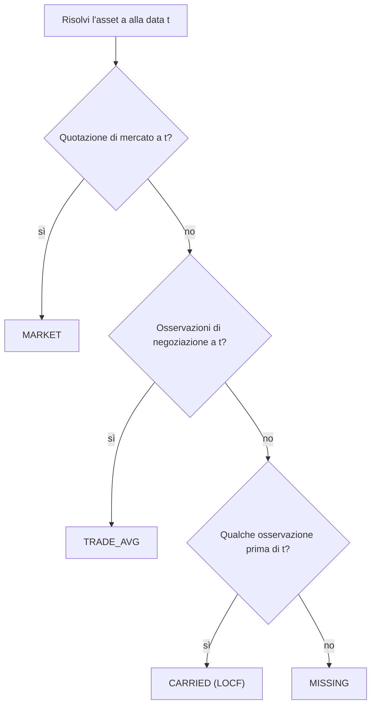

# 🧭 Risoluzione dei prezzi

## 💡 Scopo

LibreFolio utilizza un unico resolver unificato come fonte di valutazione principale per posizioni aperte, NAV, valutazione dei lotti, linee di prezzo nei grafici e indicatori di qualità dei dati. Il resolver risponde a una domanda giornaliera:

$$
\operatorname{mark}(a,t)=\text{miglior prezzo unitario noto in valuta nativa per l'asset }a\text{ alla data }t
$$

È implementato da `AssetPriceSeries.resolve(t)` e costruito a partire da due classi di osservazione:

- `MARKET`: `PriceHistory.close` del sistema asset
- `TRADE`: prezzi impliciti nelle transazioni dalle righe di acquisto/vendita e, per un asset che non ha ancora nient'altro, dal costo di un trasferimento in entrata

Una rettifica non è mai un'osservazione, in entrata o in uscita, con o senza costo di carico: il suo costo di carico è un costo — spesso un costo medio — non ciò che l'asset valeva quel giorno. Le quotazioni di mercato e le negoziazioni di acquisto/vendita determinano il prezzo di un asset; un trasferimento in entrata lo fa solo nella forma della stima descritta di seguito.

### 🔁 Costo del trasferimento come stima {: #transfer-cost-estimate }

Il costo registrato su un trasferimento in entrata — il suo costo di carico per unità, nella valuta del costo di carico — diventa un'osservazione `TRADE`, stimata come quella di una negoziazione, solo finché l'asset non ha, a quella data o prima, alcuna quotazione di mercato e nessun'altra operazione: nessun acquisto né vendita, nessuna rettifica, nessun trasferimento in uscita. Una rettifica alla data del trasferimento o precedente lo blocca, anche se non è mai un prezzo di per sé. Gli altri trasferimenti in entrata no: prima di qualsiasi osservazione reale, ciascuno è la migliore stima del proprio giorno, e quelli dello stesso giorno sono mediati come le negoziazioni. Un trasferimento senza costo di carico, con un costo pari a zero o il cui costo è privo di valuta non fornisce nulla, e lo stesso vale per uno collegato a uno split. Il costo è riportato sull'asse delle quotazioni (× `quote_base_quantity`) come il prezzo unitario di una negoziazione. La stima viene quindi mantenuta finché una quotazione o una negoziazione reale non la sostituisce.

Contano solo le transazioni lette dal calcolo — quelle dei broker nel suo ambito —, quindi un asset acquistato presso un broker al di fuori della vista e spostato al suo interno non ha, in quella vista, nulla prima del suo arrivo.

Una quotazione o una negoziazione non viene mai sovrascritta. Un ETF quotato a 200 fino a venerdì, acquistato anni fa a 50 e spostato tra due tuoi broker sabato, è comunque valorizzato a 200 sabato e domenica, la quotazione mantenuta, mai 50. La stima copre il caso in cui non c'è nient'altro: un asset arrivato solo tramite trasferimento dall'esterno, senza alcuna fonte di prezzo.

## 🧮 Cascata giornaliera a livelli

Per ogni asset e data, le osservazioni vengono ridotte a un unico prezzo di riferimento al giorno:

$$
\operatorname{mark}(a,t)=
\begin{cases}
\text{MARKET}(a,t), & \text{esiste una quotazione di mercato dello stesso giorno}\\
\operatorname{avg}\bigl(\text{TRADE}(a,t)\bigr), & \text{esistono osservazioni di negoziazione dello stesso giorno (acquisto/vendita o stima del costo di trasferimento)}\\
\text{ultima osservazione prima di }t, & \text{altrimenti, se presente}\\
\varnothing, & \text{altrimenti}
\end{cases}
$$

Lo schema pubblico del motore mappa i prezzi di riferimento del resolver alle etichette della fonte di valutazione:

| Fonte del resolver | Origine | Fonte di valutazione del portafoglio |
|-----------------|--------|----------------------------|
| `MARKET` | Quotazione reale dello stesso giorno | `MARKET_PRICE` |
| `TRADE_AVG` | Prezzo di riferimento da transazione dello stesso giorno (una negoziazione o una stima del costo di trasferimento) | `LAST_TRADE_PRICE` |
| `CARRIED` da MARKET | Quotazione reale obsoleta | `MARKET_PRICE` |
| `CARRIED` da TRADE | Prezzo di riferimento da transazione obsoleto | `LAST_TRADE_PRICE` |
| `MISSING`, costo della posizione completo | Nessuna osservazione alla data o precedente | `ESTIMATED_AT_COST` |
| `MISSING`, costo della posizione sconosciuto o incompleto | Nessuna osservazione alla data o precedente | `MISSING` |

Una posizione è quindi valutata dalla prima fonte disponibile in `MARKET_PRICE` > `LAST_TRADE_PRICE` > `ESTIMATED_AT_COST` > `MISSING`.

!!! warning "Nessuna cascata legacy"

    Il codice attualmente distribuito **non** utilizza il percorso di valutazione legacy e separato `market → last BUY → seed cost`: le quotazioni di mercato e le negoziazioni sono osservazioni all'interno dell'unico resolver unificato, e il PMC non vi entra mai come prezzo. Solo quando il resolver non ha alcuna osservazione, il motore valuta una posizione al suo costo contabile — una stima dichiarata, mai un prezzo (vedi Prezzi di riferimento mancanti di seguito).

## 🌍 Valuta e scala

I prezzi di riferimento del resolver restano nella loro **valuta nativa**. I consumatori convertono il prezzo di riferimento alla **data di valutazione**:

$$
\mathrm{Price}_{C^*}(a,t)=\operatorname{mark}(a,t)\cdot \mathrm{fx}\bigl(\mathrm{ccy}_{mark}, C^*, t\bigr)
$$

Ciò è importante per i prezzi di riferimento mantenuti: una quotazione o una negoziazione osservata alla data $s<t$ viene convertita usando il tasso di cambio FX a $t$, non il tasso di cambio FX a $s$.

Il costo di carico segue una tempistica diversa. Il costo di acquisizione è ancorato alla data della transazione:

$$
\mathrm{Cost}_{C^*}(\tau)=\mathrm{Cost}_{native}(\tau)\cdot \mathrm{fx}\bigl(\mathrm{ccy}_{cost}, C^*, \tau\bigr)
$$

Tutte le osservazioni del resolver risiedono sull'asse delle quotazioni di mercato, incluso `quote_base_quantity`:

$$
\mathrm{HoldingValue}(q,p,qbq)=\frac{q}{qbq}\cdot p
$$

I prezzi unitari di acquisto/vendita vengono moltiplicati per `quote_base_quantity` prima di entrare nel resolver, così gli asset di tipo obbligazionario quotati per 100 unità nominali si confrontano sullo stesso asse di `PriceHistory.close`.

## 🏷️ Stimato e obsoleto

`estimated=True` significa che il valore risolto è di origine TRADE:

$$
\mathrm{estimated}(a,t) \iff \mathrm{origin}(\operatorname{mark}(a,t))=\text{TRADE}
$$

Una quotazione di mercato reale mantenuta è obsoleta ma **non** stimata. L'obsolescenza è rappresentata separatamente tramite `BackwardFillInfo`:

$$
\mathrm{days\_back}=t-\mathrm{as\_of\_date}
$$

`price_backward_fill.actual_rate_date` memorizza la data di osservazione e `days_back` memorizza l'età LOCF. Gli avvisi sulla qualità dei dati del portafoglio valutano lo stato alla data di valutazione, non un'unione storica di tutti i giorni passati mantenuti/stimati.

## ⚠️ Prezzi di riferimento mancanti

`MISSING` significa che non esiste alcuna osservazione di mercato o di negoziazione alla data di valutazione o precedente — nessuna quotazione, nessun acquisto né vendita e nessun trasferimento in entrata che abbia fornito una [stima](#transfer-cost-estimate). Il motore di portafoglio valuta quindi una posizione il cui costo è completo in $C^*$ al suo costo contabile — ogni acquisizione convertita alla propria data, come in [Motore di portafoglio §3](index.md#3-position-state):

$$
\mathrm{MV}(a,b,t)=\mathrm{CB}(a,b,t) \qquad \text{se } \operatorname{mark}(a,t)=\varnothing \text{ e il costo di } (a,b) \text{ è completo}
$$

Questa è una stima dichiarata, non un prezzo: la fonte di valutazione è `ESTIMATED_AT_COST`, non viene riportato alcun prezzo unitario, il valore non varia con i tassi di cambio e il P&L latente è zero — né un effetto prezzo né un effetto del tasso di cambio. La stima viene scelta giorno per giorno, senza look-ahead: copre solo i giorni precedenti la prima osservazione dell'asset e, a partire dalla prima quotazione, dal primo acquisto, dalla prima vendita o dalla prima stima del costo di trasferimento, prevale il prezzo di riferimento, anche se vecchio e mantenuto. Un asset ricevuto solo tramite trasferimenti con un costo di carico non è quindi mai valutato al costo: dal giorno del primo trasferimento è valutato a quel costo come prezzo stimato, convertito al tasso di cambio di ogni giorno, quindi il suo valore varia con il tasso di cambio. Una posizione il cui costo è sconosciuto o incompleto rimane `MISSING`: non può contribuire al valore di mercato finché non esiste un prezzo di riferimento. Nell'analisi dei lotti, la stessa regola giorno per giorno valuta un lotto LONG aperto al suo costo nei giorni precedenti la prima osservazione dell'asset, indipendentemente dal fatto che in seguito venga prezzato. Vedi [Analisi dei lotti FIFO](../fifo-engine/fifo-lot-analysis.md#estimated-at-cost).

Gli avvisi del portafoglio sono valutati **alla data di valutazione**. Per un asset con un provider di prezzi, una valutazione di origine TRADE alimenta l'avviso «valutati al loro ultimo prezzo di transazione» una volta che l'asset non ha avuto alcuna quotazione di mercato per più del periodo di grazia di 14 giorni, conteggiato dalla sua ultima quotazione — o dal suo primo acquisto o dalla sua prima vendita quando non è mai stato quotato, oppure, per un asset valutato al [costo di un trasferimento](#transfer-cost-estimate) in assenza di entrambi, dall'arrivo di quel trasferimento —, e una valutazione al costo alimenta l'avviso «valutato al costo» una volta trascorso lo stesso periodo di grazia di 14 giorni, conteggiato dalla prima acquisizione dell'asset (il suo primo acquisto, la sua prima vendita, la sua prima rettifica o il suo primo trasferimento). Un asset senza provider non genera nessuno dei due avvisi: le sue negoziazioni, o il suo costo, costituiscono il suo valore previsto. Un asset che in seguito riceve una quotazione di mercato reale cancella l'avviso.

## 🔗 Correlati

- 💼 [NAV](nav.md) — consuma i prezzi di riferimento del resolver per il valore di mercato
- 📖 [Valore contabile](book-value.md) — lato del costo di carico, indipendente dai prezzi di riferimento
- 📈 [Rendimento annualizzato netto](net-annualized-return.md) — annualizza i rendimenti costruiti sulle valutazioni del resolver
- ⚙️ [Motore di portafoglio](index.md) — modello completo
