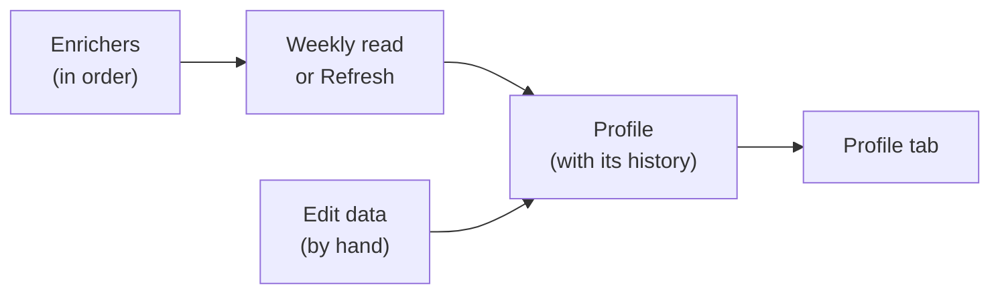

# 👤 Profile

The **Profile** tab of the asset page, between **Overview** and **Risk & Scenarios**, tells you *what the asset is*:
where it invests, what it costs, what it pays, who issues it. This page explains where that data comes from — the
asset's **enrichers** — when it is read, and how to correct it or look back at its history.

    

---

## 🧾 What the profile holds {: #what-the-profile-holds }

The profile is the asset's descriptive data, as opposed to its prices:

- **Classification** — the **Sector distribution** and the **Geographic distribution** (see
  [Classification](classification.md)).
- **Description** — a short text about the asset.
- **Key figures** — the **Annual cost (TER)**, the **Foreign withholding tax**, the **Fund size**, the **Market
  capitalisation**, the **Gross yield**, the **Modified duration**, the **Annual coupon** and the **Maturity**.
- **Details**, by group:
    - **The fund** — management company, tracked index, replication, income treatment (accumulating or
      distributing), domicile, fund currency, inception date, management fee;
    - **The company** — sector, industry, issuer's country;
    - **Identity** — legal form and issuer type, beside the asset's ISIN, ticker and other identifiers (the free ones, with no kind, are one row of chips);
    - **The bond** — coupon per period, coupon frequency and type, day count, net yield, accrued interest, issuer,
      minimum lot, interest start date, loyalty bonus, coupon schedule, payout terms.

Each item has a **history**. A value holds from a given day until another one replaces it, and LibreFolio remembers who
gave it: a source, or a person who wrote it by hand. A new value is saved only when it differs from the current one,
so the history shows real changes, not every read.

The profile also feeds other parts of LibreFolio: the Dashboard's allocation charts, the
**Risk & Scenarios** tab ([Asset Detail Page](index.md)) (a bond's modified duration, for example) and the AI Export.

---

## 🔌 Enrichers: where the data comes from {: #enrichers }

An **enricher** is a source that reads an asset's profile from a website or a public register. LibreFolio ships four:

| Enricher | Typically reads |
|---|---|
| [justETF](../providers/justetf.md) | ETFs and ETCs: description, annual cost, fund size, countries, sectors, the fund's structure (index, management company, replication, income treatment, domicile, currency) |
| [Yahoo Finance](../providers/yahoo-finance.md) | Shares: description, sector, industry, country, market capitalisation. Funds: description, annual cost, management company, inception date, sectors |
| [Borsa Italiana](../providers/borsa-italiana.md) | Bonds: coupons, maturity, yields, modified duration, issuer, description, countries, sectors. Shares: sector, and the company's description and country from its profile page. Funds: currency, inception date, management fee |
| ESMA (FIRDS) | Any instrument traded on a European market, from the official register of the European Securities and Markets Authority: the issuer's LEI and the legal form; for a bond its maturity, the type of coupon, a fixed coupon and whether a State guarantees it; for a fund whether it accumulates or distributes. It comes after the other sources, filling what they leave empty |

An asset can have several enrichers, **in order**: the order is their priority. For each item, the first enricher in
the list that gives a value wins it; if that source does not answer, the item goes to the next one.

!!! tip "✍️ A value you correct by hand"

    What you write by hand stays until a source reads that item again: at that read the source's value comes back,
    unless it is the same as yours, and the [latest changes](#latest-changes) say so. If a source keeps giving a value you do not want,
    remove that enricher from the asset, or move another one before it.

### 🧩 Choose the enrichers {: #choose-enrichers }

In the asset form ([Create & Edit](../create-edit.md)), the **Enrichers** button sits beside **Ask Provider**, with the
number of enrichers chosen. It opens the **Asset enrichers** window:

- **Enrichers chosen** — the list, in its order. Drag a row to move it (arrows on a phone); **#1** is the first to be
  asked. Each row shows the identifier the enricher reads, what it fills (costs, countries, sectors, coupons…) and, for
  an asset that already exists, its last read and how it went (*read on …*, *…: not found*, *…: no answer*).
- Open a row (✏️, **Change the binding**) to **Search on** that source, set the **Identifier type** and the
  **Identifier** by hand, and **Test the binding**: the test says what it found and what it would fill.
- **Show the other enrichers** lists the ones not in the list, with the reason (*removed by you*, *does not cover this
  asset type*…); **+** adds one back.
- **Use these enrichers** hands the list back to the asset form. Nothing is saved until you save the asset.

    

**At creation**, as soon as the form holds a complete **ISIN**, LibreFolio **recognizes** by itself which enrichers
know the asset: a line under the form's header says what it found (for example *2 enrichers found: justETF, Borsa Italiana.
They will be saved with the asset.*) with **Check or change**. It then asks them for their data and fills the empty profile items of the form
(*Their data are being read now.*). In edit mode nothing starts by itself: open the window to change the list.

!!! info "🔒 Turned off or not configured"

    The administrator can turn an enricher off for the whole instance
    (**The Active Providers** in [Configuration: Accounts and Asset Search](../../../admin/configuration_accounts.md)), and some enrichers need their
    settings before they can read. Such an enricher stays in the asset's list, drawn off and marked *not active on this
    instance* or *to configure*: the asset keeps its binding and its profile, but it is not read from that source.
    **Configure**, when you can change its settings, opens them over the window.

### 🕐 When the profile is read {: #when-read }

- **Once a week**, on its own: by default on **Saturday at 03:00**, for every active asset with at least one enricher.
  The administrator sets the day and the time
  ([Market Data Scheduler](../../../admin/settings.md#market-data-scheduler)).
- **Right after a save** that creates an asset with enrichers, or changes an asset's enrichers.
- **When you ask**, with [Refresh](#refresh) in the **Profile** tab.

Prices are not part of this: they stay with the toolbar's **Sync**.

---

## 🗂️ The Profile tab {: #profile-tab }

From top to bottom:

1. **[Classification](classification.md)** — the sector and geographic distribution.
2. **Description**.
3. **Data** — one card per key figure. Annual cost, fund size, market capitalisation, gross yield, modified duration
   and annual coupon also draw a small chart of their values over the period.
4. **Details** — the groups listed [above](#what-the-profile-holds).
5. **Latest changes** — a panel, closed at first ([below](#latest-changes)).

Good to know:

- The values **follow the period** chosen at the top of the page: the tab shows the value each item had at the end of
  it, and the cards' charts cover it. An item with no value in the period says *not available*.
- Fund size, market capitalisation, yields, duration and accrued interest change at every read. When a source has not
  confirmed one of them for more than 30 days, it shows *Confirmed on …, not up to date* under the value.
- A **dot** on the **Profile** tab means the asset has no enricher: nothing keeps its profile up to date.

### 🔄 Refresh {: #refresh }

**Refresh**, beside **Edit data** above the cards, reads the asset's enrichers again **now** and saves what changed.
Its tooltip says when they last read (*last read: …*, or *never read yet*). On a phone it shows as an icon only.

A notice tells you how it went:

| Notice | What it means |
|---|---|
| *3 data items updated* | The sources gave new values; the tab shows them. |
| *Enrichers read again: nothing changed* | Every source answered, with the values you already had. |
| *1 source did not answer; 2 data items updated…* | Some sources failed; the others were saved. The weekly read will try again. |
| *No active enricher: nothing was read…* | Every enricher of the asset is turned off or not configured on this instance. |
| *The enrichers could not be read…* | Nothing could be read: try again later. |

**Refresh** shows only when the asset has at least one enricher.

### 🧭 No enricher configured {: #no-enricher }

An asset without enrichers shows, at the top of the tab, the box **No enricher configured**: the data on the tab was
written by hand or arrived when the asset was created, and nothing keeps it up to date. Its **Configure** button opens
the asset form with the **Asset enrichers** window already on top ([Choose the enrichers](#choose-enrichers)).

### ✏️ Edit data {: #edit-data }

**Edit data** opens the **Profile data** window, to write the profile by hand:

- **Find a data item and add it**, then write its value, or choose **Leave empty** to empty it on purpose.
- The sectors and the countries each have their own editor: see
  **Set the description, sectors and countries** in [Create & Edit](../create-edit.md).
- **Ask** (on a row) and **Ask all** ask the asset's enrichers without saving: an empty item is filled *from the
  source*, a different one goes to **Compare with the sources**, where you choose which value to take. A value taken
  from a source is saved in that source's name, not yours.
- **Save all** saves everything at once.

The same window opens from the **Profile data** row of the asset form; there **Keep the changes** hands them to the
form, which saves them with the asset.

### 📜 Latest changes {: #latest-changes }

The **Latest changes** panel, at the bottom of the tab, is closed at first: click its title to open it. It lists the
asset's latest changes, newest first, twenty per page (the pages are in the bar at the bottom of the table):

- **When** — the day of the change;
- **Data** — the item;
- **What changed** — a sentence, such as *Written by hand: …*, *Corrected by hand: from … to …*, *First value read:
  …*, *Up from … to …*, *Left empty on purpose*;
- **Who** — the person who wrote it by hand, or the source that gave it; a value that was already there before the profile existed reads **System**.

The values that change at every read (fund size, market capitalisation, gross and net yield, modified duration,
accrued interest) appear here only when written by hand, and with the read that replaced them: their other steps are in
their [history](#data-history).

    

**Forget** removes a change as if it had never been made: the item goes back to the value it had before. Use it on one
row (its menu) or on the rows you select: the bar above the table shows **Forget** with the number of rows. LibreFolio
asks first, as it cannot be undone.

### 🕘 History of the data {: #data-history }

The 🕘 clock opens the **History of** window for one item. You find it on a key-figure card, beside the titles of the
sector distribution, the geographic distribution and the description; a click on a detail row with a value opens it
too.

- For a **number** (a percentage, an amount, a duration…), a chart from the item's first day: a dot marks each new
  value, coloured by who gave it — a source, or a value written by hand.
- Below, the same table as **Latest changes**, with every change of this one item, and the same **Forget**.
- Text, countries and sectors have the table only.

    

To write a new value, close the window and use **Edit data**.

---

## 🔗 Related

- 🗂️ **[Classification](classification.md)** — The sector and geographic distribution in detail
- ➕ **[Create & Edit](../create-edit.md)** — The asset form, where the enrichers are chosen
- 🔌 **[Providers](../providers/index.md)** — justETF, Yahoo Finance, Borsa Italiana and the other sources
- 🕐 **[Market Data Scheduler](../../../admin/settings.md#market-data-scheduler)** — For administrators: the day and time of the weekly read
