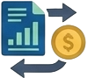
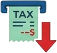

# 📝 Transaction Form

The transaction form adds or edits one transaction — or one linked pair — in the [bulk workspace](index.md#bulk-workspace). It also shows a transaction read-only when you double-click it in a list. Only the fields that the chosen type needs appear.

     BUY' alt="Buy">
     SELL' alt="Sell">
     DIVIDEND' alt="Dividend">
     DEPOSIT' alt="Deposit">
     ADJUSTMENT' alt="Adjustment">
     TRANSFER' alt="Asset Transfer">
     FX CONVERSION' alt="FX Conversion">
     CASH TRANSFER' alt="Cash Transfer">

---

## ✍️ Fill in the form

1. Pick the **Type**, then the **Broker** if it is not set already.
2. Fill in the **Required** section: the **Date**, the **Asset** and its quantity when the type has one, and the cash amount.
3. Open **Optional** for **Tags**, a **Description** or, on dividends, interest and adjustments, a **Linked Event**.
4. Click **Apply** to place the row in the workspace; **Save All** in the workspace writes it.

A few rules keep entries quick:

- **Amounts are totals** — the amount you save is the total paid or received, never the price per share (*Total amount (not per share)*). On a purchase or a sale you can write either one: the total, or the unit price (the buttons next to the field say which), and the form works out the other — see [Total or unit price](#unit-price).
- **Type positive numbers** — the form adds the minus sign where money or units go out: a purchase's payment, a sale's units, a withdrawal, a fee, a tax. Only an **Adjustment** quantity takes a sign: positive adds units, negative removes them.
- **Checks as you go** — once the required fields are filled, the form checks the entry against your ledger and the other workspace rows, and lists any problem at the top. The form also spots some mistakes by itself: a date it cannot read, or one in the future, stays on screen in red, and the previous date is not used in its place; a quantity or amount with the wrong sign or format, such as a negative quantity on a purchase, turns red; and a warning at the top flags a transfer with the same broker on both sides, or an exchange with the same currency. Until you fix them, nothing is checked, *valid* does not appear and **Apply** stays disabled. **⚡ Validate now** finds them all at once — see [Validate now](#validate-now). Transaction dates can go back as far as the year 1 and up to tomorrow, but the form itself stops at today. A date before 1900 is almost always a typo, so the form warns you with an amber banner and **Apply** stays disabled until you press **Yes, the date is right**; change the date and it asks again, and once confirmed the date is saved like any other. A date after tomorrow is refused with a message such as *Date: Not after 2026-10-18*, when today is 17 October 2026.
- **Missing broker or asset?** — **Create new** in the broker list, or **New asset** in the asset list, creates it without leaving the form.
- **Missing event?** — **+ New event** in the **Linked Event** field creates the asset's event and links it. If the asset already has an event of that type on that date, nothing is saved: the window shows that event, to use it, or to edit it if you entered it by hand, and never overwrites it ([New event from a transaction](../assets/detail/events.md#new-event)).

??? info "💰 Cost basis of incoming units — for Adjustments and Asset Transfers"

    When an **Adjustment** adds units, or on the receiving side of an **Asset Transfer**, the form asks what those units cost:

    - **Auto** — LibreFolio computes it as a [Weighted Average Cost](../../financial-theory/technical-analysis/performance-metrics/weighted-average-cost.md); press **⚡ Validate now** to see it.
    - **Manual** — you type it.

    An **Adjustment** that removes units asks for no cost: it has no value. The units only leave the quantity, and what they cost counts as a realized loss. To record a sale, use a **Sell**.

    In **Auto**, the average is taken at the sending broker of a transfer, or at the adjustment's own broker. If that broker holds none of the asset on the day the units leave it or come in, or only units whose cost is unknown, there is nothing to average: **Auto** is refused and nothing is saved — choose **Manual** and type what those units cost you (0 for a gift). In **Manual**, the field cannot stay empty: LibreFolio flags the row and saves nothing until you fill it in or switch to **Auto**; a negative cost is refused the same way — type 0 or more. Editing a saved transaction is no exception: if you empty its cost in **Manual**, the save is refused, because the transaction needs a cost basis — choose **Auto** or type a value. Type 0 for the new shares of a stock split. For a gift, instead of 0, you can type what the donor paid for those units: that keeps the weighted average cost, and the gain you may be taxed on, closer to the real ones. Units entered at a cost of 0 count as free, not as unknown: a later **Auto** average at their broker counts them at 0. If an exchange rate is missing, the **Sync FX rates** link fetches it.

---

## 🧮 Total or unit price {: #unit-price }

On a **Buy** or a **Sell** (and on any other single type that has both a quantity and a cash amount), the label of the cash field has two small buttons, **Total** and **Unit price**. The form stays a single amount and its currency: the buttons only say **how to read the number you typed** in that field.

- **Total** (the default) — the number is the amount paid or received. Under the field the form shows the unit price it works out: *= 83.40 per unit*.
- **Unit price** — the number is the price of one unit. Under the field the form shows the total it works out: *= 1,000.80 in total*.

Switching the buttons keeps the number you wrote and reads it the other way. What is saved is always the **total**: with **Unit price** on, the total shown under the field is the one that goes into the transaction. When you open a saved transaction the field shows the total, with the buttons on **Total**.

The calculation is made by the form itself, at once, on the exact digits you typed (no rounding errors from floating-point numbers). It uses the same price convention as the rest of the app: the quantity is divided by the asset's *price per N units* and multiplied by the price, so a bond quoted per 100 works the way its quote is read (*= 98.55 per 100 units*). The result is rounded to what is stored: amounts keep 6 decimals and unit prices 12. Ties round to the even digit (*half-even*). A value that is too long is flagged in red, as usual. The unit price is in the same currency as the amount. The asset and the quantity must be filled in; without them nothing is worked out and the field shows its usual hint (what to enter).

!!! example "Example"

    You bought 12 shares at 83.40. Press **Unit price**, type *83.40* in the cash field, and under it you read *= 1,000.80 in total*. Your broker actually charged 1,000.90: press **Total**, type *1,000.90*, and under it you read *= 83.408333333333 per unit*. The amount saved is *1,000.90*.

When you open a saved transaction just to look at it, you see the total and, under it, the unit price worked out from the total and the quantity. The buttons only appear while you can edit.

The types without a quantity or without an amount, transfers and exchanges have no buttons. The [bulk editor](index.md#bulk-workspace) grid does not have them yet.

---

## ⚡ Validate now {: #validate-now }

**⚡ Validate now** is always clickable, even on a form you have only just opened. Press it whenever you want to know what is still missing or wrong. It works the same for a single transaction, a transfer pair and a currency exchange.

When you press it, it looks at the form in two steps, before anything leaves your computer:

1. **Required fields** — the date, the broker, the asset and its quantity when the type has one, and the cash amount. For a pair it also checks the other side: the receiving broker and the second date, and for a currency exchange both amounts and both currencies.
2. **What you typed** — a date that cannot be read, a quantity or amount that is not a valid number or has too many digits, a wrong sign, or the same currency or the same broker on both sides.

Every wrong cell turns red at once:

- a **missing** required value gets a red outline;
- a **badly written** one is red on the field itself.

The focus jumps to the first wrong cell, counting from the top, and a small counter next to the button says how many fields need fixing. While anything is wrong, nothing is sent to the server. Each mark disappears as soon as you fix its field.

When every field is correct, the button asks the server, as it always did, and shows *valid* or the issues the server finds in your ledger and in the other workspace rows.

!!! example "Example"

    You leave the quantity empty and type *abc* as the date. Press **⚡ Validate now**: both cells turn red, the focus lands on the date, the counter reads *2 fields need fixing*, and nothing is sent. Fix the date and its mark goes away; fill in the quantity and the counter clears, and the next press asks the server.

---

## 📎 Linked charges {: #linked-charges }

A **Fee** or a **Tax** can be linked to the transaction it was paid for: the commission on a purchase, the tax withheld on a dividend. The charge stays a transaction of its own, with its own amount, currency and note; the link only says what it belongs to.

- **Which transactions can have charges**: a **Buy**, a **Sell**, a **Dividend**, an **Interest**, a **Deposit** or a **Withdrawal**.
- **Which charges fit**: the same broker, and the same asset (or no asset, when the transaction has none). The date and the currency are free.
- **Pairs**: a row of a transfer or an exchange can be neither a charge nor a transaction with charges. Split the pair first ([Link or unlink a pair](index.md#link-pairs)).

In the form, you change the links in the [bulk workspace](index.md#bulk-workspace), and **Save All** writes them with the rest. When you open a transaction from the list, the form is read-only: you see its links and can move between them, nothing more. The list has its own quick **Link** and delete — see [Linked charges](index.md#linked-charges).

### 💳 On the transaction: Linked charges

The form of a Buy, a Sell, a Dividend, an Interest, a Deposit or a Withdrawal lists its charges in **Linked charges**:

- **+ Fee** and **+ Tax** add a new charge: type its amount (in the transaction's currency unless you pick another) and, if you like, a note. It takes the transaction's broker, asset and date. A new charge without an amount shows *Enter the amount of this charge*, and **Apply** waits.
- **Link an existing charge…** picks Fees and Taxes of the same broker and asset that are not linked to anything yet. In the bulk editor it also offers the rows of the batch you have not saved yet, named by their row number, and the charges you unlinked there; a row you marked for deletion, or linked to another transaction there, is not offered. Picking a row of the batch moves that row under this transaction: it is never copied.
- **Unlink** takes a saved charge out of the list: when you save, it stays as a transaction of its own. **Delete** deletes it.

Under the list, a read-only line adds it up: **Total charged** on a Buy or a Withdrawal (the amount plus its charges), **Net received** on a Sell, a Dividend, an Interest or a Deposit (the amount minus its charges). There is one figure per currency: a charge in another currency is never converted.

!!! example "Example"

    You buy shares for 1,000.00 EUR, with a 2.00 EUR commission and a 1.00 EUR transaction tax. Add **+ Fee** with *2.00* and **+ Tax** with *1.00*: the line shows a **Total charged** of 1,003.00 EUR. Had the tax been charged in USD, you would read two figures, one in EUR and one in USD.

### 🔗 On the charge: Linked to

The form of a Fee or a Tax shows **Linked to**: the transaction it belongs to, with its type, number, date and amount.

- **Unlink**: when you save, the charge becomes a transaction of its own.
- **Link to a transaction…** appears on a charge with no link: pick a transaction of the same broker and asset. It shows as *Will be linked when saved*, and **Undo** drops it.

### 👁️ Open

**Open** (the eye) on a charge, or on its transaction in **Linked to**, shows that transaction in the same window. When you go from a charge to its transaction, the charge is highlighted in the list. If you have changed something, the form asks first whether to discard it.

From the Transactions list the window stays read-only. In the bulk workspace, **Open** also brings that transaction into the workspace as a row, ready to edit; just bringing it in is not a change, so closing the workspace afterwards does not ask to discard anything. A transaction marked for deletion asks first whether to restore it. **Open** is there only for saved transactions.

---

## 🏷️ Transaction types

The [Financial Theory guide](../../financial-theory/instruments/transaction-types/index.md) explains each type in depth.

### 🧾 Single transactions

| Type | What it records | Theory |
|------|-----------------|--------|
| {: width="24" style="vertical-align: middle;" } **Buy** | Units of an asset bought, and the total paid | [📖 Read](../../financial-theory/instruments/transaction-types/buy-sell.md) |
| {: width="24" style="vertical-align: middle;" } **Sell** | Units of an asset sold, and the total received | [📖 Read](../../financial-theory/instruments/transaction-types/buy-sell.md) |
| {: width="24" style="vertical-align: middle;" } **Dividend** | Cash paid by an asset you hold | [📖 Read](../../financial-theory/instruments/transaction-types/dividend-interest.md) |
| {: width="24" style="vertical-align: middle;" } **Interest** | Interest received, with or without an asset | [📖 Read](../../financial-theory/instruments/transaction-types/dividend-interest.md) |
| {: width="24" style="vertical-align: middle;" } **Deposit** | Cash you put into the broker | [📖 Read](../../financial-theory/instruments/transaction-types/deposit-withdrawal.md) |
| {: width="24" style="vertical-align: middle;" } **Withdrawal** | Cash you take out of the broker | [📖 Read](../../financial-theory/instruments/transaction-types/deposit-withdrawal.md) |
| {: width="24" style="vertical-align: middle;" } **Fee** | A commission or another cost, optionally tied to an asset | [📖 Read](../../financial-theory/instruments/transaction-types/fee.md) |
| {: width="24" style="vertical-align: middle;" } **Tax** | A tax paid, optionally tied to an asset | [📖 Read](../../financial-theory/instruments/transaction-types/fee.md) |
| {: width="24" style="vertical-align: middle;" } **Adjustment** | Units added or removed without cash: a split, a gift, a position opened elsewhere | [📖 Read](../../financial-theory/instruments/transaction-types/adjustment.md) |
| {: width="24" style="vertical-align: middle;" } **Reward** | Units received in kind — staking, an airdrop, a free share — with their value on the day they arrived, which counts as income. The form suggests that value from the asset's price history (the close of that day, per unit); change it if the platform shows another | [📖 Read](../../financial-theory/instruments/transaction-types/reward.md) |

### 🔗 Paired transactions {: #composite-transactions }

A paired operation is recorded as two linked transactions, which the form shows as one, with a **From** and a **To** side. Each side has its own date, and the **Swap sides** arrow turns the direction around. In a currency exchange the two dates usually match: they differ when the broker credits the new currency on another day.

| Type | What it records | Theory |
|------|-----------------|--------|
| {: width="24" style="vertical-align: middle;" } **Asset Transfer** | Units of one asset moved between two of your brokers | [📖 Read](../../financial-theory/instruments/transaction-types/transfer.md) |
| {: width="24" style="vertical-align: middle;" } **Cash Transfer** | Cash moved between two of your brokers, in one currency | [📖 Read](../../financial-theory/instruments/transaction-types/cash-transfer.md) |
| {: width="24" style="vertical-align: middle;" } **Currency Exchange** | One currency converted into another, inside one broker | [📖 Read](../../financial-theory/instruments/transaction-types/fx-conversion.md) |

A transfer needs two different brokers, an exchange two different currencies. Two single rows can also be linked into a pair later, and a pair split back — see [Link or unlink a pair](index.md#link-pairs).

---

## 🔗 Related

- 📋 **[Transactions](index.md)** — the list, the filters and the bulk workspace
- 📎 **[Linked charges in the list](index.md#linked-charges)** — fold, link and delete charges from the Transactions page
- 📥 **[Import from Broker](import/index.md)** — skip manual entry with a BRIM import
