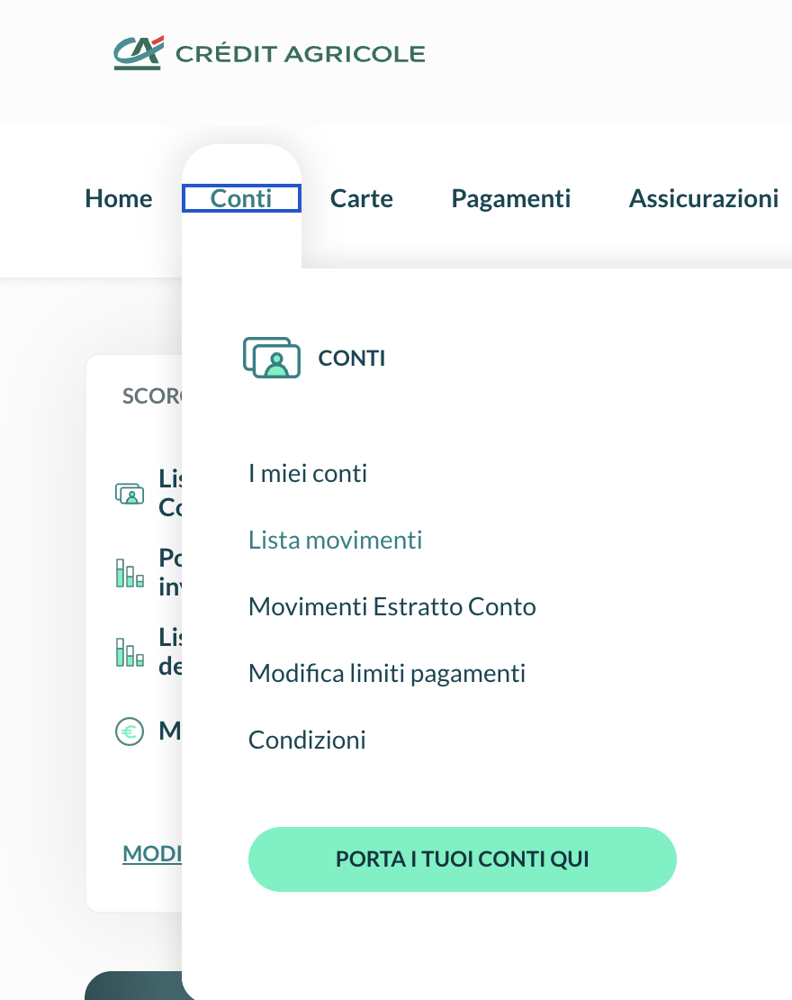
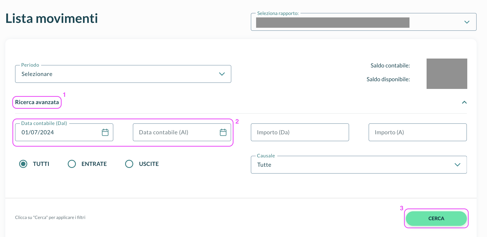
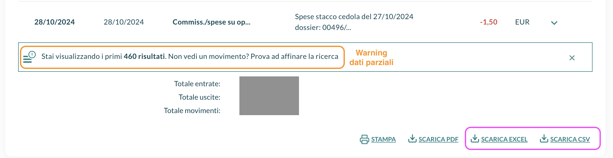
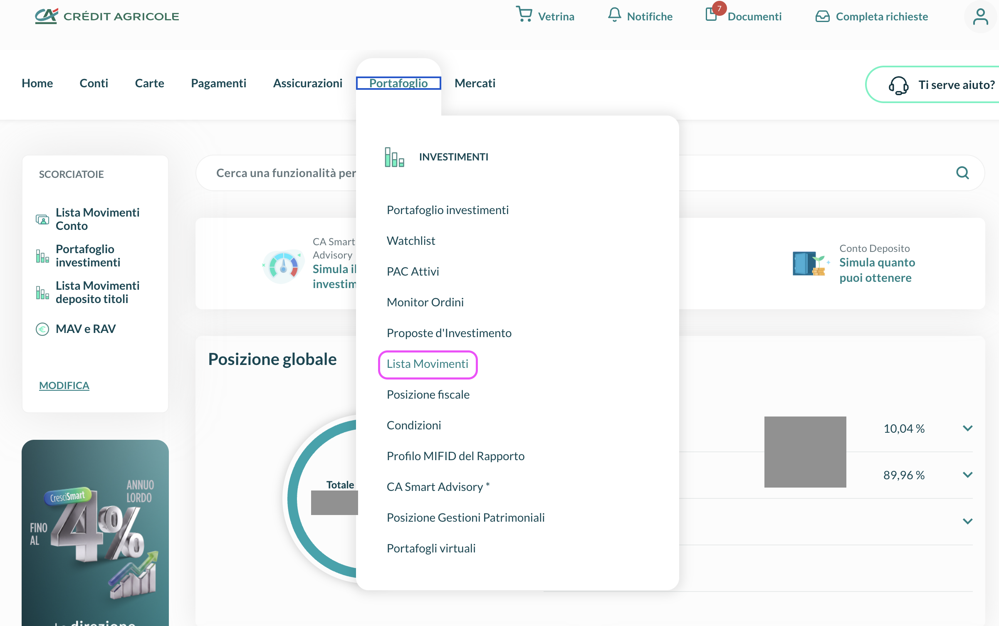
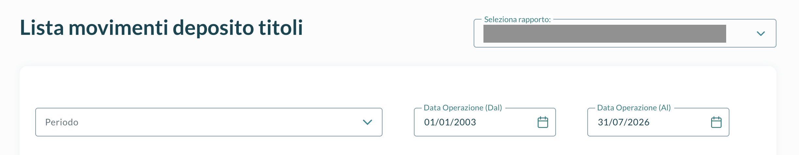
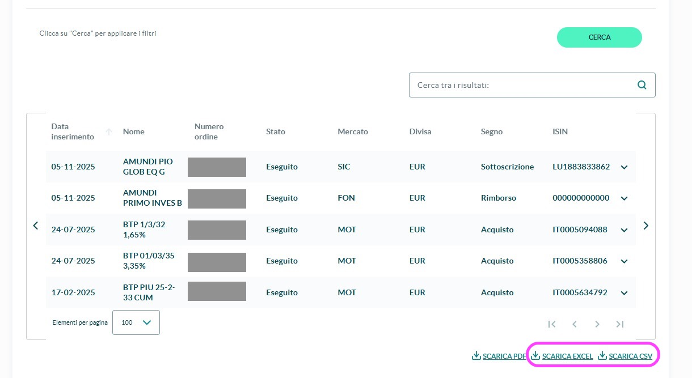

# 📥  Crédit Agricole

Crédit Agricole is both your **bank and your broker**, and it shows the same operations in two lists: a coupon, a purchase, a fund redemption or a matured bond appears in the list of your **securities** and in the list of your **account**. To import them without counting anything twice, download **both lists and upload them together**: LibreFolio recognises that two rows are the same operation and imports it once, with the cash that really moved on your account.

!!! warning "Upload both files together"

    A single Crédit Agricole file uploaded alone is not imported. The wizard tells you which export is missing: add it in the same upload and carry on.

## 💳 Export the account movements

This is the list of your real cash — salary or pension, transfers, bills, taxes, fees, coupons and dividends — for the last **two years**.

!!! tip "Prefer the Excel file"

    **SCARICA EXCEL** adds, above the table, your **Saldo Iniziale** and **Saldo Finale** (the balance at the start and at the end of the period). LibreFolio uses them to start your cash from the right amount and to check it against the bank. The CSV has no balances.

### 📄 Step 1 — Open the movement list

In online banking, open **Conti** in the top menu and choose **Lista movimenti**. If you have several accounts, pick yours in **Seleziona rapporto**.

{ style="max-height: 460px; width: auto; border-radius: 8px; box-shadow: 0 4px 16px rgba(0,0,0,0.15);" }

### 🗓️ Step 2 — Choose the period

Click **Ricerca avanzata**, set **Data contabile (Dal)** and **Data contabile (Al)** to the widest window the bank allows (two years), then click **CERCA**.

{ style="max-height: 460px; width: auto; border-radius: 8px; box-shadow: 0 4px 16px rgba(0,0,0,0.15);" }

### 💾 Step 3 — Download the file

Below the list, click **SCARICA EXCEL** (better) or **SCARICA CSV**, and import the file without opening or editing it.

{ style="max-height: 460px; width: auto; border-radius: 8px; box-shadow: 0 4px 16px rgba(0,0,0,0.15);" }

??? warning "✂️ Export in blocks — when the bank shows only the first results"

    When the list says **Stai visualizzando i primi … risultati**, it has been cut and the oldest movements are missing. Export the period in blocks:

    1. Download the block as it is.
    2. Note the date of its **oldest** movement.
    3. Set **Data contabile (Al)** to that date, click **CERCA** and download again.
    4. Repeat until a block reaches the start of your period.

    Upload all the blocks together with the securities file. You can download the same period more than once, and blocks may overlap: a row that is in two files counts once, and when two files cover the same day the one with more rows is used.

## 📂 Export the securities movements

The list of what happened in your securities account: coupons, purchases, fund redemptions, matured bonds and securities transferred in from another dossier.

### 📂 Step 1 — Open the securities movements

Open **Portafoglio** in the top menu and choose **Lista Movimenti**.

{ style="max-height: 460px; width: auto; border-radius: 8px; box-shadow: 0 4px 16px rgba(0,0,0,0.15);" }

### 🗓️ Step 2 — Choose the period

Set **Data Operazione (Dal)** and **Data Operazione (Al)** so that the period covers the one of your account export — a little wider is fine. Operations older than the start of the account export cannot be imported with their cash, because the cash of that time is not in the account list: they are listed in a warning so you can enter them by hand.

{ style="max-height: 460px; width: auto; border-radius: 8px; box-shadow: 0 4px 16px rgba(0,0,0,0.15);" }

### 💾 Step 3 — Download the file

Click **CERCA**, then **SCARICA EXCEL** or **SCARICA CSV**, and import the file as it is.

{ style="max-height: 460px; width: auto; border-radius: 8px; box-shadow: 0 4px 16px rgba(0,0,0,0.15);" }

## 🧺 Upload the set

Upload the account file(s) and the securities file(s) in the same upload. The import wizard shows them as one **set** with the two exports, how many rows each has and the period it covers. If one is missing it says so (**A file is missing**) and offers **Upload the missing file**.

Then, in the analysis step, the **Matching securities ↔ cash** panel shows what LibreFolio did with every row:

- **pairs** — an operation found in both lists, imported once;
- **standalone rows** — rows imported on their own: everything of the account that has no counterpart in the securities list (salary, bills, fees…) and the securities moved in from another dossier;
- **excluded** — rows that are *not* imported, each with its reason (below).

### 🔄 How a pair is imported

LibreFolio looks for the same kind of operation, the same amount (to the cent) and the same **value date** in the two lists. For example, with invented numbers:

| Securities list | Account list | Imported |
|:----------------|:-------------|:---------|
| `CEDOLA`, BTP Demo 2033, 87.50, value date 22/03 | Coupon of BTP Demo 2033, 87.50 credited, withholding (`RITENUTA`) 12.50, value date 22/03 | **Interest** 100.00, plus a **Tax** of −12.50 |
| `ACQ.CONT.SU MERC.`, BTP Demo 2033, 5,010.00, value date 10/03 | Debit of 5,010.00, value date 10/03 | **Buy**, with a cash amount of −5,010.00 |

The date of the transaction is always the **operation date** (the day the order was given or the coupon was booked), never the value date; the two can differ by days. The cash is the one of your account, so no automatic Deposit or Withdrawal is added.

LibreFolio never guesses: when two rows could be the same operation and there is no way to tell, it leaves them out and says so.

## 🚫 Rows that are left out

Left-out rows are listed in an amber warning with the rows in detail, so you can add them by hand if they are real movements:

| Reason | What it means | What to do |
|:-------|:--------------|:-----------|
| No counterpart | A securities row with cash that has no matching row in the account list | Check that the account export covers that day; otherwise enter the operation by hand |
| Ambiguous | Several rows could be the same operation | Enter the real movements by hand |
| Not settled yet | The cash arrives after the last day of the account export | Nothing: the row comes with your next import |
| Settled before the cash statement starts | No account file covers the day the cash moved | Download the account list for that period, or enter it by hand |
| Replaced by a newer file | Another file for the same days has more rows | Nothing |
| Unknown type | A securities operation that LibreFolio does not know | Open an issue with the link under the warning |

An account row is never left out for lack of a partner: it is real cash that moved, so it is always imported (only a row whose amount cannot be read is skipped, with a warning).

## 🕳️ A month with no account file

Imagine the account file ends on 30 June with a balance of 1,000.00 and the next one starts on 1 August with a starting balance of 900.00. Nothing says what happened in July: July is a **hole**. LibreFolio sees that the balances differ by −100.00 over a period that no file covers, tells you (**No account export covers 01/07 – 31/07**) and, in the **Align with the bank** step, proposes a cash correction of −100.00 on 31/07 (**After the gap**).

What to do:

- If the bank still has July, **download the account list for it and upload it with the others**: the balances then add up, and the correction disappears by itself.
- If you cannot, keep the correction: your cash will then match the bank.

The same step shows a **Starting point** — the cash and the positions at the beginning of the account export — and an **End-of-period check** with the bank's balance at the end of each file. A check that **does not match** is never corrected automatically: if the rows are all there, it usually means a movement is missing or was left out above.

!!! note "Balances that do not add up"

    When the balances of two files differ although movements are present in between, LibreFolio does not correct anything: it warns you that the balances do not add up, and compares them only. Check that no export is missing a day, or was cut halfway.

!!! info "Account file without balances"

    With only the **CSV** of the account (or an Excel without balances) LibreFolio cannot start or check your cash. In that case add the starting balance yourself: read **Saldo Iniziale** and **Data dal** in the bank's Excel export and add a **Deposit** of that amount on that date with the [transaction form](../form.md).

## 🔄 What gets imported

| In the exports | Imported as |
|:---------------|:------------|
| Coupon found in both lists | **Interest**, with a stated withholding (`RITENUTA`) as a separate **Tax** |
| Purchase found in both lists (`ACQ.CONT.SU MERC.`, `SICAV: SOTTOSCR`) | **Buy** |
| Fund redemption found in both lists (`FONDI: RIMBORSO`) | **Sell** |
| Matured bond found in both lists (`TITOLI SCADUTI`) | **Sell** at par (100), plus **Interest** for any amount paid above par |
| `GIRO ALTRO DOSSIER`, `VERS.TITOLI` | **Adjustment**: securities moved in from another dossier, such as an inheritance, at their book price and without cash |
| Salary or pension, card payments, bills, cash withdrawals, transfers | **Deposit** or **Withdrawal**, by the sign of the amount |
| Coupons and dividends with no securities row | **Interest** or **Dividend**, linked to the security when the line gives its ISIN |
| Account interest and the monthly fee (`INTERESSI/COMPETENZE`) | **Interest** when credited, **Fee** when charged |
| Commissions and charges | **Fee**, or **Tax** for capital gains tax, stamp duty and withholdings |
| Buys and sells of securities that have no securities row | **Buy** or **Sell** when the coupons of the same bond give the quantity; otherwise a cash row for you to complete |
| A fund redemption paid by bank transfer with no securities row | A **Deposit** for you to complete: the bank states the money, not the units sold |
| Any other operation | **Deposit** or **Withdrawal** by sign, listed in a notice so you can check it |

## ⚠️ Good to know

- **Some rows ask for your help** in the **Corrections** step of the wizard ([how it works](how-to.md#only-when-needed)):
    - trades without a quantity, and fund redemptions: pick the type, the security and the quantity;
    - trades whose amount may include accrued interest and commissions: add them under **Separate the price from the charges?**, from your contract note (*nota informativa*);
    - charges that name no security: assign them, or keep them on the account.
- **Securities are matched by name.** The securities export gives no ISIN: match each security in the **Resolve Assets** panel of [Review](how-to.md#review).
- **Amounts as written**, in the currency of each row, with no conversion. Dates are the operation dates.
- **Messages in Italian.** Most of the importer's notices about these files are in Italian, like the report.

## 🔗 Developer Reference

→ [Crédit Agricole Importer — Implementation details](../../../developer/backend/brim/credit_agricole.md)
