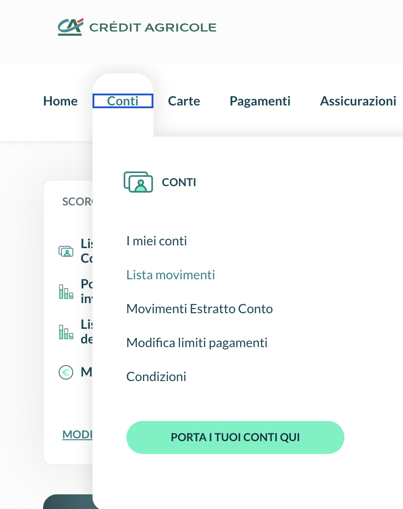
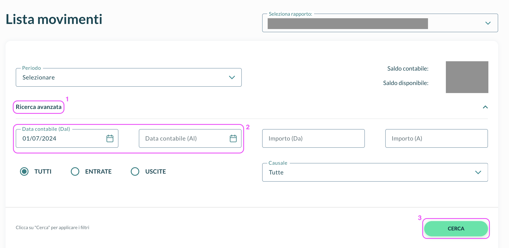
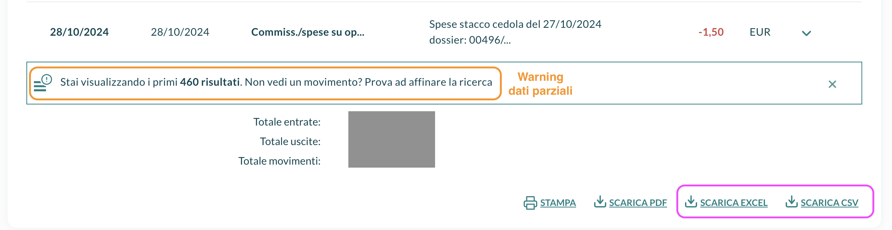
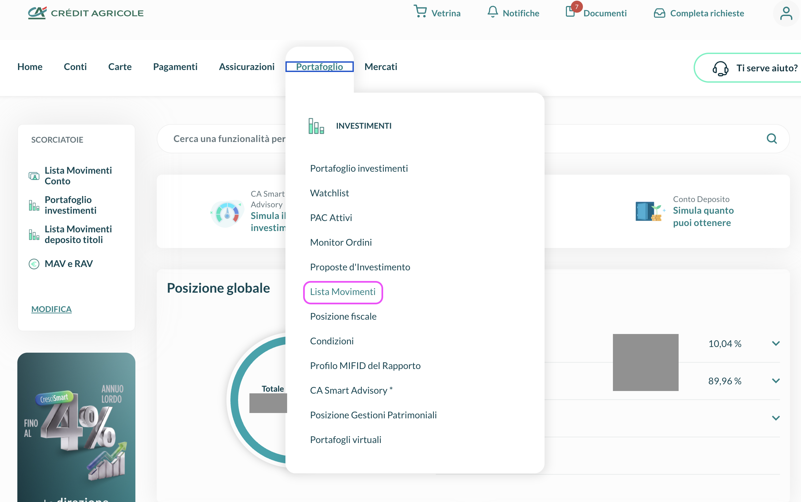
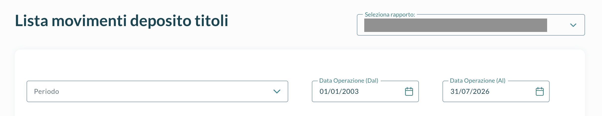
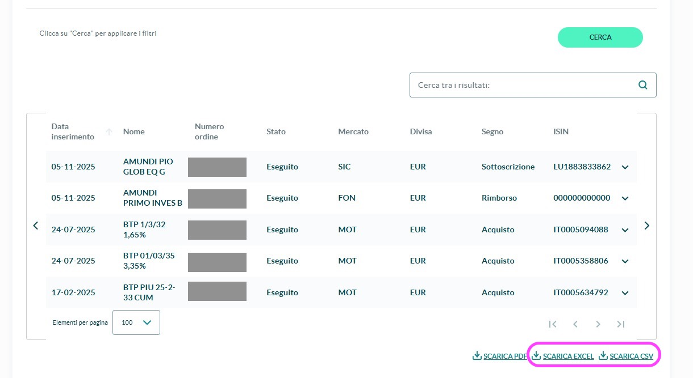

# 📥  Crédit Agricole

Crédit Agricole es a la vez tu **banco y tu bróker**, y muestra las mismas operaciones en dos listas: un cupón, una compra, un reembolso de fondo o un bono vencido aparece en la lista de tus **valores** y en la lista de tu **cuenta**. Para importarlos sin contar nada dos veces, descarga **ambas listas y súbelas juntas**: LibreFolio reconoce que dos filas son la misma operación y la importa una sola vez, con el efectivo que realmente se movió en tu cuenta.

!!! warning "Sube ambos archivos juntos"

    Un solo archivo de Crédit Agricole subido por sí solo no se importa. El asistente te indica qué exportación falta: añádela en la misma subida y continúa.

## 💳 Exporta los movimientos de la cuenta

Esta es la lista de tu efectivo real — salario o pensión, transferencias, facturas, impuestos, comisiones, cupones y dividendos — de los últimos **dos años**.

!!! tip "Prefiere el archivo Excel"

    **SCARICA EXCEL** añade, encima de la tabla, tu **Saldo Iniziale** y **Saldo Finale** (el saldo al inicio y al final del periodo). LibreFolio los usa para iniciar tu efectivo desde el importe correcto y para comprobarlo con el banco. El CSV no tiene saldos.

### 📄 Paso 1 — Abre la lista de movimientos

En la banca en línea, abre **Conti** en el menú superior y elige **Lista movimenti**. Si tienes varias cuentas, elige la tuya en **Seleziona rapporto**.

{ style="max-height: 460px; width: auto; border-radius: 8px; box-shadow: 0 4px 16px rgba(0,0,0,0.15);" }

### 🗓️ Paso 2 — Elige el periodo

Haz clic en **Ricerca avanzata**, establece **Data contabile (Dal)** y **Data contabile (Al)** en la ventana más amplia que permita el banco (dos años) y luego haz clic en **CERCA**.

{ style="max-height: 460px; width: auto; border-radius: 8px; box-shadow: 0 4px 16px rgba(0,0,0,0.15);" }

### 💾 Paso 3 — Descarga el archivo

Debajo de la lista, haz clic en **SCARICA EXCEL** (mejor) o en **SCARICA CSV**, e importa el archivo sin abrirlo ni editarlo.

{ style="max-height: 460px; width: auto; border-radius: 8px; box-shadow: 0 4px 16px rgba(0,0,0,0.15);" }

??? warning "✂️ Exportar por bloques — cuando el banco muestra solo los primeros resultados"

    Cuando la lista dice **Stai visualizzando i primi … risultati**, se ha cortado y faltan los movimientos más antiguos. Exporta el periodo por bloques:

    1. Descarga el bloque tal como está.
    2. Anota la fecha de su movimiento **más antiguo**.
    3. Establece **Data contabile (Al)** en esa fecha, haz clic en **CERCA** y vuelve a descargar.
    4. Repite hasta que un bloque llegue al inicio de tu periodo.

    Sube todos los bloques junto con el archivo de valores. Puedes descargar el mismo periodo más de una vez, y los bloques pueden solaparse: una fila que está en dos archivos cuenta una sola vez, y cuando dos archivos cubren el mismo día se usa el que tiene más filas.

## 📂 Exporta los movimientos de valores

La lista de lo que ocurrió en tu cuenta de valores: cupones, compras, reembolsos de fondos, bonos vencidos y valores traspasados desde otro dossier.

### 📂 Paso 1 — Abre los movimientos de valores

Abre **Portafoglio** en el menú superior y elige **Lista Movimenti**.

{ style="max-height: 460px; width: auto; border-radius: 8px; box-shadow: 0 4px 16px rgba(0,0,0,0.15);" }

### 🗓️ Paso 2 — Elige el periodo

Establece **Data Operazione (Dal)** y **Data Operazione (Al)** de modo que el periodo cubra el de tu exportación de la cuenta — un poco más amplio no pasa nada. Las operaciones anteriores al inicio de la exportación de la cuenta no se pueden importar con su efectivo, porque el efectivo de esa época no está en la lista de la cuenta: se muestran en un aviso para que puedas introducirlas a mano.

{ style="max-height: 460px; width: auto; border-radius: 8px; box-shadow: 0 4px 16px rgba(0,0,0,0.15);" }

### 💾 Paso 3 — Descarga el archivo

Haz clic en **CERCA**, luego en **SCARICA EXCEL** o en **SCARICA CSV**, e importa el archivo tal como está.

{ style="max-height: 460px; width: auto; border-radius: 8px; box-shadow: 0 4px 16px rgba(0,0,0,0.15);" }

## 🧺 Sube el conjunto

Sube el archivo o los archivos de la cuenta y el archivo o los archivos de valores en la misma subida. El asistente de importación los muestra como un **conjunto** con las dos exportaciones, cuántas filas tiene cada una y el periodo que cubre. Si falta una, lo indica (**Falta un archivo**) y ofrece **Subir el archivo que falta**.

Después, en el paso de análisis, el panel **Emparejamiento de valores ↔ efectivo** muestra lo que hizo LibreFolio con cada fila:

- **parejas** — una operación encontrada en ambas listas, importada una sola vez;
- **filas sueltas** — filas importadas por sí solas: todo lo de la cuenta que no tiene contrapartida en la lista de valores (salario, facturas, comisiones…) y los valores traspasados desde otro dossier;
- **excluidas** — filas que *no* se importan, cada una con su motivo (más abajo).

### 🔄 Cómo se importa una pareja

LibreFolio busca el mismo tipo de operación, el mismo importe (al céntimo) y la misma **fecha valor** en las dos listas. Por ejemplo, con números inventados:

| Lista de valores | Lista de la cuenta | Importado |
|:----------------|:-------------|:---------|
| `CEDOLA`, BTP Demo 2033, 87.50, fecha valor 22/03 | Cupón de BTP Demo 2033, 87.50 abonado, retención (`RITENUTA`) 12.50, fecha valor 22/03 | **Interés** 100.00, más un **Impuesto** de −12.50 |
| `ACQ.CONT.SU MERC.`, BTP Demo 2033, 5,010.00, fecha valor 10/03 | Cargo de 5,010.00, fecha valor 10/03 | **Compra**, con un importe de efectivo de −5,010.00 |

La fecha de la transacción es siempre la **fecha de operación** (el día en que se dio la orden o se contabilizó el cupón), nunca la fecha valor; las dos pueden diferir en días. El efectivo es el de tu cuenta, así que no se añade ningún depósito ni retiro automático.

LibreFolio nunca adivina: cuando dos filas podrían ser la misma operación y no hay forma de saberlo, las deja fuera y lo indica.

## 🚫 Filas que se quedan fuera

Las filas excluidas se muestran en un aviso ámbar con el detalle de las filas, para que puedas añadirlas a mano si son movimientos reales:

| Motivo | Qué significa | Qué hacer |
|:-------|:--------------|:-----------|
| Sin contrapartida | Una fila de valores con efectivo que no tiene fila correspondiente en la lista de la cuenta | Comprueba que la exportación de la cuenta cubre ese día; si no, introduce la operación a mano |
| Ambigua | Varias filas podrían ser la misma operación | Introduce los movimientos reales a mano |
| Aún no liquidada | El efectivo llega después del último día de la exportación de la cuenta | Nada: la fila llegará con tu próxima importación |
| Liquidada antes de que empiece el extracto de la cuenta de efectivo | Ningún archivo de la cuenta cubre el día en que se movió el efectivo | Descarga la lista de la cuenta de ese periodo o introdúcela a mano |
| Reemplazada por un archivo más reciente | Otro archivo para los mismos días tiene más filas | Nada |
| Tipo desconocido | Una operación de valores que LibreFolio no conoce | Abre una incidencia con el enlace que hay bajo el aviso |

Una fila de la cuenta nunca se queda fuera por falta de pareja: es efectivo real que se movió, así que siempre se importa (solo se omite una fila cuyo importe no se puede leer, con un aviso).

## 🕳️ Un mes sin archivo de la cuenta

Imagina que el archivo de la cuenta termina el 30 de junio con un saldo de 1,000.00 y el siguiente empieza el 1 de agosto con un saldo inicial de 900.00. Nada dice qué pasó en julio: julio es un **hueco**. LibreFolio ve que los saldos difieren en −100.00 a lo largo de un periodo que ningún archivo cubre, te lo dice (**Ninguna exportación de la cuenta cubre 01/07 – 31/07**) y, en el paso **Alinear con el banco**, propone una corrección de efectivo de −100.00 el 31/07 (**Después del hueco**).

Qué hacer:

- Si el banco todavía tiene julio, **descarga la lista de la cuenta de ese mes y súbela con las demás**: entonces los saldos cuadran y la corrección desaparece por sí sola.
- Si no puedes, mantén la corrección: así tu efectivo coincidirá con el banco.

El mismo paso muestra un **Punto de partida** — el efectivo y las posiciones al inicio de la exportación de la cuenta — y una **Comprobación de fin de periodo** con el saldo del banco al final de cada archivo. Una comprobación que **no coincide** nunca se corrige automáticamente: si todas las filas están ahí, normalmente significa que falta un movimiento o que se dejó fuera más arriba.

!!! note "Saldos que no cuadran"

    Cuando los saldos de dos archivos difieren aunque haya movimientos entre medias, LibreFolio no corrige nada: te avisa de que los saldos no cuadran y solo los compara. Comprueba que a ninguna exportación le falte un día o que no se haya cortado a medias.

!!! info "Archivo de la cuenta sin saldos"

    Con solo el **CSV** de la cuenta (o un Excel sin saldos) LibreFolio no puede iniciar ni comprobar tu efectivo. En ese caso, añade tú el saldo inicial: lee **Saldo Iniziale** y **Data dal** en la exportación Excel del banco y añade un **Depósito** de ese importe en esa fecha con el [formulario de transacción](../form.md).

## 🔄 Qué se importa

| En las exportaciones | Se importa como |
|:---------------|:------------|
| Cupón encontrado en ambas listas | **Interés**, con una retención indicada (`RITENUTA`) como **Impuesto** aparte |
| Compra encontrada en ambas listas (`ACQ.CONT.SU MERC.`, `SICAV: SOTTOSCR`) | **Compra** |
| Reembolso de fondo encontrado en ambas listas (`FONDI: RIMBORSO`) | **Venta** |
| Bono vencido encontrado en ambas listas (`TITOLI SCADUTI`) | **Venta** a la par (100), más **Interés** por cualquier importe pagado por encima de la par |
| `GIRO ALTRO DOSSIER`, `VERS.TITOLI` | **Ajuste**: valores traspasados desde otro dossier, como una herencia, a su precio contable y sin efectivo |
| Salario o pensión, pagos con tarjeta, facturas, retiros de efectivo, transferencias | **Depósito** o **Retiro**, según el signo del importe |
| Cupones y dividendos sin fila de valores | **Interés** o **Dividendo**, vinculados al valor cuando la línea da su ISIN |
| Intereses de la cuenta y la comisión mensual (`INTERESSI/COMPETENZE`) | **Interés** cuando se abona, **Comisión** cuando se carga |
| Comisiones y cargos | **Comisión**, o **Impuesto** para el impuesto sobre plusvalías, el impuesto de timbre y las retenciones |
| Compras y ventas de valores que no tienen fila de valores | **Compra** o **Venta** cuando los cupones del mismo bono dan la cantidad; de lo contrario, una fila de efectivo para que la completes |
| Un reembolso de fondo pagado por transferencia bancaria sin fila de valores | Un **Depósito** para que lo completes: el banco indica el dinero, no las participaciones vendidas |
| Cualquier otra operación | **Depósito** o **Retiro** según el signo, incluida en un aviso para que la compruebes |

## ⚠️ Conviene saber

- **Algunas filas piden tu ayuda** en el paso **Correcciones** del asistente ([cómo funciona](how-to.md#only-when-needed)):
    - operaciones sin cantidad y reembolsos de fondos: elige el tipo, el valor y la cantidad;
    - operaciones cuyo importe puede incluir intereses devengados y comisiones: añádelos en **¿Separar el precio de los gastos?**, a partir de tu nota de contrato (*nota informativa*);
    - gastos que no nombran ningún valor: asígnalos o déjalos en la cuenta.
- **Los valores se emparejan por nombre.** La exportación de valores no da ISIN: empareja cada valor en el panel **Resolver activos** de [Revisión](how-to.md#review).
- **Importes tal como están escritos**, en la moneda de cada fila, sin conversión. Las fechas son las fechas de operación.
- **Mensajes en italiano.** La mayoría de los avisos del importador sobre estos archivos están en italiano, igual que el informe.

## 🔗 Referencia para desarrolladores

→ [Importador de Crédit Agricole — Detalles de implementación](../../../developer/backend/brim/credit_agricole.md)
