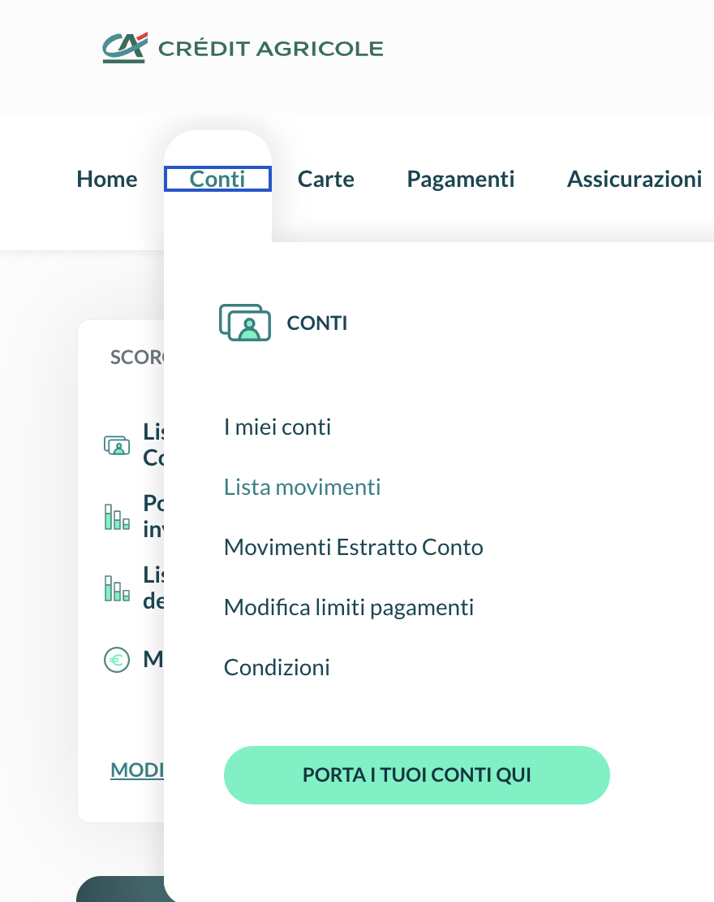
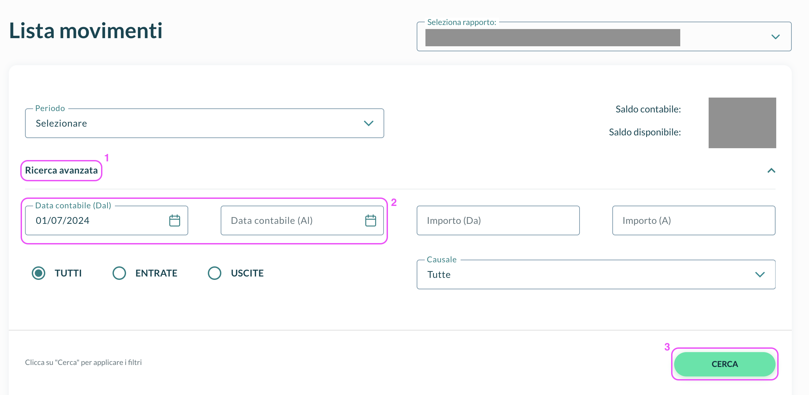
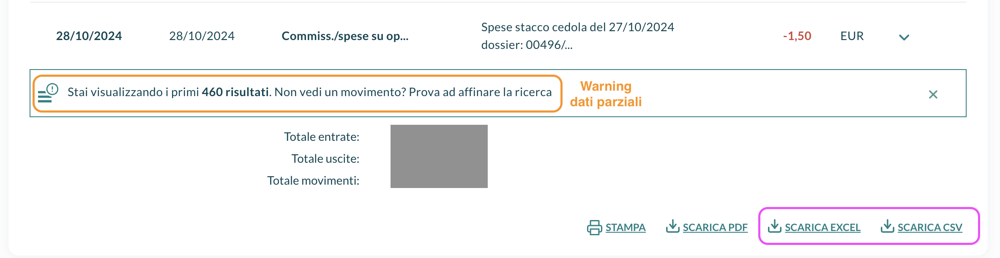
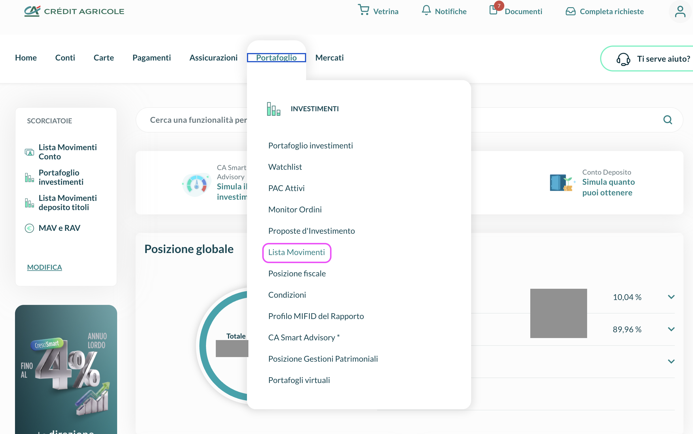
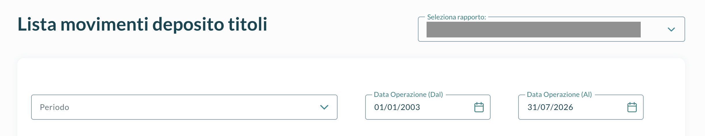
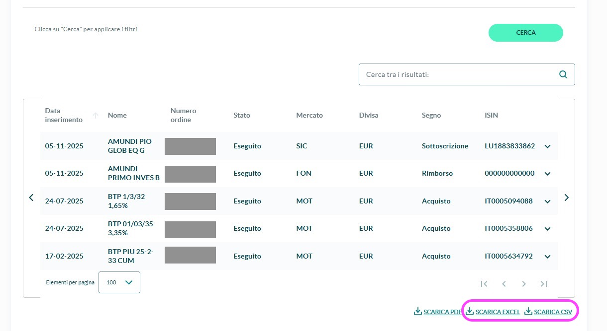

# 📥  Crédit Agricole

Crédit Agricole est à la fois votre **banque et votre courtier**, et il présente les mêmes opérations dans deux listes : un coupon, un achat, un rachat de fonds ou une obligation arrivée à échéance apparaît dans la liste de vos **titres** et dans celle de votre **compte**. Pour les importer sans compter deux fois la même chose, téléchargez **les deux listes et téléversez-les ensemble** : LibreFolio reconnaît que deux lignes correspondent à la même opération et l'importe une seule fois, avec les liquidités réellement mouvementées sur votre compte.

!!! warning "Téléversez les deux fichiers ensemble"

    Un seul fichier Crédit Agricole téléversé isolément n'est pas importé. L'assistant d'importation vous indique quel export manque : ajoutez-le au même téléversement et poursuivez.

## 💳 Exporter les mouvements du compte

Il s'agit de la liste de vos liquidités réelles — salaire ou pension, virements, factures, impôts, frais, coupons et dividendes — sur les **deux dernières années**.

!!! tip "Préférez le fichier Excel"

    **SCARICA EXCEL** ajoute, au-dessus du tableau, votre **Saldo Iniziale** et votre **Saldo Finale** (le solde au début et à la fin de la période). LibreFolio les utilise pour initialiser vos liquidités au bon montant et les comparer à celles de la banque. Le CSV ne contient pas de soldes.

### 📄 Étape 1 — Ouvrir la liste des opérations

Dans la banque en ligne, ouvrez **Conti** dans le menu principal et choisissez **Lista movimenti**. Si vous avez plusieurs comptes, sélectionnez le vôtre dans **Seleziona rapporto**.

{ style="max-height: 460px; width: auto; border-radius: 8px; box-shadow: 0 4px 16px rgba(0,0,0,0.15);" }

### 🗓️ Étape 2 — Choisir la période

Cliquez sur **Ricerca avanzata**, réglez **Data contabile (Dal)** et **Data contabile (Al)** sur la plage la plus large autorisée par la banque (deux ans), puis cliquez sur **CERCA**.

{ style="max-height: 460px; width: auto; border-radius: 8px; box-shadow: 0 4px 16px rgba(0,0,0,0.15);" }

### 💾 Étape 3 — Télécharger le fichier

En bas de la liste, cliquez sur **SCARICA EXCEL** (recommandé) ou **SCARICA CSV**, puis importez le fichier sans l'ouvrir ni le modifier.

{ style="max-height: 460px; width: auto; border-radius: 8px; box-shadow: 0 4px 16px rgba(0,0,0,0.15);" }

??? warning "✂️ Export par blocs — lorsque la banque n'affiche que les premiers résultats"

    Lorsque la liste indique **Stai visualizzando i primi … risultati**, elle a été tronquée et les mouvements les plus anciens manquent. Exportez la période par blocs :

    1. Téléchargez le bloc tel quel.
    2. Notez la date de son mouvement le plus **ancien**.
    3. Réglez **Data contabile (Al)** sur cette date, cliquez sur **CERCA** et téléchargez à nouveau.
    4. Répétez jusqu'à ce qu'un bloc atteigne le début de votre période.

    Téléversez tous les blocs avec le fichier de titres. Vous pouvez télécharger plusieurs fois la même période, et les blocs peuvent se chevaucher : une ligne présente dans deux fichiers ne compte qu'une fois, et lorsque deux fichiers couvrent le même jour, celui qui contient le plus de lignes est utilisé.

## 📂 Exporter les mouvements de titres

La liste de ce qui s'est produit sur votre compte-titres : coupons, achats, rachats de fonds, obligations arrivées à échéance et titres transférés depuis un autre dossier.

### 📂 Étape 1 — Ouvrir les mouvements de titres

Ouvrez **Portafoglio** dans le menu principal et choisissez **Lista Movimenti**.

{ style="max-height: 460px; width: auto; border-radius: 8px; box-shadow: 0 4px 16px rgba(0,0,0,0.15);" }

### 🗓️ Étape 2 — Choisir la période

Réglez **Data Operazione (Dal)** et **Data Operazione (Al)** de sorte que la période couvre celle de votre export de compte — un peu plus large ne pose pas de problème. Les opérations antérieures au début de l'export du compte ne peuvent pas être importées avec leurs liquidités, car les liquidités de cette époque ne figurent pas dans la liste du compte : elles sont signalées dans un avertissement pour que vous puissiez les saisir manuellement.

{ style="max-height: 460px; width: auto; border-radius: 8px; box-shadow: 0 4px 16px rgba(0,0,0,0.15);" }

### 💾 Étape 3 — Télécharger le fichier

Cliquez sur **CERCA**, puis sur **SCARICA EXCEL** ou **SCARICA CSV**, et importez le fichier tel quel.

{ style="max-height: 460px; width: auto; border-radius: 8px; box-shadow: 0 4px 16px rgba(0,0,0,0.15);" }

## 🧺 Téléverser l'ensemble

Téléversez le ou les fichiers de compte et le ou les fichiers de titres dans le même téléversement. L'assistant d'importation les présente comme un seul **ensemble** avec les deux exports, le nombre de lignes de chacun et la période qu'il couvre. S'il en manque un, il l'indique (**Un fichier manque**) et propose **Téléverser le fichier manquant**.

Ensuite, à l'étape d'analyse, le panneau **Correspondance titres ↔ liquidités** montre ce que LibreFolio a fait de chaque ligne :

- **paires** — une opération présente dans les deux listes, importée une seule fois ;
- **lignes autonomes** — des lignes importées seules : tout ce qui, dans le compte, n'a pas de contrepartie dans la liste des titres (salaire, factures, frais…) et les titres transférés depuis un autre dossier ;
- **exclues** — des lignes qui ne sont *pas* importées, chacune avec sa raison (ci-dessous).

### 🔄 Comment une paire est importée

LibreFolio recherche le même type d'opération, le même montant (au centime près) et la même **date de valeur** dans les deux listes. Par exemple, avec des chiffres inventés :

| Liste des titres | Liste du compte | Importé |
|:----------------|:-------------|:---------|
| `CEDOLA`, BTP Demo 2033, 87,50, date de valeur 22/03 | Coupon du BTP Demo 2033, 87,50 crédité, retenue (`RITENUTA`) 12,50, date de valeur 22/03 | **Intérêt** 100,00, plus un **Impôt** de −12,50 |
| `ACQ.CONT.SU MERC.`, BTP Demo 2033, 5 010,00, date de valeur 10/03 | Débit de 5 010,00, date de valeur 10/03 | **Achat**, avec un montant de liquidités de −5 010,00 |

La date de la transaction est toujours la **date de l'opération** (le jour où l'ordre a été donné ou le coupon a été comptabilisé), jamais la date de valeur ; les deux peuvent différer de plusieurs jours. Les liquidités sont celles de votre compte, donc aucun Dépôt ni Retrait automatique n'est ajouté.

LibreFolio ne devine jamais : lorsque deux lignes pourraient correspondre à la même opération et qu'il n'y a aucun moyen de le déterminer, il les exclut et le signale.

## 🚫 Lignes exclues

Les lignes exclues sont listées dans un avertissement ambre avec le détail des lignes, afin que vous puissiez les ajouter manuellement s'il s'agit de véritables mouvements :

| Raison | Signification | Que faire |
|:-------|:--------------|:-----------|
| Aucune contrepartie | Une ligne de titres comportant des liquidités et sans ligne correspondante dans la liste du compte | Vérifiez que l'export du compte couvre ce jour ; sinon, saisissez l'opération manuellement |
| Ambigu | Plusieurs lignes pourraient correspondre à la même opération | Saisissez les mouvements réels manuellement |
| Pas encore réglé | Les liquidités arrivent après le dernier jour de l'export du compte | Rien : la ligne sera incluse dans votre prochain import |
| Réglé avant le début du relevé du compte espèces | Aucun fichier de compte ne couvre le jour du mouvement de liquidités | Téléchargez la liste du compte pour cette période, ou saisissez l'opération manuellement |
| Remplacée par un fichier plus récent | Un autre fichier couvrant les mêmes jours contient plus de lignes | Rien |
| Type inconnu | Une opération sur titres que LibreFolio ne connaît pas | Ouvrez un ticket à l'aide du lien situé sous l'avertissement |

Une ligne de compte n'est jamais exclue faute de contrepartie : comme il s'agit de véritables liquidités mouvementées, elle est toujours importée (seule une ligne dont le montant ne peut pas être lu est ignorée, avec un avertissement).

## 🕳️ Un mois sans fichier de compte

Imaginez que le fichier de compte se termine le 30 juin avec un solde de 1 000,00 et que le suivant commence le 1er août avec un solde initial de 900,00. Rien n'indique ce qui s'est passé en juillet : juillet est un **trou**. LibreFolio constate que les soldes diffèrent de −100,00 sur une période qu'aucun fichier ne couvre, vous le signale (**Aucun export de compte ne couvre le 01/07 – 31/07**) et, à l'étape **Aligner avec la banque**, propose une correction de liquidités de −100,00 au 31/07 (**Après l'écart**).

Que faire :

- Si la banque dispose encore de juillet, **téléchargez la liste du compte pour ce mois et téléversez-la avec les autres** : les soldes concordent alors, et la correction disparaît d'elle-même.
- Si vous ne pouvez pas, conservez la correction : vos liquidités correspondront alors à celles de la banque.

La même étape affiche un **Point de départ** — les liquidités et les positions au début de l'export du compte — ainsi qu'un **Contrôle de fin de période** avec le solde de la banque à la fin de chaque fichier. Un contrôle qui **ne concorde pas** n'est jamais corrigé automatiquement : si toutes les lignes sont présentes, cela signifie généralement qu'un mouvement manque ou a été exclu ci-dessus.

!!! note "Des soldes qui ne concordent pas"

    Lorsque les soldes de deux fichiers diffèrent alors que des mouvements sont présents entre les deux, LibreFolio ne corrige rien : il vous avertit que les soldes ne concordent pas et se contente de les comparer. Vérifiez qu'aucun export ne manque un jour ou n'a été coupé en cours de route.

!!! info "Fichier de compte sans soldes"

    Avec uniquement le **CSV** du compte (ou un Excel sans soldes), LibreFolio ne peut ni initialiser ni contrôler vos liquidités. Dans ce cas, ajoutez vous-même le solde initial : relevez **Saldo Iniziale** et **Data dal** dans l'export Excel de la banque et ajoutez un **Dépôt** de ce montant à cette date avec le [formulaire de transaction](../form.md).

## 🔄 Ce qui est importé

| Dans les exports | Importé comme |
|:---------------|:------------|
| Coupon présent dans les deux listes | **Intérêt**, avec une retenue indiquée (`RITENUTA`) sous forme d'un **Impôt** distinct |
| Achat présent dans les deux listes (`ACQ.CONT.SU MERC.`, `SICAV: SOTTOSCR`) | **Achat** |
| Rachat de fonds présent dans les deux listes (`FONDI: RIMBORSO`) | **Vente** |
| Obligation arrivée à échéance présente dans les deux listes (`TITOLI SCADUTI`) | **Vente** au pair (100), plus **Intérêt** pour tout montant payé au-dessus du pair |
| `GIRO ALTRO DOSSIER`, `VERS.TITOLI` | **Ajustement** : titres transférés depuis un autre dossier, par exemple une succession, à leur valeur comptable et sans liquidités |
| Salaire ou pension, paiements par carte, factures, retraits d'espèces, virements | **Dépôt** ou **Retrait**, selon le signe du montant |
| Coupons et dividendes sans ligne de titres | **Intérêt** ou **Dividende**, rattaché au titre lorsque la ligne indique son ISIN |
| Intérêts du compte et frais mensuels (`INTERESSI/COMPETENZE`) | **Intérêt** en cas de crédit, **Frais** en cas de débit |
| Commissions et frais | **Frais**, ou **Impôt** pour l'impôt sur les plus-values, les droits de timbre et les retenues |
| Achats et ventes de titres sans ligne de titres | **Achat** ou **Vente** lorsque les coupons de la même obligation donnent la quantité ; sinon, une ligne de liquidités à compléter par vos soins |
| Un rachat de fonds payé par virement sans ligne de titres | Un **Dépôt** à compléter par vos soins : la banque indique le montant, pas les parts vendues |
| Toute autre opération | **Dépôt** ou **Retrait** selon le signe, signalé dans un avis pour que vous puissiez le vérifier |

## ⚠️ Bon à savoir

- **Certaines lignes nécessitent votre intervention** à l'étape **Corrections** de l'assistant d'importation ([comment cela fonctionne](how-to.md#only-when-needed)) :
    - les transactions sans quantité et les rachats de fonds : choisissez le type, le titre et la quantité ;
    - les transactions dont le montant peut inclure des intérêts courus et des commissions : ajoutez-les sous **Séparer le prix des frais ?**, d'après votre note d'information (*nota informativa*) ;
    - les frais qui ne désignent aucun titre : affectez-les, ou conservez-les sur le compte.
- **Les titres sont mis en correspondance par leur nom.** L'export des titres ne fournit pas d'ISIN : associez chaque titre dans le panneau **Résoudre les actifs** de [Vérification](how-to.md#review).
- **Montants tels qu'écrits**, dans la devise de chaque ligne, sans conversion. Les dates sont celles des opérations.
- **Messages en italien.** La plupart des notifications de l'importateur concernant ces fichiers sont en italien, comme le rapport.

## 🔗 Référence développeur

→ [Importateur Crédit Agricole — Détails d'implémentation](../../../developer/backend/brim/credit_agricole.md)
