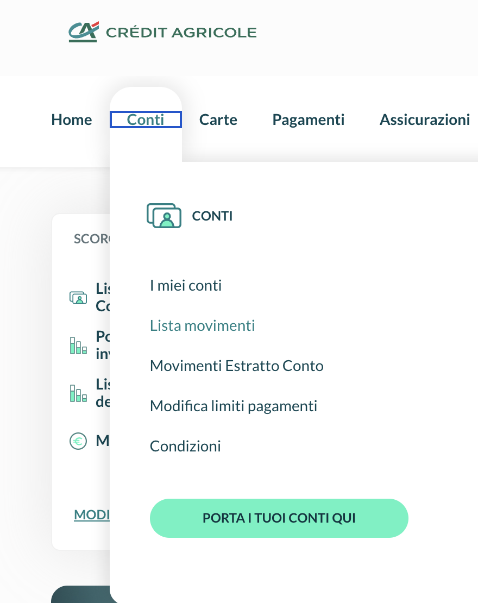
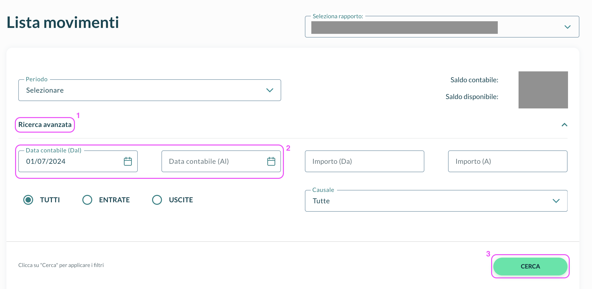
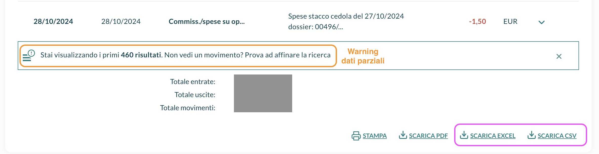
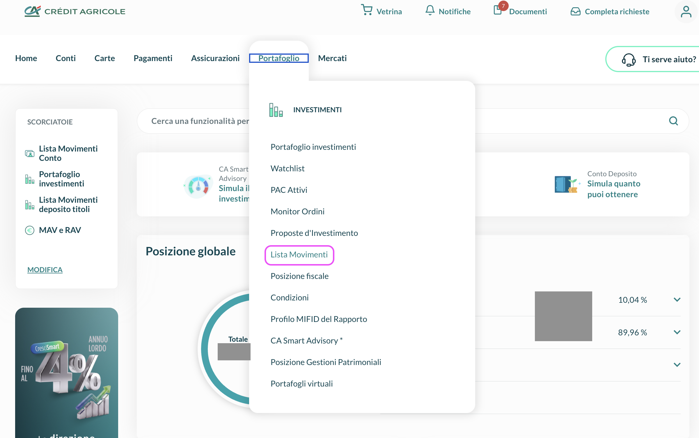
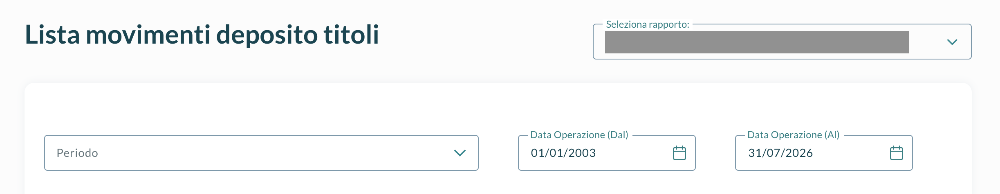
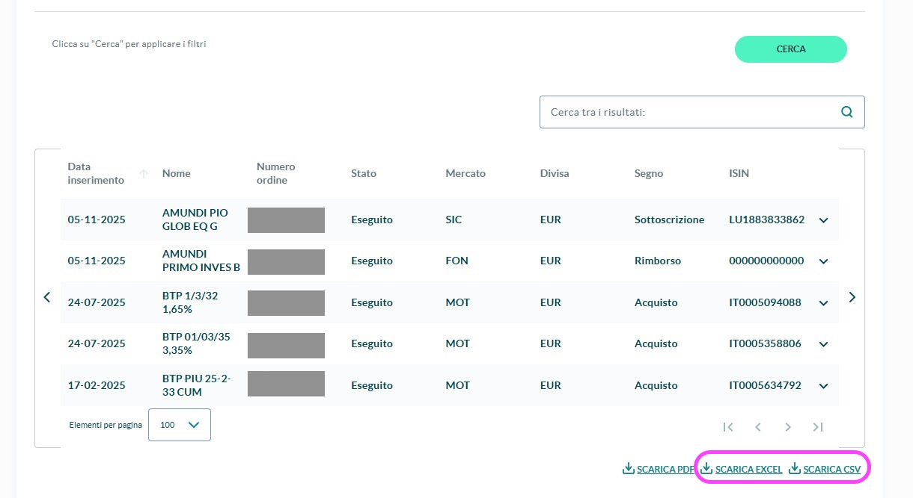

# 📥  Crédit Agricole

Crédit Agricole è sia **la tua banca che il tuo broker**, e mostra le stesse operazioni in due elenchi: una cedola, un acquisto, un rimborso di fondo o un'obbligazione a scadenza compare nell'elenco dei tuoi **titoli** e in quello del tuo **conto**. Per importarli senza contare nulla due volte, scarica **entrambi gli elenchi e caricali insieme**: LibreFolio riconosce che due righe sono la stessa operazione e la importa una sola volta, con la liquidità che si è realmente mossa sul tuo conto.

!!! warning "Carica entrambi i file insieme"

    Un singolo file Crédit Agricole caricato da solo non viene importato. La procedura guidata ti indica quale esportazione manca: aggiungila nello stesso caricamento e continua.

## 💳 Esporta i movimenti del conto

Questo è l'elenco della tua liquidità reale — stipendio o pensione, bonifici, bollette, imposte, commissioni, cedole e dividendi — degli ultimi **due anni**.

!!! tip "Preferisci il file Excel"

    **SCARICA EXCEL** aggiunge, sopra la tabella, il tuo **Saldo Iniziale** e **Saldo Finale** (il saldo all'inizio e alla fine del periodo). LibreFolio li usa per far partire la tua liquidità dall'importo corretto e per verificarla rispetto alla banca. Il CSV non contiene saldi.

### 📄 Passaggio 1 — Apri l'elenco dei movimenti

Nell'home banking, apri **Conti** nel menu in alto e scegli **Lista movimenti**. Se hai più conti, seleziona il tuo in **Seleziona rapporto**.

{ style="max-height: 460px; width: auto; border-radius: 8px; box-shadow: 0 4px 16px rgba(0,0,0,0.15);" }

### 🗓️ Passaggio 2 — Scegli il periodo

Fai clic su **Ricerca avanzata**, imposta **Data contabile (Dal)** e **Data contabile (Al)** sull'intervallo più ampio consentito dalla banca (due anni), quindi fai clic su **CERCA**.

{ style="max-height: 460px; width: auto; border-radius: 8px; box-shadow: 0 4px 16px rgba(0,0,0,0.15);" }

### 💾 Passaggio 3 — Scarica il file

Sotto l'elenco, fai clic su **SCARICA EXCEL** (meglio) o **SCARICA CSV**, e importa il file senza aprirlo né modificarlo.

{ style="max-height: 460px; width: auto; border-radius: 8px; box-shadow: 0 4px 16px rgba(0,0,0,0.15);" }

??? warning "✂️ Esporta a blocchi — quando la banca mostra solo i primi risultati"

    Quando l'elenco dice **Stai visualizzando i primi … risultati**, è stato tagliato e mancano i movimenti più vecchi. Esporta il periodo a blocchi:

    1. Scarica il blocco così com'è.
    2. Annota la data del suo movimento **più vecchio**.
    3. Imposta **Data contabile (Al)** su quella data, fai clic su **CERCA** e scarica di nuovo.
    4. Ripeti finché un blocco non raggiunge l'inizio del tuo periodo.

    Carica tutti i blocchi insieme al file dei titoli. Puoi scaricare lo stesso periodo più di una volta e i blocchi possono sovrapporsi: una riga presente in due file viene contata una sola volta e, quando due file coprono lo stesso giorno, viene usato quello con più righe.

## 📂 Esporta i movimenti dei titoli

L'elenco di ciò che è accaduto nel tuo conto titoli: cedole, acquisti, rimborsi di fondi, obbligazioni a scadenza e titoli trasferiti da un altro dossier.

### 📂 Passaggio 1 — Apri i movimenti dei titoli

Apri **Portafoglio** nel menu in alto e scegli **Lista Movimenti**.

{ style="max-height: 460px; width: auto; border-radius: 8px; box-shadow: 0 4px 16px rgba(0,0,0,0.15);" }

### 🗓️ Passaggio 2 — Scegli il periodo

Imposta **Data Operazione (Dal)** e **Data Operazione (Al)** in modo che il periodo copra quello dell'esportazione del conto — un po' più ampio va bene. Le operazioni precedenti all'inizio dell'esportazione del conto non possono essere importate con la loro liquidità, perché la liquidità di quel periodo non è nell'elenco del conto: sono elencate in un avviso così puoi inserirle manualmente.

{ style="max-height: 460px; width: auto; border-radius: 8px; box-shadow: 0 4px 16px rgba(0,0,0,0.15);" }

### 💾 Passaggio 3 — Scarica il file

Fai clic su **CERCA**, poi su **SCARICA EXCEL** o **SCARICA CSV**, e importa il file così com'è.

{ style="max-height: 460px; width: auto; border-radius: 8px; box-shadow: 0 4px 16px rgba(0,0,0,0.15);" }

## 🧺 Carica il set

Carica il/i file del conto e il/i file dei titoli nello stesso caricamento. La procedura guidata di importazione li mostra come un unico **set** con le due esportazioni, quante righe ha ciascuna e il periodo coperto. Se ne manca uno lo segnala (**Manca un file**) e offre **Carica il file mancante**.

Poi, nel passaggio di analisi, il pannello **Abbinamento titoli ↔ liquidità** mostra cosa ha fatto LibreFolio con ogni riga:

- **coppie** — un'operazione presente in entrambi gli elenchi, importata una sola volta;
- **righe autonome** — righe importate da sole: tutto ciò che nel conto non ha una contropartita nell'elenco titoli (stipendio, bollette, commissioni…) e i titoli trasferiti da un altro dossier;
- **escluse** — righe che *non* vengono importate, ciascuna con il suo motivo (sotto).

### 🔄 Come viene importata una coppia

LibreFolio cerca lo stesso tipo di operazione, lo stesso importo (al centesimo) e la stessa **data valuta** nei due elenchi. Per esempio, con numeri inventati:

| Elenco titoli | Elenco conto | Importato |
|:----------------|:-------------|:---------|
| `CEDOLA`, BTP Demo 2033, 87,50, data valuta 22/03 | Cedola di BTP Demo 2033, 87,50 accreditati, ritenuta (`RITENUTA`) 12,50, data valuta 22/03 | **Interesse** 100,00, più una **Imposta** di −12,50 |
| `ACQ.CONT.SU MERC.`, BTP Demo 2033, 5.010,00, data valuta 10/03 | Addebito di 5.010,00, data valuta 10/03 | **Acquisto**, con un importo di liquidità di −5.010,00 |

La data della transazione è sempre la **data operazione** (il giorno in cui è stato impartito l'ordine o è stata registrata la cedola), mai la data valuta; le due possono differire di giorni. La liquidità è quella del tuo conto, quindi non viene aggiunto alcun Deposito o Prelievo automatico.

LibreFolio non tira mai a indovinare: quando due righe potrebbero essere la stessa operazione e non c'è modo di distinguerle, le lascia fuori e lo segnala.

## 🚫 Righe escluse

Le righe escluse sono elencate in un avviso color ambra con il dettaglio delle righe, così puoi aggiungerle manualmente se sono movimenti reali:

| Motivo | Cosa significa | Cosa fare |
|:-------|:--------------|:-----------|
| Nessuna contropartita | Una riga titoli con liquidità che non ha una riga corrispondente nell'elenco del conto | Verifica che l'esportazione del conto copra quel giorno; altrimenti inserisci l'operazione manualmente |
| Ambigua | Più righe potrebbero essere la stessa operazione | Inserisci manualmente i movimenti reali |
| Non ancora regolata | La liquidità arriva dopo l'ultimo giorno dell'esportazione del conto | Nulla: la riga arriverà con la prossima importazione |
| Regolata prima dell'inizio dell'estratto del conto | Nessun file del conto copre il giorno in cui si è mossa la liquidità | Scarica l'elenco del conto per quel periodo, oppure inserisci l'operazione manualmente |
| Sostituita da un file più recente | Un altro file per gli stessi giorni ha più righe | Nulla |
| Tipo sconosciuto | Un'operazione sui titoli che LibreFolio non conosce | Apri una segnalazione con il link sotto l'avviso |

Una riga del conto non viene mai esclusa per mancanza di una controparte: è liquidità reale che si è mossa, quindi viene sempre importata (solo una riga il cui importo non può essere letto viene saltata, con un avviso).

## 🕳️ Un mese senza file del conto

Immagina che il file del conto termini il 30 giugno con un saldo di 1.000,00 e che il successivo inizi il 1° agosto con un saldo iniziale di 900,00. Nulla dice cosa è successo in luglio: luglio è un **buco**. LibreFolio nota che i saldi differiscono di −100,00 su un periodo che nessun file copre, te lo segnala (**Nessuna esportazione del conto copre 01/07 – 31/07**) e, nel passaggio **Allinea con la banca**, propone una correzione di liquidità di −100,00 al 31/07 (**Dopo il buco**).

Cosa fare:

- Se la banca ha ancora luglio, **scarica l'elenco del conto per quel mese e caricalo insieme agli altri**: i saldi tornano a quadrare e la correzione scompare da sola.
- Se non puoi, mantieni la correzione: la tua liquidità corrisponderà così a quella della banca.

Lo stesso passaggio mostra un **Punto di partenza** — la liquidità e le posizioni all'inizio dell'esportazione del conto — e una **Verifica di fine periodo** con il saldo della banca alla fine di ciascun file. Una verifica che **non corrisponde** non viene mai corretta automaticamente: se le righe ci sono tutte, di solito significa che manca un movimento o che è stato escluso sopra.

!!! note "Saldi che non quadrano"

    Quando i saldi di due file differiscono anche se tra essi sono presenti dei movimenti, LibreFolio non corregge nulla: ti avverte che i saldi non quadrano e li confronta soltanto. Verifica che nessuna esportazione salti un giorno o sia stata tagliata a metà.

!!! info "File del conto senza saldi"

    Con solo il **CSV** del conto (o un Excel senza saldi) LibreFolio non può avviare o verificare la tua liquidità. In quel caso aggiungi tu il saldo iniziale: leggi **Saldo Iniziale** e **Data dal** nell'esportazione Excel della banca e aggiungi un **Deposito** di quell'importo a quella data con il [modulo transazione](../form.md).

## 🔄 Cosa viene importato

| Nelle esportazioni | Importato come |
|:---------------|:------------|
| Cedola trovata in entrambi gli elenchi | **Interesse**, con una ritenuta indicata (`RITENUTA`) come **Imposta** separata |
| Acquisto trovato in entrambi gli elenchi (`ACQ.CONT.SU MERC.`, `SICAV: SOTTOSCR`) | **Acquisto** |
| Rimborso di fondo trovato in entrambi gli elenchi (`FONDI: RIMBORSO`) | **Vendita** |
| Obbligazione a scadenza trovata in entrambi gli elenchi (`TITOLI SCADUTI`) | **Vendita** alla pari (100), più **Interesse** per qualsiasi importo pagato sopra la pari |
| `GIRO ALTRO DOSSIER`, `VERS.TITOLI` | **Rettifica**: titoli trasferiti da un altro dossier, come un'eredità, al loro prezzo di carico e senza liquidità |
| Stipendio o pensione, pagamenti con carta, bollette, prelievi di contante, bonifici | **Deposito** o **Prelievo**, in base al segno dell'importo |
| Cedole e dividendi senza una riga titoli | **Interesse** o **Dividendo**, collegati al titolo quando la riga riporta l'ISIN |
| Interessi del conto e canone mensile (`INTERESSI/COMPETENZE`) | **Interesse** in caso di accredito, **Commissione** in caso di addebito |
| Commissioni e oneri | **Commissione**, oppure **Imposta** per imposta sulle plusvalenze, imposta di bollo e ritenute |
| Acquisti e vendite di titoli senza una riga titoli | **Acquisto** o **Vendita** quando le cedole della stessa obbligazione forniscono la quantità; altrimenti una riga di liquidità da completare |
| Un rimborso di fondo pagato tramite bonifico senza una riga titoli | Un **Deposito** da completare: la banca indica il denaro, non le quote vendute |
| Qualsiasi altra operazione | **Deposito** o **Prelievo** in base al segno, elencata in un avviso così puoi verificarla |

## ⚠️ Da sapere

- **Alcune righe richiedono il tuo aiuto** nel passaggio **Correzioni** della procedura guidata ([come funziona](how-to.md#only-when-needed)):
    - operazioni senza quantità e rimborsi di fondi: scegli il tipo, il titolo e la quantità;
    - operazioni il cui importo può includere interessi maturati e commissioni: aggiungili sotto **Separare il prezzo dagli oneri?**, dalla tua nota di contratto (*nota informativa*);
    - oneri che non indicano alcun titolo: assegnali a un titolo, oppure lasciali sul conto.
- **I titoli vengono abbinati per nome.** L'esportazione dei titoli non fornisce l'ISIN: abbina ciascun titolo nel pannello **Risolvi asset** di [Revisione](how-to.md#review).
- **Importi così come scritti**, nella valuta di ciascuna riga, senza conversione. Le date sono le date operazione.
- **Messaggi in italiano.** La maggior parte degli avvisi dell'importatore relativi a questi file è in italiano, come il report.

## 🔗 Riferimento per sviluppatori

→ [Importatore Crédit Agricole — Dettagli di implementazione](../../../developer/backend/brim/credit_agricole.md)
