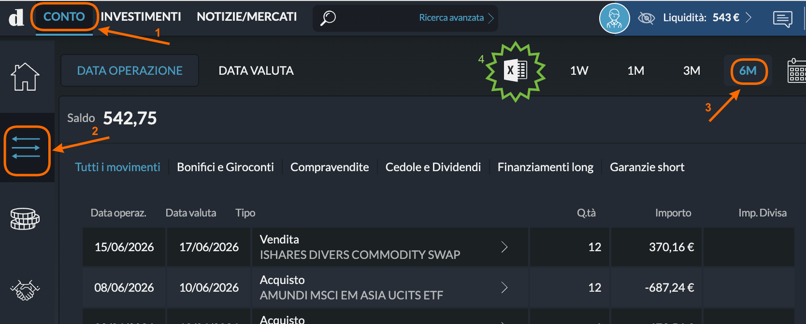
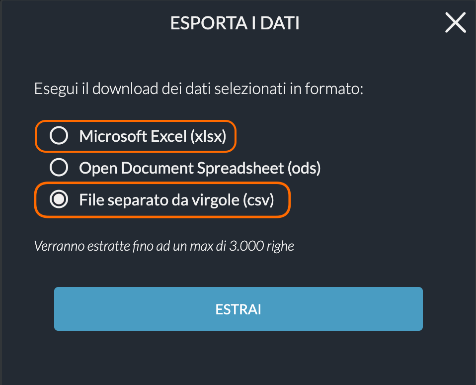

#  Directa SIM

## 📥 Cómo Exportar

LibreFolio soporta tanto el formato **CSV** como **XLSX** (Excel) exportados desde Directa SIM. Las capturas de pantalla a continuación son de escritorio, pero los pasos son similares en móvil.

### Step 1 — Abrir la lista de movimientos

Inicia sesión en [Directa](https://www.directatrading.com) y haz clic en la pestaña **CONTO** (❶). Luego haz clic en el icono de filtro/movimientos a la izquierda (❷) y selecciona el período deseado — ej. **6M** (❸).

{ style="border-radius: 8px; box-shadow: 0 4px 16px rgba(0,0,0,0.15);" }

### Step 2 — Exportar como CSV o Excel

Haz clic en el icono de exportación (el icono de hoja de cálculo con la **X** verde) en la parte superior de la tabla. En el cuadro de diálogo, selecciona **File separato da virgole (csv)** (o la opción de Excel) y haz clic en **ESTRAI**.

{ style="border-radius: 8px; box-shadow: 0 4px 16px rgba(0,0,0,0.15);" }

Guarda el archivo e impórtalo en LibreFolio. Si eliges CSV, no lo abras ni lo vuelvas a guardar en Excel antes, ya que podría alterar el formato de los números.

## 📝 Notas

- Compatible con operaciones de acciones, bonos y ETF, dividendos, impuestos (*ritenute fiscali*) y comisiones de transacción.
- Se soportan tanto el formato **CSV** como **XLSX** (Excel) — no ods.
- Las operaciones de la cuenta están denominadas en EUR.
- La exportación cubre hasta 3.000 filas por archivo. Para historiales más largos, exporta varios períodos e impórtalos en secuencia.

