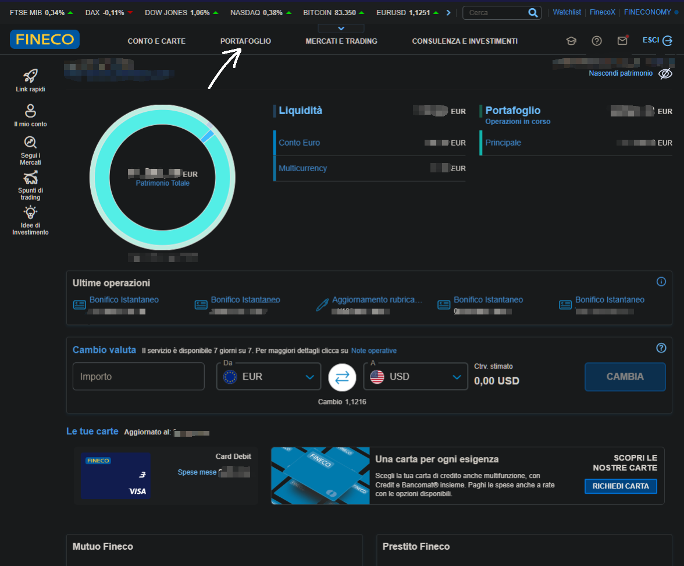
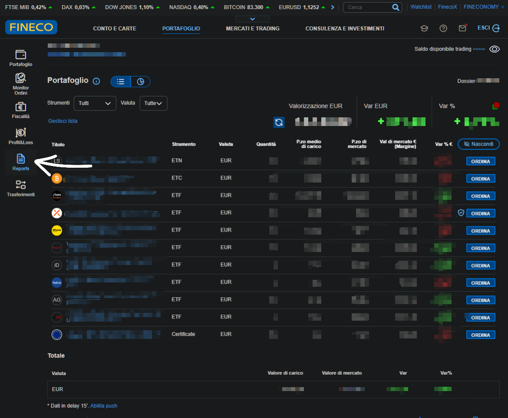
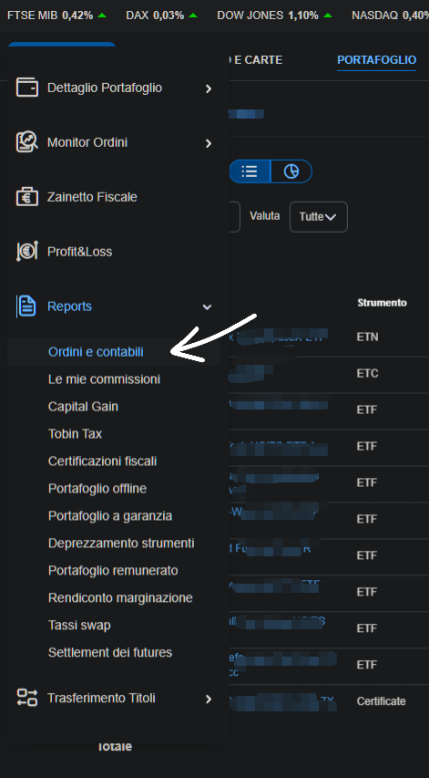
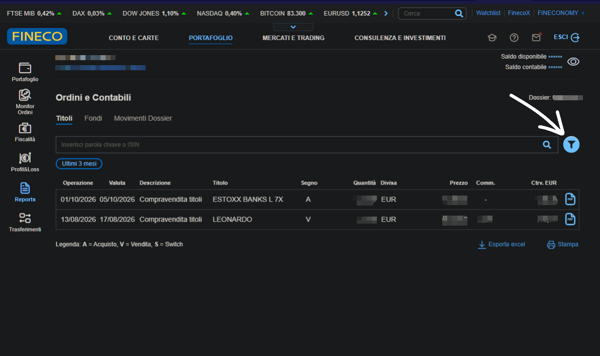
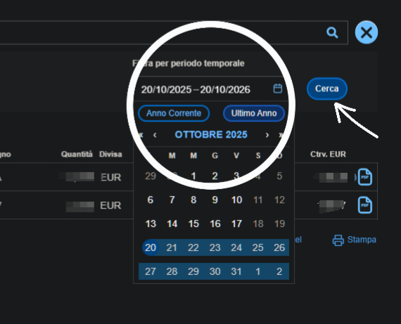
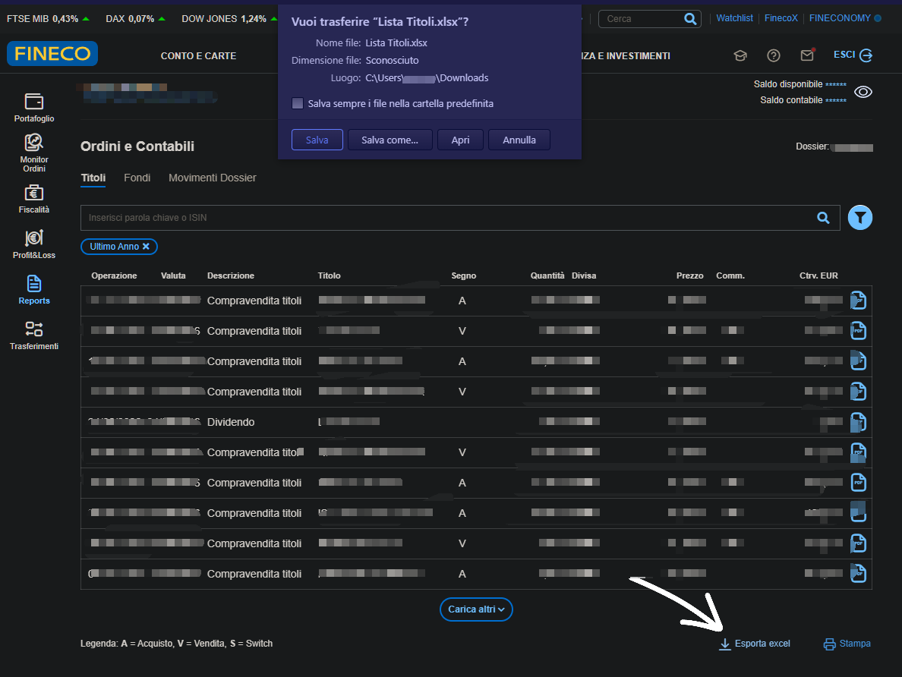

# 📥  Fineco

LibreFolio imports FinecoBank's **Ordini e contabili** report (its **Titoli** list) — your securities
operations (it carries the **Dossier** and **Intestatario** lines above the table) — saved as CSV.

This guide, and the fix to how commissions are counted, come from a real export shared by
[@Xgialippo](https://github.com/Xgialippo) in discussion
[#49](https://github.com/Librefolio/LibreFolio/discussions/49): thank you!

## 📥 How to Export

The screenshots below are from the Fineco website on desktop. Personal data is blurred.

### Step 1 — Open PORTAFOGLIO

Log in to your **FinecoBank** account. In the menu at the top of the home page, click **PORTAFOGLIO** (the arrow).

{ style="border-radius: 8px; box-shadow: 0 4px 16px rgba(0,0,0,0.15);" }

### Step 2 — Open Reports

In the left bar, click **Reports** (the arrow).

{ style="border-radius: 8px; box-shadow: 0 4px 16px rgba(0,0,0,0.15);" }

### Step 3 — Choose Ordini e contabili

In the **Reports** menu, click **Ordini e contabili** (the arrow).

{ style="border-radius: 8px; box-shadow: 0 4px 16px rgba(0,0,0,0.15);" }

### Step 4 — Open the filter

Stay on the **Titoli** tab. By default it shows only the last three months (**Ultimi 3 mesi**). Click the **filter** icon on the right (the arrow) to change the period.

{ style="border-radius: 8px; box-shadow: 0 4px 16px rgba(0,0,0,0.15);" }

### Step 5 — Choose the period

Pick the period you want, for example **Ultimo Anno** (the circle), then click **Cerca** (the arrow).

{ style="border-radius: 8px; box-shadow: 0 4px 16px rgba(0,0,0,0.15);" }

### Step 6 — Export to Excel

At the bottom of the list, click **Esporta excel** (the arrow). Fineco downloads a file named `Lista Titoli.xlsx`.

{ style="border-radius: 8px; box-shadow: 0 4px 16px rgba(0,0,0,0.15);" }

Screenshots courtesy of [@Xgialippo](https://github.com/Xgialippo).

### Step 7 — Save it as CSV

LibreFolio reads CSV files only, so open `Lista Titoli.xlsx` in Excel or LibreOffice and choose **Save As → CSV** (comma or semicolon separated: both work). Keep the lines above the table (**Dossier**, **Intestazione** or **Intestatario**) and the column names: LibreFolio recognises the report by them. Do not edit the numbers.

## 🔄 What Gets Imported

| In the report (**Descrizione**) | Imported as |
|:--------------------------------|:------------|
| *Compravendita titoli*, with **Segno** `A` or `V` | **Buy** or **Sell** |
| *Dividendo* | **Dividend** |
| *Stacco Cedole* | **Interest** (bond coupon) |
| *Rimborso* | **Sell** (redemption or maturity), with the amount as printed |
| *Aumento capitale* | **Adjustment** of the quantity, without cash |
| Commission columns, when the report has them | One separate **Fee** per row, of the same security, in euro. The commission columns of the row are summed, not one **Fee** for each kind |

Any other operation is skipped with a warning.

**Commissions.** In Fineco's report the **Controvalore** (the settled amount) of a purchase
already **includes** the commission, and the **Controvalore** of a sale already has it **taken
off**. LibreFolio records the trade for the amount without commission and the commission as a
separate **Fee** of the same security, so the two together are exactly the **Controvalore**.
Two examples, with made-up numbers:

| In the report | Imported as | Total |
|:--------------|:------------|:------|
| Purchase of 40 shares, **Controvalore** 862.95, commission 2.95 | **Buy** −860.00 and **Fee** −2.95 | −862.95, what left your account |
| Sale of 4 shares, **Controvalore** 246.65, commission 2.95 | **Sell** +249.60 and **Fee** −2.95 | +246.65, what reached your account |

Rows without commission, dividends (already net of tax, as Fineco prints them) and the other
operations are unchanged. So are reports without the commission columns.

**Bonds repaid above par.** When a bond is repaid above par (100) — a *premio fedeltà* or an
inflation revaluation — the sale is recorded at par and the amount above it as a separate
**Interest**, like a coupon, so your gain reflects the price alone. LibreFolio recognises bonds by
their name (BTP, BOT, CCT…). Bonds repaid at or below par, and other redemptions, stay a single
**Sell**.

## ⚠️ Good to know

- **Both layouts work**, with or without the commission columns: LibreFolio tells them apart on its
  own.
- **Capital gains tax.** It is not in the report, so LibreFolio cannot import it: add it by hand
  if you want it tracked.
- **Amounts as written.** Each row keeps its own currency (**Divisa**), with no conversion; the
  **Cambio** column is ignored.
- **Dates.** Each operation is recorded on the day you made it (**Operazione**): a purchase you
  made on the 27th is a purchase of the 27th, even if the money moves a couple of days later.
  When **Operazione** is missing, LibreFolio uses the value date (**Data valuta**).
- **Only settled operations.** An operation whose value date (**Data valuta**) is after today has
  not settled yet: typically one of the last one or two working days. It is not imported this
  time, commission included, and a blue note says how many. Nothing to do: it arrives with your
  next export, once settled, still on the day you made it.
- **Dates in files imported with LibreFolio 1.2 or earlier.** Those versions recorded each operation on its
  value date. Imported again, the same operations now come with the day you made them, a day or
  two earlier, so LibreFolio does not recognise them as [duplicates](index.md#duplicate-detection)
  and they would count twice. So, once: delete the Fineco transactions those files created and
  import the files again, or import only the operations after the last day you already imported.
  From then on, importing a period again finds its duplicates as usual.
- **Commissions in files imported with LibreFolio 1.2 or earlier.** Those versions counted the commission twice
  (the **Controvalore** plus a separate **Fee**), so the cash of those trades is off by the
  commission: buys too low, sales too high. The data already imported stays as it is. To correct
  it, delete the Fineco transactions created from that file and import the file again.
- **Rows with a missing number.** If a row has no quantity or no amount, LibreFolio reads it as
  it is: a missing amount counts as 0, and an operation that needs a quantity cannot be
  imported without one. A blue note lists these rows and asks you to check them. If the file looks
  right to you, use the link in the note to open an issue on GitHub, and we will look into it.
- **Rows LibreFolio cannot read or does not know.** A row with too few columns, no readable date
  or an empty description, or one whose operation LibreFolio does not map, is left out of the
  import. An amber warning lists these rows and has a link to open an issue on GitHub.

## 🚧 Known limitations

- **Checked on one kind of account.** The importer has been verified on a real export from an
  account in the **regime amministrato** (the broker withholds the tax), where the commission is in
  the **Commissioni amministrato** column.
- **Not seen yet on real exports:** accounts in the **regime dichiarativo** (you pay the tax yourself
  at the end of the year), **funds** and **BTP**. Their columns or values may differ.
- **Not seen yet on real exports, either:** a *Rimborso* (redemption) that carries a commission, a
  commission larger than the **Controvalore** of a purchase, and rows in a currency other than
  euro. LibreFolio imports them with the rules above, but they have not been checked against a real
  report, so look at them in the import preview.
- **Other column names.** If your report has commission columns with different names, LibreFolio
  sums the commission columns it finds, so check the **Fee** of a few trades against your report.
- **Something is off?** Please [open an issue](https://github.com/Librefolio/LibreFolio/issues) or
  write in [discussion #49](https://github.com/Librefolio/LibreFolio/discussions/49), with an
  anonymised example file.

## 🔗 Developer Reference

→ [BRIM Architecture — Fineco notes](../../../developer/backend/brim/architecture.md#plugin-fineco)
