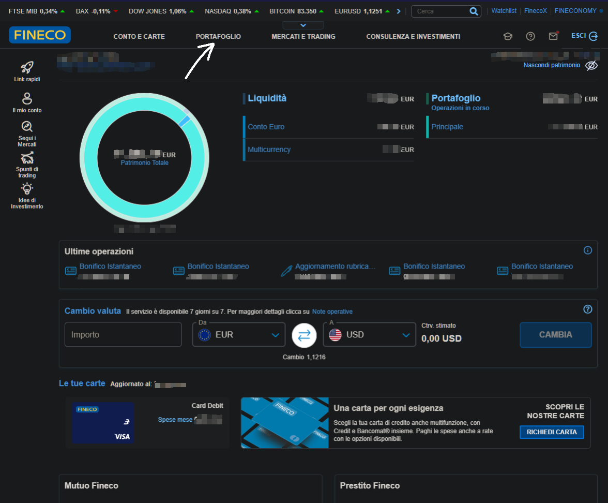
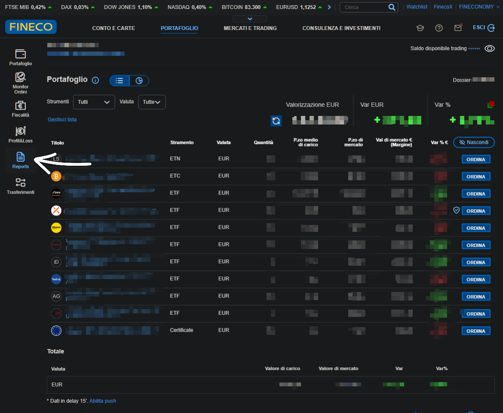
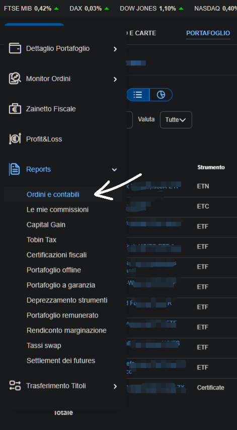
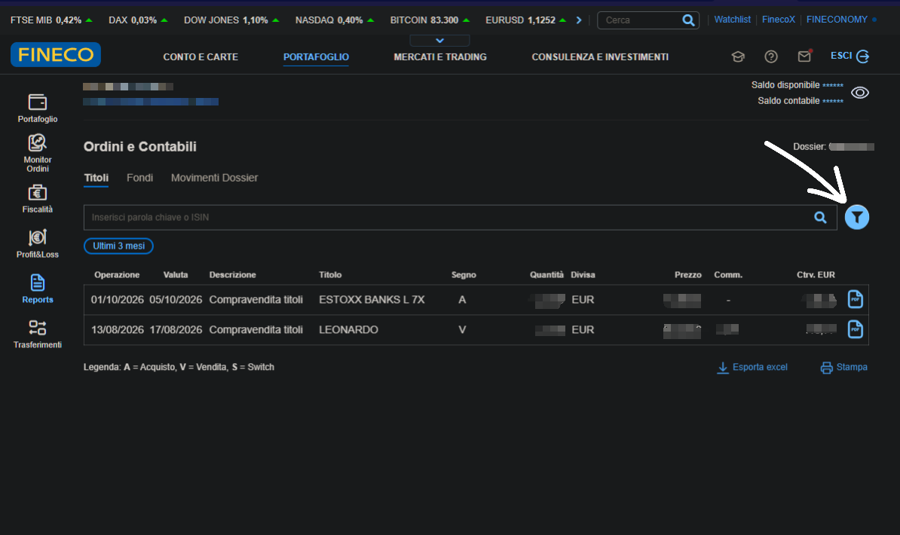
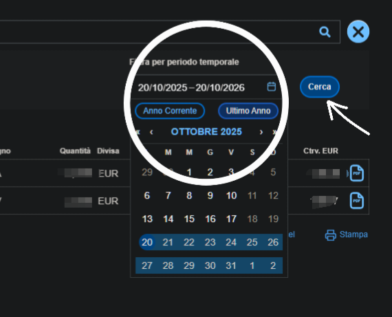
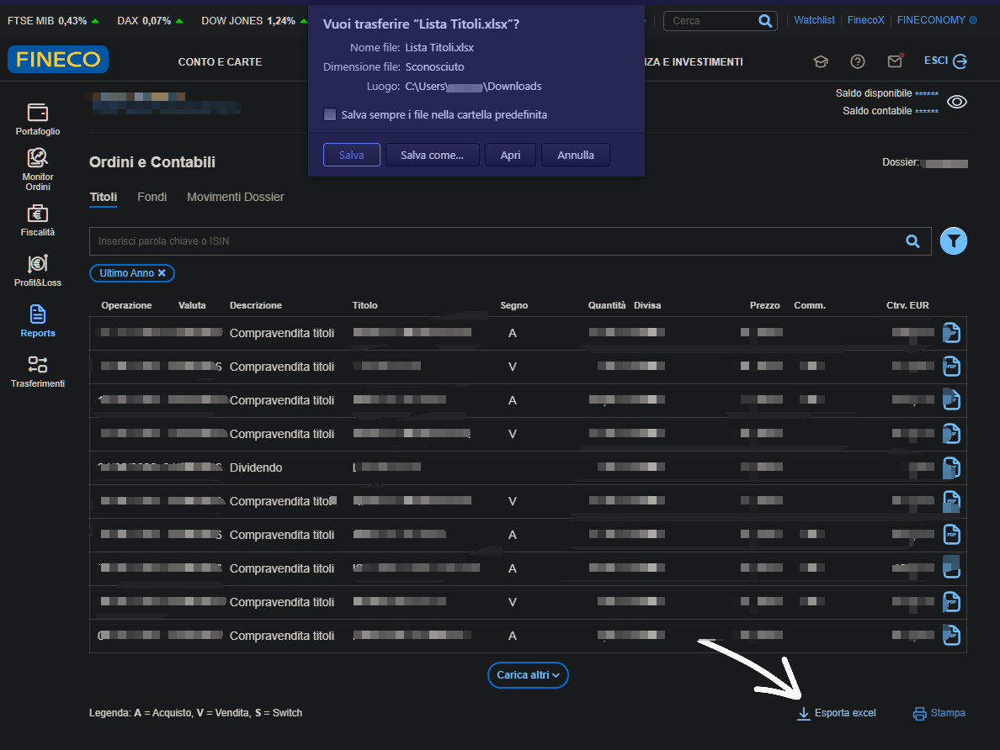

# 📥  Fineco

LibreFolio importa el informe **Ordini e contabili** de FinecoBank (su lista **Titoli**) — tus
operaciones de valores (incluye las líneas **Dossier** e **Intestatario** encima de la tabla) — guardado como CSV.

Esta guía, y la corrección de cómo se cuentan las comisiones, provienen de una exportación real compartida por
[@Xgialippo](https://github.com/Xgialippo) en la discusión
[#49](https://github.com/Librefolio/LibreFolio/discussions/49): ¡gracias!

## 📥 Cómo exportar

Las capturas de pantalla siguientes son de la versión de escritorio del sitio web de Fineco. Los datos personales están difuminados.

### Paso 1 — Abre PORTAFOGLIO

Inicia sesión en tu cuenta de **FinecoBank**. En el menú de la parte superior de la página de inicio, haz clic en **PORTAFOGLIO** (la flecha).

{ style="border-radius: 8px; box-shadow: 0 4px 16px rgba(0,0,0,0.15);" }

### Paso 2 — Abre Reports

En la barra izquierda, haz clic en **Reports** (la flecha).

{ style="border-radius: 8px; box-shadow: 0 4px 16px rgba(0,0,0,0.15);" }

### Paso 3 — Elige Ordini e contabili

En el menú **Reports**, haz clic en **Ordini e contabili** (la flecha).

{ style="border-radius: 8px; box-shadow: 0 4px 16px rgba(0,0,0,0.15);" }

### Paso 4 — Abre el filtro

Permanece en la pestaña **Titoli**. Por defecto solo muestra los últimos tres meses (**Ultimi 3 mesi**). Haz clic en el icono de **filtro** a la derecha (la flecha) para cambiar el período.

{ style="border-radius: 8px; box-shadow: 0 4px 16px rgba(0,0,0,0.15);" }

### Paso 5 — Elige el período

Elige el período que quieras, por ejemplo **Ultimo Anno** (el círculo), y luego haz clic en **Cerca** (la flecha).

{ style="border-radius: 8px; box-shadow: 0 4px 16px rgba(0,0,0,0.15);" }

### Paso 6 — Exporta a Excel

Al final de la lista, haz clic en **Esporta excel** (la flecha). Fineco descarga un archivo llamado `Lista Titoli.xlsx`.

{ style="border-radius: 8px; box-shadow: 0 4px 16px rgba(0,0,0,0.15);" }

Capturas de pantalla cortesía de [@Xgialippo](https://github.com/Xgialippo).

### Paso 7 — Guárdalo como CSV

LibreFolio solo lee archivos CSV, así que abre `Lista Titoli.xlsx` en Excel o LibreOffice y elige **Guardar como → CSV** (separado por comas o por puntos y coma: ambos funcionan). Conserva las líneas encima de la tabla (**Dossier**, **Intestazione** o **Intestatario**) y los nombres de las columnas: LibreFolio reconoce el informe por estos elementos. No modifiques los números.

## 🔄 Qué se importa

| En el informe (**Descrizione**) | Se importa como |
|:--------------------------------|:------------|
| *Compravendita titoli*, con **Segno** `A` o `V` | **Compra** o **Venta** |
| *Dividendo* | **Dividendo** |
| *Stacco Cedole* | **Interés** (cupón de bono) |
| *Rimborso* | **Venta** (amortización o vencimiento), con el importe tal como figura |
| *Aumento capitale* | **Ajuste** de la cantidad, sin efectivo |
| Columnas de comisión, cuando el informe las tiene | Una **Comisión** separada por fila, del mismo título, en euros. Las columnas de comisión de la fila se suman, no una **Comisión** por cada tipo |

Cualquier otra operación se omite con un aviso.

**Comisiones.** En el informe de Fineco, el **Controvalore** (el importe liquidado) de una compra
ya **incluye** la comisión, y al **Controvalore** de una venta ya se le ha **descontado**. LibreFolio
registra la operación por el importe sin comisión y la comisión como una **Comisión** separada del mismo
título, de modo que las dos juntas son exactamente el **Controvalore**.
Dos ejemplos, con cifras inventadas:

| En el informe | Se importa como | Total |
|:--------------|:------------|:------|
| Compra de 40 acciones, **Controvalore** 862.95, comisión 2.95 | **Compra** −860.00 y **Comisión** −2.95 | −862.95, lo que salió de tu cuenta |
| Venta de 4 acciones, **Controvalore** 246.65, comisión 2.95 | **Venta** +249.60 y **Comisión** −2.95 | +246.65, lo que llegó a tu cuenta |

Las filas sin comisión, los dividendos (ya netos de impuestos, tal como los imprime Fineco) y las demás
operaciones no cambian. Tampoco cambian los informes sin las columnas de comisión.

**Bonos amortizados por encima de la par.** Cuando un bono se amortiza por encima de la par (100) — un *premio fedeltà* o una
revalorización por inflación — la venta se registra a la par y el importe por encima como un **Interés**
separado, igual que un cupón, para que tu ganancia refleje solo el precio. LibreFolio reconoce los bonos por
su nombre (BTP, BOT, CCT…). Los bonos amortizados a la par o por debajo de ella, y las demás amortizaciones, siguen siendo una única
**Venta**.

## ⚠️ Conviene saber

- **Ambos formatos funcionan**, con o sin las columnas de comisión: LibreFolio los distingue por
  sí solo.
- **Impuesto sobre plusvalías.** No está en el informe, así que LibreFolio no puede importarlo: añádelo a mano
  si quieres hacerle seguimiento.
- **Importes tal como figuran.** Cada fila mantiene su propia moneda (**Divisa**), sin conversión; la
  columna **Cambio** se ignora.
- **Fechas.** Cada operación se registra el día en que la hiciste (**Operazione**): una compra que
  hiciste el día 27 es una compra del 27, aunque el dinero se mueva un par de días después.
  Cuando falta **Operazione**, LibreFolio usa la fecha valor (**Data valuta**).
- **Solo operaciones liquidadas.** Una operación cuya fecha valor (**Data valuta**) es posterior a hoy
  aún no se ha liquidado: normalmente, una operación de los últimos uno o dos días laborables. No se importa esta
  vez, comisión incluida, y una nota azul indica cuántas. No hay nada que hacer: llegará con tu
  siguiente exportación, una vez liquidada, aún en el día en que la hiciste.
- **Fechas en archivos importados con LibreFolio 1.2 o anterior.** Esas versiones registraban cada operación en su
  fecha valor. Si se importan de nuevo, las mismas operaciones llegan ahora con el día en que las hiciste, un día o
  dos antes, así que LibreFolio no las reconoce como [duplicados](index.md#duplicate-detection)
  y se contarían dos veces. Por ello, una sola vez: elimina las transacciones de Fineco creadas por esos archivos e
  importa los archivos de nuevo, o importa solo las operaciones posteriores al último día que ya importaste.
  A partir de entonces, al importar de nuevo un período se detectan sus duplicados como siempre.
- **Comisiones en archivos importados con LibreFolio 1.2 o anterior.** Esas versiones contaban la comisión dos veces
  (el **Controvalore** más una **Comisión** separada), así que el efectivo de esas operaciones está desfasado por la
  comisión: las compras quedan demasiado bajas y las ventas demasiado altas. Los datos ya importados se quedan como están. Para corregirlo,
  elimina las transacciones de Fineco creadas a partir de ese archivo e importa el archivo de nuevo.
- **Filas con un número que falta.** Si una fila no tiene cantidad o no tiene importe, LibreFolio la lee tal
  cual: un importe que falta cuenta como 0, y una operación que necesita una cantidad no se puede
  importar sin ella. Una nota azul enumera estas filas y te pide que las revises. Si el archivo te parece
  correcto, usa el enlace de la nota para abrir una incidencia en GitHub y lo investigaremos.
- **Filas que LibreFolio no puede leer o no conoce.** Una fila con muy pocas columnas, sin fecha legible
  o con una descripción vacía, o una cuya operación LibreFolio no reconoce, se queda fuera de la
  importación. Un aviso ámbar enumera estas filas y tiene un enlace para abrir una incidencia en GitHub.

## 🚧 Limitaciones conocidas

- **Comprobado en un solo tipo de cuenta.** El importador se ha verificado con una exportación real de una
  cuenta en **regime amministrato** (el bróker retiene el impuesto), donde la comisión está en
  la columna **Commissioni amministrato**.
- **Aún no se han visto en exportaciones reales:** cuentas en **regime dichiarativo** (pagas el impuesto tú mismo
  al final del año), **fondos** y **BTP**. Sus columnas o valores pueden diferir.
- **Tampoco se han visto aún en exportaciones reales:** un *Rimborso* (amortización) que lleve una comisión, una
  comisión mayor que el **Controvalore** de una compra, y filas en una moneda distinta del euro.
  LibreFolio los importa con las reglas anteriores, pero no se han comprobado con un informe
  real, así que revísalos en la vista previa de importación.
- **Otros nombres de columna.** Si tu informe tiene columnas de comisión con nombres diferentes, LibreFolio
  suma las columnas de comisión que encuentra, así que comprueba la **Comisión** de algunas operaciones con tu informe.
- **¿Algo va mal?** Por favor, [abre una incidencia](https://github.com/Librefolio/LibreFolio/issues) o
  escribe en la [discusión #49](https://github.com/Librefolio/LibreFolio/discussions/49), con un
  archivo de ejemplo anonimizado.

## 🔗 Referencia para desarrolladores

→ [Arquitectura de BRIM — notas sobre Fineco](../../../developer/backend/brim/architecture.md#plugin-fineco)
