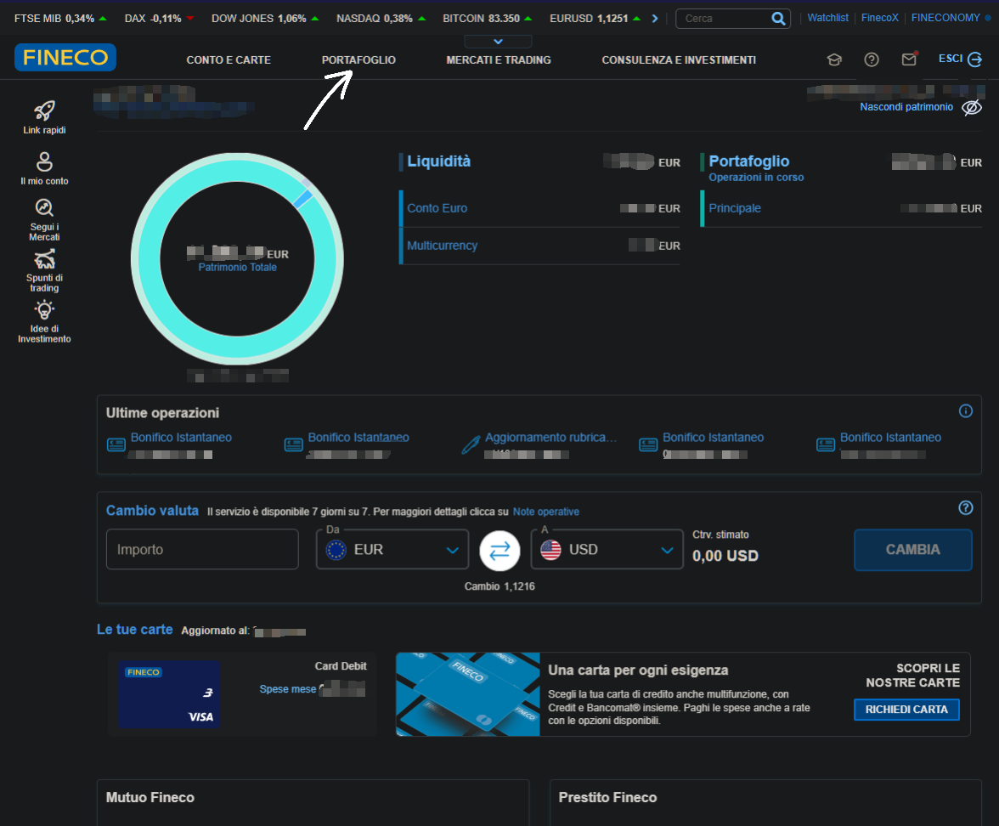
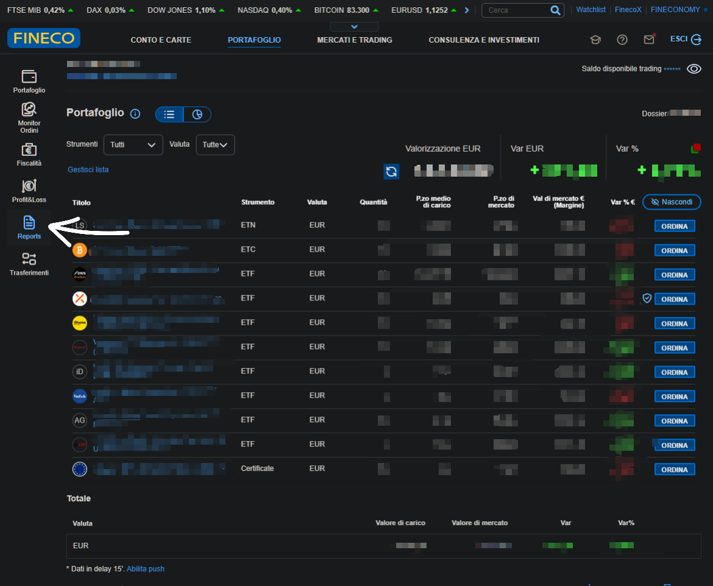
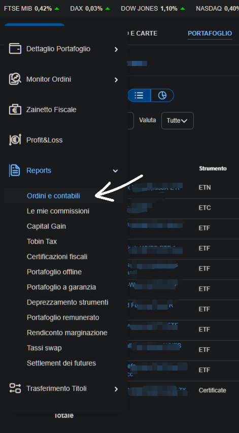
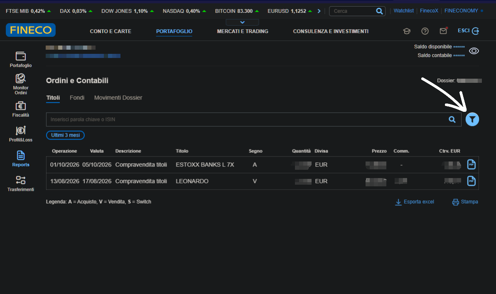
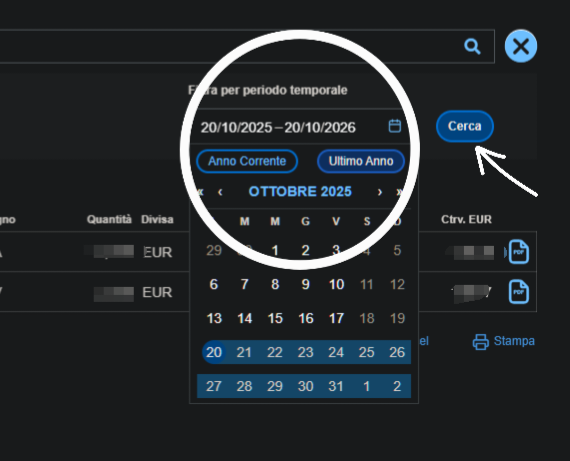
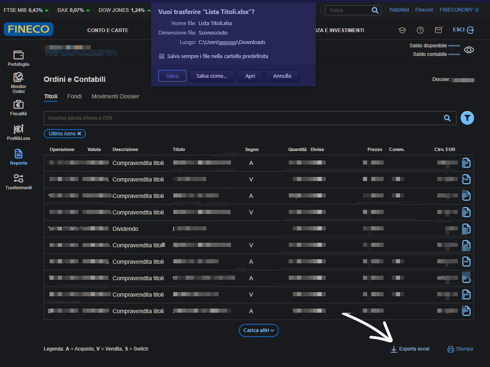

# 📥  Fineco

LibreFolio importe le rapport **Ordini e contabili** de FinecoBank (sa liste **Titoli**) — vos opérations
sur titres (il contient les lignes **Dossier** et **Intestatario** au-dessus du tableau) — enregistré au format CSV.

Ce guide, ainsi que la correction du mode de comptage des commissions, proviennent d'un export réel partagé par
[@Xgialippo](https://github.com/Xgialippo) dans la discussion
[#49](https://github.com/Librefolio/LibreFolio/discussions/49) : merci !

## 📥 Comment exporter

Les captures d'écran ci-dessous proviennent du site de Fineco sur ordinateur. Les données personnelles sont floutées.

### Étape 1 — Ouvrir PORTAFOGLIO

Connectez-vous à votre compte **FinecoBank**. Dans le menu en haut de la page d'accueil, cliquez sur **PORTAFOGLIO** (la flèche).

{ style="border-radius: 8px; box-shadow: 0 4px 16px rgba(0,0,0,0.15);" }

### Étape 2 — Ouvrir Reports

Dans la barre de gauche, cliquez sur **Reports** (la flèche).

{ style="border-radius: 8px; box-shadow: 0 4px 16px rgba(0,0,0,0.15);" }

### Étape 3 — Choisir Ordini e contabili

Dans le menu **Reports**, cliquez sur **Ordini e contabili** (la flèche).

{ style="border-radius: 8px; box-shadow: 0 4px 16px rgba(0,0,0,0.15);" }

### Étape 4 — Ouvrir le filtre

Restez sur l'onglet **Titoli**. Par défaut, il n'affiche que les trois derniers mois (**Ultimi 3 mesi**). Cliquez sur l'icône **filtre** à droite (la flèche) pour changer la période.

{ style="border-radius: 8px; box-shadow: 0 4px 16px rgba(0,0,0,0.15);" }

### Étape 5 — Choisir la période

Sélectionnez la période souhaitée, par exemple **Ultimo Anno** (le cercle), puis cliquez sur **Cerca** (la flèche).

{ style="border-radius: 8px; box-shadow: 0 4px 16px rgba(0,0,0,0.15);" }

### Étape 6 — Exporter vers Excel

En bas de la liste, cliquez sur **Esporta excel** (la flèche). Fineco télécharge un fichier nommé `Lista Titoli.xlsx`.

{ style="border-radius: 8px; box-shadow: 0 4px 16px rgba(0,0,0,0.15);" }

Captures d'écran fournies par [@Xgialippo](https://github.com/Xgialippo).

### Étape 7 — L'enregistrer au format CSV

LibreFolio ne lit que les fichiers CSV : ouvrez donc `Lista Titoli.xlsx` dans Excel ou LibreOffice et choisissez **Enregistrer sous → CSV** (séparé par des virgules ou des points-virgules : les deux fonctionnent). Conservez les lignes au-dessus du tableau (**Dossier**, **Intestazione** ou **Intestatario**) ainsi que les noms de colonnes : LibreFolio reconnaît le rapport grâce à ces éléments. Ne modifiez pas les nombres.

## 🔄 Ce qui est importé

| Dans le rapport (**Descrizione**) | Importé comme |
|:--------------------------------|:------------|
| *Compravendita titoli*, avec **Segno** `A` ou `V` | **Achat** ou **Vente** |
| *Dividendo* | **Dividende** |
| *Stacco Cedole* | **Intérêt** (coupon d'obligation) |
| *Rimborso* | **Vente** (remboursement ou échéance), avec le montant tel qu'imprimé |
| *Aumento capitale* | **Ajustement** de la quantité, sans trésorerie |
| Colonnes de commission, lorsque le rapport en contient | Un poste de **frais** distinct par ligne, du même titre, en euros. Les colonnes de commission de la ligne sont additionnées, et non des **frais** pour chaque type de commission |

Toute autre opération est ignorée avec un avertissement.

**Commissions.** Dans le rapport de Fineco, le **Controvalore** (le montant réglé) d'un achat
**inclut** déjà la commission, et le **Controvalore** d'une vente est déjà **net de la commission**. LibreFolio
enregistre l'opération pour le montant hors commission et la commission sous la forme de **Frais** distincts du même titre, de sorte que leur somme corresponde exactement au **Controvalore**.
Deux exemples, avec des chiffres fictifs :

| Dans le rapport | Importé comme | Total |
|:--------------|:------------|:------|
| Achat de 40 actions, **Controvalore** 862,95, commission 2,95 | **Achat** −860,00 et **Frais** −2,95 | −862,95, ce qui a quitté votre compte |
| Vente de 4 actions, **Controvalore** 246,65, commission 2,95 | **Vente** +249,60 et **Frais** −2,95 | +246,65, ce qui est arrivé sur votre compte |

Les lignes sans commission, les dividendes (déjà nets d'impôt, tels que Fineco les imprime) et les autres
opérations ne changent pas. Il en va de même pour les rapports sans les colonnes de commission.

**Obligations remboursées au-dessus du pair.** Lorsqu'une obligation est remboursée au-dessus du pair (100) — un *premio fedeltà* ou une
revalorisation liée à l'inflation — la vente est enregistrée au pair et le montant au-dessus comme un
**Intérêt** distinct, à la manière d'un coupon, afin que votre gain reflète uniquement le prix. LibreFolio reconnaît les obligations grâce à
leur nom (BTP, BOT, CCT…). Les obligations remboursées au pair ou en dessous, ainsi que les autres remboursements, donnent lieu à une seule
**Vente**.

## ⚠️ Bon à savoir

- **Les deux mises en page fonctionnent**, avec ou sans les colonnes de commission : LibreFolio les distingue automatiquement.
- **Impôt sur les plus-values.** Il ne figure pas dans le rapport : LibreFolio ne peut donc pas l'importer. Ajoutez-le manuellement
  si vous souhaitez en tenir compte.
- **Montants tels quels.** Chaque ligne conserve sa propre devise (**Divisa**), sans conversion ; la
  colonne **Cambio** est ignorée.
- **Dates.** Chaque opération est enregistrée le jour où vous l'avez effectuée (**Operazione**) : un achat
  effectué le 27 est un achat du 27, même si le règlement intervient quelques jours plus tard.
  Lorsque la date **Operazione** est absente, LibreFolio utilise la date de valeur (**Data valuta**).
- **Uniquement les opérations réglées.** Une opération dont la date de valeur (**Data valuta**) est postérieure à aujourd'hui n'est
  pas encore réglée : elle date généralement de l'un des deux derniers jours ouvrés. Elle n'est pas importée cette
  fois-ci, commission comprise, et une note bleue en indique le nombre. Rien à faire : elle arrivera avec votre
  prochain export, une fois réglée, toujours à la date où vous l'avez effectuée.
- **Dates dans les fichiers importés avec LibreFolio 1.2 ou antérieur.** Ces versions enregistraient chaque opération à sa
  date de valeur. Si elles sont importées à nouveau, les mêmes opérations arrivent désormais avec le jour où vous les avez effectuées, un ou
  deux jours plus tôt, si bien que LibreFolio ne les reconnaît pas comme des [doublons](index.md#duplicate-detection)
  et elles seraient comptées deux fois. Procédez donc une seule fois comme suit : supprimez les transactions Fineco créées par ces fichiers et
  réimportez les fichiers, ou importez uniquement les opérations postérieures à la dernière date déjà importée.
  Dès lors, si vous réimportez une période, les doublons sont détectés comme d'habitude.
- **Commissions dans les fichiers importés avec LibreFolio 1.2 ou antérieur.** Ces versions comptaient la commission deux fois
  (le **Controvalore** plus des **frais** distincts), si bien que la trésorerie de ces opérations est décalée de la
  commission : les achats sont trop bas et les ventes trop élevées. Les données déjà importées restent telles quelles. Pour corriger
  cela, supprimez les transactions Fineco créées à partir de ce fichier et réimportez le fichier.
- **Lignes avec un nombre manquant.** Si une ligne n'a pas de quantité ou pas de montant, LibreFolio la lit telle
  quelle : un montant manquant compte pour 0, et une opération qui nécessite une quantité ne peut pas être
  importée sans elle. Une note bleue liste ces lignes et vous invite à les vérifier. Si le fichier vous semble
  correct, utilisez le lien dans la note pour ouvrir un ticket sur GitHub, et nous l'examinerons.
- **Lignes que LibreFolio ne peut pas lire ou ne connaît pas.** Une ligne avec trop peu de colonnes, sans date lisible
  ou avec une description vide, ou dont l'opération n'est pas reconnue par LibreFolio, est exclue de
  l'import. Un avertissement ambre liste ces lignes et contient un lien pour ouvrir un ticket sur GitHub.

## 🚧 Limitations connues

- **Vérifié sur un seul type de compte.** L'importateur a été validé sur un export réel d'un
  compte en **regime amministrato** (le courtier retient l'impôt), où la commission figure dans
  la colonne **Commissioni amministrato**.
- **Pas encore observé sur des exports réels :** les comptes en **regime dichiarativo** (vous payez l'impôt vous-même
  en fin d'année), les **fonds** et les **BTP**. Leurs colonnes ou valeurs peuvent différer.
- **Pas encore observé sur des exports réels non plus :** un *Rimborso* (remboursement) comportant une commission, une
  commission supérieure au **Controvalore** d'un achat, et des lignes dans une devise autre que
  l'euro. LibreFolio les importe selon les règles ci-dessus, mais ces cas n'ont pas été vérifiés sur un
  rapport réel : examinez ces cas dans l'aperçu d'import.
- **Autres noms de colonnes.** Si votre rapport comporte des colonnes de commission portant d'autres noms, LibreFolio
  additionne les colonnes de commission qu'il trouve : vérifiez donc les **frais** de quelques opérations en les comparant à votre rapport.
- **Quelque chose cloche ?** Veuillez [ouvrir un ticket](https://github.com/Librefolio/LibreFolio/issues) ou
  écrire dans la [discussion #49](https://github.com/Librefolio/LibreFolio/discussions/49), avec un
  exemple de fichier anonymisé.

## 🔗 Référence développeur

→ [Architecture BRIM — notes Fineco](../../../developer/backend/brim/architecture.md#plugin-fineco)
