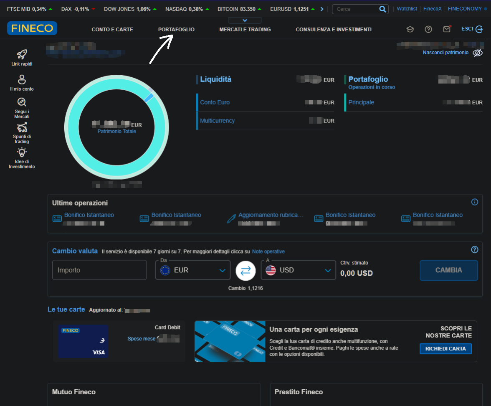
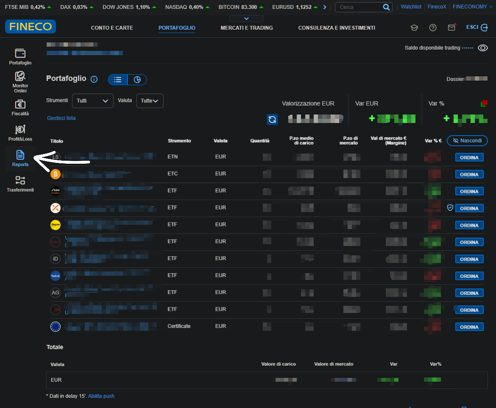
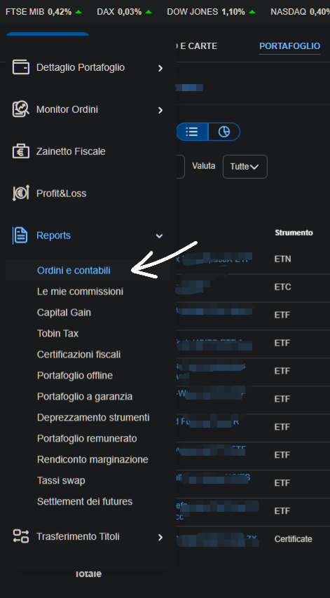
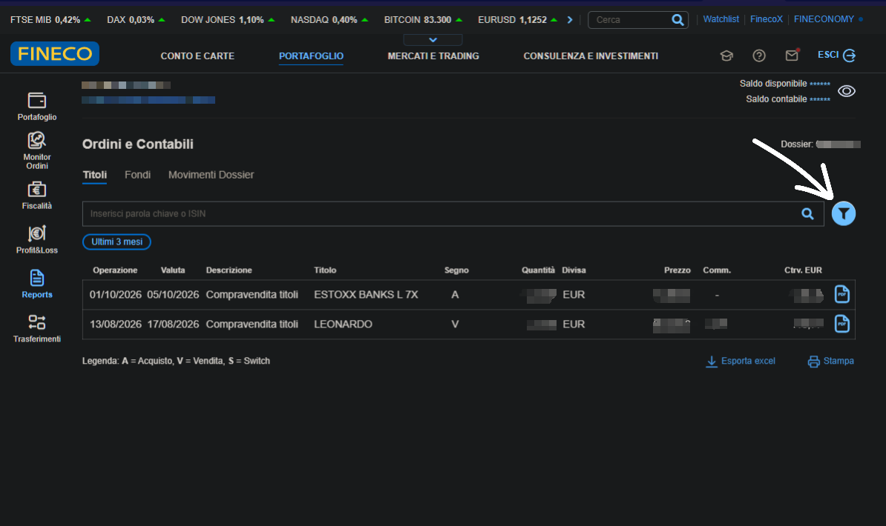
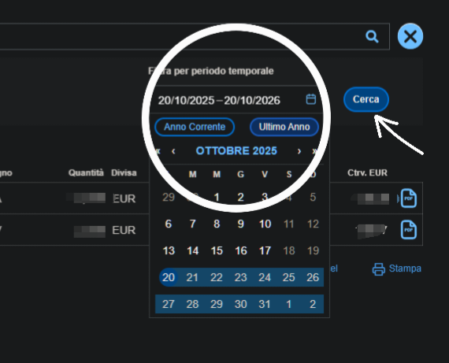
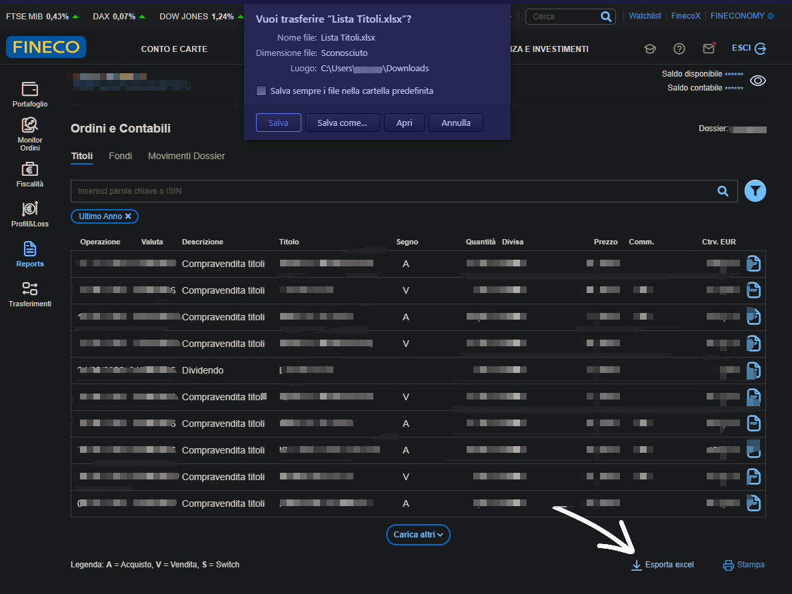

# 📥  Fineco

LibreFolio importa il report **Ordini e contabili** di FinecoBank (la sua lista **Titoli**) — le tue
operazioni su titoli (contiene le righe **Dossier** e **Intestatario** sopra la tabella) — salvato come CSV.

Questa guida, e la correzione al modo in cui vengono conteggiate le commissioni, derivano da un'esportazione reale condivisa da
[@Xgialippo](https://github.com/Xgialippo) nella discussione
[#49](https://github.com/Librefolio/LibreFolio/discussions/49): grazie!

## 📥 Come esportare

Gli screenshot seguenti provengono dal sito Fineco da desktop. I dati personali sono oscurati.

### Passaggio 1 — Apri PORTAFOGLIO

Accedi al tuo account **FinecoBank**. Nel menu in alto nella pagina iniziale, clicca su **PORTAFOGLIO** (la freccia).

{ style="border-radius: 8px; box-shadow: 0 4px 16px rgba(0,0,0,0.15);" }

### Passaggio 2 — Apri Reports

Nella barra a sinistra, clicca su **Reports** (la freccia).

{ style="border-radius: 8px; box-shadow: 0 4px 16px rgba(0,0,0,0.15);" }

### Passaggio 3 — Scegli Ordini e contabili

Nel menu **Reports**, clicca su **Ordini e contabili** (la freccia).

{ style="border-radius: 8px; box-shadow: 0 4px 16px rgba(0,0,0,0.15);" }

### Passaggio 4 — Apri il filtro

Resta nella scheda **Titoli**. Per impostazione predefinita mostra solo gli ultimi tre mesi (**Ultimi 3 mesi**). Clicca sull'icona del **filtro** a destra (la freccia) per cambiare il periodo.

{ style="border-radius: 8px; box-shadow: 0 4px 16px rgba(0,0,0,0.15);" }

### Passaggio 5 — Scegli il periodo

Scegli il periodo desiderato, per esempio **Ultimo Anno** (il cerchio), poi clicca su **Cerca** (la freccia).

{ style="border-radius: 8px; box-shadow: 0 4px 16px rgba(0,0,0,0.15);" }

### Passaggio 6 — Esporta in Excel

In fondo alla lista, clicca su **Esporta excel** (la freccia). Fineco scarica un file chiamato `Lista Titoli.xlsx`.

{ style="border-radius: 8px; box-shadow: 0 4px 16px rgba(0,0,0,0.15);" }

Screenshot per gentile concessione di [@Xgialippo](https://github.com/Xgialippo).

### Passaggio 7 — Salvalo come CSV

LibreFolio legge solo file CSV, quindi apri `Lista Titoli.xlsx` in Excel o LibreOffice e scegli **Salva con nome → CSV** (separato da virgole o da punto e virgola: entrambi vanno bene). Mantieni le righe sopra la tabella (**Dossier**, **Intestazione** o **Intestatario**) e i nomi delle colonne: LibreFolio riconosce il report grazie a questi elementi. Non modificare i numeri.

## 🔄 Cosa viene importato

| Nel report (**Descrizione**) | Importato come |
|:--------------------------------|:------------|
| *Compravendita titoli*, con **Segno** `A` o `V` | **Acquisto** o **Vendita** |
| *Dividendo* | **Dividendo** |
| *Stacco Cedole* | **Interesse** (cedola obbligazionaria) |
| *Rimborso* | **Vendita** (rimborso o scadenza), con l'importo così come stampato |
| *Aumento capitale* | **Rettifica** della quantità, senza movimenti di cassa |
| Colonne delle commissioni, quando il report le contiene | Una **Commissione** separata per riga, dello stesso titolo, in euro. Le colonne delle commissioni della riga vengono sommate; non viene registrata una **Commissione** per ciascun tipo |

Qualsiasi altra operazione viene saltata con un avviso.

**Commissioni.** Nel report Fineco il **Controvalore** (l'importo regolato) di un acquisto
**include** già la commissione, mentre il **Controvalore** di una vendita è già **al netto** della commissione. LibreFolio registra l'operazione per l'importo senza la commissione e la commissione come
**Commissione** separata dello stesso titolo, così le due insieme equivalgono esattamente al **Controvalore**.
Due esempi, con numeri inventati:

| Nel report | Importato come | Totale |
|:--------------|:------------|:------|
| Acquisto di 40 azioni, **Controvalore** 862,95, commissione 2,95 | **Acquisto** −860,00 e **Commissione** −2,95 | −862,95, quello che è uscito dal tuo conto |
| Vendita di 4 azioni, **Controvalore** 246,65, commissione 2,95 | **Vendita** +249,60 e **Commissione** −2,95 | +246,65, quello che è arrivato sul tuo conto |

Le righe senza commissione, i dividendi (già al netto delle imposte, come li stampa Fineco) e le altre
operazioni restano invariati. Lo stesso vale per i report senza le colonne delle commissioni.

**Obbligazioni rimborsate sopra la pari.** Quando un'obbligazione viene rimborsata sopra la pari (100) — un *premio fedeltà* o una
rivalutazione per inflazione — la vendita viene registrata alla pari e l'importo eccedente come **Interesse** separato, come una cedola, così la plusvalenza riflette soltanto il prezzo. LibreFolio riconosce le obbligazioni dal
loro nome (BTP, BOT, CCT…). Le obbligazioni rimborsate alla pari o sotto la pari, e gli altri rimborsi, restano un'unica
**Vendita**.

## ⚠️ Da sapere

- **Entrambi i layout funzionano**, con o senza le colonne delle commissioni: LibreFolio li distingue da solo.
- **Imposta sulle plusvalenze.** Non è presente nel report, quindi LibreFolio non può importarla: aggiungila manualmente
  se vuoi tenerne traccia.
- **Importi così come scritti.** Ogni riga mantiene la propria valuta (**Divisa**), senza conversione di valuta; la
  colonna **Cambio** viene ignorata.
- **Date.** Ogni operazione viene registrata nel giorno in cui l'hai effettuata (**Operazione**): un acquisto fatto
  il 27 è un acquisto del 27, anche se il denaro si muove un paio di giorni dopo.
  Quando **Operazione** manca, LibreFolio usa la data valuta (**Data valuta**).
- **Solo operazioni regolate.** Un'operazione la cui data valuta (**Data valuta**) è successiva a oggi non è ancora stata
  regolata: di solito si tratta di un'operazione degli ultimi uno o due giorni lavorativi. Questa volta non viene importata, commissione inclusa, e una nota blu indica quante sono. Non c'è nulla da fare: arriverà con la
  prossima esportazione, una volta regolata, sempre nel giorno in cui l'hai effettuata.
- **Date nei file importati con LibreFolio 1.2 o versioni precedenti.** Quelle versioni registravano ogni operazione alla sua
  data valuta. Importate di nuovo, le stesse operazioni ora riportano il giorno in cui le hai effettuate, uno o
  due giorni prima, quindi LibreFolio non le riconosce come [duplicati](index.md#duplicate-detection)
  e verrebbero conteggiate due volte. Quindi, una volta sola: elimina le transazioni Fineco create da quei file e
  importa di nuovo i file, oppure importa solo le operazioni successive all'ultimo giorno che hai già importato.
  Da quel momento, importando di nuovo un periodo, i duplicati vengono trovati come al solito.
- **Commissioni nei file importati con LibreFolio 1.2 o versioni precedenti.** Quelle versioni conteggiavano la commissione due volte
  (il **Controvalore** più una **Commissione** separata), quindi la liquidità di quelle operazioni è sfalsata dalla
  commissione: acquisti troppo bassi, vendite troppo alte. I dati già importati restano così come sono. Per correggerli,
  elimina le transazioni Fineco create da quel file e importa di nuovo il file.
- **Righe con un numero mancante.** Se una riga non ha quantità o non ha importo, LibreFolio la legge così
  com'è: un importo mancante vale 0, e un'operazione che richiede una quantità non può essere
  importata senza di essa. Una nota blu elenca queste righe e ti chiede di controllarle. Se il file ti sembra
  corretto, usa il link nella nota per aprire una issue su GitHub, e ci daremo un'occhiata.
- **Righe che LibreFolio non riesce a leggere o non conosce.** Una riga con un numero insufficiente di colonne, nessuna data leggibile
  o una descrizione vuota, oppure una la cui operazione non è mappata da LibreFolio, viene esclusa dall'importazione.
  Un avviso di colore ambra elenca queste righe e contiene un link per aprire una issue su GitHub.

## 🚧 Limitazioni note

- **Verificato su un solo tipo di conto.** L'importatore è stato verificato su un'esportazione reale da un
  conto in **regime amministrato** (il broker trattiene le imposte), dove la commissione si trova nella
  colonna **Commissioni amministrato**.
- **Non ancora visti su esportazioni reali:** conti in **regime dichiarativo** (paghi le imposte da solo
  a fine anno), **fondi** e **BTP**. Le loro colonne o i loro valori potrebbero essere diversi.
- **Non ancora visti nemmeno su esportazioni reali:** un *Rimborso* a cui è associata una commissione, una
  commissione maggiore del **Controvalore** di un acquisto e righe in una valuta diversa dall'euro. LibreFolio li importa con le regole sopra, ma non sono stati verificati su un report
  reale, quindi controllali nell'anteprima di importazione.
- **Altri nomi delle colonne.** Se il tuo report ha colonne delle commissioni con nomi diversi, LibreFolio
  somma le colonne delle commissioni che trova, quindi confronta la **Commissione** di alcune operazioni con il tuo report.
- **Qualcosa non torna?** Apri una [issue](https://github.com/Librefolio/LibreFolio/issues) o
  scrivi nella [discussione #49](https://github.com/Librefolio/LibreFolio/discussions/49), con un
  file di esempio anonimizzato.

## 🔗 Riferimenti per sviluppatori

→ [Architettura BRIM — note Fineco](../../../developer/backend/brim/architecture.md#plugin-fineco)
