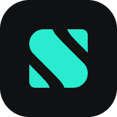
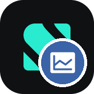
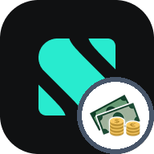

# 📥  Scalable Capital

LibreFolio imports both accounts of **Scalable Capital**: the **broker account** and the **overnight account** (*conto deposito*). LibreFolio is not affiliated with Scalable Capital.

---

## 🏦 Two accounts, two brokers {: #two-brokers }

Each account becomes a broker of its own in LibreFolio, read by its own importer. Create two [brokers](../../brokers/index.md), one per account, and choose the **Default Import Plugin** of each:

<div class="lf-accounts-table" markdown>

| Scalable account | Default Import Plugin | Files it reads |
|:--|:--|:--|
| {: style="width:36px;vertical-align:middle;margin-right:6px" } Broker account | **Scalable Capital broker** | the LibreFolio exporter's broker file, or Scalable's own CSV |
| {: style="width:36px;vertical-align:middle;margin-right:6px" } Overnight account | **Scalable Capital overnight account** | the LibreFolio exporter's overnight account file |

</div>

#### ❓ Why two brokers? {: #why-two-brokers }

- Each account has its own cash balance and its own IBAN.
- The money you move between them is a **Cash Transfer**, which links two brokers.
- With two brokers, each balance can be checked against Scalable's app, and each transfer becomes one linked pair.
- Each importer refuses the other account's file and names the importer that reads it.

---

## 📤 How to export {: #exporter }

As of October 2026, Scalable lets you download your transactions only on the **PRIME** and **PRIME+** plans, and never those of the overnight account.

That is why a browser extension was built that exports your data as CSV files: the [LibreFolio exporter](https://github.com/Librefolio/librefolio-exporter). It works in Chrome, Edge, Brave and the other Chromium browsers, version 120 or later, and reads your transactions on Scalable's pages, in your browser.

We recommend **our extension** for the following reasons:

- it works on **every plan**, FREE included;
- it is the **only way** to export the **overnight account**;
- it adds what Scalable's own CSV lacks: the **transaction id** and the **exact type** of each movement.

LibreFolio's import plugin for the broker account also reads Scalable's own CSV (PRIME); the overnight account's plugin reads only the exporter's file.

??? note "🧩 Install the exporter — once, before the first export"

    The up-to-date details are in the exporter's [README](https://github.com/Librefolio/librefolio-exporter#readme), which also covers updating, privacy, and the risks of an extension that uses the internal interface of Scalable's web app: read it before you install. Here is a summary of the steps.

    1. Download the two files of the [latest release](https://github.com/Librefolio/librefolio-exporter/releases/latest), `librefolio-exporter-<version>.zip` and `librefolio-exporter-<version>.zip.sha256`, into the same folder — for example `Downloads/chromePlugin`.
    2. Check the ZIP from a terminal. The `cd` goes to that folder; the second command compares the ZIP with the fingerprint in its `.sha256` file:

        === "macOS"

            ```bash
            cd ~/Downloads/chromePlugin
            shasum -a 256 -c librefolio-exporter-*.zip.sha256
            ```

        === "Linux"

            ```bash
            cd ~/Downloads/chromePlugin
            sha256sum -c librefolio-exporter-*.zip.sha256
            ```

        === "Windows"

            Windows has no command that reads `.sha256` files: use the PowerShell lines of the exporter's [README](https://github.com/Librefolio/librefolio-exporter#readme).

        `OK` means the ZIP is exactly the one published. On any other answer, do not install it: download both files again.

    3. Unzip it in that folder: you get a `librefolio-exporter` folder. Leave it there, since the browser loads the extension from it.
    4. Open `chrome://extensions` (`edge://extensions` in Edge), turn on **Developer mode**, click **Load unpacked** and choose the `librefolio-exporter` folder.

**Export:**

1. Log in to Scalable Capital: the **LibreFolio** button appears in the bottom-right corner of every page.
2. Click it, choose the accounts and the period, then click **Export CSV**.
3. You get `scalable-broker_<date>_<time>.csv` and `scalable-deposit_<date>_<time>.csv` — together in one ZIP when you export both accounts. Extract the ZIP: LibreFolio reads the CSV files.

The first export reads the whole history; the next ones start from the last export (**Since last**), so only new transactions are read. Rows that are already in LibreFolio come back as [likely duplicates](index.md#duplicate-detection) and arrive unticked. You can rename the files: LibreFolio recognises each one by its columns.

---

## 📥 Import {: #import }

Import each file into its own broker, in the same import or at different times: in the [Import Wizard](how-to.md), drop the CSV files and assign each one to its broker. Never import the same file into two brokers: its transactions would count twice.

Only **executed** orders are imported. Orders that are pending, cancelled, expired or rejected are left out quietly, without a note: an order executed later comes with the next export. A row with a status LibreFolio does not know is listed in an amber warning, with a link to open an issue on GitHub.

!!! note "💡 A file in the wrong broker"

    If a broker has a **Default Import Plugin**, the wizard checks every file assigned to it right after the upload. When that plugin cannot read a file, the wizard says why, shows which broker can read it, and offers to move the file, keep it or remove it.

### 🔁 Transfers between your two accounts {: #transfers }

Money you move between the broker account and the overnight account shows up in both files:

1. the account the money leaves records a **Withdrawal**;
2. the account it reaches records a **Deposit**, on the same day and for the same amount;
3. you merge the two into one **Cash Transfer**: after the import, while the [new rows](../index.md#bulk-workspace) wait for **Save All**, LibreFolio suggests the pairs, and asks before saving if you have not looked at them.

??? info "🔍 How the pairs are found, and how to fix them"

    - **Files imported together**: the two halves arrive with the other new rows, and a green banner, *Complementary transactions detected*, offers to **Merge** each pair — or all of them at once, with **Merge all (N)**.
    - **Files imported at different times**: when you import the second file, LibreFolio finds the halves already saved and shows the 💡 button: click it to add them, then **Merge** each pair from the banner. For transfers saved long ago, you can also tick the transfer rows of both brokers on the **Transactions** page and click **Edit**: the same banner appears.
    - **By hand**: tick the two rows of a pair on the **Transactions** page and click **🔗 Promote pair**.
    - **Descriptions**: the two halves have different descriptions, since each carries its own transaction id. Keep the joined description that the merge proposes (in **Merge all**, the default choice: **Combine**): an export that overlaps a merged transfer then brings its halves back as likely duplicates, unticked.

## 🔗 Developer Reference

- [Scalable Capital Importers](../../../developer/backend/brim/scalable.md)
- [BRIM Providers List](../../../developer/backend/brim/providers_list.md)
- [Saying why with a code](../../../developer/architecture/patterns/brim_plugin_guide.md#cannot-parse-detail): the refusals of the two importers
