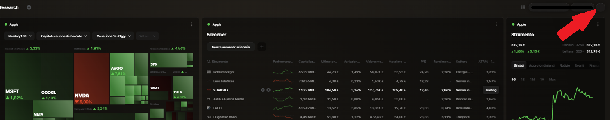
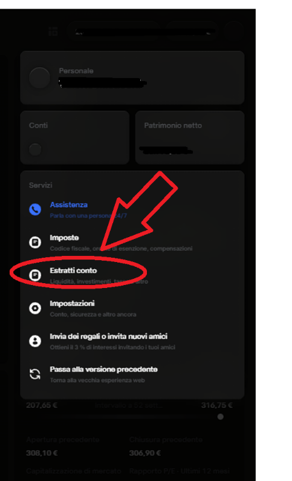
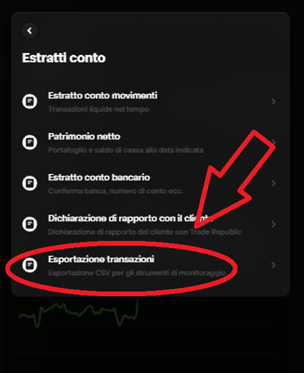
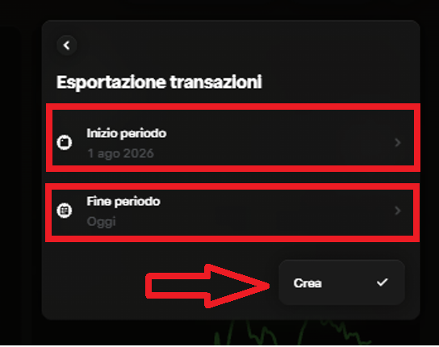

#  Trade Republic

LibreFolio imports Trade Republic's **Transaction export** (*Esportazione transazioni*), the CSV file Trade Republic
offers since April 2026 for portfolio trackers. This guide comes from a real export shared by a user: thank you!

## 📥 How to Export

The screenshots below are from the Trade Republic website, in Italian. Personal data is hidden.

### Step 1 — Open your profile

Log in to the Trade Republic website and click the round button with your initial, at the top right (the arrow).

{ style="border-radius: 8px; box-shadow: 0 4px 16px rgba(0,0,0,0.15);" }

### Step 2 — Open the account statements

In the profile panel, under **Servizi**, click **Estratti conto** (*Account statements*).

{ style="max-height: 520px; width: auto; border-radius: 8px; box-shadow: 0 4px 16px rgba(0,0,0,0.15);" }

### Step 3 — Choose the transaction export

In the list, click **Esportazione transazioni** (*Transaction export*, «CSV export for monitoring tools»).

{ style="max-height: 460px; width: auto; border-radius: 8px; box-shadow: 0 4px 16px rgba(0,0,0,0.15);" }

### Step 4 — Pick the period and create the file

Set **Inizio periodo** (*start*) and **Fine periodo** (*end*), then click **Crea** (*Create*). Trade Republic downloads
the CSV file: import it into LibreFolio as it is, following the **[Import Guide](how-to.md)**.

{ style="max-height: 360px; width: auto; border-radius: 8px; box-shadow: 0 4px 16px rgba(0,0,0,0.15);" }

!!! tip "Opened it in Excel? It still works"

    If you opened the file in Excel and saved it again, every line may end up inside a single cell between quotes.
    LibreFolio recognises that shape too, and reads the same rows.

## 📝 What LibreFolio imports

Each row of the file states its **amount**, its **fee** and its **tax** in separate columns. LibreFolio turns each of
them into its own transaction, with the value written in the file:

| In the file | In LibreFolio |
|---|---|
| A buy or a sell (funds, stocks, crypto) | **Buy** or **Sell**, plus a **Fee** and a **Tax** on the same asset when the row has them |
| An interest payment | **Interest** (gross), plus a **Tax** for the tax withheld |
| A dividend or a distribution | **Dividend** (gross), plus a **Tax** for the tax withheld |
| Stamp duty (*TAX_OPTIMIZATION*) | **Tax** |
| A tax given back (a positive tax) | **Interest** named «Tax refund»: it is part of your investment's return |
| A transfer in, a transfer out, a card payment | **Deposit**, **Withdrawal** |

- **The date** of each transaction is the day in the file's `date` column, the day of the operation.
- **The currency** is the one of each row; LibreFolio never converts amounts.
- **Crypto** keeps its ticker (for example `ETH`); the other securities their ISIN.
- **Rows dated after today** are not settled yet: they are left out, listed in a blue note, and come with the next
  export.
- **Rows LibreFolio does not import yet** — corporate actions (splits, mergers), bond maturities, Saveback, gifts, a
  reversed dividend, a positive fee, an account other than your main one (a *JUNIOR* account) — are listed in an amber
  warning during the import, with a link to open an issue on GitHub. Add them by hand if you need them.

## 🗂️ The older Dutch CSV

LibreFolio still reads an older, semicolon-separated CSV with Dutch columns (`Datum`, `Transactietype`, `Waarde (netto)`,
`Kosten`, `Belasting`…). Trade Republic never offered it: it is written by the community tool **pytr**, and LibreFolio's
support was built on a sample found online, never checked against a real export. Prefer the Transaction export above.

- **The fee and tax columns (*Kosten*, *Belasting*) are not imported**: the row itself is imported, and an amber warning
  lists the rows that have a fee or a tax, with a link to open an issue on GitHub.
- **Not sure the net value is really net**: see [Check the net amount](#check-the-net-amount) below.

### 🔍 Check the net amount {: #check-the-net-amount }

!!! warning "We do not know if the net value already includes the fee and the tax"

    In the Dutch CSV, LibreFolio imports each Buy or Sell with the column **`Waarde (netto)`** ("net value") as its
    cash. We **do not know** whether that value already contains the fee (**`Kosten`**) and the tax
    (**`Belasting`**) of the row.

    A simple example: you buy shares and Trade Republic charges a fee of 1.00 EUR.

    - **If the net value already includes the fee** (for example 101.00 EUR, of which 1.00 is the fee),
      the Buy is already right. Adding the 1.00 fee by hand, as the amber warning suggests, would
      count it **twice**.
    - **If the net value does not include the fee** (it shows 100.00 EUR), the cash of the Buy is too
      small by 1.00 EUR, and the fee has to be added by hand.

    The same reasoning applies to a Sell and to the tax.

**What to check, before adding anything:**

1. Pick one Buy or one Sell that has a fee or a tax (the amber warning lists them).
2. Compare it with your **account statement** or with the total shown by the Trade Republic app:
   does the cash that left your account (or entered it, for a sale) match what LibreFolio shows for
   that row?
3. If the two **match**, the fee is already inside: do **not** add it. If LibreFolio shows **less**
   than the real cash movement, add the **Kosten** and **Belasting** by hand as separate Fee and Tax
   transactions.

Found an issue? [Open a report](../../../community/contribute.md) — contributions welcome!
