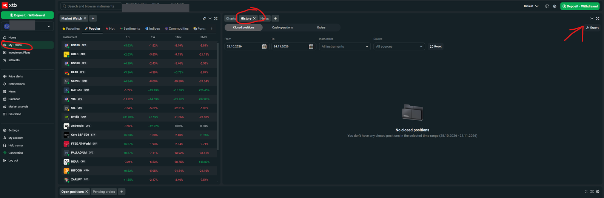
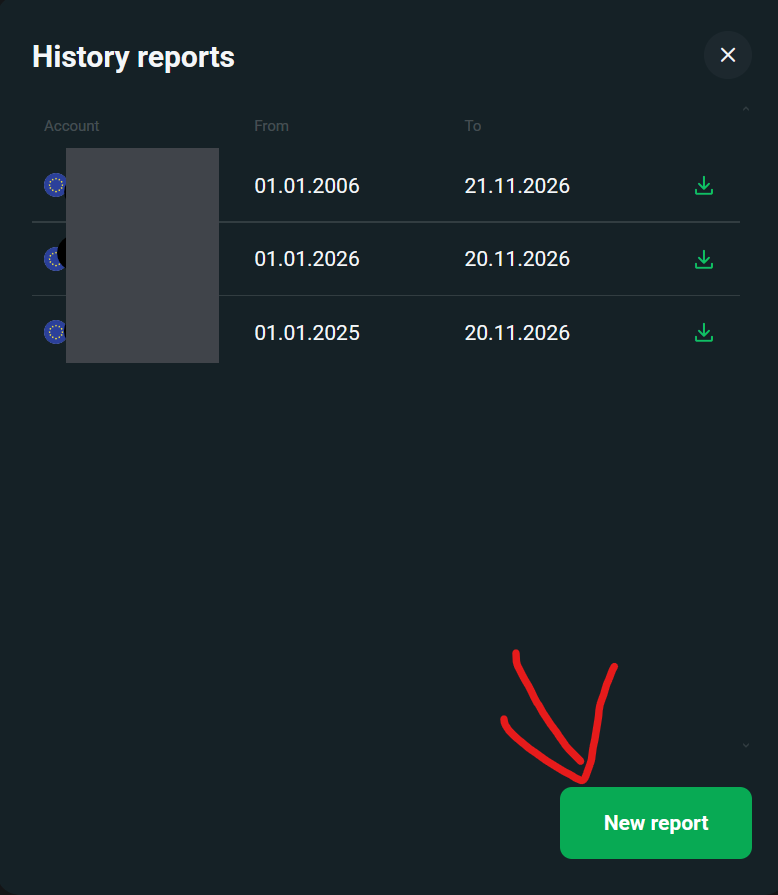
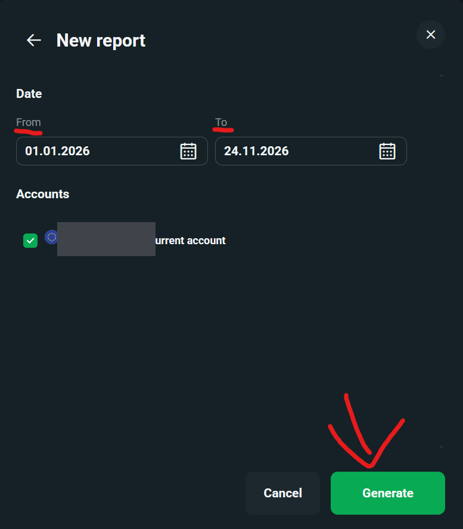
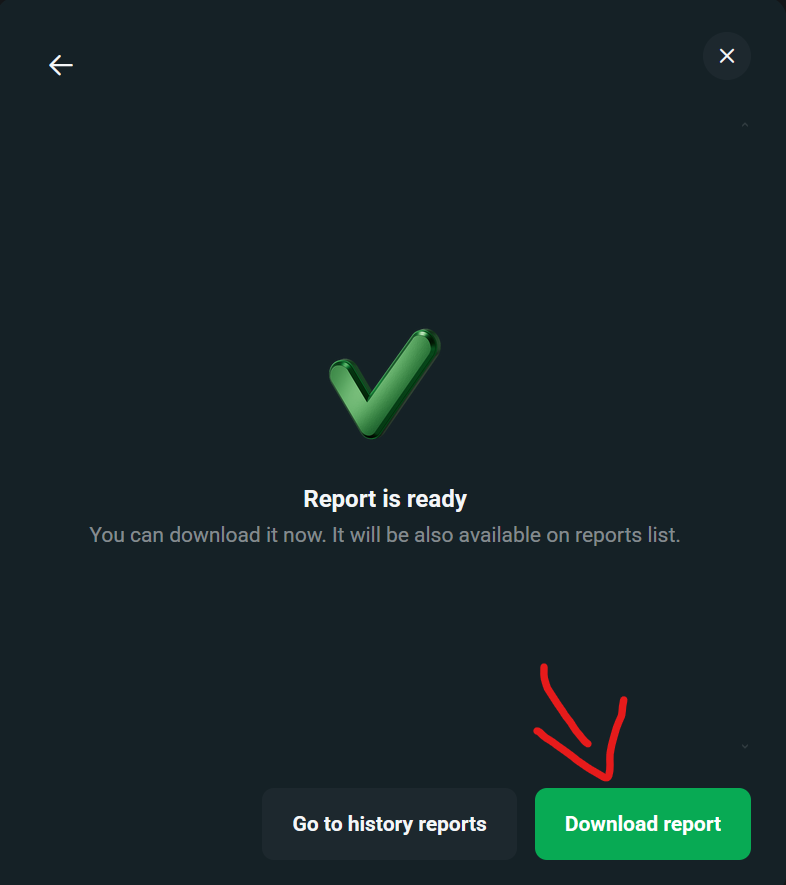
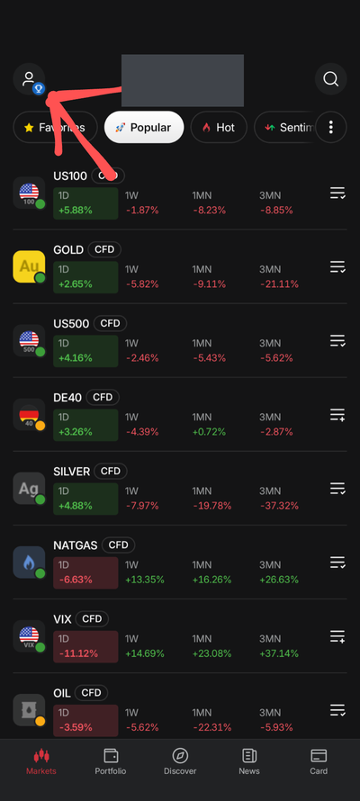
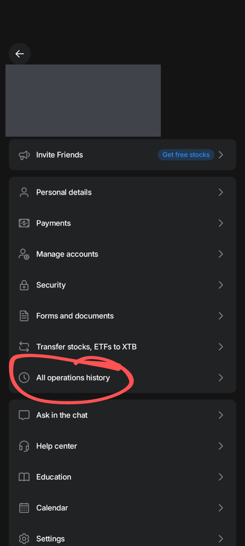
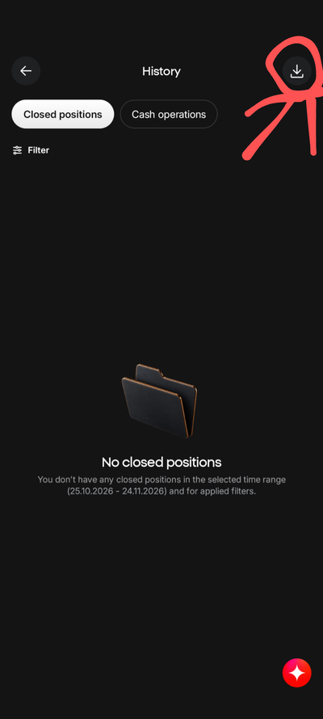
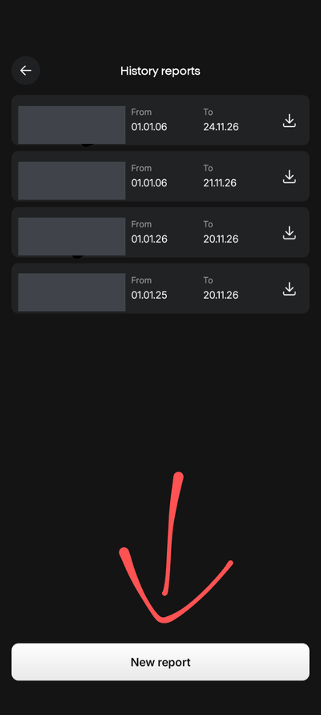
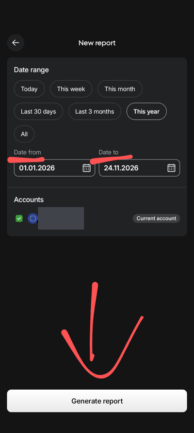
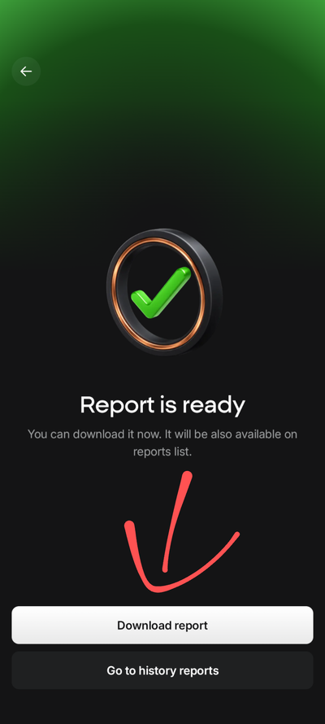

#  XTB

!!! warning "Beta — community feedback welcome"

    This plugin has been checked on one real XTB report, which held deposits and purchases of ETFs through an
    investment plan. Sales, dividends, taxes and interest follow the same rules but have not been seen in a real
    report yet: look at them in the import preview, and report anything odd.

LibreFolio imports XTB's **History report**, the Excel file (`.xlsx`) XTB generates from its desktop platform and its
mobile app.

## 📥 How to Export

XTB generates the report on request and keeps it in a list, from which you download it. The steps are the same on the
desktop platform and in the app: pick your device below. Personal data is hidden in the screenshots.

=== "Desktop"

    **Step 1 — Open History and click Export**

    In **My Trades**, open the **History** tab (the circle), then click **Export** at the top right (the arrow).

    { style="border-radius: 8px; box-shadow: 0 4px 16px rgba(0,0,0,0.15);" }

    **Step 2 — Create a new report**

    The **History reports** window lists the reports you generated before (each can be downloaded again). Click
    **New report**.

    { style="max-height: 520px; width: auto; border-radius: 8px; box-shadow: 0 4px 16px rgba(0,0,0,0.15);" }

    **Step 3 — Pick the period and generate it**

    Set **From** and **To**, keep your account ticked, and click **Generate**. To import your whole history, start
    **From** the day you opened the account.

    { style="max-height: 520px; width: auto; border-radius: 8px; box-shadow: 0 4px 16px rgba(0,0,0,0.15);" }

    **Step 4 — Download it**

    When the report is ready, click **Download report**. XTB saves an `.xlsx` file whose name starts with the account
    currency, for example `EUR_12345678_2025-01-01_2026-11-20.xlsx`.

    { style="max-height: 520px; width: auto; border-radius: 8px; box-shadow: 0 4px 16px rgba(0,0,0,0.15);" }

=== "Mobile"

    **Step 1 — Open your profile**

    On the **Markets** screen, tap the profile button at the top left (the arrow).

    { style="max-height: 560px; width: auto; border-radius: 8px; box-shadow: 0 4px 16px rgba(0,0,0,0.15);" }

    **Step 2 — Open All operations history**

    In the profile menu, tap **All operations history** (the circle).

    { style="max-height: 560px; width: auto; border-radius: 8px; box-shadow: 0 4px 16px rgba(0,0,0,0.15);" }

    **Step 3 — Tap the download button**

    On the **History** screen, tap the download button at the top right (the circle).

    { style="max-height: 560px; width: auto; border-radius: 8px; box-shadow: 0 4px 16px rgba(0,0,0,0.15);" }

    **Step 4 — Create a new report**

    **History reports** lists the reports you generated before. Tap **New report**.

    { style="max-height: 560px; width: auto; border-radius: 8px; box-shadow: 0 4px 16px rgba(0,0,0,0.15);" }

    **Step 5 — Pick the period and generate it**

    Choose a range (**All** imports your whole history) or set **Date from** and **Date to**, keep your account
    ticked, and tap **Generate report**.

    { style="max-height: 560px; width: auto; border-radius: 8px; box-shadow: 0 4px 16px rgba(0,0,0,0.15);" }

    **Step 6 — Download it**

    When the report is ready, tap **Download report** and send the `.xlsx` file to the device you use LibreFolio on.

    { style="max-height: 560px; width: auto; border-radius: 8px; box-shadow: 0 4px 16px rgba(0,0,0,0.15);" }

Then upload the file in LibreFolio: see the **[Import Guide](how-to.md)**. Upload it as XTB saved it, without opening
and saving it again.

## 🔄 What Gets Imported

The report has three sheets. LibreFolio reads the transactions from **Cash Operations** only: **Closed Positions** repeats
the sales already listed there, and **Open Positions** is a snapshot of today, used for the account currency and a check.

| In **Cash Operations** (**Type**) | Imported as |
|:----------------------------------|:------------|
| *Stock purchase* | **Buy**: the quantity from the comment (`OPEN BUY 0.1941 @ 168.22`), the amount as written |
| *Stock sale* | **Sell** |
| *Deposit* / *Withdrawal* | **Deposit** / **Withdrawal** |
| *Dividend* | **Dividend** |
| *Withholding tax*, *Free funds interests tax* | **Tax** |
| *Free funds interests* | **Interest** |
| *Commission*, *Fee* | **Fee** |
| *Subaccount transfer* | Not imported (see below) |

Any other type (CFD results, swaps, spin-offs, transfers to another XTB account…) is left out, and an amber warning
lists those rows with a link to open an issue on GitHub.

**Signs as written.** LibreFolio keeps the sign of each **Amount**, it never flips one. A *Withholding tax* with a
positive amount is tax given back: it is imported as **Interest** «Tax refund», on the same instrument, so it counts in
your gains, and a blue note lists those rows. A row whose sign does not fit its type in any other way (a negative
dividend or interest, such as a correction, or a positive fee) is left out and listed in the amber warning, for you to
check.

## ⚠️ Good to know

- **Account currency.** Every amount of the report is in your account's currency, also for an ETF quoted in dollars:
  XTB has already converted it. LibreFolio takes the currency from the **Open Positions** sheet and books every row in
  it, with no conversion.
- **Partial fills.** A comment like `OPEN BUY 2/2.1541 @ 151.66` means 2 units of an order of 2.1541, filled in more
  than one piece: each piece is its own **Buy**, with its own amount.
- **Investment plans.** An XTB account has sub-accounts: **My Trades** and **Investment Plans**. A deposit reaches My
  Trades and moves to the plan right away, as two *Subaccount transfer* rows (one out, one in). The money never leaves
  your account, so LibreFolio leaves both rows out. A transfer row without its opposite is listed in the amber warning.
- **Positions opened before the report.** If an ETF's open quantity in **Open Positions** differs from what the report's
  purchases and sales add up to, a blue note lists it: the report does not start early enough. Generate it again from
  the day you opened the account (in the app: **All**).
- **Dates.** XTB writes every time in UTC; LibreFolio records each operation on that day.
- **The older CSV export is no longer read.** Earlier versions of LibreFolio read the *Cash Operations* CSV of
  xStation 5 (`ID;Type;Time;Symbol;Comment;Amount`). XTB no longer offers it: generate the Excel report instead, and
  upload it as it is. The transactions you already imported from a CSV stay as they are; to avoid counting them twice,
  generate the report from the day after the last one you imported, or delete the XTB transactions that CSV created and
  import the whole history from the report.

## 🔗 Developer Reference

→ [BRIM Providers list](../../../developer/backend/brim/providers_list.md)
